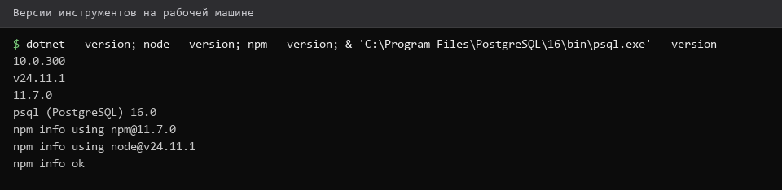

# Установка-инструментов

> Спринт 0. Подготовка: окружение и репозиторий · 70 мин · страница 1 из 54

Проверяем, что инструменты установлены и версии подходящие. Один несовпадающий пункт на площадке стоит часа: проект не собирается, и вы теряете время на поиск причины вместо работы.

**Итог страницы.** Все инструменты установлены, версии записаны в `README.md`, PostgreSQL отвечает на `SELECT version()`.

| Критерий оценивания | Что закрывает страница |
|---|---|
| Подготовка среды | Не оценивается напрямую, но без неё не выполняются все остальные критерии |

**Результат в репозитории:**

- `README.md`

## Шаг 1. Сверяем версии — 15 мин

Выполните в терминале четыре команды и сравните ответ с таблицей. Если версия ниже нужной — дальше идти бессмысленно: сборка упадёт на первой странице API.

**Команда**

```bash
dotnet --list-sdks
node --version
npm --version
psql -V
git --version
```

> **Замечание.** `dotnet --list-sdks` показывает все установленные SDK — полезно, когда их несколько и нужно понять, какой используется по умолчанию.


*Все команды ответили, версии в допустимых диапазонах*


## Шаг 2. Ставим .NET SDK 10 — 20 мин

Основной стек — **.NET 10**. Ставим SDK нативно, без Visual Studio.

**Команда**

```bash
# РедОС 8.0
sudo dnf install -y dotnet-sdk-10.0

# Windows (тренировка)
winget install Microsoft.DotNet.SDK.10
```

> **Замечание.** Если `dotnet --version` показал 8.0 или 9.0 — проект не соберётся. Именно .NET 10 указан в задании, более старая версия не принимается.


## Шаг 3. Ставим PostgreSQL 16 — 20 мин

База данных ставится нативно через `dnf`. Docker на площадке может отсутствовать — рассчитывайте только на локальную установку.

**Команда**

```bash
sudo dnf install -y postgresql-server postgresql-contrib
sudo postgresql-setup --initdb
sudo systemctl enable --now postgresql
psql -V
```

> **Замечание.** `postgresql-setup --initdb` выполняется один раз — при повторном запуске он скажет, что кластер уже инициализирован. Это нормально.


## Шаг 4. Ставим Node.js и инструменты — 15 мин

Node.js нужен для Web-клиента. DBeaver, Postman и Draw.io ставятся вручную — ссылки на загрузку лежат в официальных сайтах проектов.

**Команда**

```bash
node --version
npm --version
# dbeaver.org — DBeaver Community
# getpostman.com — Postman
# app.diagrams.net — Draw.io (работает в браузере)
```

> **Замечание.** Draw.io не требует установки: открывается в браузере по адресу app.diagrams.net и умеет сохранять файл `.drawio`.


## Если что-то не получилось

| Симптом | Что делать |
|---|---|
| `dotnet: command not found` | не прописан `PATH`; перезайдите в терминал после установки |
| `dotnet --version` показывает 9.0 | установлен старый SDK, нужен 10.0 — вернитесь к шагу 2 |
| `psql` есть, но не подключается | запустите службу: `sudo systemctl start postgresql` |
| `node: command not found` | Node.js не установлен или не прописан в `PATH` |

## Проверка

```bash
dotnet --list-sdks && psql -V && node --version && git --version
```

## Коммит

```bash
git add -A
git commit -m "chore: подготовить окружение и зафиксировать версии инструментов"
```

---

← назад · [все спринты](Home) · [Репозиторий-и-структура-проекта](02-Репозиторий-и-структура-проекта.md)
