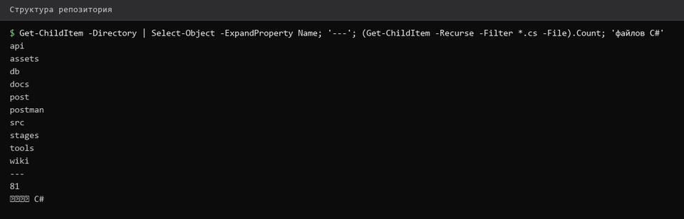
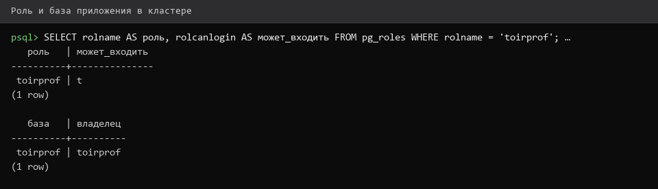

# Репозиторий-и-структура-проекта

> Спринт 0. Подготовка: окружение и репозиторий · 80 мин · страница 2 из 54

Разворачиваем репозиторий на рабочей машине и создаём каркас каталогов. Пустая структура, созданная один раз, избавляет от вопросов «куда класть файл» во всех следующих спринтах.

**Итог страницы.** Репозиторий склонирован, каталоги созданы, база `toirprof` доступна из DBeaver.

| Критерий оценивания | Что закрывает страница |
|---|---|
| Подготовка среды | Не оценивается напрямую, но без неё не выполняются все остальные критерии |

**Результат в репозитории:**

- `db/`
- `db/erd/`
- `src/api/`
- `src/desktop/`
- `src/web/`
- `src/Tests/`
- `postman/`
- `docs/diagrams/`
- `docs/screenshots/`

## Шаг 1. Клонируем репозиторий — 15 мин

Репозиторий задания хранится на Git-сервере. Склонируйте его и проверьте ветку — она должна быть `main`.

**Команда**

```bash
git clone <адрес-репозитория>
cd professionals-task
git status
git branch --show-current
```

> **Замечание.** Если клон идёт по HTTPS и сервер спрашивает логин — используйте персональный токен доступа вместо пароля.


## Шаг 2. Создаём структуру каталогов — 20 мин

Создайте каталоги проекта одной командой. Пустые каталоги Git не хранит, поэтому в каждом кладём `.gitkeep`.

**Команда**

```bash
mkdir -p db/erd docs/diagrams docs/screenshots postman \
         src/api src/desktop src/web src/Tests
for d in db db/erd docs/diagrams docs/screenshots postman \
         src/api src/desktop src/web src/Tests; do touch "$d/.gitkeep"; done
find . -type d -not -path './.git*' | sort
```

> **Замечание.** Без `.gitkeep` пустой каталог не попадёт в коммит — на другой машине он просто не появится.


*Каркас каталогов создан, .gitkeep на месте*


## Шаг 3. Создаём базу и пользователя — 25 мин

Создайте роль и базу данных для приложения. Один пользователь — одно приложение, чтобы не зависеть от прав суперпользователя.

**Команда**

```bash
sudo -u postgres psql -c "CREATE ROLE toirprof LOGIN PASSWORD 'toirprof';"
sudo -u postgres psql -c 'CREATE DATABASE toirprof OWNER toirprof;'
psql -h 127.0.0.1 -U toirprof -d toirprof -c '\conninfo'
```

> **Замечание.** `\conninfo` показывает, к какой базе вы фактически подключены. Если в строке `Database:` пусто — вы подключились не туда.


*База toirprof создана, подключение успешно*


## Шаг 4. Подключаем DBeaver — 20 мин

Создайте подключение к PostgreSQL в DBeaver: хост `127.0.0.1`, порт `5432`, база `toirprof`, пользователь `toirprof`. Все скриншоты базы в wiki сделаны именно так.

**Команда**

```bash
DBeaver → New Database Connection → PostgreSQL
Host: 127.0.0.1   Port: 5432
Database: toirprof   User: toirprof   Password: toirprof
Test Connection → Finish
```

> **Замечание.** Сохраняйте пароль: DBeaver спросит его при каждом запуске схемы, а на площадке вводить пароль вручную неудобно.


## Если что-то не получилось

| Симптом | Что делать |
|---|---|
| `psql: FATAL: role ... does not exist` | роль не создана — повторите шаг 3 целиком |
| `could not connect to server` | служба PostgreSQL не запущена: `sudo systemctl start postgresql` |
| Каталоги пропали после `git pull` | забыли `.gitkeep` — вернитесь к шагу 2 |
| DBeaver: `Connection refused` | проверьте `psql -h 127.0.0.1 -U toirprof -d toirprof -c 'SELECT 1;'` |

## Проверка

```bash
git status --short && psql -h 127.0.0.1 -U toirprof -d toirprof -c '\l toirprof'
```

## Коммит

```bash
git add -A
git commit -m "chore: создать структуру каталогов и базу данных toirprof"
```

---

[Установка-инструментов](01-Установка-инструментов.md) · [все спринты](Home) · [Use-Case-диаграмма](03-Use-Case-диаграмма.md)
