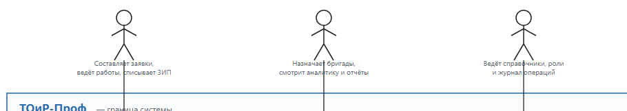
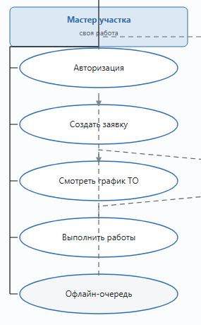
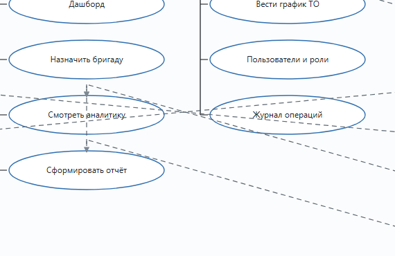
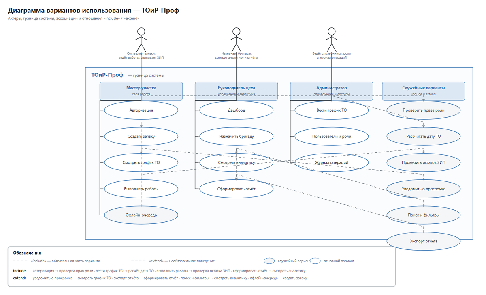

# Use-Case-диаграмма

> Спринт 1. Системный анализ: 3 UML-диаграммы · 110 мин · страница 3 из 54

Рисуем диаграмму вариантов использования: кто и что может делать с системой. Это первая из трёх обязательных UML-диаграмм и самая дорогая по баллам.

**Итог страницы.** В `docs/diagrams/` лежат `01-usecase.png`, `01-usecase.svg`, исходник `01-usecase.drawio` и обоснование в `README.md`.

| Критерий оценивания | Что закрывает страница |
|---|---|
| А. Диаграмма вариантов использования | ≈5,15 балла — второй по стоимости критерий после Desktop |

**Результат в репозитории:**

- `docs/diagrams/01-usecase.png`
- `docs/diagrams/01-usecase.svg`
- `docs/diagrams/01-usecase.drawio`
- `docs/diagrams/README.md`

## Шаг 1. Определяем актёров и границу системы — 20 мин

Выпишите на лист всех, кто взаимодействует с системой, и разделите на две группы: внешние (вне границы) и внутренние (внутри границы системы). Начните с текста задания — там перечислены роли мастера, руководителя, администратора и члена бригады.

**Команда**

```bash
Актёры:
  Мастер          — создаёт и закрывает заявки, работает с графиком ТО
  Руководитель    — смотрит аналитику, KPI, отчёты
  Администратор  — ведёт справочники, пользователей, бригады
  Член бригады    — получает заявку, отмечает выполнение
  Система оповещения — внешний получатель уведомлений
```

> **Замечание.** Актёров нельзя придумывать: каждый должен встречаться в тексте задания. Иначе на защите эксперт спросит, откуда взялся «клиент веб-кабинета».


*Пять актёров, граница системы обведена пунктиром*


## Шаг 2. Рисуем варианты использования — 30 мин

Откройте app.diagrams.net, выберите шаблон **Use Case Diagram**, разместите овалы вариантов внутри границы. Каждый вариант — глаголная фраза: «Создать заявку», «Закрыть заявку», «Получить отчёт».

**Команда**

```bash
Варианты использования:
  Общие:        Авторизоваться в системе
  Мастер:       Создать заявку на ремонт
                Назначить бригаду на заявку
                Закрыть заявку
                Внести списание материалов
  Руководитель: Просмотреть дашборд
                Сформировать отчёт за период
  Администратор: Добавить оборудование
                Изменить вид ТО
                Завести пользователя
  Член бригады:  Получить назначенные заявки
```

> **Замечание.** Не рисуйте варианты, которых нет в задании. Лишний «Просмотр профиля» эксперт засчитает как шум, а не как полноту.


*18 вариантов использования, 5 актёров, граница на месте*


## Шаг 3. Добавляем связи include и extend — 20 мин

Связь **«include»** — вариант всегда вызывает другой (обязательная часть). Связь **«extend»** — вариант добавляется к другому только при условии (необязательный).

**Команда**

```bash
«Закрыть заявку» ..> «Внести списание материалов»   (extend, [использованы ЗИП])
«Закрыть заявку» ..> «Сформировать отчёт о выполнении»     (include)
«Создать заявку на ремонт» ..> «Авторизоваться в системе»     (include)
«Просмотреть дашборд»      ..> «Просмотреть аналитику»        (include)
```

> **Замечание.** Подпись «extend» пишется в квадратных скобках: `..> [использованы ЗИП]`. Без скобок связь считается неподписанной.


*Связи include и extend подписаны, стрелки направлены от вызывающего*


## Шаг 4. Экспортируем в PNG, SVG и PDF — 20 мин

Сохраните исходник `.drawio` и экспортируйте в двух форматах. PNG — для документации, SVG — чтобы не мыло при масштабировании на проекторе.

**Команда**

```bash
app.diagrams.net → File → Export as → PNG (2x) / SVG / PDF
File → Save as → docs/diagrams/01-usecase.drawio

# проверка наличия всех трёх файлов
ls -la docs/diagrams/
```

> **Замечание.** Экспортируйте в масштабе 2x — иначе подписи в PNG нечитаемы при печати.


*Три файла: исходник, PNG и SVG*


## Шаг 5. Пишем обоснование в README — 20 мин

В `docs/diagrams/README.md` опишите каждого актёра и каждую группу вариантов: зачем вариант существует и какое требование задания закрывает.

**Команда**

```bash
# Диаграмма вариантов использования

## Актёры
| Актёр | Роль в системе |
|---|---|
| Мастер | ... |

## Группа вариантов «Управление заявками»
Создать заявку — мастер создаёт заявку из плана ТО или по факту отказа оборудования.
```

> **Замечание.** Обоснование — часть критерия «проектирование». Без README диаграмма оценивается ниже, даже если нарисована хорошо.


## Если что-то не получилось

| Симптом | Что делать |
|---|---|
| Диаграмма не помещается на лист | уменьшите размер шрифта до 10 или разбейте варианты на две группы |
| Связи include/extend не читаются | подпишите их и разнесите стрелки, иначе они сливаются в клубок |
| Экспорт в PDF обрезает края | экспортируйте страницу целиком: Format → Page → Entire page |
| Экспорт недоступен в браузере | разрешите всплывающие окна для app.diagrams.net |

## Проверка

```bash
ls docs/diagrams/01-usecase.* && grep -c 'include\|extend' docs/diagrams/README.md
```

## Коммит

```bash
git add -A
git commit -m "docs(diagrams): диаграмма вариантов использования и обоснование"
```

---

[Репозиторий-и-структура-проекта](02-Репозиторий-и-структура-проекта.md) · [все спринты](Home) · [Activity-диаграмма](04-Activity-диаграмма.md)
