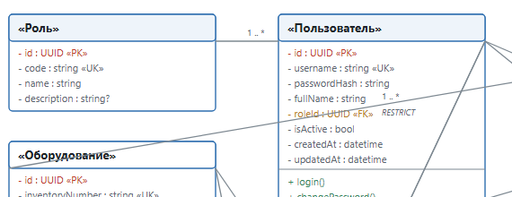
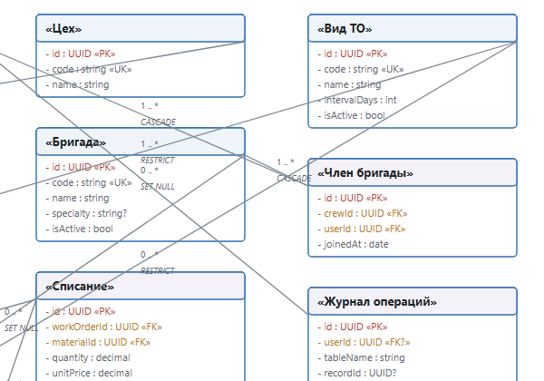
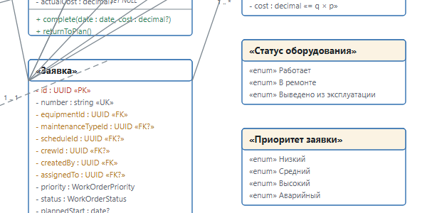
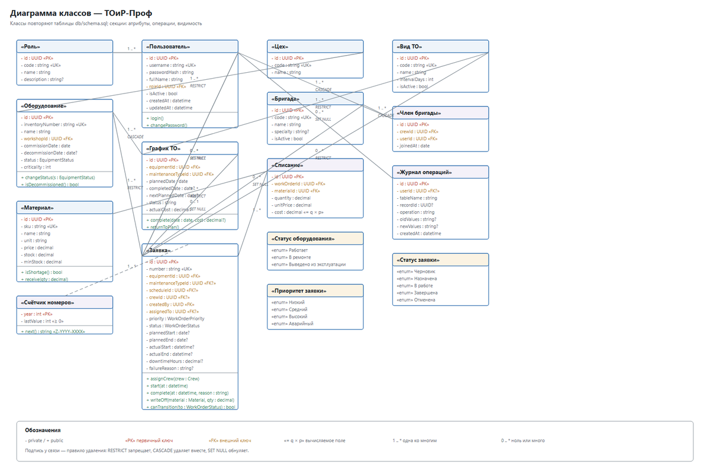

# Class-диаграмма

> Спринт 1. Системный анализ: 3 UML-диаграммы · 90 мин · страница 5 из 54

Рисуем диаграмму классов: сущности системы, их атрибуты и связи. Эта диаграмма — контракт для базы данных и для API, поэтому согласуйте атрибуты с заданием до того, как писать `schema.sql`.

**Итог страницы.** В `docs/diagrams/` лежат `03-class.png`, `03-class.svg`, исходник `03-class.drawio` и раздел обоснования в `README.md`.

| Критерий оценивания | Что закрывает страница |
|---|---|
| А. Диаграмма классов | ≈4,0 балла |

**Результат в репозитории:**

- `docs/diagrams/03-class.png`
- `docs/diagrams/03-class.svg`
- `docs/diagrams/03-class.drawio`
- `docs/diagrams/README.md`

## Шаг 1. Выписываем сущности и атрибуты — 25 мин

Начните с сущностей, названных в задании: пользователи, роли, оборудование, виды ТО, график ТО, заявки, ремонтные бригады, материалы, журнал операций. Каждый класс рисуется прямоугольником с тремя секциями.

**Команда**

```bash
┌──────────────────────┐
│        Заявка        │
├──────────────────────┤
│ - id : UUID          │
│ - number : String    │
│ - status : Статус    │
├──────────────────────┤
│ + close() : void     │
└──────────────────────┘
```

> **Замечание.** Средняя секция обязательна: критерий проверяет именно три секции. Пустую среднюю секцию не оставляйте.


*Прямоугольники в три секции: имя, атрибуты, методы*


## Шаг 2. Определяем связи и кратности — 25 мин

Связи рисуйте линиями с ромбами на стороне «многих». Обязательная связь — залитый ромб, необязательная — пустой. Композицию показывайте залитой чёрной ромбом у границы.

**Команда**

```bash
Оборудование 1 —— 0..* График ТО        (одно оборудование — много записей графика)
Виды ТО    1 —— 0..* График ТО        (один вид ТО — много записей графика)
Оборудование 1 —— 0..* Заявка          (одно оборудование — много заявок)
Бригада    0..1 —— 0..* Заявка         (у заявки бригада назначается позже)
Заявка    1 —— 0..* Списание ЗИП       (одна заявка — несколько позиций)
```

> **Замечание.** Кратность `0..1` у бригады принципиальна: заявка создаётся раньше, чем за ней закрепят бригаду. Рисуйте `1` — и диаграмма разойдётся с БД.


*Связи с ромбами и кратностями 1, 0..1, 0..**


## Шаг 3. Расставляем ассоциации и наследование — 20 мин

Вынесите повторяющиеся атрибуты в отдельный класс и свяжите их ассоциацией. В задании для этого подходит `Аудит операций` — общий журнал изменений.

**Команда**

```bash
АудитОперации
  - id : UUID
  - таблица : String
  - действие : Действие (создание/изменение/удаление)
  - время : DateTime

Связан с Заявка, Оборудование, Пользователь кратностью 0..* с каждой стороны.
```

> **Замечание.** Ассоциация читается в обе стороны: с каждой стороны подпишите свою кратность, иначе связь неоднозначна.


*Ассоциация с классом аудита и кратностями*


## Шаг 4. Экспортируем и сверяем с заданием — 20 мин

Экспортируйте диаграмму и сверьте каждую сущность с перечнем из задания. Допишите в `README.md` обоснование: какое требование закрывает каждая связь.

**Команда**

```bash
app.diagrams.net → File → Export as → PNG (2x) / SVG
# сверка списка классов с заданием
ls docs/diagrams/03-class.*
# в README.md перечислены все 9 сущностей задания
```

> **Замечание.** Сверьте имена классов с будущими таблицами БД: «Заявка» → work_orders, «Оборудование» → equipment. Расхождение имён снижает баллы за проектирование.


*Диаграмма готова, список классов сверен с заданием*


## Если что-то не получилось

| Симптом | Что делать |
|---|---|
| Диаграмма не читается | разделите на две группы: «Справочники» и «Операционные» |
| Связи наезжают на прямоугольники | используйте ортогональные линии Draw.io |
| Средняя секция пустая | добавьте атрибуты — критерий требует три секции |
| Кратности не совпадают с БД | зафиксируйте кратности в README и сверьте со схемой на странице 7 |

## Проверка

```bash
ls docs/diagrams/03-class.* && grep -c 'class\|таблиц' docs/diagrams/README.md
```

## Коммит

```bash
git add -A
git commit -m "docs(diagrams): диаграмма классов и обоснование связей"
```

---

[Activity-диаграмма](04-Activity-диаграмма.md) · [все спринты](Home) · [Нормализация-и-ER-диаграмма](06-Нормализация-и-ER-диаграмма.md)
