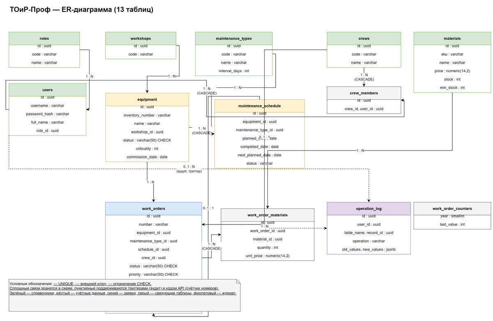

# 6. Нормализация и ER диаграмма

> Спринт 2. БД: модель данных, таблицы, связи · 90 мин · страница 6 из 54

Приводим модель к трём нормальным формам и рисуем ER-диаграмму. Критерий проверяет и формы, и то, что таблицы и поля названы осмысленно.

**Итог страницы.** В `docs/erd/` лежит ER-диаграмма, в `db/schema.sql` — таблицы и связи, в `db/README.md` — обоснование по каждой нормальной форме.

| Критерий оценивания | Что закрывает страница |
|---|---|
| А. Проектирование и реализация БД | 1НФ ≈0,2 · 2НФ ≈0,4 · 3НФ ≈1,0 · наименование таблиц и полей ≈0,5 |

**Результат в репозитории:**

- `db/erd/er-diagram.png`
- `db/erd/er-diagram.drawio`
- `db/schema.sql`
- `db/README.md`

## Шаг 1. Выписываем сущности из задания — 20 мин

Возьмите список сущностей из задания и для каждой выпишите поля прямо из текста. Не добавляйте полей «на будущее» — лишние поля ломают 3НФ и раздувают таблицы.

**Команда**

```bash
users            — id, username, password_hash, full_name, role_id
roles            — id, code, name
workshops        — id, code, name
eq  uipment       — id, inventory_number, name, type, serial_number,
                    workshop_id, commission_date, status, criticality
maintenance_types— id, code, name, interval_months
maintenance_schedule — id, equipment_id, maintenance_type_id, planned_date, status
work_orders      — id, number, equipment_id, maintenance_type_id, crew_id,
                    priority, status, description, reason, planned_start, planned_end,
                    actual_start, actual_end, downtime_hours
crews            — id, name, specialization, phone
materials        — id, sku, name, unit, unit_price
```

> **Замечание.** Если поле встречается в задании дважды (например, «дата начала»), вынесите его в отдельную сущность — это и есть нормализация.


## Шаг 2. Нормализуем: 1НФ, 2НФ, 3НФ — 25 мин

Пройдите формы по порядку и запишите в `db/README.md`, что именно изменили на каждом шаге. Обоснование по формам — половина критерия.

**Команда**

```bash
1НФ: атомарность. В заявке не было отдельной таблицы списаний —
      список материалов лежал в одном поле. Вынесли в work_order_materials.
2НФ: в maintenance_schedule (equipment_id, maintenance_type_id) →
      код_установки был зависим только от equipment_id. Вынесли в equipment.
3НФ: название цеха не должно храниться в equipment — только workshop_id,
      само название лежит в workshops. Устранена транзитивная зависимость.
```

> **Замечание.** Название таблиц и полей — отдельный пункт критерия ≈0,5 балла. Пишите по-русски или английскими snake_case, но одинаково везде.


## Шаг 3. Строим ER-диаграмму — 25 мин

Нарисуйте связи «один ко многим» между таблицами. Обозначения Crow's Foot в Draw.io: `||` — ровно один, `o{` — ноль или много.

**Команда**

```bash
Связи:
  roles        1 ── 0..* users
  workshops    1 ── 0..* equipment
  equipment    1 ── 0..* maintenance_schedule
  equipment    1 ── 0..* work_orders
  maintenance_types 1 ── 0..* maintenance_schedule
  crews        1 ── 0..* work_orders
  work_orders  1 ── 0..* work_order_materials
  materials    1 ── 0..* work_order_materials
```

> **Замечание.** Диаграмма должна совпадать с диаграммой классов со страницы 5. Расхождение между ними эксперт заметит сразу.


*ER-диаграмма: 10 таблиц, 8 связей*


## Шаг 4. Проверяем модель на связность — 20 мин

Пройдитесь по каждой таблице и спросите: можно ли её удалить без потери данных и не останется ли «висящих» ссылок. Ответы запишите в `db/README.md`.

**Команда**

```bash
Каждая таблица связана хотя бы одним внешним ключом — «висячих» нет.
Удаление мастера (users) не удаляет его заявки: журнал операций хранит только id.
Справочники (maintenance_types, materials) не удаляются, если на них ссылается хотя бы одна запись.
```

> **Замечание.** Этот разбор — заготовка для ограничений целостности на страницах 8–11.


## Если что-то не получилось

| Симптом | Что делать |
|---|---|
| ER-диаграмма не совпадает с диаграммой классов | вернитесь к странице 5 и синхронизируйте имена |
| Связи не читаются | используйте ортогональные линии и подписи кратностей у обоих концов |
| Экспорт PNG обрезает края | Format → Page → Entire page, затем Export as PNG 2x |
| Обоснование выглядит формальным | приведите конкретный пример поля до и после нормализации |

## Проверка

```bash
ls db/erd/er-diagram.png db/schema.sql db/README.md && grep -c 'НФ' db/README.md
```

## Коммит

```bash
git add -A
git commit -m "docs(db): ER-диаграмма и обоснование нормализации 1НФ–3НФ"
```

---

[Class диаграмма](05-Class-диаграмма.md) · [все спринты](Home) · [Скрипт schema sql и тестовые данные](07-Скрипт-schema-sql-и-тестовые-данные.md)
