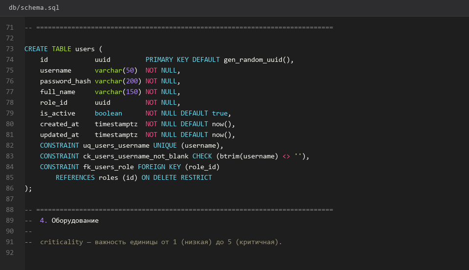
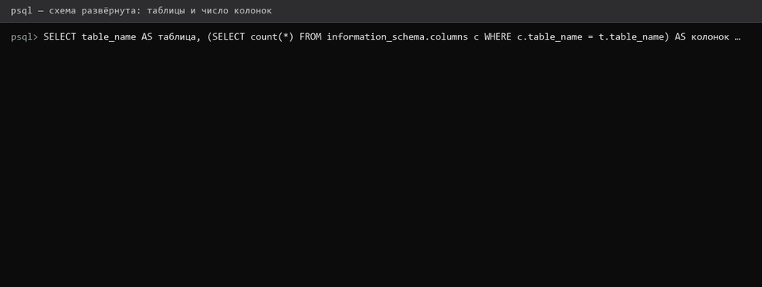
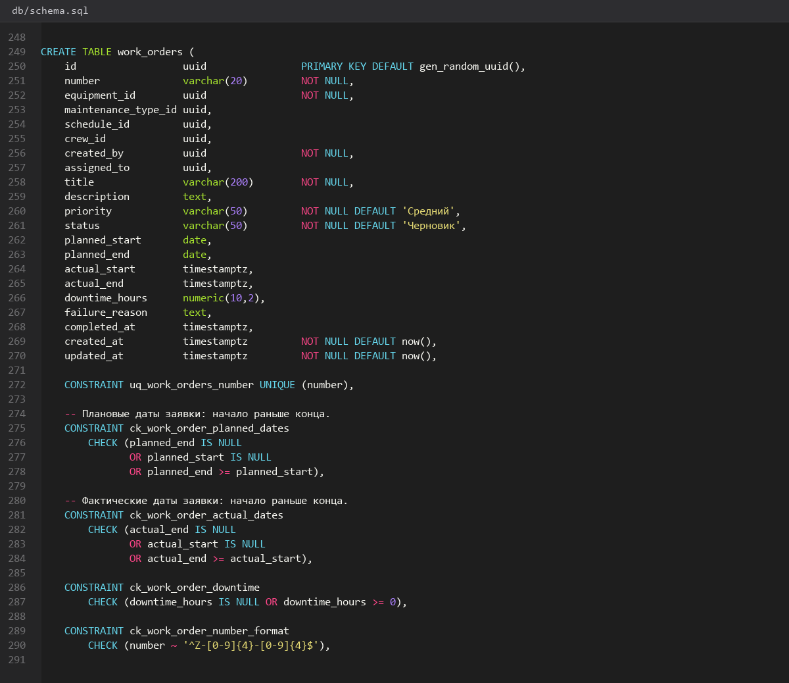
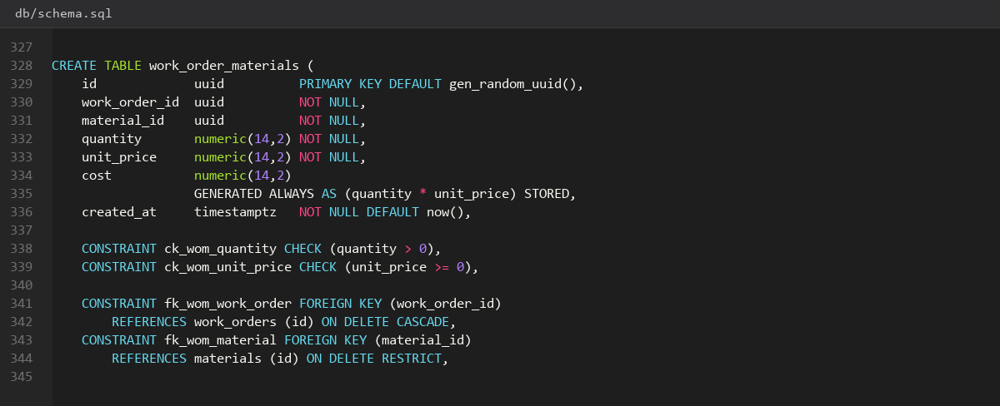
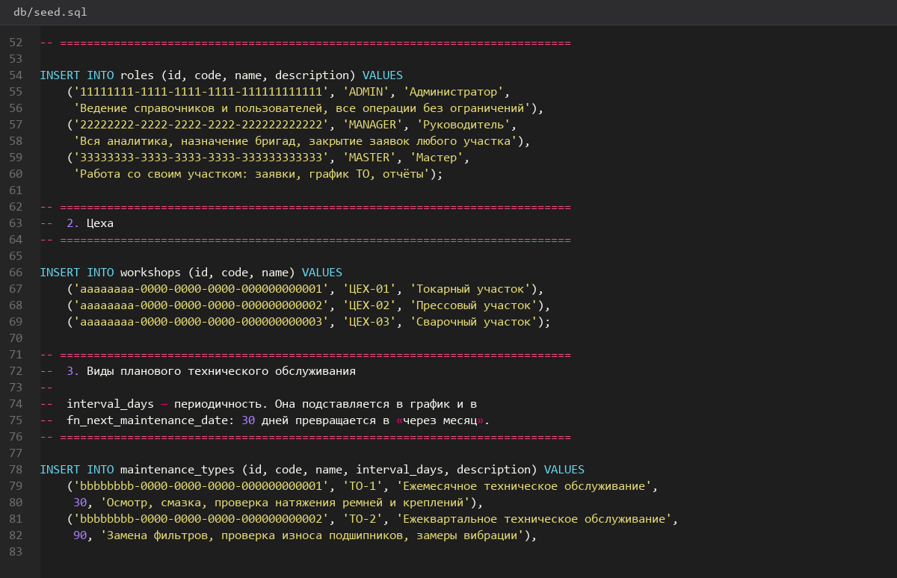
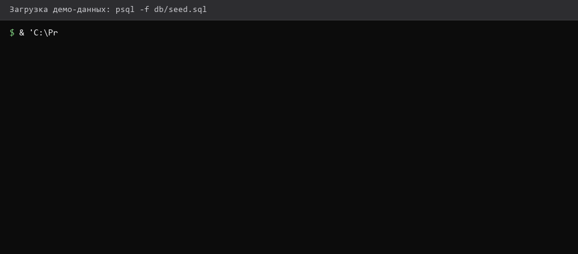
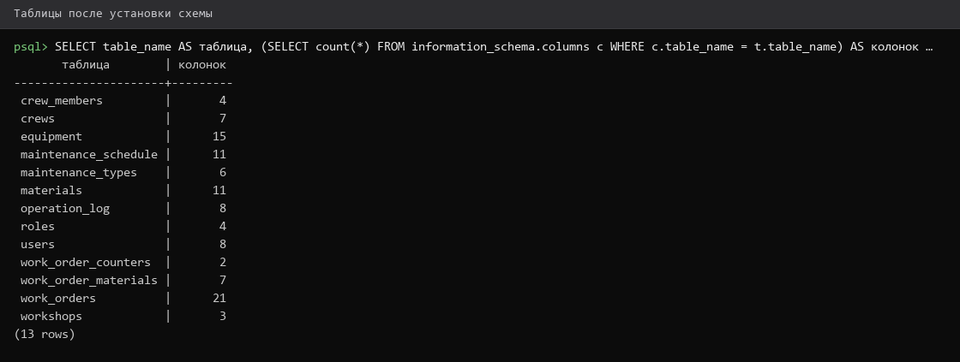

# 7. Скрипт schema sql и тестовые данные

> Спринт 2. БД: модель данных, таблицы, связи · 125 мин · страница 7 из 54

Пишем `db/schema.sql` — единственный скрипт, который создаёт базу с нуля — и `db/seed.sql` с тестовыми данными. Тестовые данные — отдельный пункт критерия, ими заполняют базу при проверке.

**Итог страницы.** `db/schema.sql` создаёт 10 таблиц без ошибок на чистой базе, `db/seed.sql` наполняет их данными.

| Критерий оценивания | Что закрывает страница |
|---|---|
| А. Проектирование и реализация БД | тестовые данные ≈0,5 балла · реализация БД ≈0,5 балла |

**Результат в репозитории:**

- `db/schema.sql`
- `db/seed.sql`

## Шаг 1. Создаём таблицы пользователей и оборудования — 25 мин

Начните `schema.sql` с таблиц, на которые ссылаются остальные. Идентификаторы — `UUID` с генерацией на стороне приложения, временные метки — `TIMESTAMPTZ`.

**db/schema.sql**

```sql
-- db/schema.sql · часть 1: пользователи и оборудование

CREATE TABLE roles (
    id          UUID PRIMARY KEY,
    code        VARCHAR(30)  NOT NULL UNIQUE,
    name        VARCHAR(100) NOT NULL
);

CREATE TABLE users (
    id            UUID PRIMARY KEY,
    username      VARCHAR(50)  NOT NULL UNIQUE,
    password_hash VARCHAR(255) NOT NULL,
    full_name     VARCHAR(150) NOT NULL,
    role_id       UUID NOT NULL REFERENCES roles (id) ON DELETE RESTRICT,
    is_active     BOOLEAN NOT NULL DEFAULT TRUE,
    created_at    TIMESTAMPTZ NOT NULL DEFAULT now()
);

CREATE TABLE workshops (
    id   UUID PRIMARY KEY,
    code VARCHAR(20)  NOT NULL UNIQUE,
    name VARCHAR(100) NOT NULL
);

CREATE TYPE equipment_status AS ENUM ('В работе', 'В ремонте', 'В простое', 'Выведено из эксплуатации');

CREATE TABLE equipment (
    id               UUID PRIMARY KEY,
    inventory_number VARCHAR(20)  NOT NULL UNIQUE,
    name             VARCHAR(200) NOT NULL,
    equipment_type   VARCHAR(100) NOT NULL,
    serial_number    VARCHAR(50)  NOT NULL UNIQUE,
    workshop_id      UUID NOT NULL REFERENCES workshops (id) ON DELETE RESTRICT,
    commission_date  DATE NOT NULL,
    status           equipment_status NOT NULL DEFAULT 'В работе',
    criticality      SMALLINT NOT NULL DEFAULT 3
);
```

> **Замечание.** `CREATE TYPE` выполняется один раз. При повторном запуске скрипта PostgreSQL скажет, что тип уже существует — это ожидаемо.


*Четыре таблицы созданы, psql не сообщил об ошибках*


*Четыре таблицы созданы, psql не сообщил об ошибках*


## Шаг 2. Создаём таблицы ТО, заявок, бригад и материалов — 30 мин

Оставшиеся таблицы. Обратите внимание на `UNIQUE (equipment_id, maintenance_type_id, planned_date)` — один вид ТО на одном оборудовании не может быть запланирован дважды на одну дату.

**db/schema.sql**

```sql
-- db/schema.sql · часть 2: обслуживание, заявки, бригады, материалы

CREATE TABLE maintenance_types (
    id               UUID PRIMARY KEY,
    code             VARCHAR(20) NOT NULL UNIQUE,
    name             VARCHAR(150) NOT NULL,
    interval_months  INTEGER NOT NULL,
    description      VARCHAR(500)
);

CREATE TABLE maintenance_schedule (
    id                   UUID PRIMARY KEY,
    equipment_id         UUID NOT NULL REFERENCES equipment (id) ON DELETE CASCADE,
    maintenance_type_id  UUID NOT NULL REFERENCES maintenance_types (id) ON DELETE RESTRICT,
    planned_date         DATE NOT NULL,
    status               VARCHAR(20) NOT NULL DEFAULT 'Запланировано',
    UNIQUE (equipment_id, maintenance_type_id, planned_date)
);

CREATE TYPE work_order_status AS ENUM ('Создана','Назначена','В работе','Ожидает материалов','Выполнена','Закрыта','Отменена');
CREATE TYPE work_order_priority AS ENUM ('Низкий','Средний','Высокий','Критический');

CREATE TABLE crews (
    id             UUID PRIMARY KEY,
    name           VARCHAR(100) NOT NULL UNIQUE,
    specialization VARCHAR(150),
    phone          VARCHAR(30)
);

CREATE TABLE work_orders (
    id                  UUID PRIMARY KEY,
    number              VARCHAR(20) NOT NULL UNIQUE,
    equipment_id        UUID NOT NULL REFERENCES equipment (id) ON DELETE RESTRICT,
    maintenance_type_id UUID REFERENCES maintenance_types (id) ON DELETE RESTRICT,
    crew_id             UUID REFERENCES crews (id) ON DELETE SET NULL,
    priority            work_order_priority NOT NULL DEFAULT 'Средний',
    status              work_order_status NOT NULL DEFAULT 'Создана',
    description         VARCHAR(500) NOT NULL,
    reason              VARCHAR(500),
    planned_start       TIMESTAMPTZ,
    planned_end         TIMESTAMPTZ,
    actual_start        TIMESTAMPTZ,
    actual_end          TIMESTAMPTZ,
    downtime_hours      NUMERIC(8,2),
    created_by          UUID NOT NULL REFERENCES users (id) ON DELETE RESTRICT,
    created_at          TIMESTAMPTZ NOT NULL DEFAULT now()
);
```

> **Замечание.** `ON DELETE` правила расставлены осмысленно: график ТО удаляется вместе с оборудованием (CASCADE), а справочник видов ТО удалить нельзя, пока на него ссылается график (RESTRICT). Подробнее — на странице 9.


*Заявки и график ТО созданы, ограничение UNIQUE на месте*


## Шаг 3. Дописываем списание и журнал операций — 25 мин

Две вспомогательные таблицы: списание материалов в заявку и журнал аудита. Журнал пишется триггером на странице 10.

**db/schema.sql**

```sql
-- db/schema.sql · часть 3: ЗИП и аудит

CREATE TABLE materials (
    id           UUID PRIMARY KEY,
    sku          VARCHAR(30)  NOT NULL UNIQUE,
    name         VARCHAR(200) NOT NULL,
    unit         VARCHAR(10)  NOT NULL,
    unit_price   NUMERIC(12,2) NOT NULL,
    min_quantity NUMERIC(12,2) NOT NULL DEFAULT 0
);

CREATE TABLE work_order_materials (
    id             UUID PRIMARY KEY,
    work_order_id  UUID NOT NULL REFERENCES work_orders (id) ON DELETE CASCADE,
    material_id    UUID NOT NULL REFERENCES materials (id) ON DELETE RESTRICT,
    quantity       NUMERIC(12,2) NOT NULL,
    unit_price     NUMERIC(12,2) NOT NULL,
    UNIQUE (work_order_id, material_id)
);

CREATE TABLE operation_log (
    id         UUID PRIMARY KEY,
    table_name VARCHAR(50) NOT NULL,
    operation  VARCHAR(20) NOT NULL,
    entity_id  UUID NOT NULL,
    user_id    UUID REFERENCES users (id) ON DELETE SET NULL,
    changed_at TIMESTAMPTZ NOT NULL DEFAULT now(),
    details    JSONB
);
```

> **Замечание.** `unit_price` дублируется в списании намеренно: цена материала может измениться, а в закрытой заявке должна остаться та, по которой считали.


*Журнал операций и списание созданы*


## Шаг 4. Пишем seed.sql с тестовыми данными — 25 мин

Тестовые данные нужны, чтобы эксперт сразу увидел работающую систему. Сделайте минимум: 3 роли, 6 пользователей, 2 цеха, 10 единиц оборудования, 5 видов ТО, 12 записей графика, 15 заявок в разных статусах, 4 бригады, 12 материалов.

**db/seed.sql**

```sql
-- db/seed.sql · выполняется после schema.sql
INSERT INTO roles (id, code, name) VALUES
  ('11111111-1111-1111-1111-111111111111', 'admin', 'Администратор'),
  ('22222222-2222-2222-2222-222222222222', 'manager', 'Руководитель'),
  ('33333333-3333-3333-3333-333333333333', 'master', 'Мастер');

INSERT INTO workshops (id, code, name) VALUES
  ('aaaaaaaa-aaaa-aaaa-aaaa-aaaaaaaaaaaa', 'Ц1', 'Цех №1 — механический'),
  ('bbbbbbbb-bbbb-bbbb-bbbb-bbbbbbbbbbbb', 'Ц2', 'Цех №2 — кузнечный');
```

> **Замечание.** Заявки должны быть во всех пяти статусах — иначе нельзя проверить дашборд и фильтры веб-клиента, а это ≈19 баллов.


*Тестовые данные загружены: 15 заявок в разных статусах*


*Тестовые данные загружены: 15 заявок в разных статусах*


## Шаг 5. Проверяем чистую установку с нуля — 20 мин

Удалите базу и создайте заново из скриптов. Если повторная установка проходит — значит скрипты корректны и пригодны для проверки.

**Команда**

```bash
psql -h 127.0.0.1 -U toirprof -d postgres -c 'DROP DATABASE IF EXISTS toirprof;'
psql -h 127.0.0.1 -U toirprof -d postgres -c 'CREATE DATABASE toirprof OWNER toirprof;'
psql -h 127.0.0.1 -U toirprof -d toirprof -f db/schema.sql
psql -h 127.0.0.1 -U toirprof -d toirprof -f db/seed.sql
psql -h 127.0.0.1 -U toirprof -d toirprof -c '\dt'
```

> **Замечание.** `DROP DATABASE` не сработает, пока к базе подключён DBeaver. Закройте соединение в DBeaver и повторите.


*Чистая база собрана из скриптов: 10 таблиц*


## Если что-то не получилось

| Симптом | Что делать |
|---|---|
| `type ... already exists` | база создана повторно — удалите её и прогоните скрипты заново |
| `permission denied for schema public` | вы вошли не как `toirprof`; проверьте `-U toirprof` |
| `syntax error at or near ...` | пропущена точка с запятой в конце `CREATE TABLE` |
| Данные загрузились частично | в `seed.sql` нарушен порядок вставки: сначала справочники, потом ссылки |

## Проверка

```bash
psql -h 127.0.0.1 -U toirprof -d toirprof -c '\dt' | grep -c table && psql -h 127.0.0.1 -U toirprof -d toirprof -c 'SELECT count(*) FROM work_orders;'
```

## Коммит

```bash
git add -A
git commit -m "feat(db): schema.sql и seed.sql для системы ТОиР-Проф"
```

---

[Нормализация и ER диаграмма](06-Нормализация-и-ER-диаграмма.md) · [все спринты](Home) · [Ограничения UNIQUE и ENUM](08-Ограничения-UNIQUE-и-ENUM.md)
