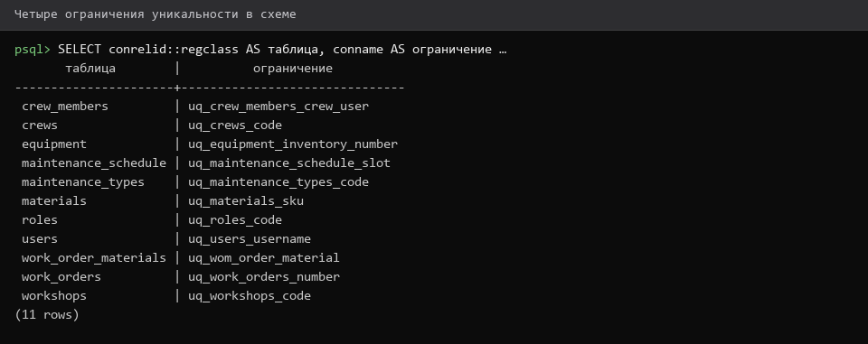
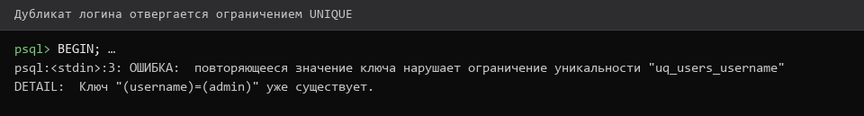
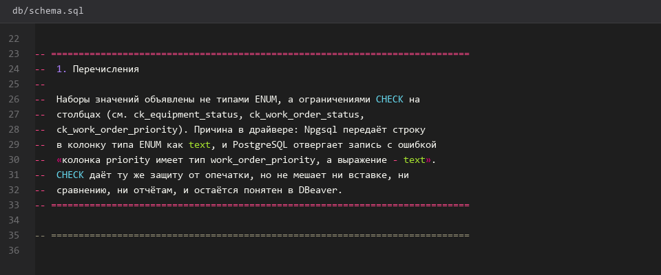
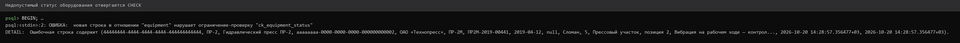

# Ограничения-UNIQUE-и-ENUM

> Спринт 3. БД: ограничения целостности · 85 мин · страница 8 из 54

Добавляем ограничения уникальности и допустимых значений. Это ≈1,4 балла из ≈5,1 подкритерия «Ограничения целостности БД» — и почти бесплатные баллы: всё делается в SQL.

**Итог страницы.** Четыре ограничения UNIQUE и три типа ENUM работают: попытка вставить дубликат или недопустимое значение отклоняется базой.

| Критерий оценивания | Что закрывает страница |
|---|---|
| Б. Ограничения целостности БД | UNIQUE ×4 ≈0,8 · ENUM ×3 ≈0,6 |

**Результат в репозитории:**

- `db/schema.sql`
- `db/README.md`

## Шаг 1. Разбираем, где нужны UNIQUE — 15 мин

Критерий требует четыре ограничения уникальности. Возьмите по одному на каждую бизнес-сущность, где «дубль» не имеет смысла.

**Команда**

```bash
1) users.username          — два пользователя с одним логином невозможны
2) equipment.inventory_number — инвентарный номер уникален
3) work_orders.number       — номер заявки уникален
4) materials.sku            — артикул материала уникален
```

> **Замечание.** Все четыре уже есть в `schema.sql` со страницы 7 — здесь вы их проверяете и документируете, а не пишете заново.


*Четыре места, где UNIQUE обязателен*


## Шаг 2. Проверяем каждый UNIQUE осознанно — 25 мин

Попытайтесь вставить дубликат в каждую из четырёх таблиц и убедитесь, что база отвергает операцию. Отказ — это и есть работа ограничения.

**Команда**

```bash
psql -h 127.0.0.1 -U toirprof -d toirprof <<'SQL'
INSERT INTO users (id, username, password_hash, full_name, role_id)
SELECT gen_random_uuid(), username, 'x', 'Дубль', role_id FROM users LIMIT 1;
-- ERROR:  duplicate key value violates unique constraint "users_username_key"
SQL
```

> **Замечание.** Текст ошибки `duplicate key value violates unique constraint` — именно он доказывает эксперту, что ограничение работает.


*База отвергает дубликат логина: duplicate key value violates unique constraint*


## Шаг 3. Создаём три типа ENUM — 20 мин

Допустимые значения храните в пользовательских типах, а не в строках. Так база сама не даст записать «выведено из екслплуатации» с опечаткой.

**db/schema.sql**

```sql
CREATE TYPE equipment_status  AS ENUM ('Работает', 'В ремонте', 'Выведено из эксплуатации');
CREATE TYPE work_order_status  AS ENUM ('Черновик', 'Назначена', 'В работе', 'Завершена', 'Отменена');
CREATE TYPE work_order_priority AS ENUM ('Низкий', 'Средний', 'Высокий', 'Аварийный');
```

> **Замечание.** Названия значений пишите с заглавной буквы и в том же регистре, что в тексте задания — расхождение регистра ломает сравнение в API.


*Три пользовательских типа в списке DBeaver*


## Шаг 4. Проверяем ENUM и фиксируем в README — 25 мин

Попробуйте записать в поле статуса значение, которого нет в типе. Опишите все семь ограничений в `db/README.md` таблицей: объект → ограничение → зачем.

**Команда**

```bash
psql -h 127.0.0.1 -U toirprof -d toirprof <<'SQL'
UPDATE equipment SET status = 'сломан' WHERE id = (SELECT id FROM equipment LIMIT 1);
-- ERROR:  invalid input value for enum equipment_status: "сломан"
SQL

# фиксация в документации
printf '| Таблица | Ограничение | Зачем |\n|---|---|---|\n| users | UNIQUE(username) | один логин — один пользователь |\n' >> db/README.md
```

> **Замечание.** Критерий оценивает не само ограничение, а его наличие в БД и демонстрацию. Скриншот ошибки базы — половина доказательства.


*Недопустимое значение отклонено, ограничения описаны в README*


## Если что-то не получилось

| Симптом | Что делать |
|---|---|
| `invalid input value for enum` | ожидаемое поведение — так работает ограничение |
| `relation ... does not exist` | выполняли проверку не в базе `toirprof` |
| Ошибка не воспроизводится | забыли `COMMIT` — сделайте `ROLLBACK` и повторите |
| В DBeaver не видно типов | обновите схему: правой кнопкой по базе → Refresh |

## Проверка

```bash
grep -c 'UNIQUE' db/schema.sql && psql -h 127.0.0.1 -U toirprof -d toirprof -c '\dT'
```

## Коммит

```bash
git add -A
git commit -m "feat(db): ограничения UNIQUE и типы ENUM"
```

---

[Скрипт-schema-sql-и-тестовые-данные](07-Скрипт-schema-sql-и-тестовые-данные.md) · [все спринты](Home) · [Ограничения-CHECK-и-ON-DELETE](09-Ограничения-CHECK-и-ON-DELETE.md)
