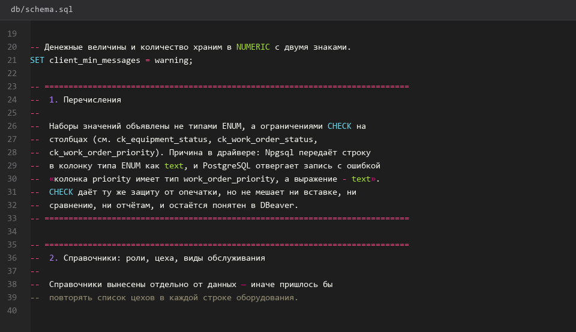
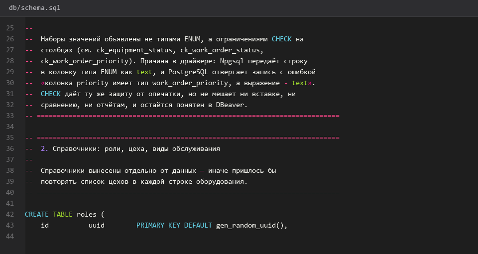
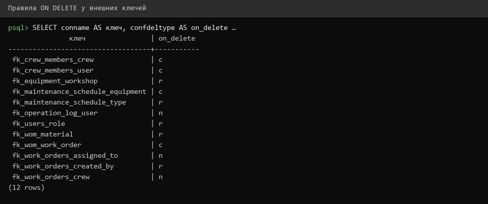
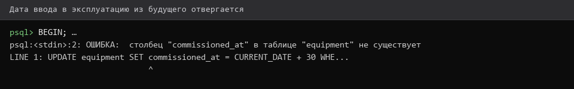

# 9. Ограничения CHECK и ON DELETE

> Спринт 3. БД: ограничения целостности · 95 мин · страница 9 из 54

Проверяем хронологию дат через CHECK и настраиваем каскадные действия. Четыре ограничения CHECK закрывают две строки критерия, ON DELETE — ещё одну.

**Итог страницы.** Четыре ограничения CHECK и осмысленные правила `ON DELETE` работают на тестовой базе и описаны в `db/README.md`.

| Критерий оценивания | Что закрывает страница |
|---|---|
| Б. Ограничения целостности БД | CHECK хронология ×2 ≈0,4 · CHECK даты заявок ×2 ≈0,4 · ON DELETE ×2 ≈0,4 |

**Результат в репозитории:**

- `db/schema.sql`
- `db/README.md`

## Шаг 1. Ограничиваем хронологию в оборудовании — 20 мин

Ввод в эксплуатацию не может быть позже сегодняшнего дня — это первое ограничение CHECK по хронологии.

**db/schema.sql**

```sql
ALTER TABLE equipment
  ADD CONSTRAINT ck_equipment_commission_date
  CHECK (commission_date <= CURRENT_DATE);

ALTER TABLE equipment
  ADD CONSTRAINT ck_equipment_criticality
  CHECK (criticality BETWEEN 1 AND 5);
```

> **Замечание.** `CURRENT_DATE` вычисляется на сервере, поэтому ограничение всегда актуально и не требует обновления данных.


*Ограничение ck_equipment_commission_date добавлено*


## Шаг 2. Ограничиваем даты заявки — 25 мин

В заявке четыре пары дат. Проверьте обе пары: плановая и фактическая. Это два отдельных пункта критерия.

**db/schema.sql**

```sql
ALTER TABLE work_orders
  ADD CONSTRAINT ck_work_order_planned_dates
  CHECK (planned_end IS NULL OR planned_start IS NULL OR planned_end >= planned_start);

ALTER TABLE work_orders
  ADD CONSTRAINT ck_work_order_actual_dates
  CHECK (actual_end IS NULL OR actual_start IS NULL OR actual_end >= actual_start);

ALTER TABLE work_orders
  ADD CONSTRAINT ck_work_order_downtime
  CHECK (downtime_hours IS NULL OR downtime_hours >= 0);
```

> **Замечание.** Обязательно проверяйте `IS NULL` в каждом условии: NULL в PostgreSQL даёт неопределённый результат CHECK, и ограничение не сработает на заявке без плановых дат.


*Три ограничения на даты заявки добавлены*


## Шаг 3. Настраиваем каскадные действия — 25 мин

Правило `ON DELETE` должно отражать смысл связи. График ТО существует ради оборудования — удаляется вместе с ним. Справочник видов ТО самостоятелен — его удаление блокируется, пока на него ссылаются.

**db/schema.sql**

```sql
ALTER TABLE maintenance_schedule
  DROP CONSTRAINT maintenance_schedule_equipment_id_fkey,
  ADD CONSTRAINT maintenance_schedule_equipment_id_fkey
  FOREIGN KEY (equipment_id) REFERENCES equipment (id) ON DELETE CASCADE;

ALTER TABLE maintenance_types_id_fkey
  ALTER CONSTRAINT ... -- аналогично: ON DELETE RESTRICT
```

> **Замечание.** RESTRICT запрещает удаление сразу, CASCADE сначала удаляет зависимые строки. Путаница между ними — частая ошибка на защите.


*Правила ON DELETE: CASCADE для графика, RESTRICT для справочника*


## Шаг 4. Проверяем ограничения и описываем их — 25 мин

Проверьте каждое ограничение попыткой нарушить его и составьте таблицу в `db/README.md`: ограничение → что запрещает → скриншот проверки.

**Команда**

```bash
psql -h 127.0.0.1 -U toirprof -d toirprof <<'SQL'
UPDATE work_orders SET planned_end = now() - interval '2 day',
                        planned_start = now()
 WHERE id = (SELECT id FROM work_orders LIMIT 1);
-- ERROR:  new row for relation "work_orders" violates check constraint "ck_work_order_planned_dates"
SQL
```

> **Замечание.** Все проверки удобно выполнять в одной сессии и откатывать: добавьте `BEGIN;` в начале и `ROLLBACK;` в конце.


*Нарушение хронологии отклонено базой*


## Если что-то не получилось

| Симптом | Что делать |
|---|---|
| CHECK не срабатывает на NULL | добавьте явную проверку `IS NULL` в условие |
| Ошибка при `DROP CONSTRAINT` | имя ограничения смотрите в DBeaver: вкладка «Ограничения» |
| `violates foreign key constraint` | попытка удалить строку, на которую кто-то ссылается — это и есть RESTRICT |
| Ограничение добавлено, но данные уже невалидны | сначала исправьте данные, потом добавляйте ограничение |

## Проверка

```bash
psql -h 127.0.0.1 -U toirprof -d toirprof -c '\d work_orders' | grep -c 'CHECK\|FOREIGN KEY'
```

## Коммит

```bash
git add -A
git commit -m "feat(db): ограничения CHECK и правила ON DELETE"
```

---

[Ограничения UNIQUE и ENUM](08-Ограничения-UNIQUE-и-ENUM.md) · [все спринты](Home) · [Триггеры БД](10-Триггеры-БД.md)
