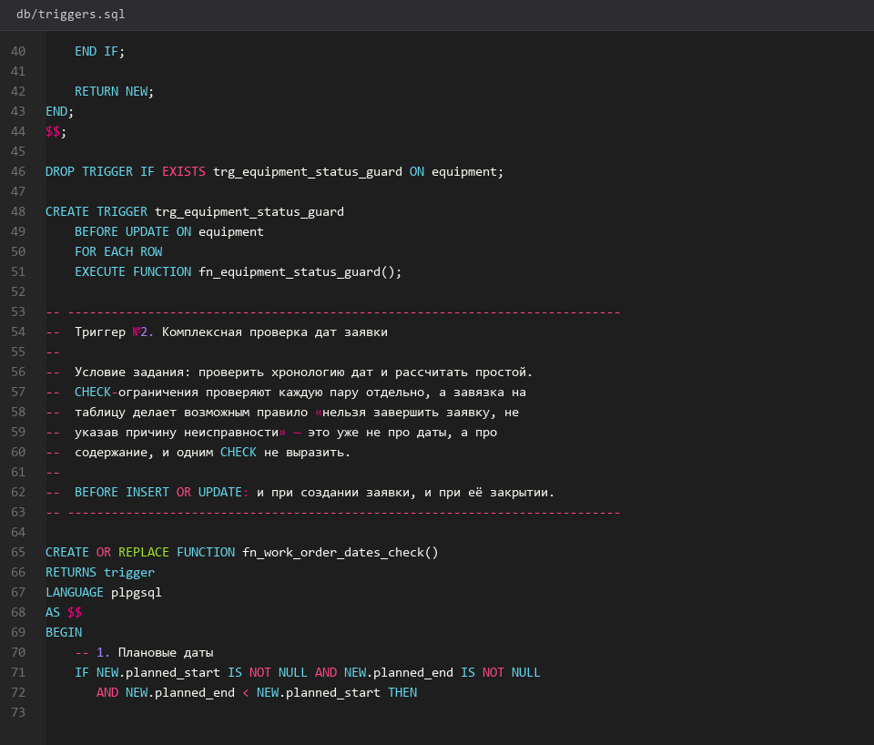
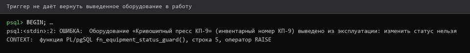
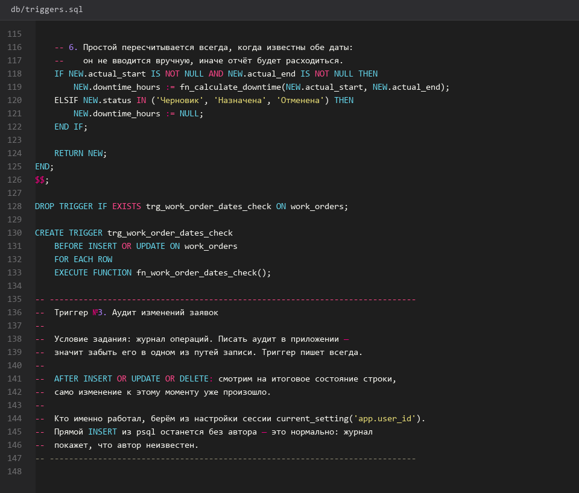
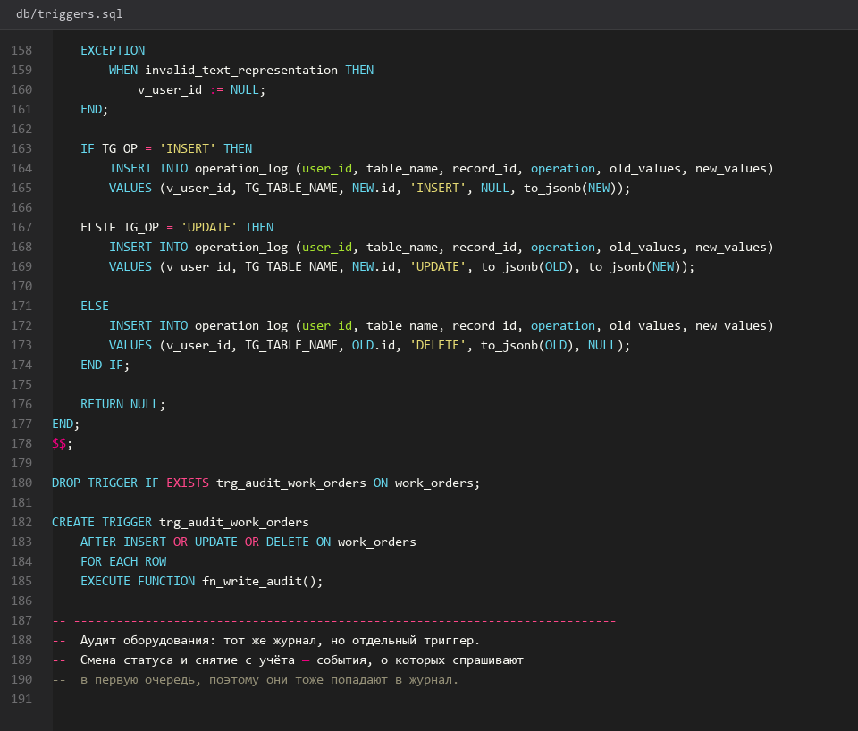
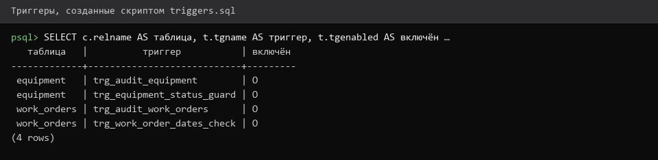

# Триггеры-БД

> Спринт 4. БД: триггеры, функции, процедура · 105 мин · страница 10 из 54

Пишем два триггера, которые задание требует дословно: запрет смены статуса оборудования, выведенного из эксплуатации, и комплексную проверку дат заявки. Вместе с ними — триггер журнала аудита.

**Итог страницы.** Оба обязательных триггера срабатывают, попытка обойти их невозможна: ограничение живёт в базе, а не в приложении.

| Критерий оценивания | Что закрывает страница |
|---|---|
| Б. Ограничения целостности БД | триггеры ×2 ≈1,0 |

**Результат в репозитории:**

- `db/triggers.sql`
- `db/README.md`

## Шаг 1. Пишем триггер защиты оборудования — 25 мин

По заданию статус «выведено из эксплуатации» менять нельзя. Триггер `BEFORE UPDATE` проверяет это на уровне строки.

**db/triggers.sql**

```sql
-- db/triggers.sql · триггер №1
CREATE OR REPLACE FUNCTION fn_equipment_status_guard()
RETURNS trigger AS $$
BEGIN
    IF OLD.status = 'Выведено из эксплуатации' AND NEW.status <> OLD.status THEN
        RAISE EXCEPTION 'Оборудование % выведено из эксплуатации: статус изменить нельзя',
                        OLD.inventory_number
            USING ERRCODE = 'check_violation';
    END IF;
    RETURN NEW;
END;
$$ LANGUAGE plpgsql;

CREATE TRIGGER trg_equipment_status_guard
BEFORE UPDATE ON equipment
FOR EACH ROW EXECUTE FUNCTION fn_equipment_status_guard();
```

> **Замечание.** Используйте `FOR EACH ROW` и `$$ … $$`: внутри функции нужны блоки и точки с запятой, которые конфликтуют с разделителем команд `psql`.


*Триггер создан, попытка смены статуса отклонена*


## Шаг 2. Проверяем триггер защиты — 15 мин

Выведите оборудование из эксплуатации и попробуйте вернуть его в работу. База должна отказать.

**Команда**

```bash
psql -h 127.0.0.1 -U toirprof -d toirprof <<'SQL'
UPDATE equipment SET status = 'Выведено из эксплуатации' WHERE inventory_number = 'ОБ-0001';
UPDATE equipment SET status = 'Работает'             WHERE inventory_number = 'ОБ-0001';
-- ERROR:  оборудование ОБ-0001 выведено из эксплуатации: статус изменить нельзя
SQL
```

> **Замечание.** Свой текст в `RAISE EXCEPTION` эксперт видит на демонстрации — это читаемее, чем стандартное сообщение PostgreSQL.


*Ошибка от пользовательского текста триггера*


## Шаг 3. Пишем комплексную проверку дат заявки — 25 мин

Второй обязательный триггер проверяет все пары дат разом и пересчитывает простой через функцию со страницы 11.

**db/triggers.sql**

```sql
-- db/triggers.sql · триггер №2
CREATE OR REPLACE FUNCTION fn_work_order_dates_check()
RETURNS trigger AS $$
BEGIN
    IF NEW.planned_start IS NOT NULL AND NEW.planned_end IS NOT NULL
       AND NEW.planned_end < NEW.planned_start THEN
        RAISE EXCEPTION 'Плановая дата окончания раньше даты начала';
    END IF;
    IF NEW.actual_start IS NOT NULL AND NEW.actual_end IS NOT NULL
       AND NEW.actual_end < NEW.actual_start THEN
        RAISE EXCEPTION 'Фактическая дата окончания раньше даты начала';
    END IF;
    IF NEW.actual_start IS NOT NULL AND NEW.actual_end IS NOT NULL THEN
        NEW.downtime_hours := fn_calculate_downtime(NEW.actual_start, NEW.actual_end);
    END IF;
    RETURN NEW;
END;
$$ LANGUAGE plpgsql;

CREATE TRIGGER trg_work_order_dates_check
BEFORE INSERT OR UPDATE ON work_orders
FOR EACH ROW EXECUTE FUNCTION fn_work_order_dates_check();
```

> **Замечание.** Триггер вызывается и на INSERT, и на UPDATE: иначе заявку можно  было бы создать сразу с неверными датами.


*Комплексная проверка дат заявки реализована*


## Шаг 4. Пишем триггер журнала аудита — 20 мин

Задание требует журнал операций. Заполняйте его триггером — тогда история пишется для всех клиентов одинаково и её нельзя обойти.

**db/triggers.sql**

```sql
CREATE OR REPLACE FUNCTION fn_write_audit()
RETURNS trigger AS $$
BEGIN
    INSERT INTO operation_log (id, table_name, operation, entity_id, details)
    VALUES (gen_random_uuid(), TG_TABLE_NAME,
            lower(TG_OP), COALESCE(NEW.id, OLD.id),
            to_jsonb(COALESCE(NEW, OLD)) - 'password_hash');
    RETURN COALESCE(NEW, OLD);
END;
$$ LANGUAGE plpgsql;

CREATE TRIGGER trg_audit_work_orders
AFTER INSERT OR UPDATE OR DELETE ON work_orders
FOR EACH ROW EXECUTE FUNCTION fn_write_audit();
```

> **Замечание.** `- 'password_hash'` исключает хеш пароля из журнала. Проверяющий может обратить на это внимание.


*После любой операции в журнале появляется запись*


## Шаг 5. Проверяем все триггеры разом — 20 мин

Прогоните скрипт на чистой базе и выполните одну операцию каждого вида. Зафиксируйте вывод в `db/README.md` — это доказательство для защиты.

**Команда**

```bash
psql -h 127.0.0.1 -U toirprof -d toirprof -f db/triggers.sql
psql -h 127.0.0.1 -U toirprof -d toirprof -c '\dt work_orders'
psql -h 127.0.0.1 -U toirprof -d toirprof -c 'SELECT table_name, operation FROM operation_log ORDER BY changed_at DESC LIMIT 5;'
```

> **Замечание.** Проверьте в DBeaver: Database → Triggers — должны быть видны все три.


*Три триггера активны, журнал заполняется*


## Если что-то не получилось

| Симптом | Что делать |
|---|---|
| `function ... already exists` | пересоздавайте функции с `CREATE OR REPLACE`, а триггеры — через `DROP TRIGGER IF EXISTS` |
| Триггер не срабатывает | проверьте `BEFORE` или `AFTER` и наличие `FOR EACH ROW` |
| Простой не считается | функция `fn_calculate_downtime` ещё не создана — сделайте страницу 11 |
| Журнал растёт при каждом чтении | триггер должен быть `AFTER INSERT OR UPDATE OR DELETE`, без `SELECT` |

## Проверка

```bash
psql -h 127.0.0.1 -U toirprof -d toirprof -c '\dT+' 2>/dev/null; psql -h 127.0.0.1 -U toirprof -d toirprof -c 'SELECT count(*) FROM operation_log;'
```

## Коммит

```bash
git add -A
git commit -m "feat(db): триггеры защиты оборудования, проверки дат и аудита"
```

---

[Ограничения-CHECK-и-ON-DELETE](09-Ограничения-CHECK-и-ON-DELETE.md) · [все спринты](Home) · [Функции-и-сводная-процедура](11-Функции-и-сводная-процедура.md)
