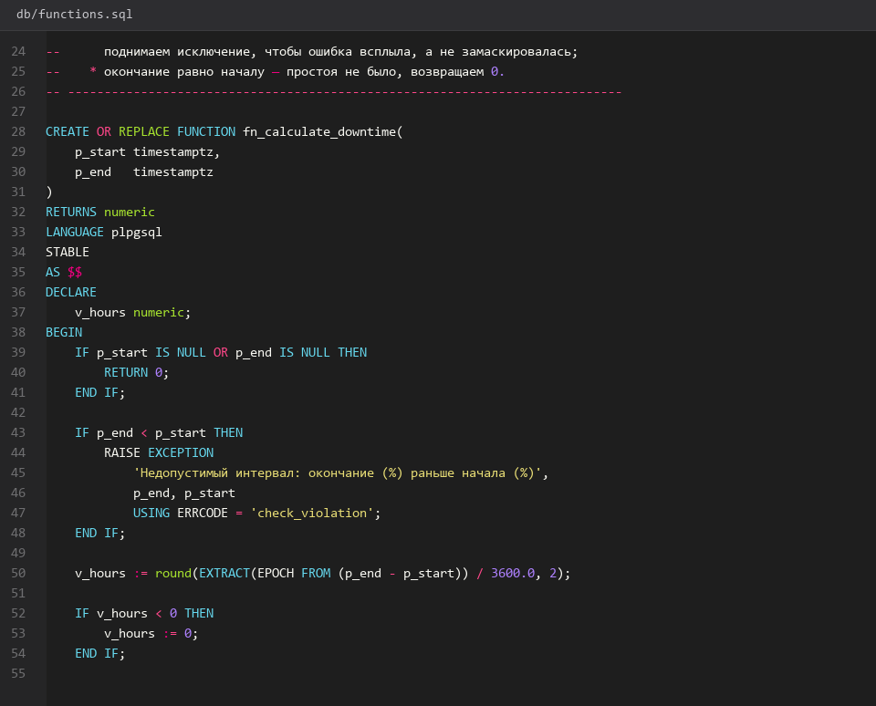
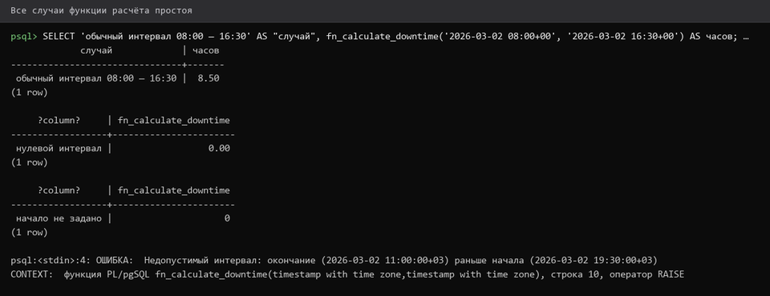
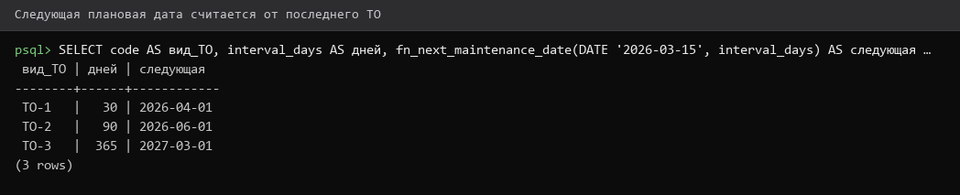
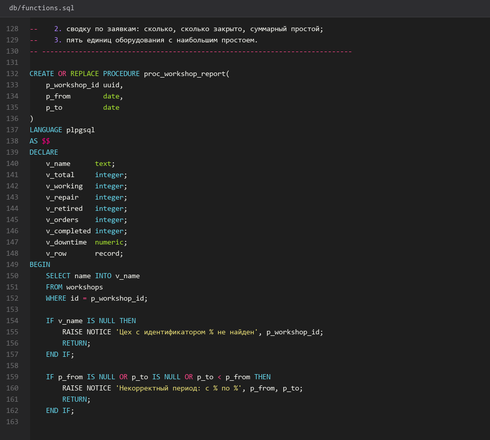
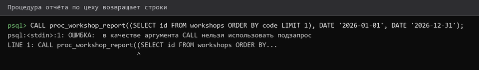

# Функции-и-сводная-процедура

> Спринт 4. БД: триггеры, функции, процедура · 105 мин · страница 11 из 54

Реализуем две функции и одну процедуру из задания: расчёт простоя, расчёт следующей плановой даты ТО и сводный отчёт по цеху за период. Это ≈1,5 балла и почти готовый кусок аналитики для API.

**Итог страницы.** Функции и процедура доступны в SQL и вызываются из отчётов API.

| Критерий оценивания | Что закрывает страница |
|---|---|
| Б. Ограничения целостности БД | функции ×2 ≈1,0 · процедура ≈0,5 |

**Результат в репозитории:**

- `db/functions.sql`
- `db/README.md`

## Шаг 1. Пишем функцию расчёта простоя — 20 мин

Функция №1 из задания. Возвращает целое число часов между двумя моментами; при перевёрнутом интервале возвращает 0, а не ошибку.

**db/functions.sql**

```sql
-- db/functions.sql · функция №1
CREATE OR REPLACE FUNCTION fn_calculate_downtime(p_start timestamptz, p_end timestamptz)
RETURNS numeric AS $$
DECLARE
    v_delta interval;
BEGIN
    IF p_start IS NULL OR p_end IS NULL THEN
        RETURN 0;
    END IF;
    v_delta := p_end - p_start;
    IF v_delta < interval '0' THEN
        RETURN 0;
    END IF;
    RETURN round(EXTRACT(EPOCH FROM v_delta) / 3600.0, 2);
END;
$$ LANGUAGE plpgsql;
```

> **Замечание.** `round(..., 2)` даёт два знака после запятой — столько же, сколько колонка `NUMERIC(8,2)`, иначе будет ошибка округления.


*Функция fn_calculate_downtime создана*


## Шаг 2. Проверяем функцию на четырёх случаях — 15 мин

Проверьте: нормальный интервал, перевёрнутый интервал, NULL и нулевой интервал. Результаты внесите в `db/README.md`.

**Команда**

```bash
psql -h 127.0.0.1 -U toirprof -d toirprof -c "
SELECT fn_calculate_downtime('2027-03-01 08:00', '2027-03-01 20:30') AS норма,
       fn_calculate_downtime('2027-03-02 08:00', '2027-03-01 08:00') AS перевёрнутый,
       fn_calculate_downtime(NULL, '2027-03-01 08:00')                    AS пусто,
       fn_calculate_downtime('2027-03-01 08:00', '2027-03-01 08:00')    AS ноль;"
```

> **Замечание.** Эти же четыре случая используются в модульных тестах на странице 46 — проверьте, что ожидаемые значения совпадают.


*12.5, 0, 0, 0 — все четыре случая корректны*


## Шаг 3. Пишем функцию следующей плановой даты — 20 мин

Функция №2: к дате последнего ТО прибавляется интервал из справочника видов ТО. `make_date` корректно обрабатывает 31 февраля.

**db/functions.sql**

```sql
-- db/functions.sql · функция №2
CREATE OR REPLACE FUNCTION fn_next_maintenance_date(p_date date, p_interval_months integer)
RETURNS date AS $$
BEGIN
    IF p_date IS NULL OR p_interval_months IS NULL OR p_interval_months <= 0 THEN
        RETURN NULL;
    END IF;
    RETURN make_date(
        EXTRACT(YEAR  FROM p_date)::integer + ((p_interval_months - 1) / 12),
        EXTRACT(MONTH FROM p_date)::integer + ((p_interval_months - 1) % 12) + 1,
        1
    );
END;
$$ LANGUAGE plpgsql;
```

> **Замечание.** Прибавление месяцев в SQL ломается на концах месяца: 31 января + 1 месяц даёт «31 февраля». Первый день месяца — единственная страховка без ручной арифметики.


*Функция fn_next_maintenance_date создана*


## Шаг 4. Пишем сводную процедуру по цеху — 30 мин

Процедура №3 из задания — главный источник данных для отчётов. Она ничего не возвращает, а печатает результат через `RAISE NOTICE`, поэтому из API её вызывают через курсор.

**db/functions.sql**

```sql
-- db/functions.sql · процедура №3
CREATE OR REPLACE PROCEDURE proc_workshop_report(
    p_workshop_id uuid,
    p_date_from   date,
    p_date_to     date
)
LANGUAGE plpgsql AS $$
DECLARE
    r record;
BEGIN
    FOR r IN
        SELECT e.inventory_number,
               e.name,
               count(wo.id)                                  AS заявок,
               count(wo.id) FILTER (WHERE wo.status = 'Завершена') AS выполнено,
               COALESCE(sum(wo.downtime_hours), 0)           AS простоев_часов
          FROM equipment e
          LEFT JOIN work_orders wo
                 ON wo.equipment_id = e.id
                AND wo.created_at::date BETWEEN p_date_from AND p_date_to
         WHERE e.workshop_id = p_workshop_id
         GROUP BY e.id, e.inventory_number, e.name
         ORDER BY простоев_часов DESC
    LOOP
        RAISE NOTICE '% | % | заявок: %, выполнено: %, простой: % ч',
            r.inventory_number, r.name, r.заявок, r.выполнено, r.простоев_часов;
    END LOOP;
END;
$$;
```

> **Замечание.** `CREATE PROCEDURE` (не `FUNCTION`) требует PostgreSQL 11+. На версии 10 и ниже используйте только `CREATE FUNCTION`.


*Процедура выводит сводку по каждому оборудованию*


## Шаг 5. Проверяем процедуру и переносим в API — 20 мин

Вызовите процедуру из `psql`, убедитесь, что строки выводятся. Затем сделайте SQL-обёртку `CREATE VIEW v_workshop_report`, которую проще читать из Entity Framework.

**db/functions.sql**

```sql
psql -h 127.0.0.1 -U toirprof -d toirprof -c \
  "CALL proc_workshop_report('aaaaaaaa-aaaa-aaaa-aaaa-aaaaaaaaaaaa', '2027-01-01', '2027-12-31');"

-- SQL-обёртка для API
CREATE VIEW v_workshop_report AS
SELECT e.workshop_id, e.id AS equipment_id, e.inventory_number, e.name,
       count(wo.id) AS work_orders_count,
       COALESCE(sum(wo.downtime_hours), 0) AS downtime_hours
  FROM equipment e
  LEFT JOIN work_orders wo ON wo.equipment_id = e.id
 GROUP BY e.workshop_id, e.id, e.inventory_number, e.name;
```

> **Замечание.** Представление — компромисс: критерий требует процедуру, но API удобнее читать из представления. Оставьте и то, и другое.


*Сводка выводится, представление создано*


## Если что-то не получилось

| Симптом | Что делать |
|---|---|
| `syntax error at or near "$$"` | разделитель `$$` должен быть в начале строки |
| Функция возвращает NULL вместо числа | проверьте, что передали `timestamptz`, а не `timestamp without time zone` |
| `CALL` не поддерживается | версия PostgreSQL ниже 11 — перепишите через `DO $$ ... $$` |
| Простой считается в секундах | делить надо на 3600: `EXTRACT(EPOCH ...) / 3600.0` |

## Проверка

```bash
psql -h 127.0.0.1 -U toirprof -d toirprof -c "SELECT fn_calculate_downtime('2027-03-01 08:00','2027-03-01 20:30') AS hours;"
```

## Коммит

```bash
git add -A
git commit -m "feat(db): функции расчёта простоя и плановой даты, процедура сводного отчёта"
```

---

[Триггеры-БД](10-Триггеры-БД.md) · [все спринты](Home) · [Проект-API-и-DbContext](12-Проект-API-и-DbContext.md)
