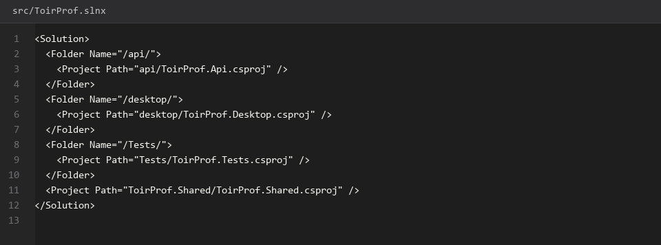
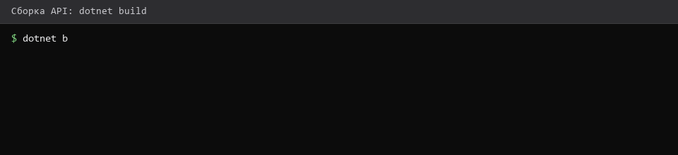
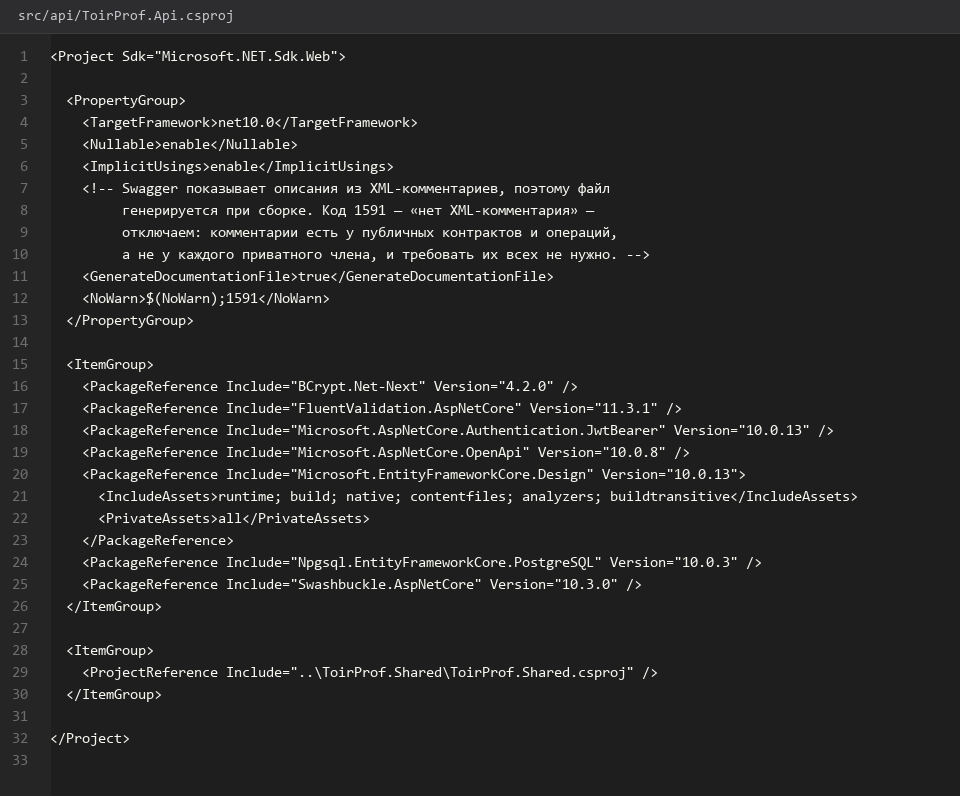
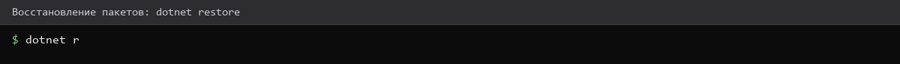
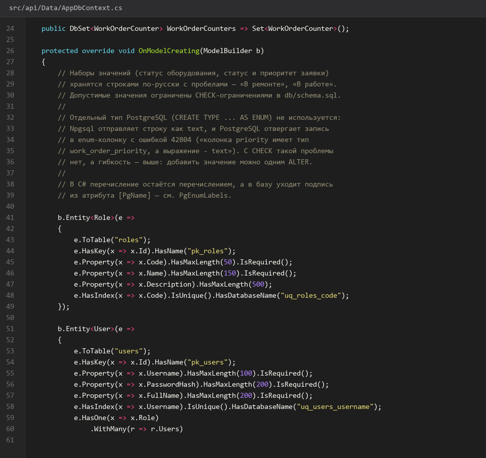
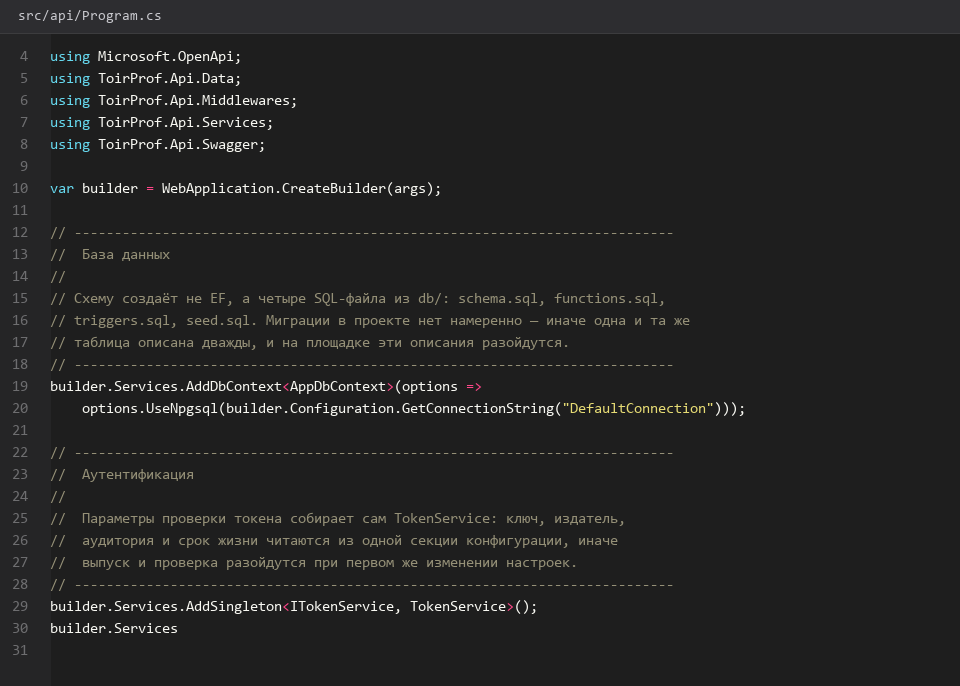
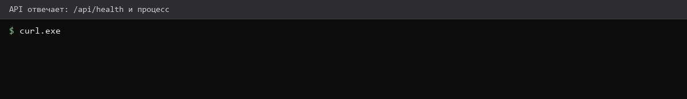

# Проект-API-и-DbContext

> Спринт 5. API: каркас, обёртка ответа, ошибки · 120 мин · страница 12 из 54

Создаём Solution с тремя проектами: собственно API, общую библиотеку контрактов и проект тестов. Подключаем Entity Framework Core к PostgreSQL и включаем Swagger в режиме разработки — без него проверяющий не увидит ни одного метода.

**Итог страницы.** API поднимается на `http://localhost:5080`, `/swagger` открывается, DbContext видит 11 таблиц.

| Критерий оценивания | Что закрывает страница |
|---|---|
| Б / API | Единый сервер для всех клиентов, документирование API через Swagger |

**Результат в репозитории:**

- `src/api/ToirProf.Api.csproj`
- `src/api/Program.cs`
- `src/api/appsettings.json`
- `src/api/Data/AppDbContext.cs`

## Шаг 1. Создаём Solution и проекты — 30 мин

Создайте Solution в корне `src/` и три проекта внутри. Общая библиотека нужна, чтобы Desktop-клиент и тесты использовали одни и те же модели ответа.

**Команда**

```bash
cd src
dotnet new sln -n ToirProf
dotnet new classlib -n ToirProf.Shared -o Shared
dotnet new webapi -n ToirProf.Api -o api --use-controllers
dotnet new xunit -n ToirProf.Tests -o Tests
dotnet sln add Shared/ToirProf.Shared.csproj api/ToirProf.Api.csproj Tests/ToirProf.Tests.csproj
dotnet add api/ToirProf.Api.csproj reference Shared/ToirProf.Shared.csproj
dotnet add Tests/ToirProf.Tests.csproj reference Shared/ToirProf.Shared.csproj
```

> **Замечание.** `dotnet new webapi` создаёт заготовку с `WeatherForecast`. Удалите `Controllers/WeatherForecastController.cs` и `Program.cs` изменим полностью — лишний код снижает впечатление на демонстрации.


*Solution создан, три проекта в дереве*


*Solution создан, три проекта в дереве*


## Шаг 2. Подключаем EF Core и строку подключения — 30 мин

Добавьте пакеты и создайте DbContext. Строку подключения держите в `appsettings.json`, пароль — в переменной окружения, чтобы не светить его в репозитории.

**src/api/appsettings.json**

```json
dotnet add api package Npgsql.EntityFrameworkCore.PostgreSQL --version 9.*
dotnet add api package Microsoft.EntityFrameworkCore.Design --version 9.*
dotnet add api package Swashbuckle.AspNetCore

// appsettings.json
{
  "ConnectionStrings": {
    "Default": "Host=127.0.0.1;Port=5432;Database=toirprof;Username=toirprof;Password=toirprof"
  },
  "Jwt": { "Key": "<secret-32+символа>", "Issuer": "ToirProf", "Audience": "ToirProfClient" },
  "Kestrel": { "Endpoints": { "Http": { "Url": "http://localhost:5080" } } }
}
```

> **Замечание.** Регион `Jwt` читается через `builder.Configuration.GetSection("Jwt")`. Ключ должен быть не короче 32 байт — иначе `SymmetricSecurityKey` бросит исключение при первом же входе.


*Пакеты восстановлены, версия EF Core в выводе совпадает с версией .NET*


*Пакеты восстановлены, версия EF Core в выводе совпадает с версией .NET*


## Шаг 3. Создаём DbContext на 11 сущностей — 40 мин

Опишите сущности как классы с первичным ключом `Guid`. Миграции против Code-First здесь не нужны: схему уже создал `db/schema.sql`, EF работает поверх неё.

**src/api/Data/AppDbContext.cs**

```csharp
public class AppDbContext : DbContext
{
    public AppDbContext(DbContextOptions<AppDbContext> options) : base(options) { }

    public DbSet<Role> Roles => Set<Role>();
    public DbSet<User> Users => Set<User>();
    public DbSet<Workshop> Workshops => Set<Workshop>();
    public DbSet<Equipment> Equipment => Set<Equipment>();
    public DbSet<MaintenanceType> MaintenanceTypes => Set<MaintenanceType>();
    public DbSet<MaintenanceSchedule> MaintenanceSchedule => Set<MaintenanceSchedule>();
    public DbSet<Crew> Crews => Set<Crew>();
    public DbSet<Material> Materials => Set<Material>();
    public DbSet<WorkOrder> WorkOrders => Set<WorkOrder>();
    public DbSet<WorkOrderMaterial> WorkOrderMaterials => Set<WorkOrderMaterial>();
    public DbSet<OperationLogEntry> OperationLog => Set<OperationLogEntry>();
}
```

> **Замечание.** Схема создана скриптом, поэтому `EnsureCreated` и миграции **не вызывайте** — иначе EF попытается создать таблицы заново и упадёт на `relation already exists`. Для проверки соединения достаточно `db.Database.CanConnectAsync()`.


*11 наборов сущностей в AppDbContext*


## Шаг 4. Включаем Swagger и запускаем — 20 мин

Настройте Swagger в development-режиме и убедитесь, что сервер отвечает. Порт фиксируем в `appsettings.json`, а не в коде — тогда Postman и оба клиента настраиваются одной правкой.

**Команда**

```bash
dotnet build
dotnet run --project api/ToirProf.Api.csproj
# в другом терминале
curl -i http://localhost:5080/swagger/index.html
```

> **Замечание.** Swagger подключается только в `app.Environment.IsDevelopment()`. На защите эксперты открывают `/swagger` без переменных окружения — добавьте `ASPNETCORE_ENVIRONMENT=Development` в инструкцию по развёртыванию.


*Swagger UI открыт, в группе ToirProf.Api виден Health*


*Swagger UI открыт, в группе ToirProf.Api виден Health*


## Если что-то не получилось

| Симптом | Что делать |
|---|---|
| `relation "equipment" already exists` | EF пытался создать схему — уберите вызовы `EnsureCreated` |
| `dotnet: command not found` | SDK не установлен или не прописан `PATH` — вернитесь на страницу 01 |
| Swagger открывается, но без методов | контроллеры не добавлены в `AddControllers` — проверьте `Program.cs` |
| `A network error occurred` в браузере | сервер слушает другой порт — сверьтесь с `appsettings.json` |

## Проверка

```bash
curl -s http://localhost:5080/swagger/v1/swagger.json | head -c 200 && dotnet build -v q
```

## Коммит

```bash
git add -A
git commit -m "feat(api): каркас Solution, DbContext на 11 сущностей и Swagger"
```

---

[Функции-и-сводная-процедура](11-Функции-и-сводная-процедура.md) · [все спринты](Home) · [Формат-ответа-и-обработка-ошибок](13-Формат-ответа-и-обработка-ошибок.md)
