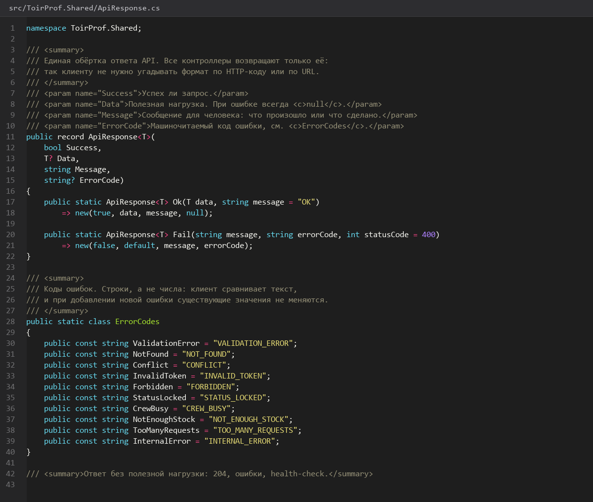
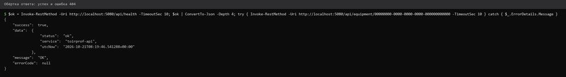
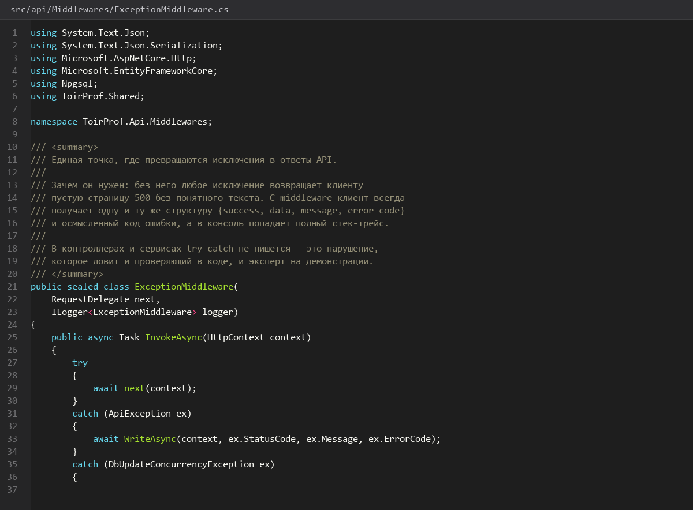

# 13. Формат ответа и обработка ошибок

> Спринт 5. API: каркас, обёртка ответа, ошибки · 90 мин · страница 13 из 54

Вводим единую обёртку ответа `{ success, data, message, error_code }` и таблицу кодов ошибок. Это требование задания и одновременно то, на чём держится всё остальное API: оба клиента разбирают ответ одним и тем же кодом.

**Итог страницы.** Любой метод возвращает `ApiResponse<T>`, коды ошибок описаны в одном перечислении, исключения превращаются в JSON автоматически.

| Критерий оценивания | Что закрывает страница |
|---|---|
| Б / API | Единый формат ответа, корректные HTTP-коды ошибок |

**Результат в репозитории:**

- `src/ToirProf.Shared/ApiResponse.cs`
- `src/api/Common/ErrorCodes.cs`
- `src/api/Common/ExceptionMiddleware.cs`

## Шаг 1. Описываем ApiResponse — 25 мин

Обёртка лежит в общей библиотеке: и API, и Desktop, и Web используют один тип. Статические фабрики убирают повторяющийся `new ApiResponse<T> { Success = false }`.

**src/ToirProf.Shared/ApiResponse.cs**

```csharp
public class ApiResponse<T>
{
    public bool Success { get; init; }
    public T? Data { get; init; }
    public string Message { get; init; } = string.Empty;
    public string? ErrorCode { get; init; }

    public static ApiResponse<T> Ok(T data, string message = "OK")
        => new() { Success = true, Data = data, Message = message };

    public static ApiResponse<T> Fail(string message, ErrorCode code)
        => new() { Success = false, Message = message, ErrorCode = code.ToString() };
}

public enum ErrorCode
{
    Validation = 400, Unauthorized = 401, Forbidden = 403,
    NotFound = 404, Conflict = 409, TooManyRequests = 429, Internal = 500
}
```

> **Замечание.** `error_code` отдаётся строкой, а не числом: клиенту проще читать `CONFLICT`, чем `409`, а в логах API остаётся привязка к HTTP-коду через сам `enum`.


*ApiResponse<T> с фабриками Ok и Fail*


## Шаг 2. Проверяем коды на живом методе — 25 мин

Добавьте пробный контроллер и проверьте все шесть кодов ответа через Postman. Проверять их на демонстрации дороже, чем сейчас.

**src/api/Controllers/HealthController.cs**

```csharp
[ApiController]
[Route("api/health")]
public class HealthController : ControllerBase
{
    [HttpGet("ok")]
    public ApiResponse<object> Ok() => ApiResponse<object>.Ok(new { ping = "pong" });

    [HttpGet("fail/{code}")]
    public IActionResult Fail(int code) => code switch
    {
        400 => BadRequest(ApiResponse<object>.Fail("Некорректный запрос", ErrorCode.Validation)),
        401 => Unauthorized(ApiResponse<object>.Fail("Требуется авторизация", ErrorCode.Unauthorized)),
        403 => StatusCode(403, ApiResponse<object>.Fail("Недостаточно прав", ErrorCode.Forbidden)),
        404 => NotFound(ApiResponse<object>.Fail("Не найдено", ErrorCode.NotFound)),
        409 => Conflict(ApiResponse<object>.Fail("Конфликт данных", ErrorCode.Conflict)),
        429 => StatusCode(429, ApiResponse<object>.Fail("Слишком много запросов", ErrorCode.TooManyRequests)),
        _ => StatusCode(500, ApiResponse<object>.Fail("Внутренняя ошибка", ErrorCode.Internal)),
    };
}
```

> **Замечание.** Для 429 добавьте заголовок `Retry-After: 5` — по нему клиент поймёт, через сколько секунд повторить запрос.


*Postman: семь ответов, у каждого свой HTTP-код*


## Шаг 3. Ловим исключения middleware — 25 мин

Необработанные исключения превращаются в 500 с тем же форматом ответа. Без этого стек трейса попадёт в ответ и засветит внутренние пути.

**src/api/Common/ExceptionMiddleware.cs**

```csharp
public class ExceptionMiddleware(RequestDelegate next, ILogger<ExceptionMiddleware> log)
{
    public async Task InvokeAsync(HttpContext ctx)
    {
        try { await next(ctx); }
        catch (Exception ex)
        {
            log.LogError(ex, "Необработанная ошибка: {Path}", ctx.Request.Path);
            ctx.Response.StatusCode = 500;
            ctx.Response.ContentType = "application/json";
            await ctx.Response.WriteAsJsonAsync(
                ApiResponse<object>.Fail("Внутренняя ошибка сервера", ErrorCode.Internal));
        }
    }
}
```

> **Замечание.** Регистрируйте middleware **до** `UseAuthentication` и `UseAuthorization` — иначе исключения из конвейера аутентификации останутся необработанными.


*Middleware зарегистрирован первым в конвейере*


## Шаг 4. Описываем таблицу кодов — 15 мин

Сведите коды в таблицу и положите её в `docs/`. Эксперты проверяют именно соответствие: 401 на защищённом маршруте и 403 у пользователя без роли.

**docs/error-codes.md**

```markdown
| Ситуация | HTTP | error_code |
|---|---|---|
| Поля не прошли валидацию | 400 | VALIDATION |
| Нет или просрочен токен | 401 | UNAUTHORIZED |
| Роль не даёт доступ | 403 | FORBIDDEN |
| Запись не найдена | 404 | NOT_FOUND |
| Дубликат номера заявки | 409 | CONFLICT |
| Частота запросов превышена | 429 | TOO_MANY_REQUESTS |
| Сбой сервера | 500 | INTERNAL |
```


## Если что-то не получилось

| Симптом | Что делать |
|---|---|
| Ответ приходит без обёртки | метод возвращает `IActionResult` напрямую — заверните в `ApiResponse` |
| 422 вместо 400 | не подключён FluentValidation — вернитесь к странице 12 |
| Middleware не ловит исключение | зарегистрирован после `UseRouting` — перенесите в самое начало |
| Swagger не показывает 401/403 | не хватает `ProducesResponseType` на методе |

## Проверка

```bash
curl -s -o /dev/null -w '%{http_code}\n' http://localhost:5080/api/health/fail/409
```

## Коммит

```bash
git add -A
git commit -m "feat(api): единый формат ответа ApiResponse и middleware обработки ошибок"
```

---

[Проект API и DbContext](12-Проект-API-и-DbContext.md) · [все спринты](Home) · [Регистрация вход и JWT](14-Регистрация-вход-и-JWT.md)
