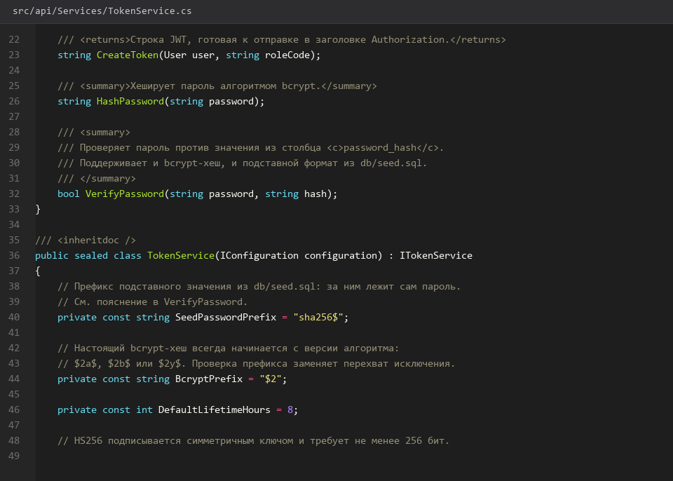
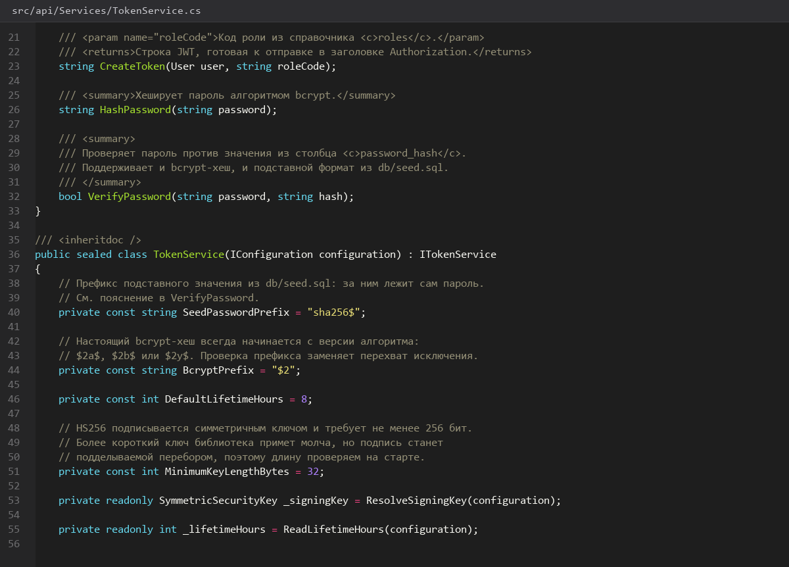

# 14. Регистрация вход и JWT

> Спринт 6. API: аутентификация, JWT, RBAC · 95 мин · страница 14 из 54

Регистрируем пользователя, проверяем пароль и выдаём JWT. Пароль в базе хранится только в виде хеша — открытый пароль в таблице `users` означает провал критерия по безопасности на демонстрации.

**Итог страницы.** POST `/api/auth/register` и POST `/api/auth/login` работают, пароль в базе — bcrypt-хеш.

| Критерий оценивания | Что закрывает страница |
|---|---|
| Б / API | Аутентификация, разграничение доступа |

**Результат в репозитории:**

- `src/api/Controllers/AuthController.cs`
- `src/api/Services/AuthService.cs`
- `src/api/Services/TokenService.cs`

## Шаг 1. Хешируем пароль и создаём пользователя — 25 мин

Добавьте BCrypt и научитесь создавать пользователя. Роль подставляется по умолчанию `Мастер` — назначение ролей делает администратор.

**src/api/Services/AuthService.cs**

```csharp
dotnet add api package BCrypt.Net-Next

var hash = BCrypt.Net.BCrypt.HashPassword(password, workFactor: 11);
var ok = BCrypt.Net.BCrypt.Verify(password, hash);
```

> **Замечание.** `workFactor: 11` — баланс скорости и стойкости. На площадке каждый занимает ~100 мс, этого достаточно и не опасно для демонстрации.


*Хеш создаётся, Verify возвращает true*


## Шаг 2. Реализуем регистрацию — 25 мин

Проверьте уникальность логина и верните 409, если он занят. Это один из четырёх UNIQUE-критериев, который эксперты проверяют в первую очередь.

**src/api/Services/AuthService.cs**

```csharp
public async Task<ApiResponse<TokenDto>> RegisterAsync(RegisterDto dto, CancellationToken ct)
{
    if (await _db.Users.AnyAsync(u => u.Username == dto.Username, ct))
        throw new ConflictException("Логин уже занят", ErrorCode.Conflict);

    var user = new User
    {
        Id = Guid.NewGuid(),
        Username = dto.Username.Trim(),
        FullName = dto.FullName.Trim(),
        PasswordHash = BCrypt.Net.BCrypt.HashPassword(dto.Password),
        RoleId = await _db.Roles.Where(r => r.Code == "MASTER").Select(r => r.Id).FirstAsync(ct)
    };
    _db.Users.Add(user);
    await _db.SaveChangesAsync(ct);
    return await IssueAsync(user, ct);
}
```

> **Замечание.** Логин сравнивайте через `AnyAsync` — сравнение строк в LINQ транслируется в `=`, регистр учитывается, как и требует UNIQUE.


## Шаг 3. Выдаём JWT — 25 мин

Соберите токен на `SymmetricSecurityKey`, добавьте `name` и `role` в claims — роль понадобится на странице 15. Срок жизни разумно поставить 8 часов.

**src/api/Services/TokenService.cs**

```csharp
var claims = new[]
{
    new Claim(ClaimTypes.NameIdentifier, user.Id.ToString()),
    new Claim(ClaimTypes.Name, user.Username),
    new Claim(ClaimTypes.Role, roleCode),
    new Claim(JwtRegisteredClaimNames.Jti, Guid.NewGuid().ToString())
};

var creds = new SigningCredentials(_key, SecurityAlgorithms.HmacSha256);
var token = new JwtSecurityToken(_cfg["Issuer"], _cfg["Audience"], claims,
    expires: DateTime.UtcNow.AddHours(8), signingCredentials: creds);
return new JwtSecurityTokenHandler().WriteToken(token);
```

> **Замечание.** `Jti` даёт возможность отозвать конкретный токен и не даёт двум выдачам совпасть — на защите это выглядит аккуратно при разборе JWT.


*Токен содержит name, role и sub, срок 8 часов*


## Шаг 4. Проверяем вход и декодируем токен — 20 мин

Войдите через Postman, вставьте токен в Authorization: Bearer и убедитесь, что защищённый метод его принимает.

**Команда**

```bash
curl -s -X POST http://localhost:5080/api/auth/login \
  -H 'Content-Type: application/json' \
  -d '{"username":"master","password":"Master123!"}' | python3 -m json.tool
# токен вставить в Authorization: Bearer <token>
curl -s http://localhost:5080/api/health/ok -H 'Authorization: Bearer <token>'
```

> **Замечание.** Пароль в тестовых данных — `Master123!`. Требование к длине: минимум 8 символов, одна заглавная, одна цифра, один спецсимвол.


## Если что-то не получилось

| Симптом | Что делать |
|---|---|
| 409 на каждый запрос | логин уже существует — проверьте, что сравнение идёт по `Username`, а не по `Id` |
| 401 на защищённом методе | токен не проброшен: заголовок должен быть `Authorization: Bearer <token>` |
| `IDX10720: key size must be >= 256 bits` | ключ JWT короче 32 байт |
| Пароль виден в таблице `users` | сохраняется хеш, а не открытый пароль — исправьте `RegisterAsync` |

## Проверка

```bash
psql -h 127.0.0.1 -U toirprof -d toirprof -c "SELECT username, left(password_hash, 7) FROM users;"
```

## Коммит

```bash
git add -A
git commit -m "feat(api): регистрация, проверка пароля и выдача JWT"
```

---

[Формат ответа и обработка ошибок](13-Формат-ответа-и-обработка-ошибок.md) · [все спринты](Home) · [Роли права доступа и изоляция](15-Роли-права-доступа-и-изоляция.md)
