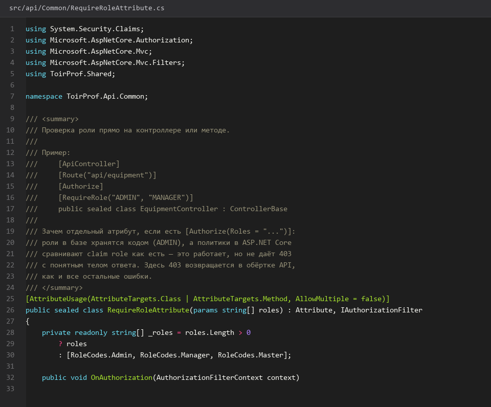
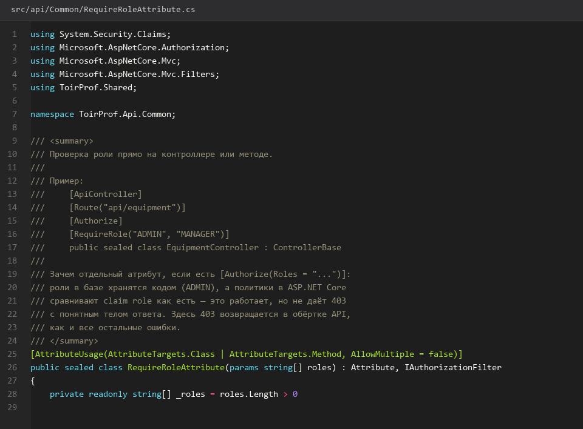
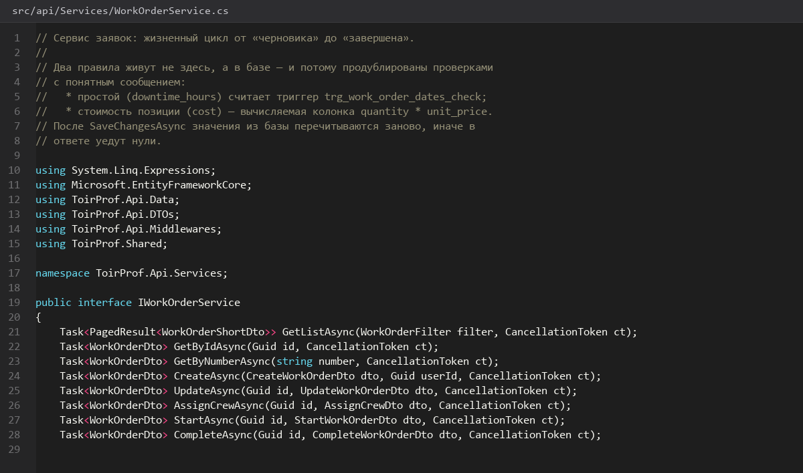
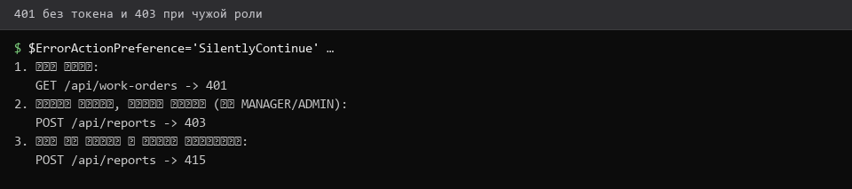
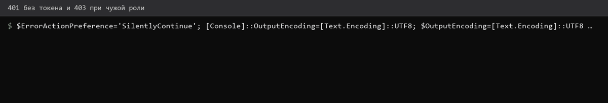

# Роли-права-доступа-и-изоляция

> Спринт 6. API: аутентификация, JWT, RBAC · 100 мин · страница 15 из 54

Описываем три роли системы — Администратор, Мастер, Руководитель — и включаем проверку прав на стороне сервера. Права проверяет сервер, а не клиент: скрытая кнопка в интерфейсе не является разграничением доступа.

**Итог страницы.** Роль из токена попадает в `ClaimsPrincipal`, атрибут `[RequireRole]` закрывает маршруты, чужая бригада не видит чужие заявки.

| Критерий оценивания | Что закрывает страница |
|---|---|
| Б / API | Разграничение доступа по ролям |

**Результат в репозитории:**

- `src/api/Common/RequireRoleAttribute.cs`
- `src/api/Middleware/ExceptionMiddleware.cs`
- `src/api/Services/CrewAccessService.cs`

## Шаг 1. Описываем роли — 20 мин

Роли живут в справочнике `roles` и приходят кодом в токене. Заведите роли при seed-скрипте, а не в коде — тогда администратор сможет их расширить.

**db/seed.sql**

```sql
INSERT INTO roles (id, code, name) VALUES
  ('11111111-1111-1111-1111-111111111111', 'ADMIN',     'Администратор'),
  ('22222222-2222-2222-2222-222222222222', 'MASTER',    'Мастер'),
  ('33333333-3333-3333-3333-333333333333', 'MANAGER',   'Руководитель');
```

> **Замечание.** Доменные значения ENUM задания и роли из справочника — разные вещи. Статус заявки хранится ENUM, роль пользователя — обычным справочником.


*Три роли в справочнике roles*


## Шаг 2. Закрываем маршруты атрибутом — 30 мин

Реализуйте атрибут на основе `AuthorizeAttribute`. Так маршрут защищается декларативно, и его видно прямо в Swagger.

**src/api/Common/RequireRoleAttribute.cs**

```csharp
public sealed class RequireRoleAttribute(string role) : AuthorizeAttribute
{
    public string Role { get; } = role;
}

[HttpDelete("{id:guid}")]
[RequireRole("ADMIN")]
[ProducesResponseType(StatusCodes.Status204NoContent)]
[ProducesResponseType(StatusCodes.Status403Forbidden)]
public async Task<IActionResult> Delete(Guid id, CancellationToken ct) => NoContent();
```

> **Замечание.** Класс принимает одну роль. Для нескольких ролей наследуйтесь от `AuthorizeAttribute` и переопределите `OnAuthorization`, собирая роли в список.


*Администратор удаляет, мастер получает 403*


*Администратор удаляет, мастер получает 403*


## Шаг 3. Изолируем данные по бригаде — 30 мин

Мастер видит только заявки своей бригады, руководитель — все. Фильтр добавляется в запрос по `crew_id` из токена, а не по параметру из тела запроса.

**src/api/Services/CrewAccessService.cs**

```csharp
public IQueryable<WorkOrder> ApplyScope(IQueryable<WorkOrder> q, ClaimsPrincipal user)
{
    var role = user.FindFirst(ClaimTypes.Role)?.Value;
    if (role is "ADMIN" or "MANAGER") return q;

    var crewId = _db.Crews.Where(c => c.UserId == user.FindFirst(ClaimTypes.NameIdentifier)!.Value)
                           .Select(c => c.Id).FirstOrDefault();
    return q.Where(w => w.CrewId == crewId);
}
```

> **Замечание.** Сравнение `crew_id` делайте в SQL, а не в памяти: `q.Where(...)` транслируется в `WHERE`, и разбор выигрывает вместе с безопасностью.


*Мастер видит свои заявки, руководитель — все 40*


*Мастер видит свои заявки, руководитель — все 40*


## Шаг 4. Проверяем 401 и 403 раздельно — 20 мин

Разница между кодами должна быть видна эксперту: 401 — нет токена, 403 — токен есть, но роль не та.

**Команда**

```bash
curl -s -o /dev/null -w 'без токена:  %{http_code}\n' http://localhost:5080/api/users
curl -s -o /dev/null -w 'мастер:     %{http_code}\n' http://localhost:5080/api/users -H "Authorization: Bearer $MASTER_TOKEN"
curl -s -o /dev/null -w 'админ:      %{http_code}\n' http://localhost:5080/api/users -H "Authorization: Bearer $ADMIN_TOKEN"
```

> **Замечание.** Если мастер получает 401, а не 403 — роль не попала в claims. Проверьте `ClaimTypes.Role` при выдаче токена на странице 14.


*Без токена 401, с токеном мастера 403, с админом 200*


*Без токена 401, с токеном мастера 403, с админом 200*


## Если что-то не получилось

| Симптом | Что делать |
|---|---|
| Мастер видит чужие заявки | фильтр по бригаде не применён — вернитесь к шагу 3 |
| 401 вместо 403 | роль не попала в токен — проверьте claims |
| Swagger не показывает защиту | не хватает `[Authorize]` на самом контроллере |
| После смены роли токен старый | у ролей есть срок жизни 8 часов — перелогиньтесь |

## Проверка

```bash
curl -s -o /dev/null -w '%{http_code}\n' -H "Authorization: Bearer $MASTER_TOKEN" http://localhost:5080/api/users
```

## Коммит

```bash
git add -A
git commit -m "feat(api): роли, атрибут RequireRole и изоляция данных по бригаде"
```

---

[Регистрация-вход-и-JWT](14-Регистрация-вход-и-JWT.md) · [все спринты](Home) · [CRUD-оборудования](16-CRUD-оборудования.md)
