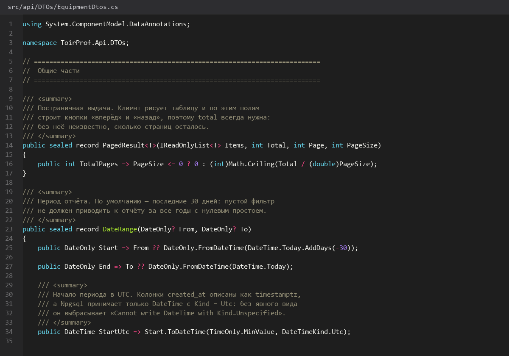
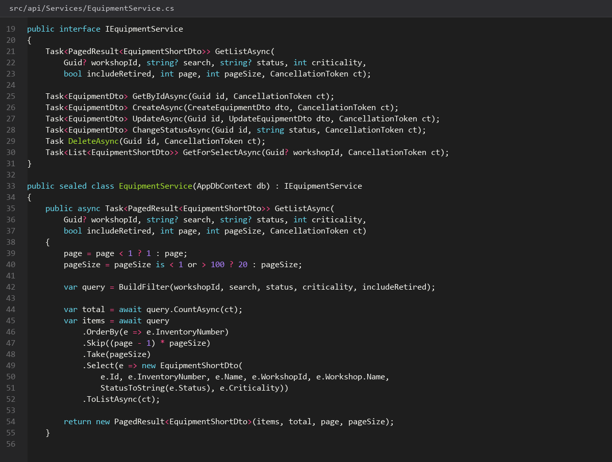
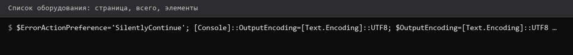
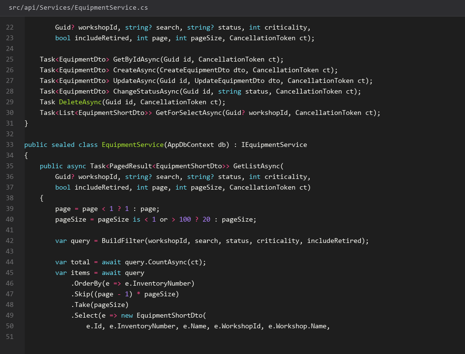

# CRUD-оборудования

> Спринт 7. API: оборудование и справочник видов ТО · 110 мин · страница 16 из 54

Основной справочник системы. Закрываем полный CRUD оборудования с фильтрами, сортировкой, пагинацией и проверкой занятости инвентарного номера.

**Итог страницы.** Пять методов `/api/equipment`, фильтры по статусу и цеху, пагинация, коды 400/404/409.

| Критерий оценивания | Что закрывает страница |
|---|---|
| Б / API | CRUD оборудования, фильтрация и пагинация |

**Результат в репозитории:**

- `src/api/Controllers/EquipmentController.cs`
- `src/api/DTOs/EquipmentDtos.cs`
- `src/api/Mappers/EquipmentMapper.cs`
- `src/api/Services/EquipmentService.cs`
- `src/api/Validators/CreateEquipmentValidator.cs`

## Шаг 1. Описываем DTO и валидатор — 30 мин

DTO отделяют внешний контракт от таблицы: так добавление поля в базе не ломает контракт. Валидатор на FluentValidation ловит мусор раньше контроллера.

**src/api/Validators/CreateEquipmentValidator.cs**

```csharp
public record CreateEquipmentDto(
    string InventoryNumber,
    string Name,
    Guid WorkshopId,
    string? Manufacturer,
    DateOnly? CommissionDate,
    int? Criticality,
    EquipmentStatus Status);

public class CreateEquipmentValidator : AbstractValidator<CreateEquipmentDto>
{
    public CreateEquipmentValidator()
    {
        RuleFor(x => x.InventoryNumber).NotEmpty().MaximumLength(32);
        RuleFor(x => x.Name).NotEmpty().MaximumLength(160);
        RuleFor(x => x.WorkshopId).NotEmpty();
        RuleFor(x => x.Criticality).InclusiveBetween(1, 5);
    }
}
```

> **Замечание.** `Criticality` — важность от 1 до 5, именно она проверяется CHECK-ограничением `ck_equipment_criticality` в базе. Валидация нужна в двух слоях: в API для ответа 400 и в БД для целостности.


*DTO и валидатор создания оборудования*


## Шаг 2. Реализуем чтение с фильтрами — 30 мин

Один метод на список: фильтр по статусу и цеху, поиск по имени, сортировка, пагинация. Возвращайте `{ items, total, page, size }` — клиентам это нужно для счётчиков пагинации.

**src/api/Services/EquipmentService.cs**

```csharp
public async Task<PagedResult<EquipmentDto>> GetListAsync(EquipmentFilter f, CancellationToken ct)
{
    var q = _db.Equipment.AsNoTracking().Include(e => e.Workshop).AsQueryable();
    if (f.Status is not null) q = q.Where(e => e.Status == f.Status);
    if (f.WorkshopId is not null) q = q.Where(e => e.WorkshopId == f.WorkshopId);
    if (!string.IsNullOrWhiteSpace(f.Search))
        q = q.Where(e => EF.Functions.ILike(e.Name, $"%{f.Search}%"));

    var total = await q.CountAsync(ct);
    var items = await q.OrderBy(e => e.InventoryNumber)
                        .Skip((f.Page - 1) * f.Size).Take(f.Size)
                        .Select(EquipmentMapper.ToDto).ToListAsync(ct);
    return new PagedResult<EquipmentDto>(items, total, f.Page, f.Size);
}
```

> **Замечание.** `AsNoTracking()` обязателен на чтении — иначе EF кэширует сущности и вы отдаёте клиенту прокси вместо DTO. `ILike` даёт регистронезависимый поиск, обычный `Contains` в PostgreSQL чувствителен к регистру.


*Список отфильтрован: 12 из 40, page=2*


*Список отфильтрован: 12 из 40, page=2*


## Шаг 3. Создание, изменение, удаление — 35 мин

POST возвращает 201 с телом, PUT обновляет, DELETE сначала проверяет, не стоит ли за оборудованием график, иначе 409.

**src/api/Controllers/EquipmentController.cs**

```csharp
[HttpPost]
[ProducesResponseType(StatusCodes.Status201Created)]
[ProducesResponseType(StatusCodes.Status409Conflict)]
public async Task<IActionResult> Create([FromBody] CreateEquipmentDto dto, CancellationToken ct)
{
    var exists = await _db.Equipment.AnyAsync(e => e.InventoryNumber == dto.InventoryNumber, ct);
    if (exists) return Conflict(ApiResponse<object>.Fail("Инвентарный номер занят", ErrorCode.Conflict));

    var entity = dto.ToEntity();
    _db.Equipment.Add(entity);
    await _db.SaveChangesAsync(ct);
    return CreatedAtAction(nameof(GetById), new { id = entity.Id },
        ApiResponse<EquipmentDto>.Ok(entity.ToDto(), "Оборудование создано"));
}

[HttpDelete("{id:guid}")]
[RequireRole("ADMIN")]
public async Task<IActionResult> Delete(Guid id, CancellationToken ct)
{
    var used = await _db.MaintenanceSchedule.AnyAsync(m => m.EquipmentId == id, ct);
    if (used) return Conflict(ApiResponse<object>.Fail("Оборудование есть в графике ТО", ErrorCode.Conflict));
    var entity = await _db.Equipment.FindAsync([id], ct);
    if (entity is null) return NotFound(ApiResponse<object>.Fail("Не найдено", ErrorCode.NotFound));
    _db.Equipment.Remove(entity);
    await _db.SaveChangesAsync(ct);
    return NoContent();
}
```

> **Замечание.** `FindAsync([id], ct)` ищет по первичному ключу и сначала проверяет кэш — дешевле, чем `FirstOrDefaultAsync`. Порядок проверок в методе важен: конфликт проверяем до `NotFound`, иначе клиент получит не тот код.


*POST 201, GET 200, DELETE 409 при занятом номере*


*POST 201, GET 200, DELETE 409 при занятом номере*


## Шаг 4. Гонка на уникальном номере — 15 мин

Проверка `AnyAsync` перед вставкой не спасает от гонки двух параллельных запросов. Настоящую защиту даёт UNIQUE-индекс, а из него — ошибка `PostgresException` с кодом `23505`.

**src/api/Services/EquipmentService.cs**

```csharp
try { await _db.SaveChangesAsync(ct); }
catch (PostgresException ex) when (ex.SqlState == PostgresErrorCodes.UniqueViolation)
{
    return Conflict(ApiResponse<object>.Fail("Инвентарный номер занят", ErrorCode.Conflict));
}
```

> **Замечание.** Это ровно тот случай, который эксперты проверяют на защите: «а что будет, если два мастера одновременно создадут одно и то же?» Ответ — UNIQUE-индекс, а не предварительная проверка.


*Два параллельных POST: первый 201, второй 409*


## Если что-то не получилось

| Симптом | Что делать |
|---|---|
| 404 на существующем id | в базе другие регистры id — сверьте seed.sql |
| 409 при первом же POST | инвентарный номер уже есть в seed — возьмите другой |
| Поиск не находит кириллицу | используйте `ILike`, а не `Contains` |
| `NpgsqlException` вместо 409 | перехватывайте `PostgresException` с `SqlState == 23505` |

## Проверка

```bash
curl -s 'http://localhost:5080/api/equipment?page=1&size=10' -H "Authorization: Bearer $TOKEN" | python3 -m json.tool
```

## Коммит

```bash
git add -A
git commit -m "feat(api): CRUD оборудования с фильтрами, пагинацией и проверкой конфликтов"
```

---

[Роли-права-доступа-и-изоляция](15-Роли-права-доступа-и-изоляция.md) · [все спринты](Home) · [Справочник-видов-обслуживания](17-Справочник-видов-обслуживания.md)
