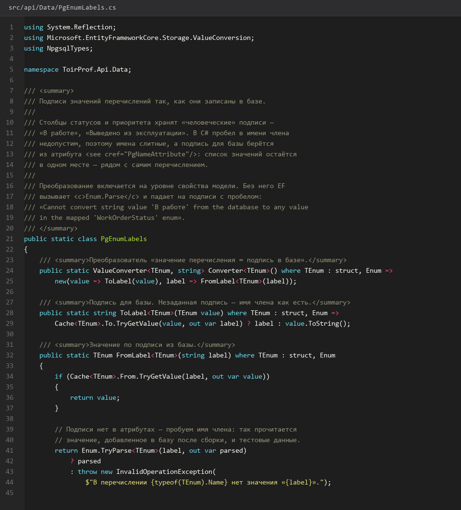
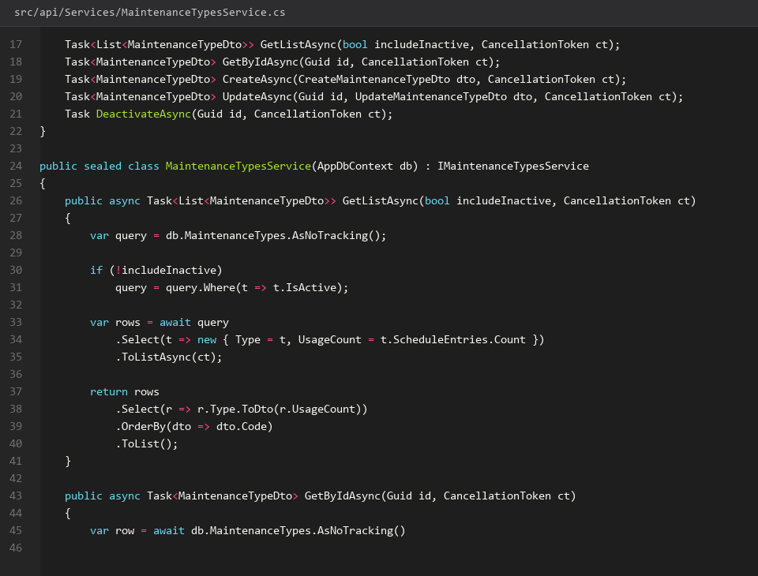
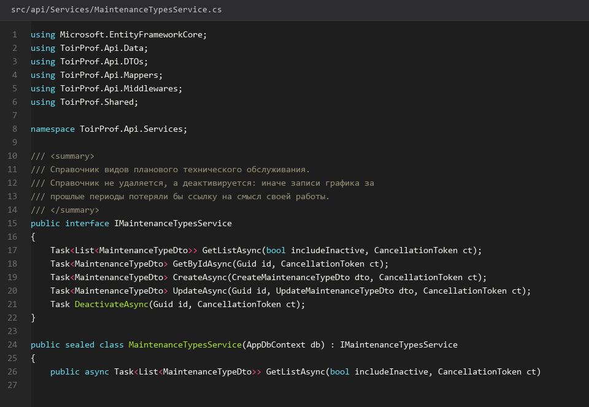
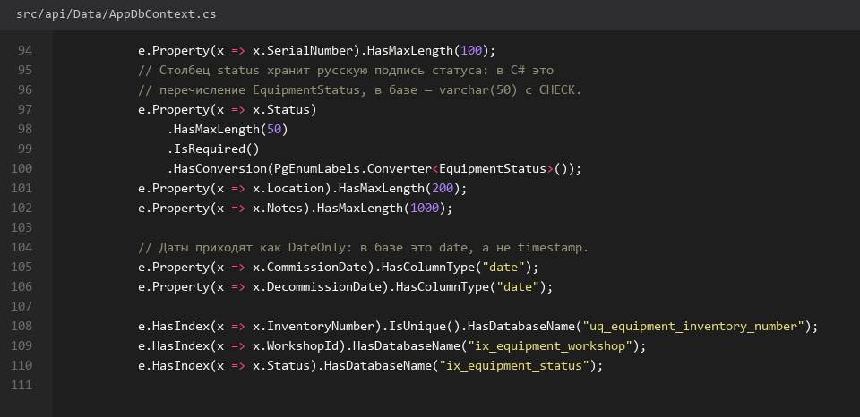

# Справочник-видов-обслуживания

> Спринт 7. API: оборудование и справочник видов ТО · 100 мин · страница 17 из 54

Виды ТО — это справочник с интервалом в днях. От него зависят и график, и автоподбор даты следующего обслуживания, поэтому удалять запись, на которую ссылается график, нельзя: возвращайте 409.

**Итог страницы.** CRUD справочника `/api/maintenance-types`, поле `interval_days` валидируется, удаление занятой записи даёт 409.

| Критерий оценивания | Что закрывает страница |
|---|---|
| Б / API | Справочник видов ТО |

**Результат в репозитории:**

- `src/api/Controllers/MaintenanceTypesController.cs`
- `src/api/Services/MaintenanceTypesService.cs`

## Шаг 1. Справочник и его интервал — 25 мин

Каждому виду обслуживания соответствует периодичность в днях: ежедневный, ежемесячный, квартальный, годовой. Интервал хранится в днях, чтобы расчёт следующей даты был одинаковым для всех видов.

**src/api/Controllers/MaintenanceTypesController.cs**

```csharp
public record MaintenanceTypeDto(Guid Id, string Code, string Name, int IntervalDays, string? Description);

[HttpGet]
[RequireRole("ADMIN", "MASTER", "MANAGER")]
[ProducesResponseType(typeof(ApiResponse<List<MaintenanceTypeDto>>), StatusCodes.Status200OK)]
public async Task<IActionResult> GetAll(CancellationToken ct)
    => Ok(ApiResponse<List<MaintenanceTypeDto>>.Ok(await _service.GetAllAsync(ct)));
```

> **Замечание.** Справочник небольшой, поэтому отдавайте его целиком без пагинации — клиенту нужен выпадающий список, а не таблица.


*GET вернул четыре вида обслуживания*


## Шаг 2. Создание и изменение — 25 мин

Код справочника уникален и не редактируется после создания: по нему ссылаются графики и отчёты. Интервал ограничьте сверху двумя годами.

**src/api/Validators/MaintenanceTypeValidator.cs**

```csharp
RuleFor(x => x.Code).NotEmpty().Matches(@"^[A-Z0-9_]{2,16}$").WithMessage("Код: заглавные латинские буквы, цифры и подчёркивание");
RuleFor(x => x.IntervalDays).InclusiveBetween(1, 730);

if (await _db.MaintenanceTypes.AnyAsync(t => t.Code == dto.Code && t.Id != dto.Id, ct))
    return Conflict(ApiResponse<object>.Fail("Код вида ТО уже существует", ErrorCode.Conflict));
```

> **Замечание.** Регулярное выражение в валидаторе и CHECK в базе должны описывать одно и то же правило, иначе значения пройдут один слой и упадут на другом.


*POST 201, повторный POST с тем же кодом 409*


## Шаг 3. Удаление с проверкой использования — 30 мин

Прежде чем удалить, проверяем ссылки: если на вид ТО ссылается хотя бы одна запись графика, отвечаем 409 и объясняем причину.

**src/api/Services/MaintenanceTypesService.cs**

```csharp
var used = await _db.MaintenanceSchedule.AnyAsync(m => m.MaintenanceTypeId == id, ct);
if (used)
{
    var count = await _db.MaintenanceSchedule.CountAsync(m => m.MaintenanceTypeId == id, ct);
    return Conflict(ApiResponse<object>.Fail(
        $"Вид ТО используется в {count} записях графика", ErrorCode.Conflict));
}
```

> **Замечание.** Сообщение с числом использований выглядит убедительнее, чем сухое `Conflict`. На демонстрации эксперт видит, что сервер знает о ссылочной целостности.


*Удаление занятого справочника возвращает 409*


## Шаг 4. Связываем справочник с графиком — 20 мин

Справочник вызывается из формы графика ТО: выпадающий список с интервалом и кнопкой «Создать следующий». Проверьте, что удалённый вид исчез из списка.

**Команда**

```bash
curl -s http://localhost:5080/api/maintenance-types -H "Authorization: Bearer $TOKEN"
# ответ: data: [{ code: "DAILY", intervalDays: 1 }, { code: "MONTHLY", intervalDays: 30 }, ...]
```

> **Замечание.** Не храните копию интервала в графике. Если интервал изменится, в записях графика должна применяться новая версия — иначе отчёт покажет неверные сроки.


*Форма графика использует справочник, интервал подставляется*


## Если что-то не получилось

| Симптом | Что делать |
|---|---|
| 409 при первом удалении | вид уже используется в графике — так и должно быть |
| 422 на интервал 0 | валидатор `InclusiveBetween(1, 730)` — интервал минимум один день |
| Справочник вернул пустой массив | не применён `RequireRole` или seed не выполнен |
| Ошибка при изменении кода | код неизменяемый — вернитесь к шагу 2 |

## Проверка

```bash
curl -s http://localhost:5080/api/maintenance-types -H "Authorization: Bearer $TOKEN" | python3 -m json.tool
```

## Коммит

```bash
git add -A
git commit -m "feat(api): справочник видов обслуживания с проверкой ссылочной целостности"
```

---

[CRUD-оборудования](16-CRUD-оборудования.md) · [все спринты](Home) · [График-планового-ТО](18-График-планового-ТО.md)
