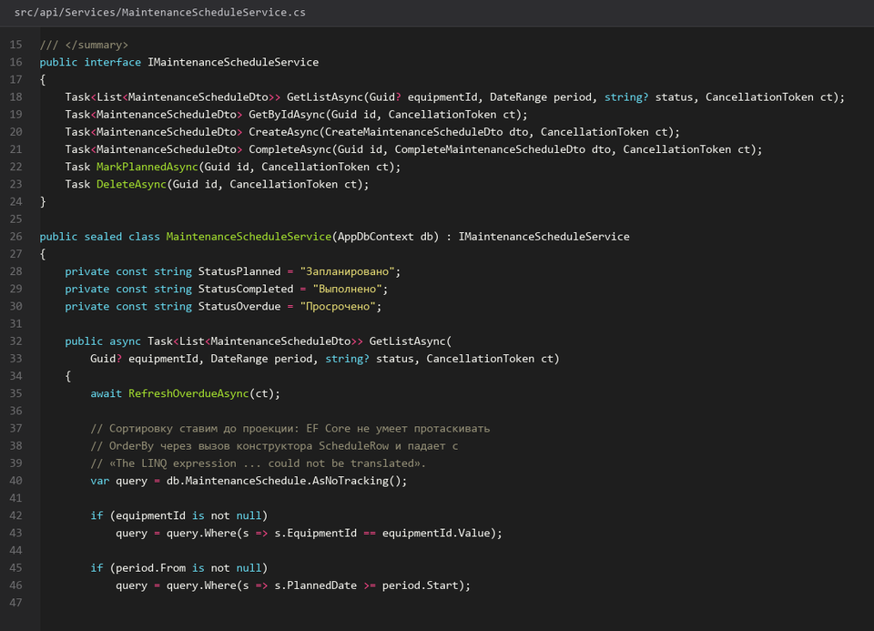
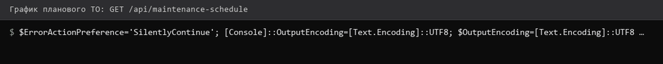
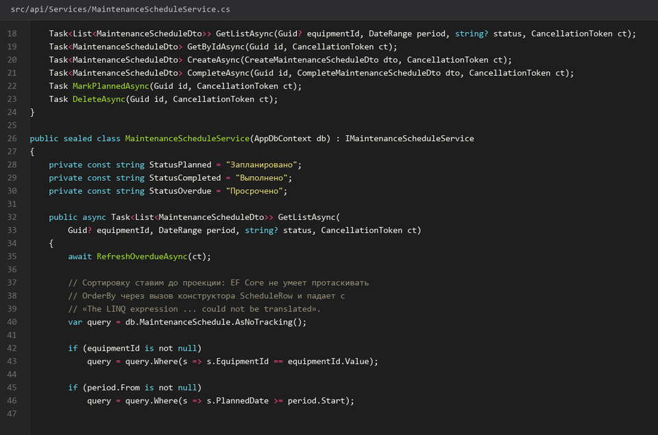
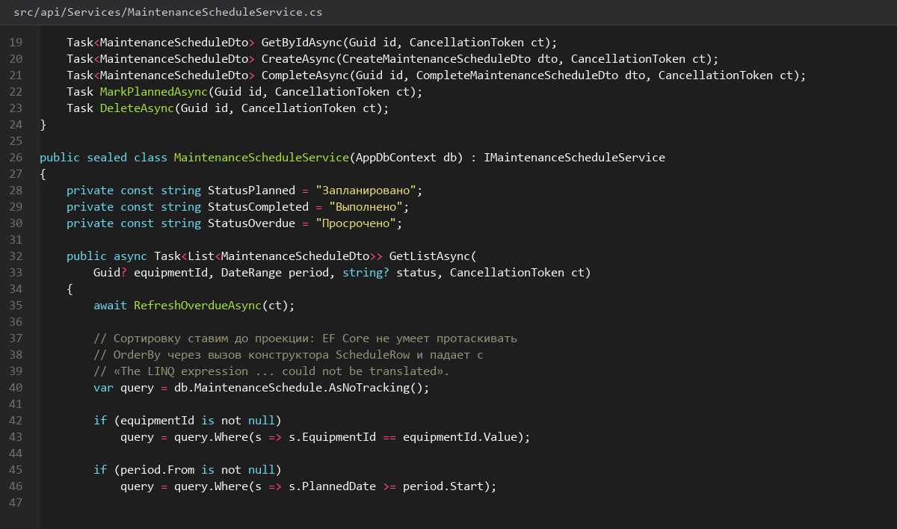

# График-планового-ТО

> Спринт 8. API: график ТО и генерация заявок · 110 мин · страница 18 из 54

График планового технического обслуживания — расписание по оборудованию. Здесь же живёт автоподстановка следующей даты через функцию `fn_next_maintenance_date`, которая делает часть работы прямо в базе.

**Итог страницы.** CRUD графика, фильтр по периоду и статусу, расчёт следующей даты из базовой функции.

| Критерий оценивания | Что закрывает страница |
|---|---|
| Б / API | График планового ТО |

**Результат в репозитории:**

- `src/api/Controllers/MaintenanceScheduleController.cs`
- `src/api/Services/MaintenanceScheduleService.cs`

## Шаг 1. Чтение графика с фильтрами — 30 мин

Главный сценарий — «что запланировано на этот месяц». Фильтруйте по диапазону дат планового ТО, по оборудованию и по статусу выполнения.

**src/api/Services/MaintenanceScheduleService.cs**

```csharp
public async Task<PagedResult<ScheduleItemDto>> GetListAsync(ScheduleFilter f, CancellationToken ct)
{
    var q = _db.MaintenanceSchedule.AsNoTracking()
        .Include(m => m.Equipment).ThenInclude(e => e.Workshop)
        .Include(m => m.MaintenanceType)
        .AsQueryable();

    if (f.From is not null) q = q.Where(m => m.PlannedDate >= f.From.Value);
    if (f.To is not null)   q = q.Where(m => m.PlannedDate <= f.To.Value);
    if (f.EquipmentId is not null) q = q.Where(m => m.EquipmentId == f.EquipmentId);

    var total = await q.CountAsync(ct);
    var items = await q.OrderBy(m => m.PlannedDate)
        .Skip((f.Page - 1) * f.Size).Take(f.Size)
        .Select(m => new ScheduleItemDto(m.Id, m.PlannedDate, m.Equipment.InventoryNumber,
            m.Equipment.Name, m.MaintenanceType.Name, m.Status)).ToListAsync(ct);
    return new(items, total, f.Page, f.Size);
}
```

> **Замечание.** Два `Include` подряд — это две разные навигации. Первый тянет оборудование вместе с цехом, второй — вид обслуживания. Без них в ответе будут нули вместо названий.


*График за месяц: 18 записей, отсортировано по дате*


*График за месяц: 18 записей, отсортировано по дате*


## Шаг 2. Создаём запись графика — 30 мин

При создании записи поле `next_planned_date` считает функция базы. Не дублируйте формулу в C# — при изменении правил расчёта разъедутся две реализации.

**src/api/Services/MaintenanceScheduleService.cs**

```csharp
var next = _db.Database.SqlQuery<DateOnly?>("SELECT fn_next_maintenance_date({0}, {1}) AS \"Value\"",
    plannedDate, maintenanceType.IntervalDays).AsNoTracking().FirstOrDefault();

var item = new MaintenanceSchedule
{
    Id = Guid.NewGuid(),
    EquipmentId = dto.EquipmentId,
    MaintenanceTypeId = dto.MaintenanceTypeId,
    PlannedDate = dto.PlannedDate,
    NextPlannedDate = next,
    Status = "Запланировано"
};
_db.MaintenanceSchedule.Add(item);
await _db.SaveChangesAsync(ct);
```

> **Замечание.** `SqlQuery<T>` для скалярных функций важнее `FromSqlRaw`: он возвращает типизированный скаляр. Название колонки в алиасе обязательно — PostgreSQL приводит `fn_...` к snake_case.


*POST 201: planned 2026-03-10, next 2026-04-10*


*POST 201: planned 2026-03-10, next 2026-04-10*


## Шаг 3. Отметка выполнения и продление — 30 мин

Когда ТО выполнено, запись получает фактическую дату, а следующая считается от фактической, а не от плановой. Так график не «уезжает» после каждого простоя.

**src/api/Services/MaintenanceScheduleService.cs**

```csharp
public async Task<ApiResult> CompleteAsync(Guid id, CompleteScheduleDto dto, CancellationToken ct)
{
    var item = await _db.MaintenanceSchedule.FindAsync([id], ct)
        ?? throw new NotFoundException("Запись графика не найдена");

    item.ActualDate = dto.ActualDate;
    item.Status = "Выполнено";

    var interval = await _db.MaintenanceTypes
        .Where(t => t.Id == item.MaintenanceTypeId)
        .Select(t => t.IntervalDays).FirstAsync(ct);

    item.NextPlannedDate = await _db.Database
        .SqlQuery<DateOnly?>("SELECT fn_next_maintenance_date({0}, {1}) AS \"Value\"",
            dto.ActualDate, interval).FirstOrDefaultAsync(ct);

    await _db.SaveChangesAsync(ct);
    return ApiResult.Ok("Запись выполнена, следующая дата рассчитана");
}
```

> **Замечание.** Сдвиг даты от фактической — то, за что спрашивают на защите: «ваш график сдвигается, если ремонт затянулся?» Ответ должен быть да.


*Выполнено 2026-03-12, следующая дата 2026-04-12*


*Выполнено 2026-03-12, следующая дата 2026-04-12*


## Шаг 4. Отменяем и удаляем — 20 мин

Удаление записи графика возможно только до выполнения. Выполненную запись не удаляют — она часть истории, на которую ссылается журнал операций.

**src/api/Controllers/MaintenanceScheduleController.cs**

```csharp
if (item.Status == "Выполнено")
    return Conflict(ApiResponse<object>.Fail("Выполненную запись нельзя удалить", ErrorCode.Conflict));

_db.MaintenanceSchedule.Remove(item);
await _db.SaveChangesAsync(ct);
return NoContent();
```

> **Замечание.** `ON DELETE CASCADE` в схеме сработает при удалении оборудования и унесёт его график. Но ручное удаление записи ограничено статусом — это разные вещи, не путайте их на защите.


*Удаление выполненной записи возвращает 409*


*Удаление выполненной записи возвращает 409*


## Если что-то не получилось

| Симптом | Что делать |
|---|---|
| `next_planned_date` всегда NULL | функция вернула NULL — проверьте интервал вида ТО |
| Список пуст при верном периоде | даты фильтра в UTC, а записи в локальном времени |
| 409 на удалении | запись уже выполнена — это ожидаемое поведение |
| Дубли по дате и оборудованию | добавьте UNIQUE на `(equipment_id, planned_date)` в схеме |

## Проверка

```bash
curl -s 'http://localhost:5080/api/maintenance-schedule?from=2026-03-01&to=2026-03-31' -H "Authorization: Bearer $TOKEN" | python3 -m json.tool
```

## Коммит

```bash
git add -A
git commit -m "feat(api): график планового ТО с расчётом следующей даты"
```

---

[Справочник-видов-обслуживания](17-Справочник-видов-обслуживания.md) · [все спринты](Home) · [Генерация-номера-заявки](19-Генерация-номера-заявки.md)
