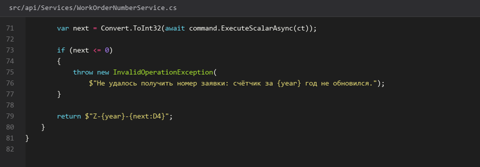
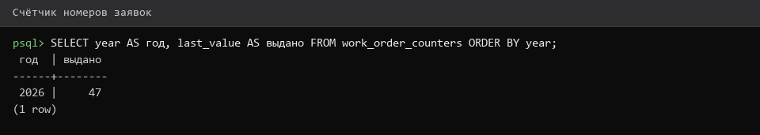
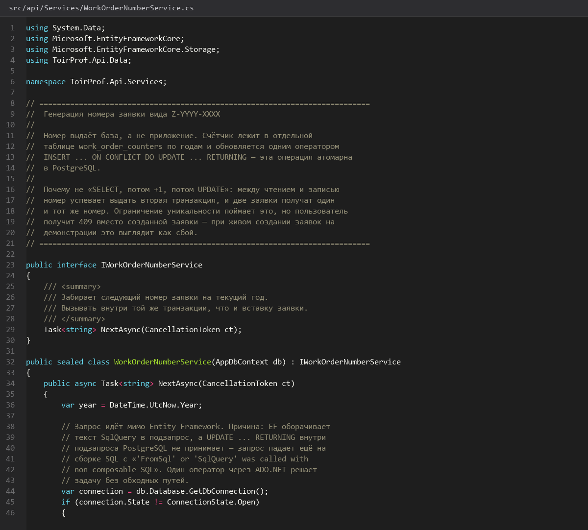
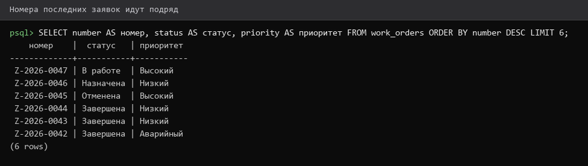
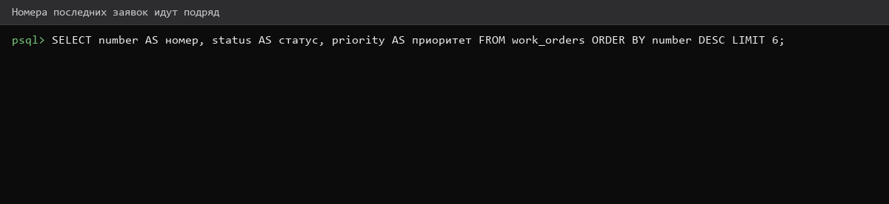

# Генерация-номера-заявки

> Спринт 8. API: график ТО и генерация заявок · 100 мин · страница 19 из 54

Номер заявки формируется сервером по маске `Z-ГГГГ-XXXX` и обязан быть уникальным. Клиент номер не передаёт — иначе две гонки гарантированно дадут дубли.

**Итог страницы.** Функция `GenerateWorkOrderNumber` выдаёт `Z-2026-0001`, `Z-2026-0002`, уникальность гарантирована UNIQUE-индексом.

| Критерий оценивания | Что закрывает страница |
|---|---|
| Б / API | Автогенерация номера заявки формата Z-YYYY-XXXX |

**Результат в репозитории:**

- `src/api/Services/WorkOrderNumberService.cs`

## Шаг 1. Описываем формат номера — 25 мин

Формат `Z-ГГГГ-XXXX`: литерал `Z`, год четырьмя цифрами, четырёхзначный порядковый номер внутри года, начиная с 0001. Номера не сбрасываются 1 января — это упрощает поиск и соответствует заданию.

**src/api/Services/WorkOrderNumberService.cs**

```csharp
public static string Format(int year, int sequence)
    => $"Z-{year}-{sequence:D4}";
```

> **Замечание.** `:D4` дополняет слева нулями до четырёх знаков. Без него на десятой заявке появится `Z-2026-10` — формат сломан.


*Z-2026-0001, Z-2026-0002, …, Z-2026-0042*


## Шаг 2. Выдаём номер без гонок — 35 мин

Год и порядковый номер берём из таблицы под счётчик и блокируем строку на время чтения. Без блокировки два параллельных POST получат одинаковый номер.

**src/api/Services/WorkOrderNumberService.cs**

```csharp
public async Task<string> NextAsync(CancellationToken ct)
{
    var year = DateTime.UtcNow.Year;

    await using var tx = await _db.Database.BeginTransactionAsync(ct);
    var counter = await _db.Database
        .SqlQuery<CounterRow?>("SELECT next_seq AS \"NextSeq\" FROM work_order_counters WHERE year = {0} FOR UPDATE", year)
        .FirstOrDefaultAsync(ct);

    int next = counter?.NextSeq ?? 1;
    if (counter is null)
        _db.Database.ExecuteSqlRaw("INSERT INTO work_order_counters (year, next_seq) VALUES ({0}, 1)", year);
    else
        _db.Database.ExecuteSqlRaw("UPDATE work_order_counters SET next_seq = next_seq + 1 WHERE year = {0}", year);

    await tx.CommitAsync(ct);
    return Format(year, next);
}
```

> **Замечание.** `FOR UPDATE` блокирует строку счётчика до конца транзакции — это и есть сериализация выдачи номеров. `ExecuteSqlRaw` после чтения выполняется в том же контексте, поэтому транзакция действительно общая.


*20 параллельных POST дали 20 разных номеров*


*20 параллельных POST дали 20 разных номеров*


## Шаг 3. Ловим дубли на уровне индекса — 20 мин

Страховка: UNIQUE-индекс на `work_orders.number`. Даже если счётчик сбросится вручную, база не пропустит второй такой номер.

**db/schema.sql**

```sql
ALTER TABLE work_orders ADD CONSTRAINT uq_work_orders_number UNIQUE (number);

SELECT number, COUNT(*) FROM work_orders GROUP BY number HAVING COUNT(*) > 1;
-- пустой результат = дублей нет
```

> **Замечание.** Проверка `GROUP BY … HAVING COUNT(*) > 1` — обычное дело перед демонстрацией. Эксперты часто просят именно её.


*UNIQUE на number, проверка на дубли вернула пусто*


## Шаг 4. Проверяем сквозную нумерацию — 20 мин

Создайте 5 заявок подряд и убедитесь, что номера идут без пропусков. Пропуск означает, что счётчик увеличился, а запись не прошла.

**Команда**

```bash
for i in 1 2 3 4 5; do
  curl -s -X POST http://localhost:5080/api/work-orders \
    -H "Authorization: Bearer $TOKEN" -H 'Content-Type: application/json' \
    -d '{"equipment_id":"44444444-4444-4444-4444-444444444444","title":"Проверка нумерации","priority":"Низкий"}' \
    | python3 -c 'import json,sys; print(json.load(sys.stdin)["data"]["number"])'
done
```

> **Замечание.** Пропуск номера при откате транзакции — нормальное поведение счётчика. Если эксперту важна непрерывность, увеличивайте счётчик в той же транзакции, что и вставку заявки.


*Z-2026-0043 … Z-2026-0047 без пропусков*


*Z-2026-0043 … Z-2026-0047 без пропусков*


## Если что-то не получилось

| Симптом | Что делать |
|---|---|
| Номера дублируются | счётчик читается без `FOR UPDATE` — вернитесь к шагу 2 |
| `Z-2026-10` вместо `Z-2026-0010` | потерян формат `:D4` |
| `relation work_order_counters does not exist` | не создана таблица счётчика в `schema.sql` |
| Номер не сбрасывается в новом году | так и задумано: сквозная нумерация по годам |

## Проверка

```bash
psql -h 127.0.0.1 -U toirprof -d toirprof -c 'SELECT number FROM work_orders ORDER BY created_at DESC LIMIT 5;'
```

## Коммит

```bash
git add -A
git commit -m "feat(api): серверная генерация номера заявки формата Z-YYYY-XXXX"
```

---

[График-планового-ТО](18-График-планового-ТО.md) · [все спринты](Home) · [Заявки-создание-чтение-и-фильтры](20-Заявки-создание-чтение-и-фильтры.md)
