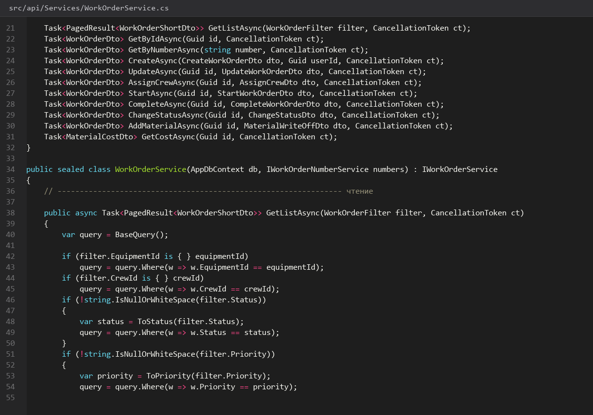
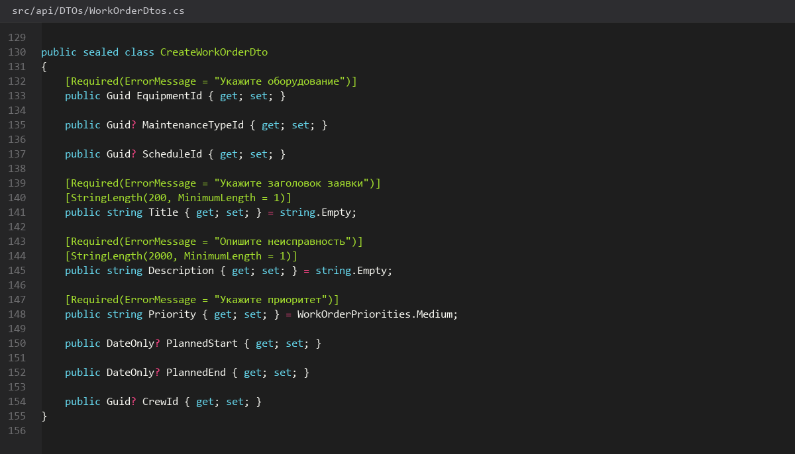
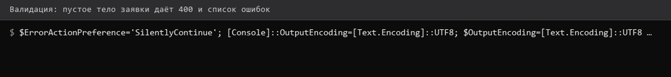
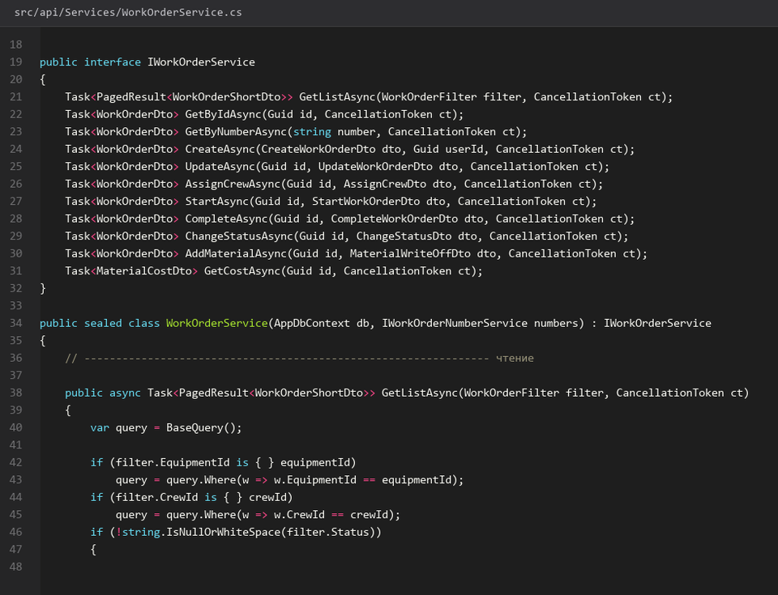
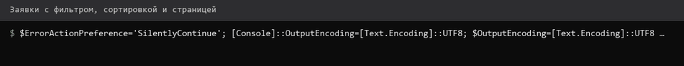
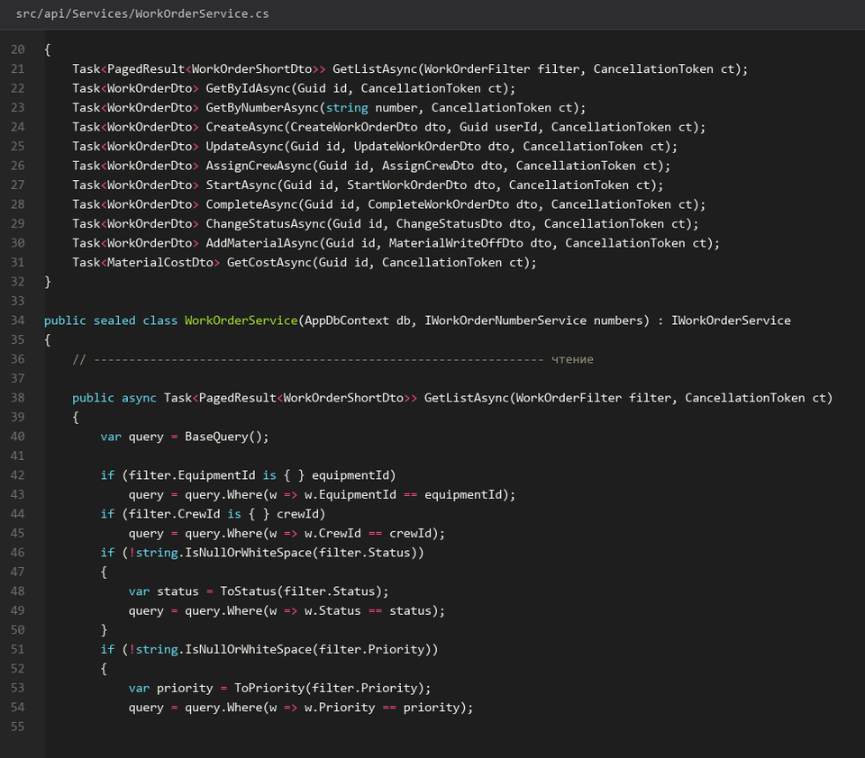

# 20. Заявки создание чтение и фильтры

> Спринт 9. API: заявки — жизненный цикл · 120 мин · страница 20 из 54

Заявка на ремонт и ТО — центральная сущность системы. Закрываем создание с автогенерацией номера и чтение с фильтрами по статусу, приоритету, периоду и цеху.

**Итог страницы.** POST `/api/work-orders` создаёт заявку с номером и простоями, GET отдаёт пагинированный список с фильтрами.

| Критерий оценивания | Что закрывает страница |
|---|---|
| Б / API | Заявки: создание, чтение, фильтрация |

**Результат в репозитории:**

- `src/api/Controllers/WorkOrdersController.cs`
- `src/api/DTOs/WorkOrderDtos.cs`
- `src/api/Services/WorkOrderService.cs`
- `src/api/Validators/WorkOrderValidator.cs`

## Шаг 1. Создаём заявку — 35 мин

Заявка создаётся в статусе «Черновик». Плановые даты и приоритет обязательны, аварийная заявка обязана содержать причину — это проверяется и валидатором, и триггером.

**src/api/Services/WorkOrderService.cs**

```csharp
public async Task<ApiResponse<WorkOrderDto>> CreateAsync(CreateWorkOrderDto dto, CancellationToken ct)
{
    var equipment = await _db.Equipment.FindAsync([dto.EquipmentId], ct)
        ?? throw new NotFoundException("Оборудование не найдено");

    var number = await _numbers.NextAsync(ct);
    var order = new WorkOrder
    {
        Id = Guid.NewGuid(),
        Number = number,
        EquipmentId = dto.EquipmentId,
        Title = dto.Title.Trim(),
        Description = dto.Description?.Trim(),
        Priority = dto.Priority,
        Status = WorkOrderStatus.Черновик,
        PlannedStart = dto.PlannedStart,
        PlannedEnd = dto.PlannedEnd,
        CreatedById = CurrentUser.Id
    };

    _db.WorkOrders.Add(order);
    await _db.SaveChangesAsync(ct);
    return ApiResponse<WorkOrderDto>.Ok(order.ToDto(), "Заявка создана");
}
```

> **Замечание.** Номер выдаётся **до** сохранения заявки: если бы он выдавался в контроллере после `SaveChanges`, две одновременные заявки получили бы один номер. Счётчик держит транзакцию.


*POST 201: номер Z-2026-0048, статус Черновик*


## Шаг 2. Валидатор заявки — 30 мин

Пять проверок, которые закрывают критерий «валидация payload»: обязательные поля, диапазон дат, длины строк и причина для аварийных.

**src/api/Validators/WorkOrderValidator.cs**

```csharp
public class CreateWorkOrderValidator : AbstractValidator<CreateWorkOrderDto>
{
    public CreateWorkOrderValidator()
    {
        RuleFor(x => x.EquipmentId).NotEmpty();
        RuleFor(x => x.Title).NotEmpty().MaximumLength(200);
        RuleFor(x => x.Description).MaximumLength(2000);
        RuleFor(x => x.Priority).IsInEnum();
        RuleFor(x => x.PlannedEnd)
            .GreaterThanOrEqualTo(x => x.PlannedStart)
            .WithMessage("Дата окончания не может быть раньше даты начала");
        RuleFor(x => x)
            .Must(x => x.Priority != WorkOrderPriority.Аварийный || !string.IsNullOrWhiteSpace(x.Description))
            .WithMessage("Для аварийной заявки обязательна причина");
    }
}
```

> **Замечание.** Правило на аварийную заявку — `Must` по всему объекту, потому что оно зависит от двух полей сразу. Валидатор должен возвращать **все** ошибки разом: `.WithName("Причина")` иначе поймает первое нарушение и замолчит.


*Пять нарушений — пять одинаковых ответов 400*


*Пять нарушений — пять одинаковых ответов 400*


## Шаг 3. Список заявок с фильтрами — 30 мин

Основной экран приложения. Фильтры комбинируются, сортировка по свободному полю защищена белым списком, чтобы через `OrderBy` нельзя было зайти на чужое свойство.

**src/api/Services/WorkOrderService.cs**

```csharp
var sort = f.Sort switch
{
    "number" => q.OrderBy(w => w.Number),
    "priority" => q.OrderByDescending(w => w.Priority),
    "downtime" => q.OrderByDescending(w => w.DowntimeHours),
    _ => q.OrderByDescending(w => w.CreatedAt)
};

return new(await sort.Skip((f.Page - 1) * f.Size).Take(f.Size)
    .Select(WorkOrderMapper.ToDto).ToListAsync(ct), total, f.Page, f.Size);
```

> **Замечание.** `f.Sort` приходит из строки запроса. Без `switch` с белым списком вы передаёте строку прямо в `OrderBy`, и это уже не разбор запроса, а исполнение кода из URL.


*Фильтр «Аварийный + В работе + март»: 7 из 42*


*Фильтр «Аварийный + В работе + март»: 7 из 42*


## Шаг 4. Детальная страница заявки — 25 мин

Отдайте вложенные списки: назначенная бригада, списанные материалы, история статусов из журнала операций. Один запрос вместо четырёх.

**src/api/Controllers/WorkOrdersController.cs**

```csharp
var order = await _db.WorkOrders.AsNoTracking()
    .Include(w => w.Equipment).ThenInclude(e => e.Workshop)
    .Include(w => w.Crew).ThenInclude(c => c.Members)
    .Include(w => w.Materials).ThenInclude(m => m.Material)
    .Include(w => w.History.OrderBy(h => h.ChangedAt))
    .FirstOrDefaultAsync(w => w.Number == number, ct)
    ?? throw new NotFoundException("Заявка не найдена");

return ApiResponse<WorkOrderDto>.Ok(order.ToDto());
```

> **Замечание.** Поиск по номеру, а не по `id`, — так удобнее эксперту: в Swagger не нужно искать GUID. Номер уникален, значит и результат один.


*Заявка Z-2026-0047: оборудование, бригада, 3 материала, 4 записи истории*


## Если что-то не получилось

| Симптом | Что делать |
|---|---|
| Номер не приходит в ответе | номер выдаётся в сервисе, а не в контроллере — проверьте порядок |
| 400 приходит без списка ошибок | не подключён `AddValidatorsFromAssembly` в `Program.cs` |
| Список всегда сортируется по дате | в `switch` сортировки нет ветки для `"createdAt"` |
| `Include` не подтягивает материалы | `Include(w => w.Materials)` тянет связку, а не сам материал — нужен `ThenInclude` |

## Проверка

```bash
curl -s 'http://localhost:5080/api/work-orders?priority=%D0%90%D0%B2%D0%B0%D1%80%D0%B8%D0%B9%D0%BD%D1%8B%D0%B9&page=1&size=10' -H "Authorization: Bearer $TOKEN" | python3 -m json.tool
```

## Коммит

```bash
git add -A
git commit -m "feat(api): создание и чтение заявок с фильтрами и валидацией"
```

---

[Генерация номера заявки](19-Генерация-номера-заявки.md) · [все спринты](Home) · [Назначение бригады и завершение](21-Назначение-бригады-и-завершение.md)
