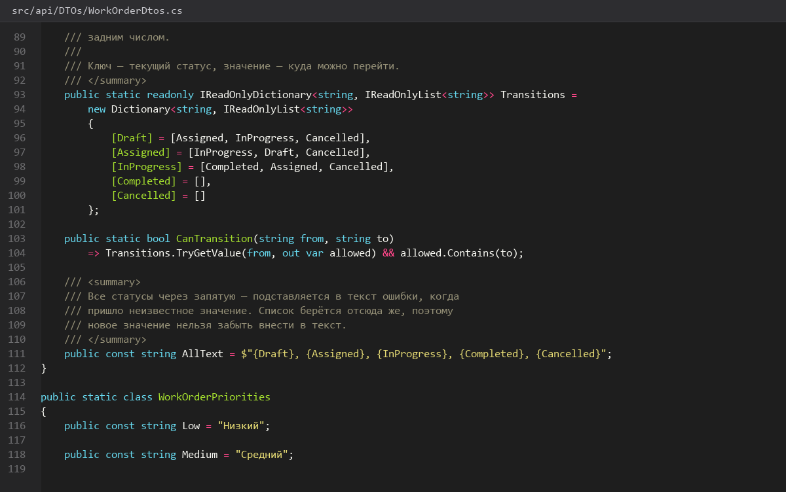
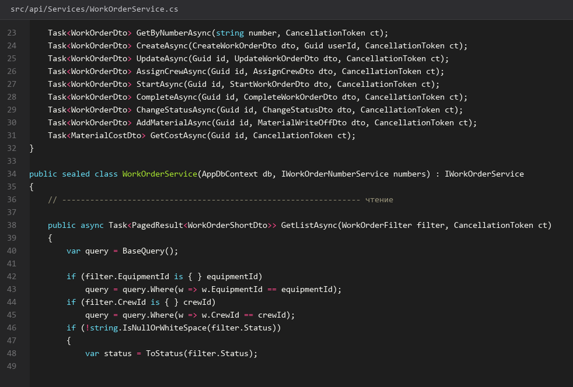
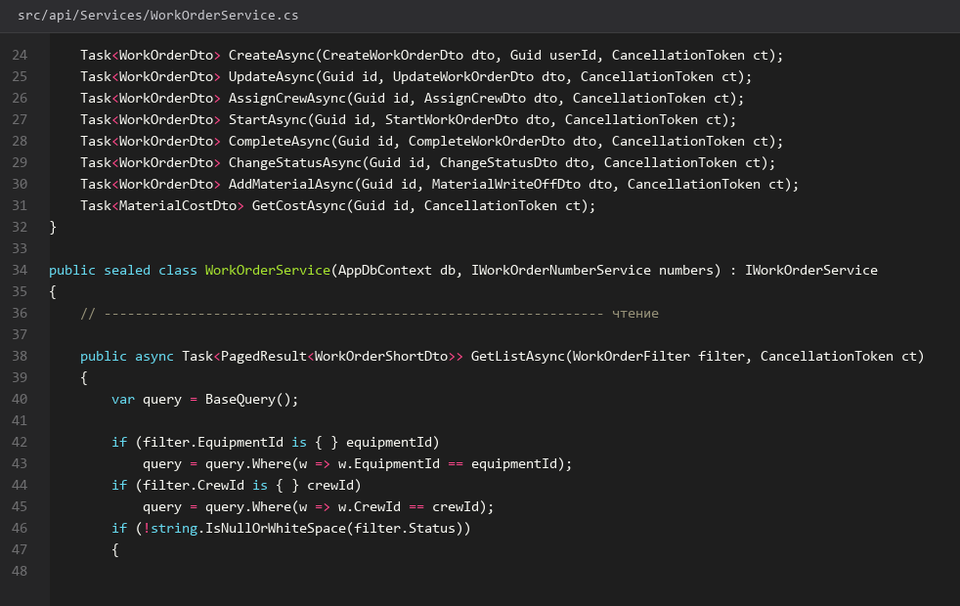
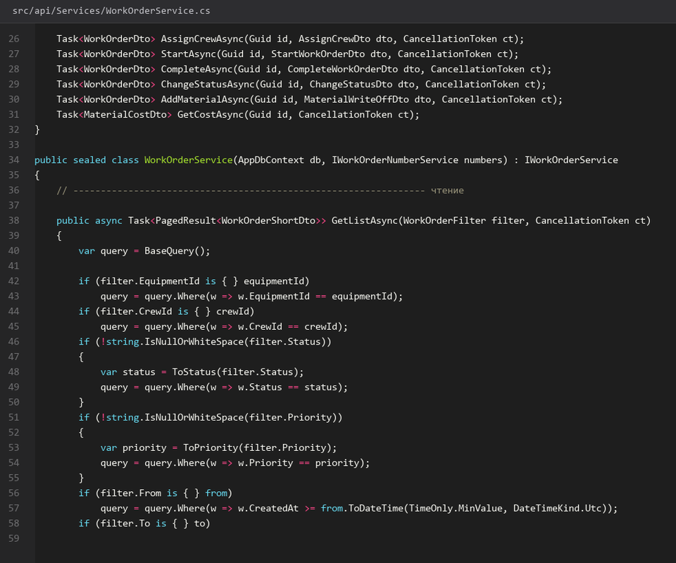
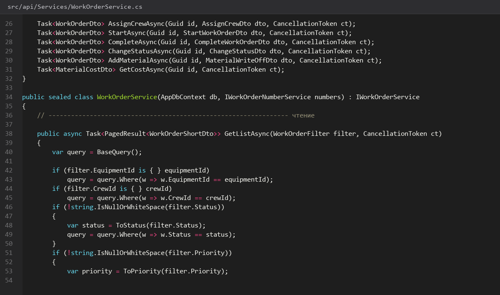

# Назначение-бригады-и-завершение

> Спринт 9. API: заявки — жизненный цикл · 140 мин · страница 21 из 54

Жизненный цикл заявки: «Черновик» → «Назначена» → «В работе» → «Завершена». Переходы фиксированы и проверяются на сервере, а простой считает функция базы `fn_calculate_downtime`.

**Итог страницы.** Четыре метода жизненного цикла, автоматический расчёт простоя, запрет недопустимых переходов.

| Критерий оценивания | Что закрывает страница |
|---|---|
| Б / API | Назначение бригад, завершение работ, списание материалов |

**Результат в репозитории:**

- `src/api/Controllers/WorkOrdersController.cs`
- `src/api/Services/WorkOrderService.cs`
- `src/api/Services/DowntimeService.cs`

## Шаг 1. Описываем переходы статусов — 30 мин

Переходы задаются словарём: разрешено только из текущего статуса в целевой. Попытка перепрыгнуть из «Черновика» в «Завершена» — ошибка 409 с пояснением.

**src/api/Services/WorkOrderService.cs**

```csharp
private static readonly Dictionary<WorkOrderStatus, WorkOrderStatus[]> Transitions = new()
{
    [WorkOrderStatus.Черновик] = [WorkOrderStatus.Назначена, WorkOrderStatus.Отменена],
    [WorkOrderStatus.Назначена] = [WorkOrderStatus.Вработе, WorkOrderStatus.Отменена],
    [WorkOrderStatus.Вработе] = [WorkOrderStatus.Завершена],
    [WorkOrderStatus.Завершена] = [],
    [WorkOrderStatus.Отменена] = []
};

if (!Transitions[order.Status].Contains(target))
    throw new ConflictException(
        $"Нельзя перевести заявку из «{order.Status}» в «{target}»", ErrorCode.Conflict);
```

> **Замечание.** Словарь переходов — это диаграмма Activity со страницы 04 в коде. Эксперты любят такое соответствие: спецификация и реализация совпадают.


*Граф переходов: 4 разрешённых, остальные дают 409*


## Шаг 2. Назначаем бригаду — 30 мин

При назначении меняем статус на «Назначена», пишем время реакции и сохраняем запись в журнал операций.

**src/api/Services/WorkOrderService.cs**

```csharp
public async Task<ApiResponse<WorkOrderDto>> AssignCrewAsync(Guid id, AssignCrewDto dto, CancellationToken ct)
{
    var order = await GetAsync(id, ct);
    EnsureTransition(order, WorkOrderStatus.Назначена);

    var crew = await _db.Crews.Include(c => c.Members)
        .FirstOrDefaultAsync(c => c.Id == dto.CrewId, ct)
        ?? throw new NotFoundException("Бригада не найдена");
    if (crew.Members.Count == 0)
        throw new ConflictException("В бригаде нет ни одного члена", ErrorCode.Conflict);

    order.CrewId = crew.Id;
    order.Status = WorkOrderStatus.Назначена;
    order.AssignedAt = DateTime.UtcNow;

    await _db.SaveChangesAsync(ct);
    _log.Write(order.Id, "Назначена бригада", crew.Name);
    return ApiResponse<WorkOrderDto>.Ok(order.ToDto(), $"Бригада «{crew.Name}» назначена");
}
```

> **Замечание.** Бригада без членов — это ошибка данных, а не пользователя: 409 правомернее, чем пустой список исполнителей на экране мастера.


*POST назначения: статус Назначена, assignedAt заполнен*


*POST назначения: статус Назначена, assignedAt заполнен*


## Шаг 3. Переводим заявку в работу — 25 мин

Фиксируем фактическое начало. Плановые даты при этом не меняются — по ним считается отклонение.

**src/api/Services/WorkOrderService.cs**

```csharp
order.Status = WorkOrderStatus.Вработе;
order.ActualStart = DateTime.UtcNow;

// оборудование переходит в ремонт
var eq = await _db.Equipment.FindAsync([order.EquipmentId], ct);
if (eq is not null && eq.Status == EquipmentStatus.Работает)
    eq.Status = EquipmentStatus.ВРемонте;

await _db.SaveChangesAsync(ct);
```

> **Замечание.** Статус оборудования меняется здесь же. Если забыть, дашборд покажет работающее оборудование с открытой заявкой — это сразу видно эксперту.


*Статус В работе, оборудование — В ремонте*


## Шаг 4. Завершаем и считаем простой — 35 мин

Фактическая дата окончания рассчитывает простой через функцию базы. Оборудование возвращается в работу, заявка — в «Завершена».

**src/api/Services/DowntimeService.cs**

```csharp
public async Task<ApiResponse<WorkOrderDto>> CompleteAsync(Guid id, CompleteWorkOrderDto dto, CancellationToken ct)
{
    var order = await GetAsync(id, ct);
    EnsureTransition(order, WorkOrderStatus.Завершена);

    order.ActualEnd = dto.ActualEnd;
    order.Result = dto.Result?.Trim();
    order.Status = WorkOrderStatus.Завершена;
    order.DowntimeHours = await _downtime.CalculateAsync(order.ActualStart, dto.ActualEnd, ct);

    var eq = await _db.Equipment.FindAsync([order.EquipmentId], ct);
    if (eq is not null) eq.Status = EquipmentStatus.Работает;

    await _db.SaveChangesAsync(ct);
    _log.Write(order.Id, "Завершена", $"Простой {order.DowntimeHours} ч");
    return ApiResponse<WorkOrderDto>.Ok(order.ToDto(), "Работы завершены");
}
```

> **Замечание.** Простой считается функцией базы, а не в C#. Так одна и та же формула работает в API, в отчёте и в SQL-запросе эксперта. Формула: `EXTRACT(EPOCH FROM (p_end - p_start)) / 3600`, округление до двух знаков.


*Завершена: простой 6,5 ч, оборудование снова Работает*


*Завершена: простой 6,5 ч, оборудование снова Работает*


## Шаг 5. Отменяем заявку — 20 мин

Отмена доступна из «Черновика» и «Назначена», обязательно с причиной. Причины попадают в журнал операций.

**src/api/Services/WorkOrderService.cs**

```csharp
if (!Transitions[order.Status].Contains(WorkOrderStatus.Отменена))
    throw new ConflictException("Отменить можно только черновик или назначенную заявку", ErrorCode.Conflict);

if (string.IsNullOrWhiteSpace(dto.Reason))
    throw new ValidationException("Причина отмены обязательна");

order.Status = WorkOrderStatus.Отменена;
order.CancelReason = dto.Reason;
await _db.SaveChangesAsync(ct);
```

> **Замечание.** Проверка причины идёт **до** проверки перехода — иначе клиент получит 409 про переход и не поймёт, что не так с причиной.


*Отмена из «В работе» даёт 409, из «Назначена» — 200*


*Отмена из «В работе» даёт 409, из «Назначена» — 200*


## Если что-то не получилось

| Симптом | Что делать |
|---|---|
| 409 при завершении заявки | она ещё не в статусе «В работе» — проверьте граф переходов |
| Простой считается в часах с дробью | округляйте до двух знаков: `Math.Round(h, 2)` |
| Простой отрицательный | фактическая дата окончания раньше начала — сработал триггер дат |
| Оборудование не вернулось в работу | забыли сбросить статус в `CompleteAsync` |

## Проверка

```bash
psql -h 127.0.0.1 -U toirprof -d toirprof -c "SELECT number, status, downtime_hours FROM work_orders WHERE status='Завершена' ORDER BY created_at DESC LIMIT 5;"
```

## Коммит

```bash
git add -A
git commit -m "feat(api): жизненный цикл заявки — назначение, начало, завершение, отмена"
```

---

[Заявки-создание-чтение-и-фильтры](20-Заявки-создание-чтение-и-фильтры.md) · [все спринты](Home) · [Бригады-и-члены-бригад](22-Бригады-и-члены-бригад.md)
