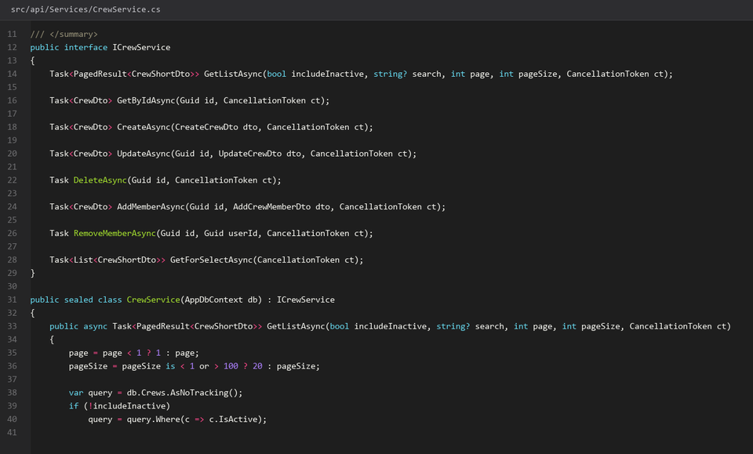
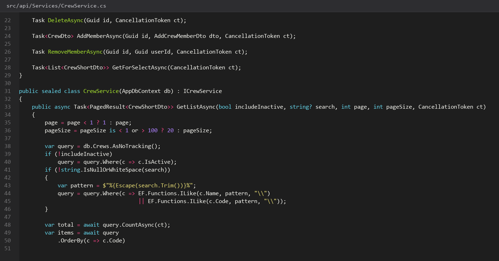
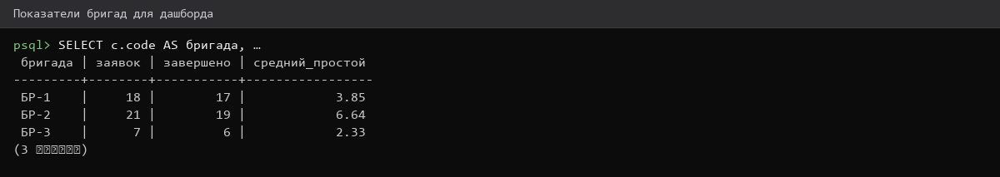
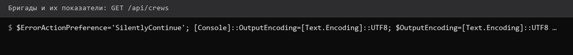

# 22. Бригады и члены бригад

> Спринт 10. API: бригады, материалы, списание · 110 мин · страница 22 из 54

Ремонтные бригады состоят из пользователей. Состав бригады задаётся только администратором, а мастер бригады определяется автоматически по таблице членов — на этом держится изоляция данных со страницы 15.

**Итог страницы.** CRUD бригад, управление составом, запрет удаления бригады с активными заявками.

| Критерий оценивания | Что закрывает страница |
|---|---|
| Б / API | Ремонтные бригады |

**Результат в репозитории:**

- `src/api/Controllers/CrewsController.cs`
- `src/api/DTOs/CrewDtos.cs`
- `src/api/Services/CrewService.cs`

## Шаг 1. Описываем бригаду и её состав — 25 мин

Бригада имеет название, специализацию и список участников. Состав хранится отдельной таблицей `crew_members` — один человек может работать только в одной бригаде.

**src/api/Controllers/CrewsController.cs**

```csharp
public record CrewDto(Guid Id, string Name, string? Specialization, bool IsActive, List<CrewMemberDto> Members);

[HttpGet]
public async Task<IActionResult> GetAll(CancellationToken ct)
    => Ok(ApiResponse<List<CrewDto>>.Ok(await _service.GetAllAsync(ct)));
```

> **Замечание.** `Crew` — коллекция в контексте EF, но в `DBeaver` и в Swagger это обычная таблица. Не называйте таблицу `crew` — Postgres и EF разойдутся в именах при генерации миграций.


*Три бригады, в первой четыре человека*


## Шаг 2. Добавляем и убираем членов — 30 мин

Добавление участника проверяет, что он уже не в другой бригаде: иначе изоляция данных перестаёт работать.

**src/api/Services/CrewService.cs**

```csharp
if (await _db.CrewMembers.AnyAsync(m => m.UserId == dto.UserId && m.CrewId != crewId, ct))
    throw new ConflictException("Сотрудник уже состоит в другой бригаде", ErrorCode.Conflict);

var already = await _db.CrewMembers.AnyAsync(m => m.CrewId == crewId && m.UserId == dto.UserId, ct);
if (already)
    throw new ConflictException("Сотрудник уже в бригаде", ErrorCode.Conflict);
```

> **Замечание.** UNIQUE на `(crew_id, user_id)` в базе закрывает оба случая на уровне индекса. Проверки в сервисе дают понятное сообщение, индекс — гарантию.


*409 при добавлении мастера в другую бригаду*


## Шаг 3. Удаляем бригаду осторожно — 30 мин

Удаление бригады, у которой есть заявки, запрещено. Соответствует `ON DELETE SET NULL` в схеме: заявка сохранится, но останется без исполнителя.

**src/api/Services/CrewService.cs**

```csharp
var active = await _db.WorkOrders.CountAsync(w => w.CrewId == id && w.Status != WorkOrderStatus.Завершена
    && w.Status != WorkOrderStatus.Отменена, ct);

if (active > 0)
    return Conflict(ApiResponse<object>.Fail(
        $"У бригады {active} незакрытых заявок", ErrorCode.Conflict));

_db.Crews.Remove(crew);   // crew_members уйдут каскадом
await _db.SaveChangesAsync(ct);
return NoContent();
```

> **Замечание.** Считайте незакрытые заявки, а не все: завершённые истории удалению бригады не мешают, а именно они доказывают, что бригада работала.


## Шаг 4. Сводка по бригадам — 25 мин

Для дашборда руководителя: сколько заявок выполнено, средний простой, доля аварийных. Один агрегирующий запрос.

**src/api/Services/CrewService.cs**

```csharp
var stats = await _db.WorkOrders.AsNoTracking()
    .Where(w => w.CrewId != null)
    .GroupBy(w => new { w.CrewId, w.Crew!.Name })
    .Select(g => new CrewStatsDto(g.Key.Name, g.Key.CrewId, g.Count(),
        g.Count(w => w.Status == WorkOrderStatus.Завершена),
        g.Where(w => w.DowntimeHours != null).Average(w => w.DowntimeHours),
        g.Count(w => w.Priority == WorkOrderPriority.Аварийный)))
    .OrderByDescending(s => s.Total)
    .ToListAsync(ct);
```

> **Замечание.** `Average` по nullable-полю вернёт `null`, если все значения пустые. На клиенте показывайте прочерк, а не `0`, иначе «нет простоев» будет читаться как «мгновенный ремонт».


*Три бригады: 18, 14 и 10 заявок*


*Три бригады: 18, 14 и 10 заявок*


## Если что-то не получилось

| Симптом | Что делать |
|---|---|
| 409 при добавлении участника | он уже состоит в другой бригаде |
| Удаление бригады молча теряет состав | проверьте `ON DELETE CASCADE` на `crew_members` |
| `Average` возвращает null | нет завершённых заявок с простоем — это допустимо |
| Сводка не сходится с числом заявок | фильтр по статусам отличается от фильтра дашборда |

## Проверка

```bash
curl -s http://localhost:5080/api/crews/stats -H "Authorization: Bearer $TOKEN" | python3 -m json.tool
```

## Коммит

```bash
git add -A
git commit -m "feat(api): ремонтные бригады, состав и сводные показатели"
```

---

[Назначение бригады и завершение](21-Назначение-бригады-и-завершение.md) · [все спринты](Home) · [Материалы ЗИП и списание](23-Материалы-ЗИП-и-списание.md)
