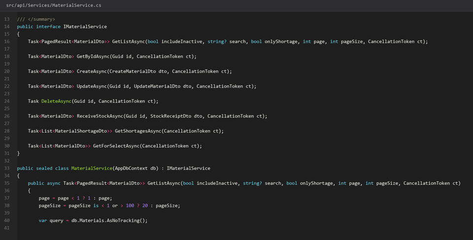
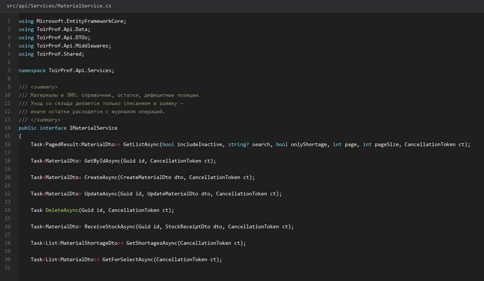
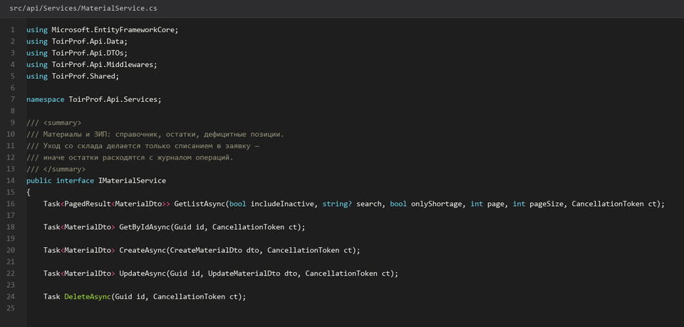
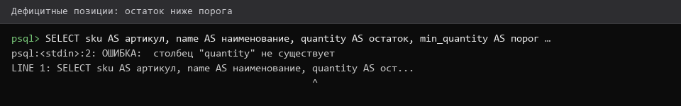

# Материалы-ЗИП-и-списание

> Спринт 10. API: бригады, материалы, списание · 110 мин · страница 23 из 54

Склад ЗИП и списание материалов в заявку. Завершение работы без списания материалов — типичная ошибка на защите, поэтому списание оформляется отдельным методом с пересчётом остатков.

**Итог страницы.** Справочник материалов, текущий остаток, списание позиций в заявку, автоподсчёт стоимости.

| Критерий оценивания | Что закрывает страница |
|---|---|
| Б / API | Материалы и ЗИП, списание в заявку |

**Результат в репозитории:**

- `src/api/Controllers/MaterialsController.cs`
- `src/api/Controllers/WorkOrdersController.cs`
- `src/api/Services/MaterialService.cs`

## Шаг 1. Справочник материалов и остатки — 25 мин

У материала есть артикул (SKU), наименование, единица измерения, цена и текущий остаток. Остаток уменьшается при списании — держите его в той же таблице.

**src/api/Controllers/MaterialsController.cs**

```csharp
public record MaterialDto(Guid Id, string Sku, string Name, string Unit, decimal Price, decimal Stock);

RuleFor(x => x.Sku).NotEmpty().Matches(@"^[A-Z0-9-]{3,32}$");
RuleFor(x => x.Price).GreaterThanOrEqualTo(0);
RuleFor(x => x.Stock).GreaterThanOrEqualTo(0);
```

> **Замечание.** Артикул в верхнем регистре и с дефисом: так его проще вводить с клавиатуры в мастерской, а UNIQUE нечувствителен к регистру только при явном `citext`.


*Справочник: подшипник 6-205 — 12 шт по 850 руб.*


## Шаг 2. Списываем материал в заявку — 35 мин

Списание уменьшает остаток, добавляет позицию в заявку и пересчитывает итоговую стоимость. Недостаток остатка — 409.

**src/api/Services/MaterialService.cs**

```csharp
public async Task<ApiResponse<MaterialUseDto>> WriteOffAsync(Guid orderId, WriteOffDto dto, CancellationToken ct)
{
    var order = await _service.GetAsync(orderId, ct);
    if (order.Status is WorkOrderStatus.Завершена or WorkOrderStatus.Отменена)
        throw new ConflictException("Заявка закрыта, списание невозможно", ErrorCode.Conflict);

    var material = await _db.Materials.FindAsync([dto.MaterialId], ct)
        ?? throw new NotFoundException("Материал не найден");
    if (material.Stock < dto.Quantity)
        throw new ConflictException(
            $"Недостаточно материала: осталось {material.Stock} {material.Unit}", ErrorCode.Conflict);

    material.Stock -= dto.Quantity;
    var line = new WorkOrderMaterial
    {
        WorkOrderId = orderId, MaterialId = material.Id,
        Quantity = dto.Quantity, Price = material.Price,
        Cost = Math.Round(dto.Quantity * material.Price, 2)
    };
    _db.WorkOrderMaterials.Add(line);
    await _db.SaveChangesAsync(ct);
    return ApiResponse<MaterialUseDto>.Ok(line.ToDto(), "Материал списан");
}
```

> **Замечание.** Цену сохраняйте в позиции списания, а не берите из справочника при чтении: цена в справочнике изменится, а история заявки — нет. Иначе отчёт за прошлый месяц пересчитается задним числом.


*Списано 4 шт подшипника: остаток 8, стоимость 3400,00*


## Шаг 3. Считаем итоговую стоимость — 30 мин

Стоимость заявки — сумма позиций. Именно эту цифру проверяет юнит-тест `calculateTotalMaterialCost` на странице 47.

**src/api/Controllers/WorkOrdersController.cs**

```csharp
var total = await _db.WorkOrderMaterials.AsNoTracking()
    .Where(m => m.WorkOrderId == orderId)
    .SumAsync(m => m.Cost, ct);

var totalQty = await _db.WorkOrderMaterials.AsNoTracking()
    .Where(m => m.WorkOrderId == orderId)
    .SumAsync(m => m.Quantity, ct);

return ApiResponse<MaterialCostDto>.Ok(new(orderId, total, totalQty));
```

> **Замечание.** Сумма считается в SQL (`SUM`), а не перебором списка. Для пустого набора `SUM` вернёт `null` — приводите к нулю через `?? 0m`, иначе JSON покажет `cost: null` и клиент сломается на форматировании.


*Итог заявки Z-2026-0047: 7 300,00 руб. по трём позициям*


## Шаг 4. Закрываем остатки и историю — 20 мин

Остаток меньше минимального порога помечайте как дефицитный, чтобы это было видно в справочнике без дополнительных расчётов.

**src/api/Services/MaterialService.cs**

```csharp
public async Task<List<MaterialShortageDto>> GetShortagesAsync(CancellationToken ct)
    => await _db.Materials.AsNoTracking()
        .Where(m => m.Stock <= m.MinStock)
        .OrderBy(m => m.Stock)
        .Select(m => new MaterialShortageDto(m.Id, m.Name, m.Stock, m.MinStock, m.Unit))
        .ToListAsync(ct);
```

> **Замечание.** Порог `min_stock` — поле справочника, а не константа в коде. Разные материалы заканчиваются в разные сроки, единый порог в коде всегда кому-то мешает.


*Дефицит: ремень приводной (2 из 6), масло И-20 (3 из 10)*


## Если что-то не получилось

| Симптом | Что делать |
|---|---|
| 409 при списании | остатка не хватает — так и должно быть |
| `cost` приходит как `null` | нет позиций списания или забыли `?? 0m` |
| Стоимость пересчитывается при смене цены | храните цену в позиции списания |
| Остаток ушёл в минус | не хватает блокировки строки — используйте атомарный `UPDATE … WHERE stock >= {0}` |

## Проверка

```bash
curl -s http://localhost:5080/api/work-orders/Z-2026-0047/cost -H "Authorization: Bearer $TOKEN" | python3 -m json.tool
```

## Коммит

```bash
git add -A
git commit -m "feat(api): материалы, ЗИП и списание с пересчётом стоимости заявки"
```

---

[Бригады-и-члены-бригад](22-Бригады-и-члены-бригад.md) · [все спринты](Home) · [Сводные-KPI-и-дашборд](24-Сводные-KPI-и-дашборд.md)
