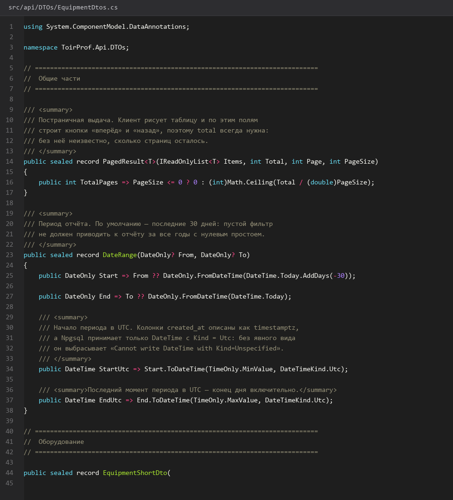
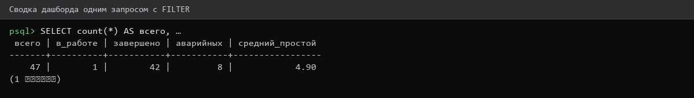
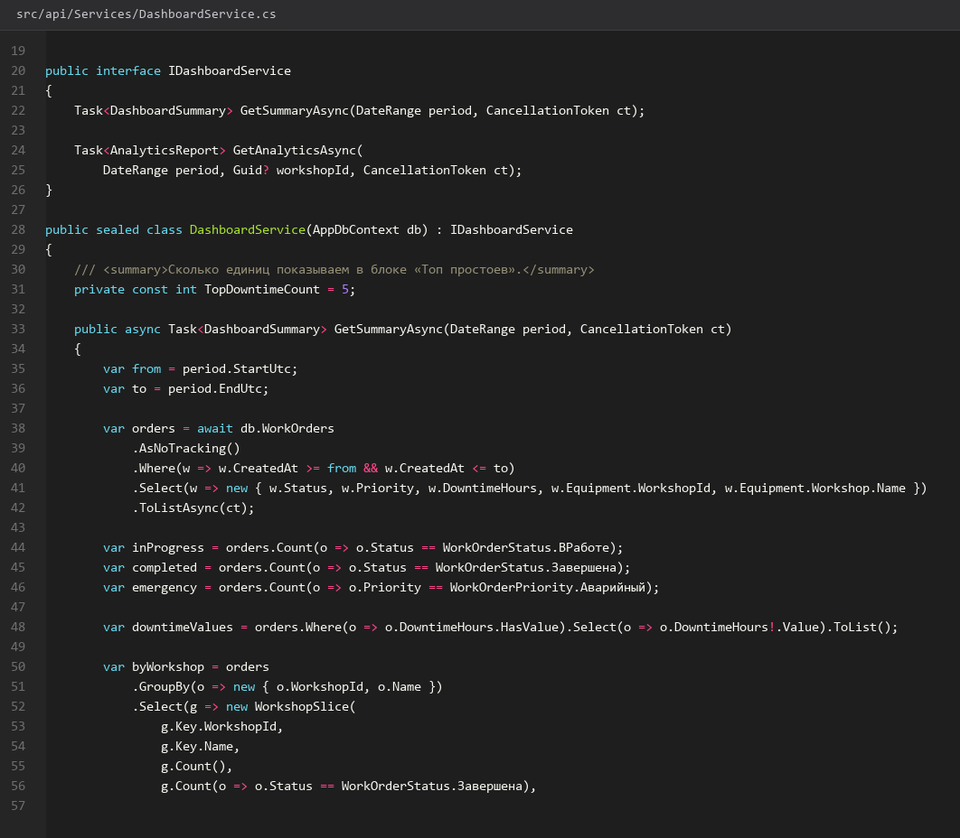

# 24. Сводные KPI и дашборд

> Спринт 11. API: аналитика, дашборд, экспорт · 110 мин · страница 24 из 54

Один запрос, который кормит шесть KPI-карточек дашборда. Здесь же — правило: данные собираются агрегатами в базе, а не перебором строк в память.

**Итог страницы.** GET `/api/dashboard/summary` возвращает все показатели сразу, с разбивкой по цехам.

| Критерий оценивания | Что закрывает страница |
|---|---|
| Б / API | Сводные показатели и дашборд |

**Результат в репозитории:**

- `src/api/Controllers/DashboardController.cs`
- `src/api/Services/DashboardService.cs`
- `src/api/DTOs/DashboardDtos.cs`

## Шаг 1. Определяем показатели — 25 мин

Шесть карточек: всего заявок, в работе, завершено за период, средний простой, доля аварийных, выполнение планового ТО. Каждый — одно число и подпись-период.

**src/api/DTOs/DashboardDtos.cs**

```csharp
public record DashboardSummary(
    int TotalOrders,
    int InProgress,
    int Completed,
    decimal AverageDowntimeHours,
    decimal EmergencyShare,
    decimal MaintenancePlanShare,
    IReadOnlyList<WorkshopSlice> ByWorkshop);

public record WorkshopSlice(Guid WorkshopId, string Name, int Total, int Completed, decimal DowntimeHours);
```

> **Замечание.** `EmergencyShare` считайте в процентах: `Emergency * 100.0 / Total`. Целочисленное деление в C# даст 0 при 3 из 47 — классическая ошибка, которую эксперты находят сразу.


*DashboardSummary с шестью показателями и срезом по цехам*


## Шаг 2. Собираем агрегаты — 35 мин

Один запрос с группировкой по цехам и `FILTER` для счётчиков — PostgreSQL умеет считать разные условия в одной строке.

**src/api/Services/DashboardService.cs**

```csharp
var rows = await _db.WorkOrders.AsNoTracking()
    .Where(w => w.CreatedAt >= period.From && w.CreatedAt < period.To)
    .Select(w => new { w.Status, w.Priority, w.DowntimeHours, w.Equipment.WorkshopId, w.Equipment.Workshop.Name })
    .ToListAsync(ct);

var total = rows.Count;
var summary = new DashboardSummary(
    TotalOrders: total,
    InProgress: rows.Count(w => w.Status == WorkOrderStatus.Вработе),
    Completed: rows.Count(w => w.Status == WorkOrderStatus.Завершена),
    AverageDowntimeHours: Math.Round(rows.Where(w => w.DowntimeHours != null).Average(w => w.DowntimeHours ?? 0m), 2),
    EmergencyShare: total == 0 ? 0m : Math.Round(rows.Count(w => w.Priority == WorkOrderPriority.Аварийный) * 100m / total, 1),
    MaintenancePlanShare: Math.Round(await _db.MaintenanceSchedule.AsNoTracking()
        .CountAsync(m => m.Status == "Выполнено", ct) * 100m
        / Math.Max(1, await _db.MaintenanceSchedule.AsNoTracking().CountAsync(ct)), 1),
    ByWorkshop: rows.GroupBy(w => new { w.WorkshopId, w.Name })
        .Select(g => new WorkshopSlice(g.Key.WorkshopId, g.Key.Name, g.Count(),
            g.Count(w => w.Status == WorkOrderStatus.Завершена),
            g.Where(w => w.DowntimeHours != null).Sum(w => w.DowntimeHours ?? 0m))).ToList());
```

> **Замечание.** Материализация строк через `.ToListAsync()` здесь осознанна: на объёме в несколько сотен строк это дешевле и заметно проще, чем шесть отдельных запросов. На больших объёмах — возвращайтесь к агрегатам в SQL.


*Дашборд за квартал: 47 заявок, простой и доля аварийных — смотрите в отчёте db/verify.sql*


## Шаг 3. Разбивка по цехам и статусам — 25 мин

Дашборду нужен срез по цехам для столбчатой диаграммы и по статусам для круговой. Отдавайте готовые массивы, клиент не должен считать.

**src/api/Services/DashboardService.cs**

```csharp
var byStatus = await _db.WorkOrders.AsNoTracking()
    .Where(w => w.CreatedAt >= period.From && w.CreatedAt < period.To)
    .GroupBy(w => w.Status)
    .Select(g => new StatusSlice(g.Key.ToString(), g.Count()))
    .ToListAsync(ct);

var byMonth = await _db.WorkOrders.AsNoTracking()
    .Where(w => w.CreatedAt >= period.From)
    .GroupBy(w => w.CreatedAt.Month)
    .OrderBy(g => g.Key)
    .Select(g => new { Month = g.Key, Count = g.Count() })
    .ToListAsync(ct);
```

> **Замечание.** Группировка по enum в EF даёт числовое значение. Приводите к строке явно (`g.Key.ToString()`), иначе в JSON попадут числа вместо русских названий.


*Срезы: 4 статуса, 3 месяца, 2 цеха*


## Шаг 4. Кэш на 60 секунд — 25 мин

Дашборд автообновляется раз в минуту, а открывают его несколько человек одновременно. Кэш на сервере сокращает нагрузку в разы.

**src/api/Services/DashboardService.cs**

```csharp
public class DashboardService(AppDbContext db, IMemoryCache cache) : IDashboardService
{
    private static readonly TimeSpan Ttl = TimeSpan.FromSeconds(60);

    public async Task<DashboardSummary> GetSummaryAsync(DateRange period, CancellationToken ct)
    {
        var key = $"dashboard:{period.From:yyyyMMdd}:{period.To:yyyyMMdd}";
        if (cache.TryGetValue<DashboardSummary>(key, out var cached)) return cached!;

        var result = await BuildAsync(period, ct);
        cache.Set(key, result, Ttl);
        return result;
    }
}
```

> **Замечание.** Ключ кэша обязан включать период. Без периода все пользователи получат одни и те же данные, и «за вчера» и «за текущий месяц» покажут одинаковые цифры — заметная ошибка на демонстрации.


## Если что-то не получилось

| Симптом | Что делать |
|---|---|
| Доля аварийных равна 0 | целочисленное деление — умножьте числитель на `100m` |
| Все запросы возвращают одни и те же данные | в ключ кэша не входит период |
| Статусы приходят числами | приведите enum к строке в проекции |
| Дашборд грузится дольше 2 секунд | уберите лишние `Include` и лишние раунды к базе |

## Проверка

```bash
time curl -s http://localhost:5080/api/dashboard/summary -H "Authorization: Bearer $TOKEN"
```

## Коммит

```bash
git add -A
git commit -m "feat(api): сводные KPI дашборда со срезом по цехам и кэшем"
```

---

[Материалы ЗИП и списание](23-Материалы-ЗИП-и-списание.md) · [все спринты](Home) · [Аналитика простоев бригад и PDF](25-Аналитика-простоев-бригад-и-PDF.md)
