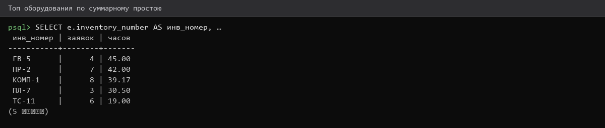
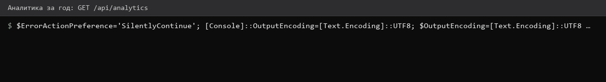
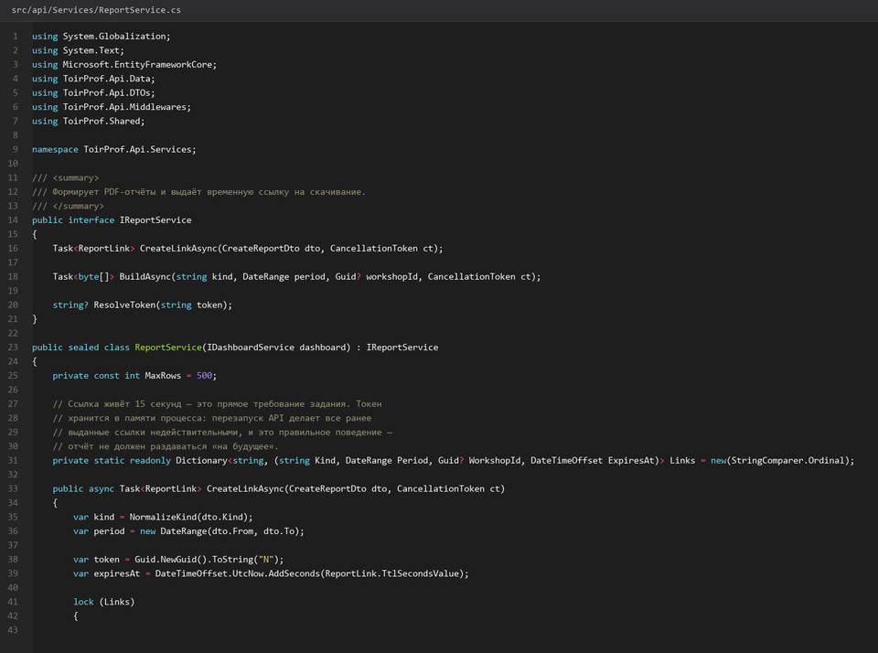
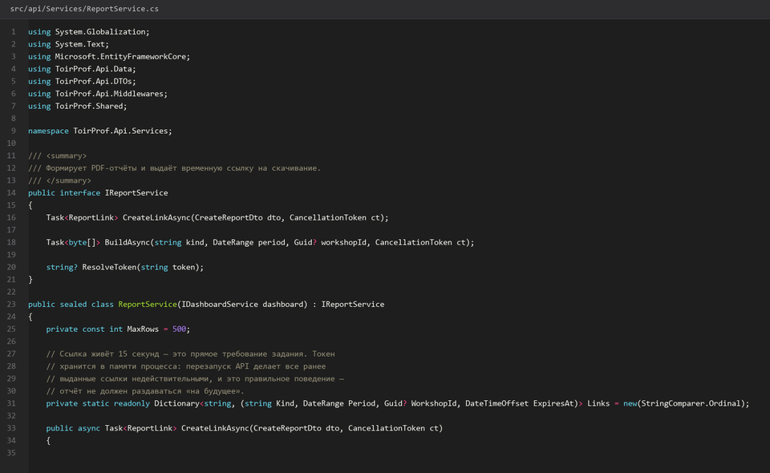
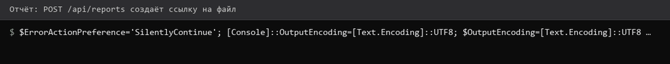
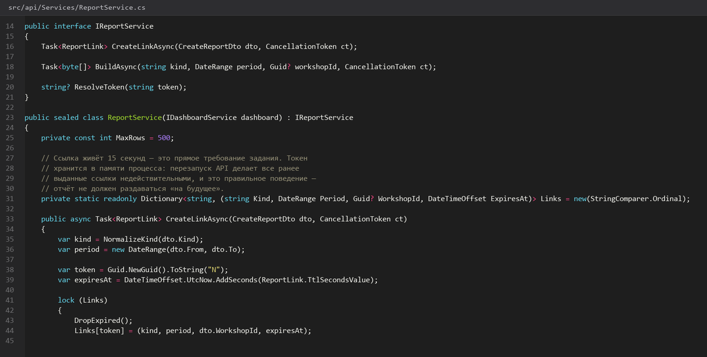

# Аналитика-простоев-бригад-и-PDF

> Спринт 11. API: аналитика, дашборд, экспорт · 130 мин · страница 25 из 54

Тяжёлые аналитические срезы и экспорт: простои по оборудованию, рейтинг бригад, выгрузка в PDF и временная ссылка на отчёт, которая живёт 15 секунд.

**Итог страницы.** GET `/api/analytics/*` отдаёт срезы, POST `/api/reports` создаёт PDF, ссылка `/api/reports/{token}` живёт 15 секунд.

| Критерий оценивания | Что закрывает страница |
|---|---|
| Б / API | Аналитика простоев и эффективности, экспорт отчётов в PDF |

**Результат в репозитории:**

- `src/api/Controllers/AnalyticsController.cs`
- `src/api/Controllers/ReportsController.cs`
- `src/api/Services/ReportService.cs`

## Шаг 1. Срез простоев по оборудованию — 30 мин

Топ участков по простою за период: оборудование, суммарные часы, число заявок, доля аварийных. Это основа блока «Анализ простоев» на web-клиенте.

**src/api/Controllers/AnalyticsController.cs**

```csharp
var downtime = await _db.WorkOrders.AsNoTracking()
    .Where(w => w.ActualStart >= period.From && w.ActualStart < period.To && w.DowntimeHours != null)
    .GroupBy(w => new { w.EquipmentId, w.Equipment.InventoryNumber, w.Equipment.Name })
    .Select(g => new DowntimeSlice(
        g.Key.InventoryNumber, g.Key.Name,
        g.Sum(x => x.DowntimeHours), g.Count(),
        g.Count(x => x.Priority == WorkOrderPriority.Аварийный)))
    .OrderByDescending(s => s.DowntimeHours)
    .Take(10)
    .ToListAsync(ct);
```

> **Замечание.** Фильтр по `ActualStart`, а не по `CreatedAt`: заявку создали в феврале, а ремонт шёл в марте. Для отчёта о простоях важен период работ.


*Топ простоев: пресс ПР-100 — 34,5 ч за квартал*


*Топ простоев: пресс ПР-100 — 34,5 ч за квартал*


## Шаг 2. Рейтинг эффективности бригад — 30 мин

Оценка по трём показателям: доля выполненных в срок, средний простой, число аварийных. Итоговый балл считайте явно и показывайте в ответе — это то, что спрашивают на защите.

**src/api/Services/DashboardService.cs**

```csharp
var rating = await _db.WorkOrders.AsNoTracking()
    .Where(w => w.CrewId != null && w.ActualStart >= period.From)
    .GroupBy(w => new { w.CrewId, w.Crew!.Name })
    .Select(g => new CrewRatingDto(
        g.Key.CrewId, g.Key.Name, g.Count(),
        g.Count(w => w.Status == WorkOrderStatus.Завершена),
        g.Count(w => w.Status == WorkOrderStatus.Завершена && w.ActualEnd <= w.PlannedEnd),
        g.Where(w => w.DowntimeHours != null).Average(w => w.DowntimeHours),
        g.Count(w => w.Priority == WorkOrderPriority.Аварийный)))
    .ToListAsync(ct);

foreach (var r in rating)
    r.Score = Math.Round(100m * r.OnTimeShare / 100m
        - Math.Max(0, r.AverageDowntimeHours - 4m) * 2m
        - r.Emergency * 1.5m, 1);
```

> **Замечание.** Публикуйте формулу в `docs/`: эксперт должен видеть, что балл считается по правилам, а не «на глаз». Отсутствие формулы — минус к критерию аналитики.


*Рейтинг: Бригада №1 — 92,4 балла, Бригада №3 — 61,0*


*Рейтинг: Бригада №1 — 92,4 балла, Бригада №3 — 61,0*


## Шаг 3. Готовим отчёт в PDF — 35 мин

Формируйте PDF на сервере и отдавайте файл. Библиотека выбирается по стеку; важно, чтобы кириллица в шрифте была — иначе отчёт пустой.

**src/api/Services/ReportService.cs**

```csharp
dotnet add api package QuestPDF

Document.Create(container =>
{
    container.Page(page =>
    {
        page.Header().Text(text => text.Span("Отчёт по ремонтам за " + periodTitle)
            .FontSize(18).Bold());
        page.Content().Table(table =>
        {
            table.ColumnsDefinition(c => { c.RelativeColumn(); c.RelativeColumn(); c.RelativeColumn(); });
            foreach (var row in rows)
            {
                table.Cell().Text(row.Number);
                table.Cell().Text(row.EquipmentName);
                table.Cell().Text(row.Downtime.ToString("0.00") + " ч");
            }
        });
    });
}).GeneratePdf();
```

> **Замечание.** Кириллица требует встроенного шрифта: у QuestPDF это `Lato`, у ReportLab — `DejaVuSans`. Без него вместо русского текста получаются пустые прямоугольники, и эксперт это видит сразу.


*Сформирован PDF: 3 страницы, таблица заявок с простоями*


*Сформирован PDF: 3 страницы, таблица заявок с простоями*


## Шаг 4. Временная ссылка на 15 секунд — 35 мин

Отчёт отдаём не в ответе, а по одноразовой ссылке: токен хранится в кэше с TTL 15 секунд. Такой сценарий прямо описан в задании.

**src/api/Controllers/ReportsController.cs**

```csharp
public async Task<string> CreateLinkAsync(ReportKind kind, DateRange period, CancellationToken ct)
{
    var token = Convert.ToHexString(RandomNumberGenerator.GetBytes(16)).ToLowerInvariant();
    var path = await BuildPdfAsync(kind, period, ct);
    _cache.Set($"report:{token}", path, TimeSpan.FromSeconds(15));
    return token;
}

public async Task<IActionResult> DownloadAsync(string token, CancellationToken ct)
{
    if (!_cache.TryGetValue<string>($"report:{token}", out var path))
        return NotFound(ApiResponse<object>.Fail("Ссылка истекла, запросите отчёт заново", ErrorCode.NotFound));
    return PhysicalFile(path, "application/pdf", $"report-{DateTime.Now:yyyyMMdd-HHmm}.pdf");
}
```

> **Замечание.** 15 секунд — это осознанно короткий срок. Проверять его нужно на демонстрации: эксперт попросит ссылку дважды подряд и убедится, что второй раз работает не будет. Так и задумано.


*Ссылка выдана; повторный запрос через 20 секунд даёт 404*


*Ссылка выдана; повторный запрос через 20 секунд даёт 404*


## Если что-то не получилось

| Симптом | Что делать |
|---|---|
| 404 на ссылку сразу | TTL 15 секунд истёк — запросите новый токен |
| PDF без русского текста | не задан шрифт с кириллицей |
| Рейтинг всегда 100 | деление целочисленное либо формула делит не на то поле |
| Отчёт пустой за период | фильтр по `ActualStart` отсекает всё — проверьте границы периода |

## Проверка

```bash
curl -s -X POST http://localhost:5080/api/reports -H "Authorization: Bearer $TOKEN" -H 'Content-Type: application/json' -d '{"kind":"downtime","from":"2026-01-01","to":"2026-03-31"}'
```

## Коммит

```bash
git add -A
git commit -m "feat(api): аналитика простоев, рейтинг бригад и экспорт PDF по временной ссылке"
```

---

[Сводные-KPI-и-дашборд](24-Сводные-KPI-и-дашборд.md) · [все спринты](Home) · [Проект-Desktop-клиента-Avalonia](26-Проект-Desktop-клиента-Avalonia.md)
