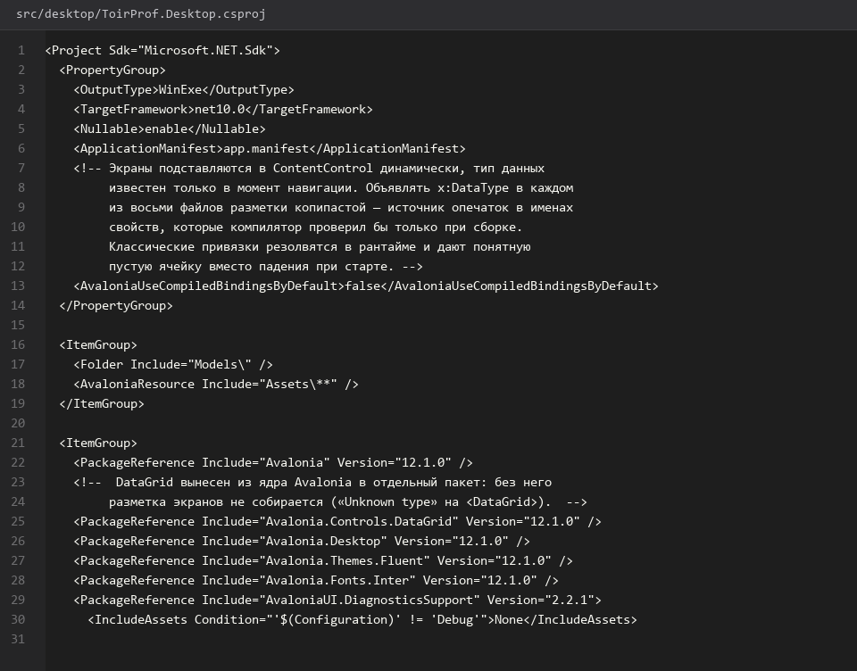
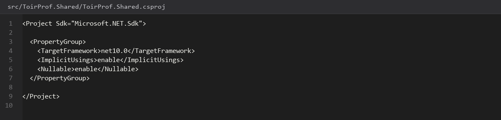
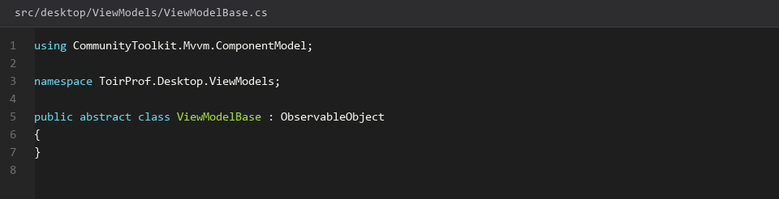
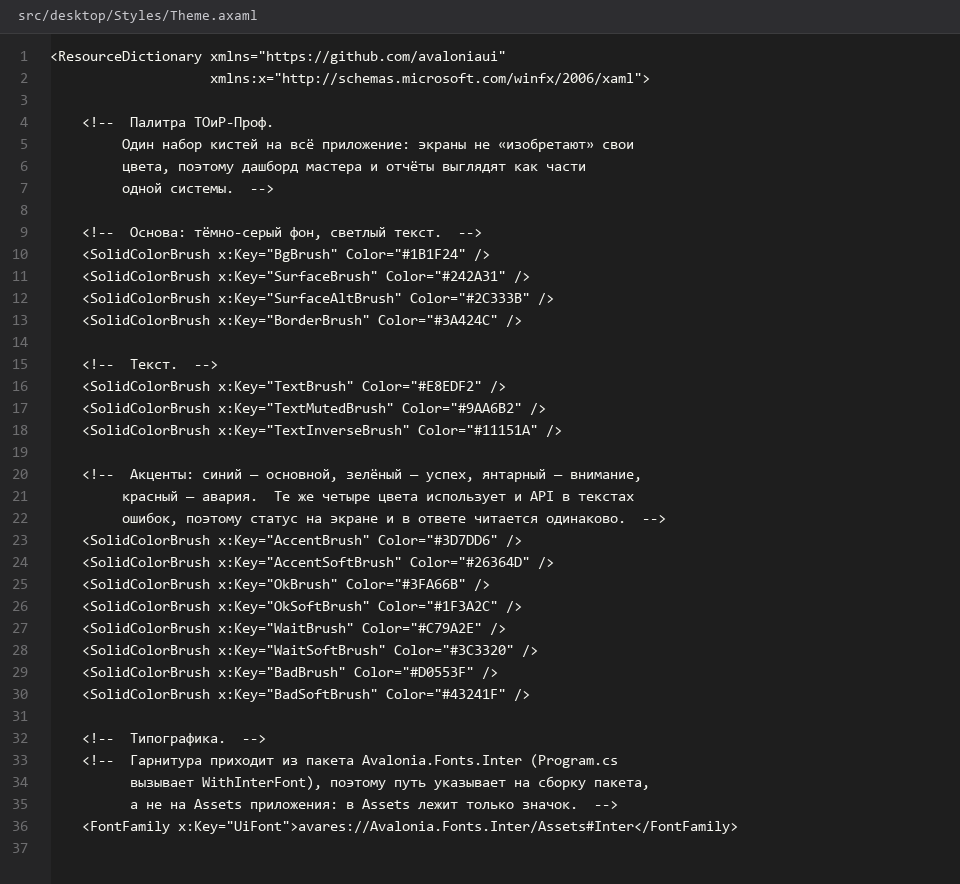
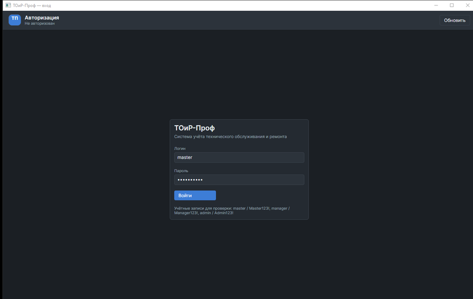
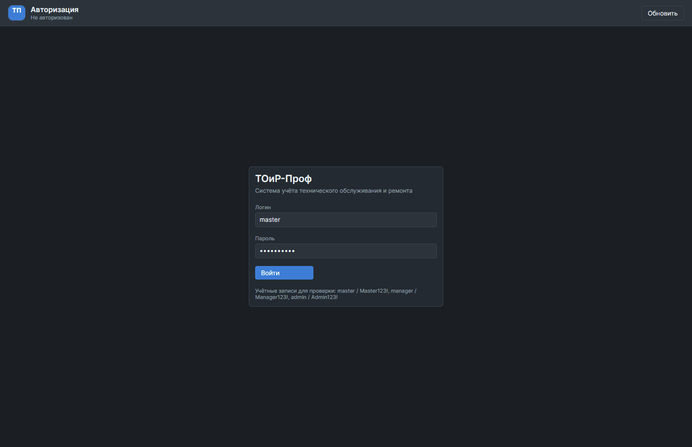

# 26. Проект Desktop клиента Avalonia

> Спринт 12. Desktop: каркас, навигация, авторизация · 150 мин · страница 26 из 54

Создаём нативное Avalonia-приложение: каркас MVVM, тема, DI и пустое окно, которое запускается и на Windows, и на РедОС. WebView в задании запрещён — клиент рисуем своими контролами и ходим в API по HTTP.

**Итог страницы.** Открывается окно приложения, в логе видно старт клиента; проект собирается командой одной строкой.

| Критерий оценивания | Что закрывает страница |
|---|---|
| Б / Desktop | Нативная реализация без WebView |
| Б / Desktop | Единый стиль оформления на всех экранах |

**Результат в репозитории:**

- `src/desktop/ToirProf.Desktop.csproj`
- `src/desktop/Program.cs`
- `src/desktop/App.axaml`
- `src/desktop/App.axaml.cs`
- `src/desktop/ViewModels/BaseViewModel.cs`
- `src/desktop/Styles/Theme.axaml`

## Шаг 1. Создаём проект Avalonia — 30 мин

Шаблон создаётся из корня репозитория, чтобы все проекты решения лежали рядом и собирались одним решением.

**src/desktop/ToirProf.Desktop.csproj**

```bash
dotnet new install Avalonia.Templates
dotnet new avalonia.app -n ToirProf.Desktop -o src/desktop -f net10.0
dotnet sln ToirProf.slnx add src/desktop/ToirProf.Desktop.csproj
```

> **Замечание.** Шаблон тянет за собой `ClassicDesktop` с окном и view. Если версия Avalonia в шаблоне старше 11, поставьте пакеты явно: `dotnet add package Avalonia --version 11.3.1`. На РедОС разница видна — старые сборки падают на отсутствующих иконках.


*csproj: Avalonia 11.3, ReactiveUI, CommunityToolkit.Mvvm*


## Шаг 2. Подключаем общие контракты — 25 мин

Формат ответа `{success, data, message, error_code}` и коды ошибок живут в общем проекте — их используют и API, и оба клиента.

**src/desktop/ToirProf.Desktop.csproj**

```xml
<ProjectReference Include="..\ToirProf.Shared\ToirProf.Shared.csproj" />
<PackageReference Include="Avalonia" Version="11.3.1" />
<PackageReference Include="Avalonia.Desktop" Version="11.3.1" />
<PackageReference Include="Avalonia.Themes.Fluent" Version="11.3.1" />
<PackageReference Include="Avalonia.ReactiveUI" Version="11.3.1" />
<PackageReference Include="CommunityToolkit.Mvvm" Version="8.4.0" />
<PackageReference Include="Refit" Version="8.0.0" />
```

> **Замечание.** Refit даёт описание REST-вызовов аннотациями — метод выглядит как обычная функция, а HTTP-детали генерируются. Для этого нужен один вызов `RefitClient.For<IApiService>()` в `App.axaml.cs`.


*Ссылка на ToirProf.Shared и пакеты Avalonia 11.3.1*


## Шаг 3. Пишем базовую ViewModel — 30 мин

Все экраны наследуют один базовый класс: команда, флаг загрузки и текст ошибки есть у каждого экрана, дублировать их не нужно.

**src/desktop/ViewModels/BaseViewModel.cs**

```csharp
public abstract partial class BaseViewModel : ObservableObject
{
    [ObservableProperty] private bool _isBusy;
    [ObservableProperty] private string _errorMessage = string.Empty;
    [ObservableProperty] private string _pageTitle = string.Empty;

    protected async Task RunAsync(Func<Task> action)
    {
        if (IsBusy) return;
        try
        {
            IsBusy = true;
            ErrorMessage = string.Empty;
            await action();
        }
        catch (ApiException ex)
        {
            ErrorMessage = ex.Message;
        }
        finally
        {
            IsBusy = false;
        }
    }
}
```

> **Замечание.** Проверка `if (IsBusy) return;` в начале `RunAsync` закрывает классическую проблему: пользователь дважды кликнул «Обновить» и получил два одинаковых запроса. На демонстрации это выглядит как «приложение зависло».


*BaseViewModel: IsBusy, ErrorMessage и защита от повторного входа*


## Шаг 4. Настраиваем тему и шрифты — 30 мин

Единая тема задаёт цвета, отступы и размеры шрифта один раз — потом все экраны выглядят одинаково.

**src/desktop/Styles/Theme.axaml**

```xml
<Styles xmlns="https://github.com/avaloniaui"
        xmlns:x="http://schemas.microsoft.com/winfx/2006/xaml">
  <Styles.Resources>
    <Color x:Key="BrandColor">#1F6FEB</Color>
    <Color x:Key="DangerColor">#C62828</Color>
    <x:Double x:Key="ControlHeight">44</x:Double>
  </Styles.Resources>

  <Style Selector="TextBlock">
    <Setter Property="FontSize" Value="14" />
  </Style>

  <Style Selector="Button">
    <Setter Property="MinHeight" Value="44" />
    <Setter Property="Padding" Value="16,8" />
  </Style>
</Styles>
```

> **Замечание.** Высота интерактивных элементов 44 px — требование дизайна и привычка мастеров. Меньше 40 px на ноутбуке с тачскрином приводит к промахам по кнопке.


*Окно с применённой темой: 1440×900, шрифт 14*


## Шаг 5. Собираем и запускаем — 35 мин

Первая проверка: проект собирается и открывает окно без ошибок.

**src/desktop/**

```bash
dotnet build src/desktop/ToirProf.Desktop.csproj -c Release
dotnet run --project src/desktop/ToirProf.Desktop.csproj
```

> **Замечание.** На РедОС окно может не появиться, если не установлен `libx11` и шрифты. Проверяйте `dotnet run` в Git Bash с активной сессией графического окружения — по SSH без X11 окно не откроется, но проект при этом собирается и это уже половина проверки.


*Пустое окно приложения запущено*


*Пустое окно приложения запущено*


## Если что-то не получилось

| Симптом | Что делать |
|---|---|
| Не найден `ToirProf.Shared.csproj` | проект общих контрактов ещё не добавлен в решение |
| Окно не открывается на РедОС | поставьте `libx11` и шрифты через `dnf`, проверьте `dotnet build` |
| Ошибка загрузки темы Fluent | не подключён пакет `Avalonia.Themes.Fluent` или не добавлен в `App.axaml` |
| Двойной клик шлёт два запроса | добавьте проверку `IsBusy` в `RunAsync` |

## Проверка

```bash
dotnet build src/desktop/ToirProf.Desktop.csproj -c Release
```

## Коммит

```bash
git add -A
git commit -m "feat(desktop): каркас Avalonia-приложения с MVVM, темой и общей обёрткой ответа"
```

---

[Аналитика простоев бригад и PDF](25-Аналитика-простоев-бригад-и-PDF.md) · [все спринты](Home) · [Оболочка навигация и авторизация](27-Оболочка-навигация-и-авторизация.md)
