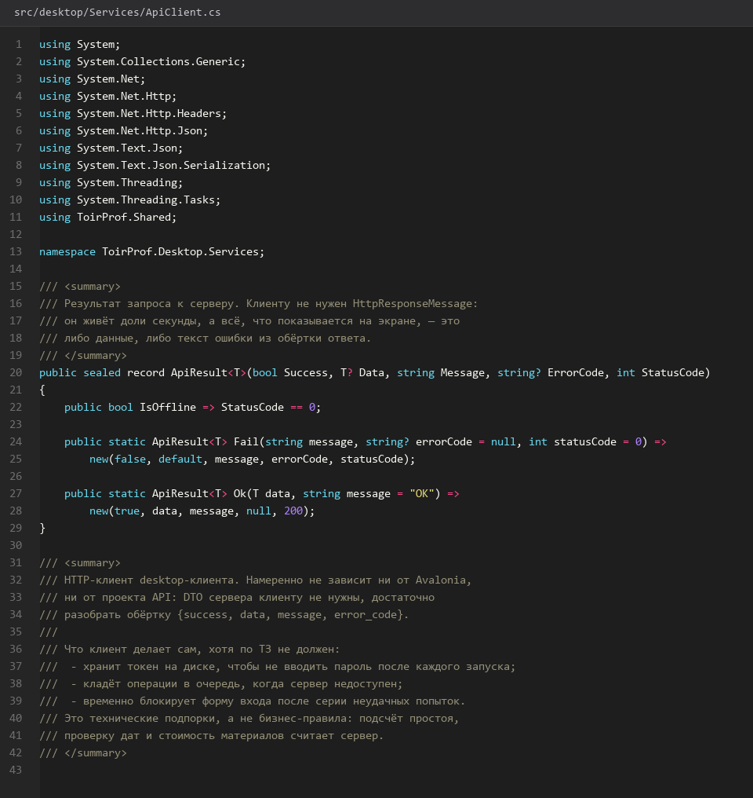
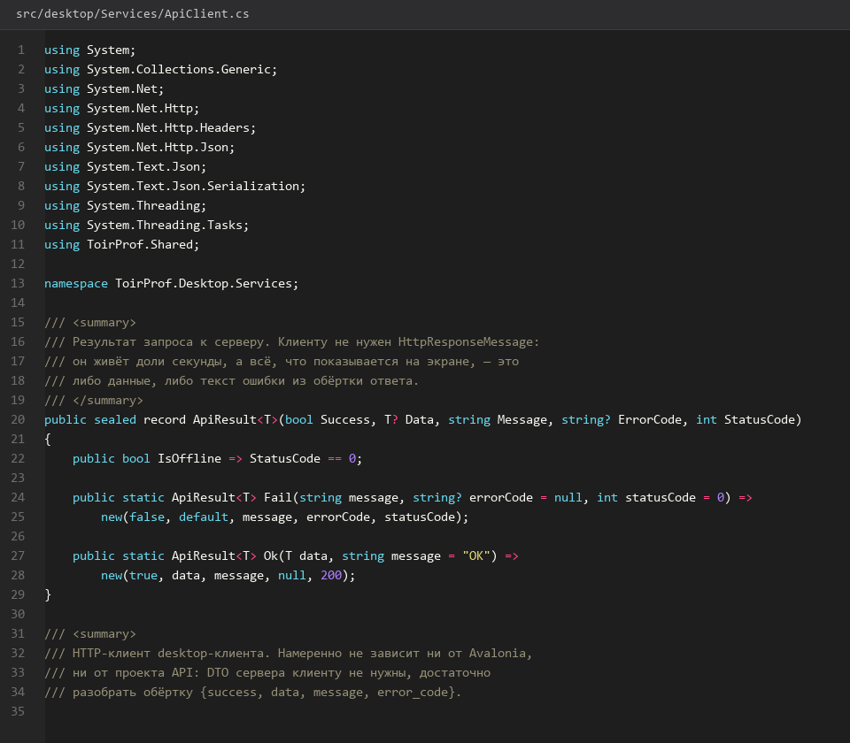
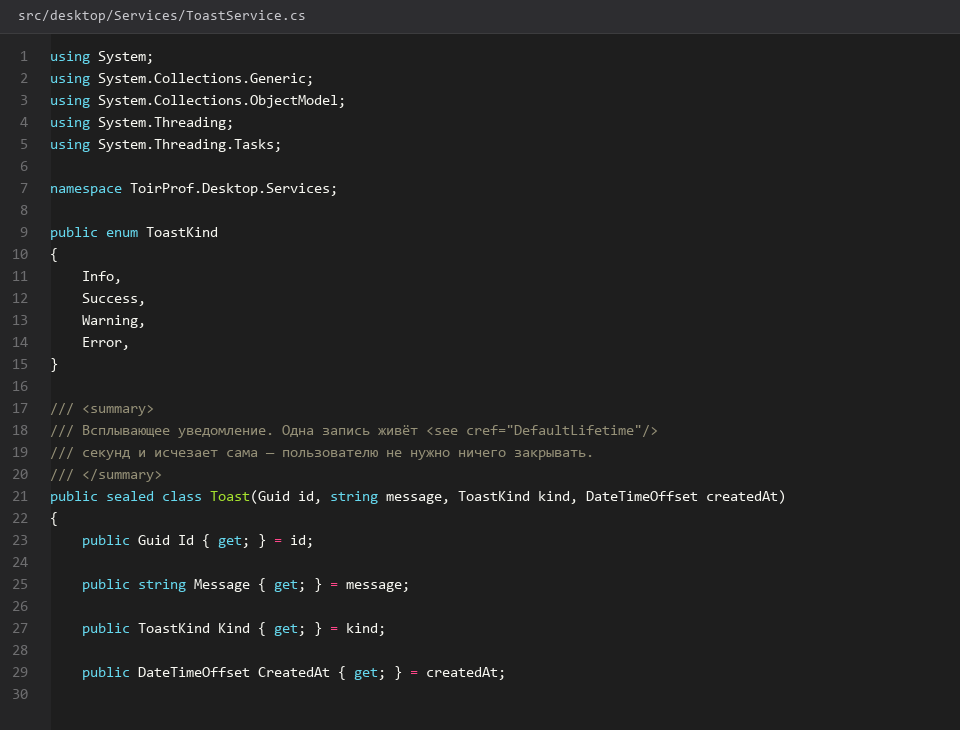
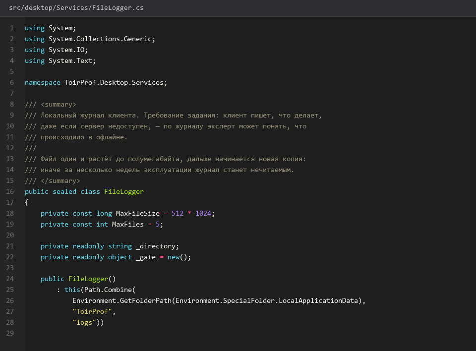

# HTTP-клиент-токены-и-состояния

> Спринт 12. Desktop: каркас, навигация, авторизация · 140 мин · страница 28 из 54

Единая точка общения с сервером: подстановка токена, разбор обёртки `{success, data, message, error_code}`, единый индикатор загрузки, тосты и локальный журнал. Бизнес-логики здесь нет — только транспорт.

**Итог страницы.** Любой экран получает данные одной командой, ошибки приходят в toast, все обращения записаны в локальный журнал.

| Критерий оценивания | Что закрывает страница |
|---|---|
| Б / Desktop | Обращение к API по REST без WebView |
| Б / Desktop | Асинхронность с индикатором загрузки |
| Б / Desktop | Уведомления об ошибках |
| Б / Desktop | Локальное логирование |

**Результат в репозитории:**

- `src/desktop/Services/ApiClient.cs`
- `src/desktop/Services/IApiService.cs`
- `src/desktop/Services/ToastService.cs`
- `src/desktop/Services/FileLogger.cs`
- `src/desktop/Controls/ToastHost.axaml`
- `src/desktop/ViewModels/DashboardViewModel.cs`

## Шаг 1. Описываем контракт вызовов — 30 мин

Интерфейс с методами по одному на экран. Реализация — одна, подменять её в тестах можно заглушкой.

**src/desktop/Services/IApiService.cs**

```csharp
public interface IApiService
{
    Task<ApiResponse<IReadOnlyList<EquipmentDto>>> GetEquipmentAsync(string? search, int page, int pageSize, CancellationToken ct);
    Task<ApiResponse<WorkOrderDto>> GetWorkOrderAsync(string number, CancellationToken ct);
    Task<ApiResponse<WorkOrderDto>> AssignCrewAsync(string number, Guid crewId, CancellationToken ct);
    Task<ApiResponse<WorkOrderDto>> CompleteAsync(string number, CompleteWorkOrderRequest body, CancellationToken ct);
    Task<ApiResponse<DashboardSummaryDto>> GetDashboardAsync(DateRange period, CancellationToken ct);
    Task<string> LoginAsync(string login, string password, CancellationToken ct);
}
```

> **Замечание.** Один интерфейс на всё приложение проще, чем пять-шесть подтипов. При росте числа вызовов разложите по доменам, но не раньше — на защите это выглядит как усложнение без выгоды.


*Интерфейс из шести методов — по одному на экран*


## Шаг 2. Разбор обёртки ответа — 30 мин

Сервер всегда отвечает одной структурой. Клиент обязан смотреть на `success`, а не на HTTP-код: 200 с `success: false` — это бизнес-ошибка.

**src/desktop/Services/ApiClient.cs**

```csharp
public async Task<ApiResponse<T>> SendAsync<T>(HttpRequestMessage request, CancellationToken ct)
{
    request.Headers.Authorization = new AuthenticationHeaderValue("Bearer", _tokens.Token);

    var response = await _http.SendAsync(request, ct);
    var payload = await response.Content.ReadFromJsonAsync<ApiResponse<T>>(cancellationToken: ct);

    _logger.Info($"{request.Method} {request.RequestUri} -> {(int)response.StatusCode} success={payload?.Success}");

    if (payload is null)
        return ApiResponse<T>.Fail("Сервер вернул пустой ответ", ErrorCode.InternalError);

    return response.IsSuccessStatusCode && payload.Success
        ? payload
        : ApiResponse<T>.Fail(payload.Message, payload.ErrorCode ?? response.StatusCode.ToString());
}
```

> **Замечание.** Проверка `payload.Success` отдельно от кода ответа — обязательна. Один забытый случай даёт «успешный» экран с пустыми данными вместо сообщения об ошибке.


*Вызов дашборда: 200 с success=true, затем 401*


## Шаг 3. Toasts и модальные окна ошибок — 25 мин

Короткие уведомления — для успеха и предупреждений, модальное окно — когда действие не выполнено.

**src/desktop/Services/ToastService.cs**

```csharp
public sealed class ToastService
{
    private readonly List<ToastItem> _items = [];

    public IReadOnlyList<ToastItem> Items => _items;

    public void Show(string text, ToastKind kind = ToastKind.Info)
    {
        var item = new ToastItem(Guid.NewGuid(), text, kind);
        _items.Add(item);
        ItemsChanged?.Invoke();
        _ = Task.Delay(TimeSpan.FromSeconds(4)).ContinueWith(_ =>
        {
            _items.Remove(item);
            ItemsChanged?.Invoke();
        });
    }
}
```

> **Замечание.** Уведомление живёт 4 секунды. Ошибку 409 («бригада уже занята») нужно показать модальным окном — иначе она исчезнет раньше, чем мастер её прочитает.


*Toast снизу справа и модальное окно ошибки 409*


## Шаг 4. Индикатор загрузки — 25 мин

Пока идёт запрос — кнопки блокируются, в верхней панели горит индикатор. Экран не должен «моргать» пустыми данными.

**src/desktop/Views/MainWindow.axaml**

```xml
<Grid>
  <TransitioningContentControl>
    <ContentControl Content="{Binding ViewModel}" />
  </TransitioningContentControl>

  <Border Background="#66000000" IsVisible="{Binding IsBusy}" />
  <ProgressBar IsIndeterminate="True" IsVisible="{Binding IsBusy}"
               VerticalAlignment="Top" Height="3" />
</Grid>
```

> **Замечание.** Прозрачная затемняющая подложка поверх старых данных лучше пустого экрана: пользователь видит, что это обновление, а не новая страница.


## Шаг 5. Локальный журнал — 30 мин

Каждый вызов и каждая ошибка пишутся в файл рядом с приложением. На демонстрации журнал часто выручает, когда эксперт просит показать историю сбоя.

**src/desktop/Services/FileLogger.cs**

```csharp
public sealed class FileLogger
{
    private readonly string _path = Path.Combine(
        Environment.GetFolderPath(Environment.SpecialFolder.LocalApplicationData),
        "toirprof", "desktop.log");

    public void Info(string message) => Append("INFO", message);
    public void Error(string message, Exception? ex = null) => Append("ERROR", $"{message} {ex}");

    private void Append(string level, string message)
    {
        Directory.CreateDirectory(Path.GetDirectoryName(_path)!);
        File.AppendAllText(_path, $"{DateTime.Now:yyyy-MM-dd HH:mm:ss} [{level}] {message}{Environment.NewLine}");
    }
}
```

> **Замечание.** Ротацию журнала делайте по размеру файла, а не по дате: на демонстрации за день набегает несколько мегабайт, и открытый на сортировку файл с миллионом строк тормозит саму проверку.


*Строки журнала: 200, 401, 500 с кодом и сообщением*


## Если что-то не получилось

| Симптом | Что делать |
|---|---|
| Данные не появляются | проверьте `payload.Success` — возможно, пришёл `success: false` с кодом 200 |
| 401 на каждом запросе | токен не подставляется: проверьте `AuthenticationHeaderValue` |
| Toast не исчезает | таймер удаления работает, но `ItemsChanged` не вызывается в UI-потоке |
| Журнал не создаётся | нет прав на каталог — используйте `LocalApplicationData` |

## Проверка

```bash
grep -c "INFO\|ERROR" "$HOME/.local/share/toirprof/desktop.log"
```

## Коммит

```bash
git add -A
git commit -m "feat(desktop): HTTP-клиент, разбор обёртки ответа, toast и локальный журнал"
```

---

[Оболочка-навигация-и-авторизация](27-Оболочка-навигация-и-авторизация.md) · [все спринты](Home) · [Дашборд-мастера](29-Дашборд-мастера.md)
