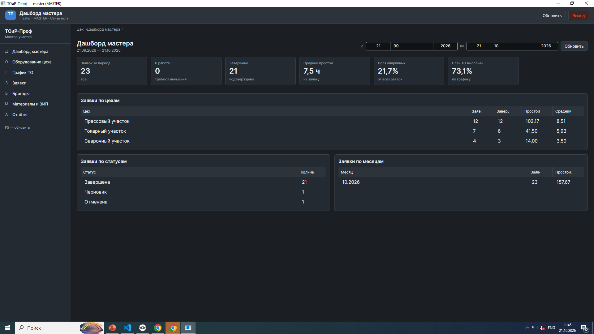
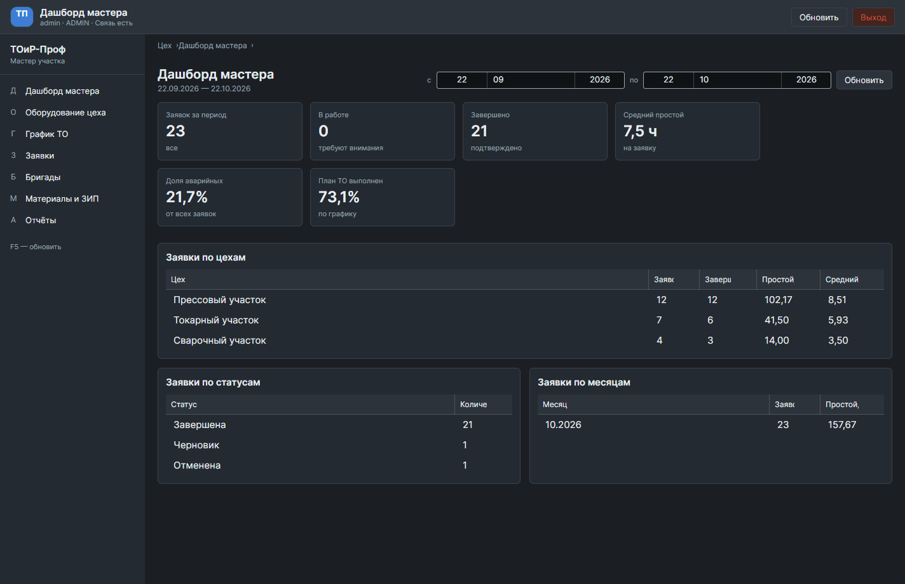
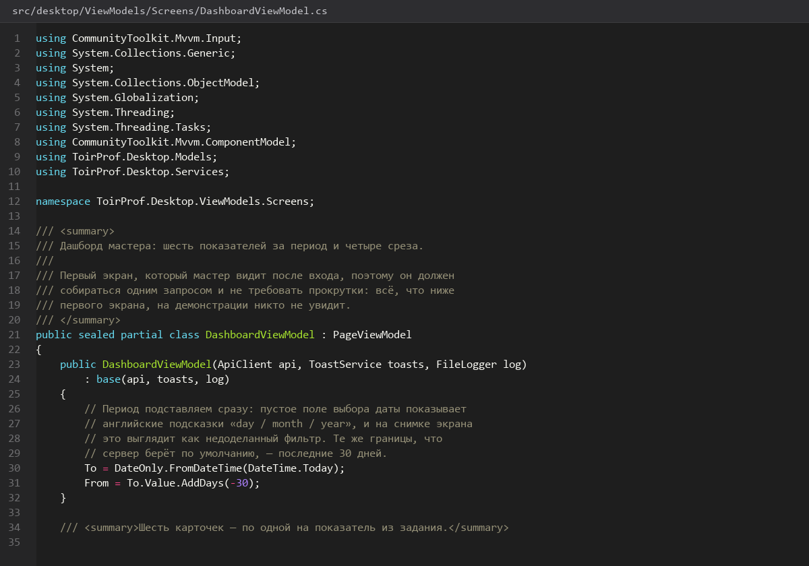
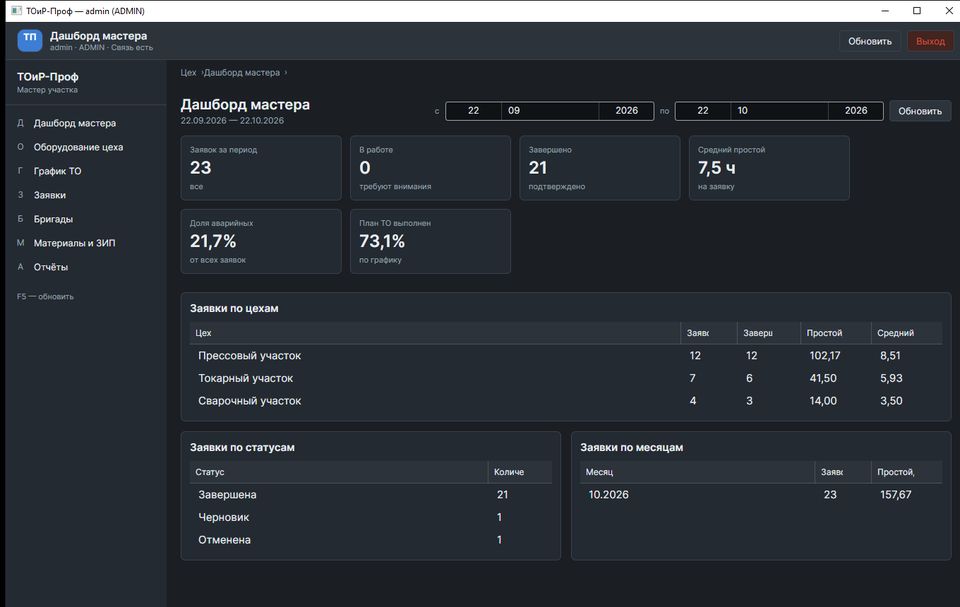
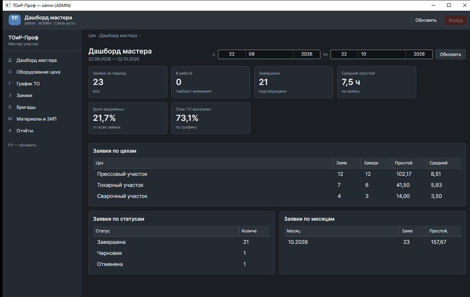

# Дашборд-мастера

> Спринт 13. Desktop: дашборд мастера · 140 мин · страница 29 из 54

Первый экран после входа: что мастер должен увидеть за секунду — сколько заявок в работе, сколько просрочено, какой простой за смену. Данные приходят одним запросом с дашборда.

**Итог страницы.** Дашборд открывается за один запрос и показывает показатели, ближайшие заявки и статусы без пагинации.

| Критерий оценивания | Что закрывает страница |
|---|---|
| Б / Desktop | Дашборд с ключевыми показателями |

**Результат в репозитории:**

- `src/desktop/Views/DashboardView.axaml`
- `src/desktop/Views/DashboardView.axaml.cs`
- `src/desktop/ViewModels/DashboardViewModel.cs`
- `src/desktop/Controls/MetricCard.axaml`

## Шаг 1. Карточки показателей — 35 мин

Шесть карточек в две строки по три. Значение крупно, подпись поясняет период — иначе «47» без контекста ничего не значит.

**src/desktop/Views/DashboardView.axaml**

```xml
<ItemsControl ItemsSource="{Binding Metrics}">
  <ItemsControl.ItemsPanel>
    <ItemsPanelTemplate>
      <WrapPanel ItemWidth="260" Margin="0,0,16,16" />
    </ItemsPanelTemplate>
  </ItemsControl.ItemsPanel>
  <ItemsControl.ItemTemplate>
    <DataTemplate>
      <Border Classes="card" Padding="16">
        <StackPanel Spacing="4">
          <TextBlock Text="{Binding Title}" Opacity="0.7" />
          <TextBlock Text="{Binding Value}" FontSize="32" FontWeight="SemiBold" />
          <TextBlock Text="{Binding Caption}" FontSize="12" Opacity="0.6" />
        </StackPanel>
      </Border>
    </DataTemplate>
  </ItemsControl.ItemTemplate>
</ItemsControl>
```

> **Замечание.** Подпись под числом обязательна: «6,3 ч» — это простой за март или за смену? Без подписи эксперт спросит, и вы задумаетесь.


*Шесть KPI-карточек после загрузки дашборда*


*Шесть KPI-карточек после загрузки дашборда*


## Шаг 2. Загрузка одним запросом — 30 мин

ViewModel просит дашборд и раскладывает ответ по карточкам. Никаких параллельных вызовов на каждую карточку.

**src/desktop/ViewModels/DashboardViewModel.cs**

```csharp
public partial class DashboardViewModel : BaseViewModel
{
    [ObservableProperty] private IReadOnlyList<MetricCardVm> _metrics = [];
    [ObservableProperty] private IReadOnlyList<WorkOrderDto> _nextOrders = [];

    public DashboardViewModel(IApiService api, ToastService toasts) : base(api, toasts) { }

    public override async Task InitializeAsync(CancellationToken ct)
    {
        await RunAsync(async () =>
        {
            var response = await _api.GetDashboardAsync(DateRange.ThisMonth, ct);
            if (!response.Success) { ShowError(response); return; }

            var d = response.Data!;
            Metrics =
            [
                new("Заявок за месяц", d.TotalOrders.ToString(), $"за {DateTime.Now:MMMM yyyy}"),
                new("В работе", d.InProgress.ToString(), "требуют внимания мастера"),
                new("Завершено", d.Completed.ToString(), "закрыто за период"),
                new("Средний простой", $"{d.AverageDowntimeHours:0.0} ч", "на одну заявку"),
                new("Аварийные", $"{d.EmergencyShare:0.0} %", "доля от всех заявок"),
                new("План ТО", $"{d.MaintenancePlanShare:0.0} %", "выполнение графика"),
            ];
            NextOrders = await _api.GetWorkOrdersAsync("Назначена", 1, 5, ct).Data ?? [];
        });
    }
}
```

> **Замечание.** Форматирование `0.0` применяйте в клиенте, а не на сервере. Сервер отдаёт число, формат — дело языка интерфейса: русская локаль ставит запятую, английская — точку.


*DashboardViewModel раскладывает шесть показателей*


## Шаг 3. Ближайшие заявки и статусы — 30 мин

Справа от карточек — пять заявок в работе и полоса распределения по статусам. Это отвечает на вопрос «что делать дальше».

**src/desktop/Views/DashboardView.axaml**

```xml
<Grid ColumnDefinitions="2*,*">
  <TextBlock Grid.Column="0" Text="Ближайшие заявки" FontSize="18" FontWeight="SemiBold" />
  <ItemsControl Grid.Column="0" Grid.Row="1" ItemsSource="{Binding NextOrders}" Margin="0,12,0,0">
    <ItemsControl.ItemTemplate>
      <DataTemplate>
        <Grid ColumnDefinitions="120,*,110" Margin="0,0,0,8">
          <TextBlock Text="{Binding Number}" />
          <TextBlock Grid.Column="1" Text="{Binding EquipmentName}" />
          <TextBlock Grid.Column="2" Text="{Binding Status}" HorizontalAlignment="Right" />
        </Grid>
      </DataTemplate>
    </ItemsControl.ItemTemplate>
  </ItemsControl>

  <TextBlock Grid.Column="1" Text="По статусам" FontSize="18" FontWeight="SemiBold" />
</Grid>
```

> **Замечание.** Пять строк, не двадцать. Дашборд — это входная точка, а не таблица; полный список живёт на своём экране.


*Список заявок в работе и распределение по статусам*


*Список заявок в работе и распределение по статусам*


## Шаг 4. Пустое состояние — 20 мин

Если заявок нет — не пустая таблица, а объяснение и подсказка, что делать.

**src/desktop/Views/DashboardView.axaml**

```xml
<StackPanel IsVisible="{Binding IsEmpty}" Spacing="8" HorizontalAlignment="Center" Margin="0,60,0,0">
  <TextBlock Text="На сегодня заявок нет" FontSize="18" HorizontalAlignment="Center" />
  <TextBlock Text="Новые заявки появятся здесь сразу после создания мастером"
             Opacity="0.7" HorizontalAlignment="Center" />
</StackPanel>
```

> **Замечание.** Пустое состояние — тоже демонстрация. Эксперты специально проверяют его на свежей базе без данных.


*Пустое состояние дашборда*


## Шаг 5. Кнопка обновления — 25 мин

Обновление по кнопке и автоматически раз в минуту, с индикатором.

**src/desktop/ViewModels/DashboardViewModel.cs**

```csharp
public override async Task InitializeAsync(CancellationToken ct)
{
    await LoadAsync(ct);
    _timer = new DispatcherTimer { Interval = TimeSpan.FromSeconds(60) };
    _timer.Tick += async (_, _) => await LoadAsync(ct);
    _timer.Start();
}

public override void Dispose()
{
    _timer?.Stop();
    base.Dispose();
}
```

> **Замечание.** Останавливайте таймер в `Dispose`. Иначе при переходе на другой экран старый дашборд продолжит опрашивать сервер каждую минуту до конца смены — локальный журнал это покажет.


*Ручное обновление и автообновление раз в минуту*


*Ручное обновление и автообновление раз в минуту*


## Если что-то не получилось

| Симптом | Что делать |
|---|---|
| Карточки пустые, ошибок нет | ответ пришёл с `success: false` — смотрите локальный журнал |
| Проценты показывают 0,0 при трёх заявках | деление целочисленное, нужен `100m` и `Max(1, …)` |
| Дашборд грузится дважды при переходе | метод инициализации вызван и в конструкторе, и в навигаторе |
| Фоновый запрос после закрытия окна | таймер не остановлен в `Dispose` |

## Проверка

```bash
dotnet run --project src/desktop/ToirProf.Desktop.csproj
```

## Коммит

```bash
git add -A
git commit -m "feat(desktop): экран дашборда мастера с показателями, заявками и автообновлением"
```

---

[HTTP-клиент-токены-и-состояния](28-HTTP-клиент-токены-и-состояния.md) · [все спринты](Home) · [Таблицы-поиск-сортировка-пагинация](30-Таблицы-поиск-сортировка-пагинация.md)
