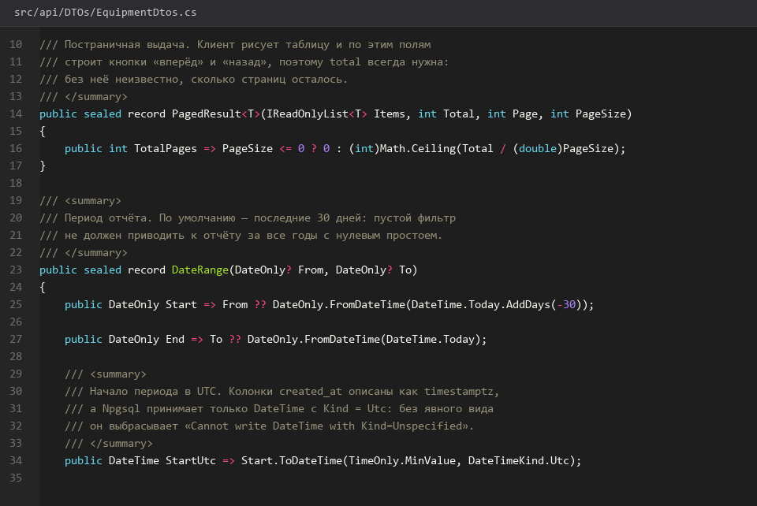
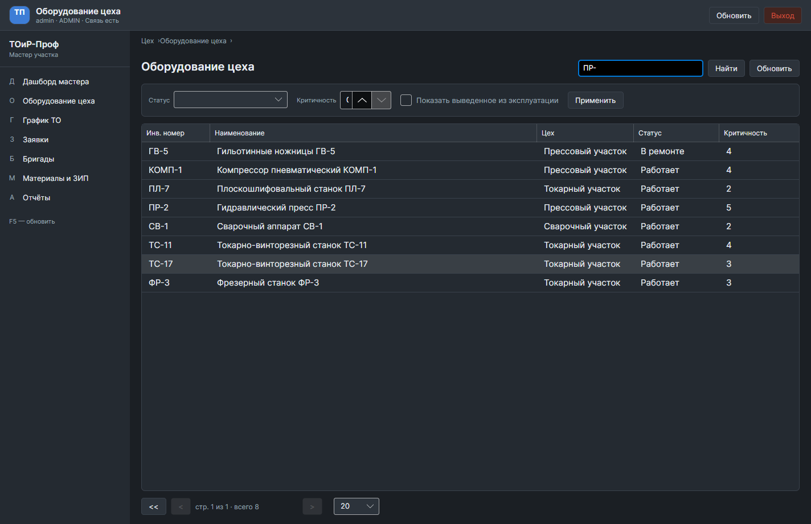
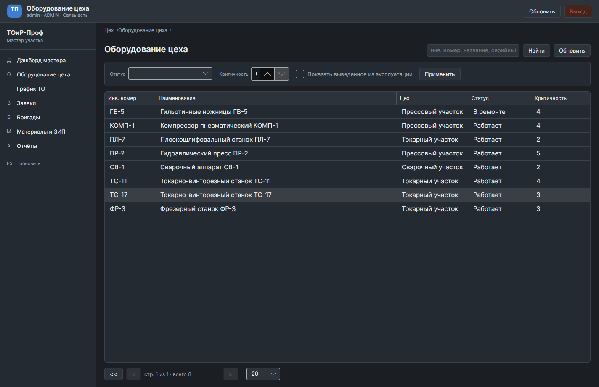
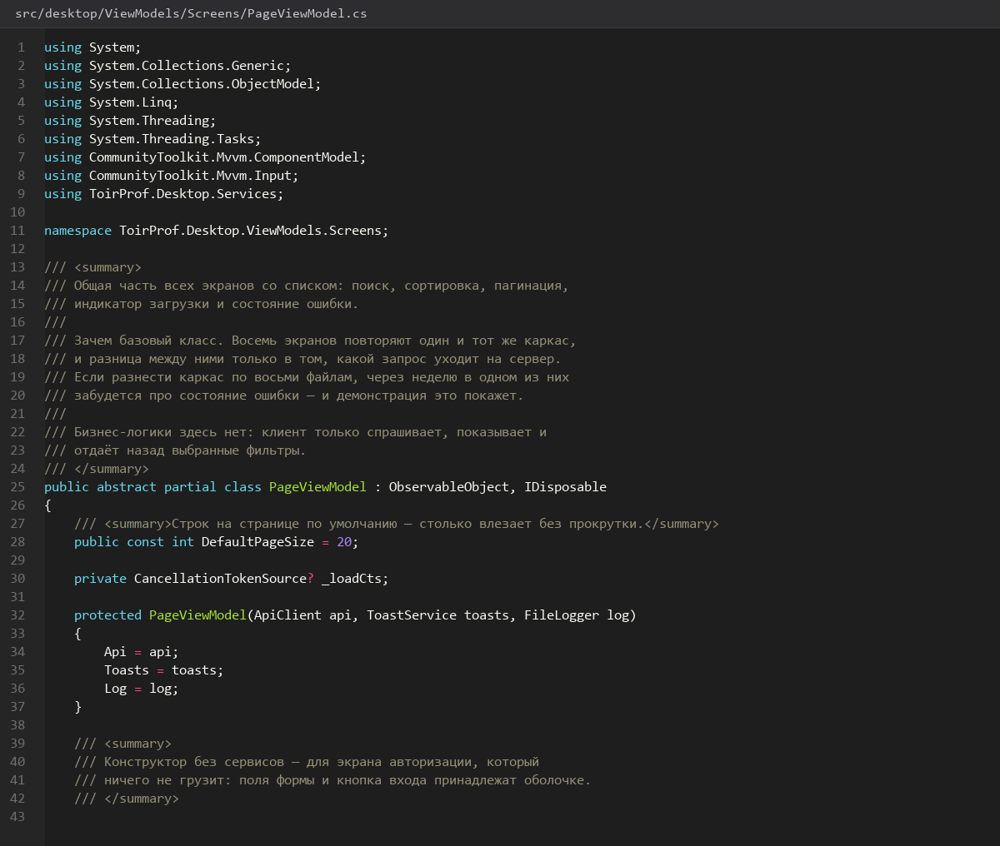

# Таблицы-поиск-сортировка-пагинация

> Спринт 13. Desktop: дашборд мастера · 140 мин · страница 30 из 54

Общий компонент таблицы для всех экранов: колонки, сортировка по клику, поиск с задержкой ввода и постраничная навигация. Один компонент — один набор правил на всём приложении.

**Итог страницы.** Один и тот же компонент используется на пяти экранах: работают сортировка, поиск и пагинация без копипаста кода.

| Критерий оценивания | Что закрывает страница |
|---|---|
| Б / Desktop | Сортировка и пагинация |
| Б / Desktop | Поиск |
| Б / Desktop | Асинхронность при загрузке данных |

**Результат в репозитории:**

- `src/desktop/Controls/DataTableControl.axaml`
- `src/desktop/Controls/DataTableControl.axaml.cs`
- `src/desktop/ViewModels/TableViewModelBase.cs`
- `src/desktop/DTOs/PagedResult.cs`

## Шаг 1. Контракт постраничного ответа — 25 мин

Единый формат страницы: список, общее количество, номер страницы. Сервер и клиент обязаны понимать его одинаково.

**src/desktop/ViewModels/TableViewModelBase.cs**

```csharp
public sealed record PagedResult<T>(IReadOnlyList<T> Items, int Total, int Page, int PageSize)
{
    public int Pages => PageSize == 0 ? 0 : (int)Math.Ceiling(Total / (double)PageSize);
}

public abstract class TableViewModelBase<T> : BaseViewModel
{
    [ObservableProperty] private IReadOnlyList<T> _items = [];
    [ObservableProperty] private int _page = 1;
    [ObservableProperty] private int _pageSize = 20;
    [ObservableProperty] private int _total;
    [ObservableProperty] private string _search = string.Empty;
    [ObservableProperty] private string _sortBy = "name";
    [ObservableProperty] private bool _descending;

    public int Pages => PageSize == 0 ? 0 : (int)Math.Ceiling(Total / (double)PageSize);

    protected abstract Task<PagedResult<T>> FetchAsync(CancellationToken ct);

    protected async Task ReloadAsync(CancellationToken ct)
    {
        var result = await FetchAsync(ct);
        Items = result.Items;
        Total = result.Total;
        OnPropertyChanged(nameof(Pages));
    }
}
```

> **Замечание.** `Pages` считайте через `Math.Ceiling` в double. Целочисленное деление теряет последнюю неполную страницу — при 47 записях и по 20 на страницу получится 2 страницы вместо 3.


*PagedResult и базовая ViewModel для всех таблиц*


## Шаг 2. Сортировка по клику — 30 мин

Клик по заголовку меняет направление, второй клик — переключает. Индикатор стрелки обязателен.

**src/desktop/Controls/DataTableControl.axaml.cs**

```csharp
private void OnHeaderClick(ColumnDefinition column)
{
    if (SortBy == column.Key)
        Descending = !Descending;
    else
    {
        SortBy = column.Key;
        Descending = false;
    }
    _ = RefreshAsync();
}

private string SortExpression => SortBy switch
{
    "status" => "status",
    "date" => "planned_start",
    _ => "name"
};
```

> **Замечание.** Сортируйте на сервере, а не перестановкой уже загруженных строк. На первой странице клиент отсортирует 20 записей, а в таблице останется порядок случайных двадцати из сорока семи.


*Сортировка по статусу: по возрастанию и по убыванию*


*Сортировка по статусу: по возрастанию и по убыванию*


## Шаг 3. Поиск с задержкой ввода — 30 мин

Запрос уходит через 300 мс после последнего символа, а не на каждое нажатие.

**src/desktop/ViewModels/TableViewModelBase.cs**

```csharp
private CancellationTokenSource? _searchCts;

private void OnSearchChanged(string value)
{
    Search = value;
    _searchCts?.Cancel();
    _searchCts = new CancellationTokenSource();
    var token = _searchCts.Token;

    _ = Task.Delay(TimeSpan.FromMilliseconds(300), token).ContinueWith(async _ =>
    {
        if (token.IsCancellationRequested) return;
        Page = 1;
        await ReloadAsync(token);
    }, token, TaskContinuationOptions.ExecuteSynchronously, TaskScheduler.Default);
}
```

> **Замечание.** Отмена предыдущего токена обязательна. Без неё быстрый набор «пресс» даст четыре параллельных запроса, и последний ответ может прийти раньше первого — список покажет результат для «пре», а введён «пресс».


*Поиск «пресс»: запросы на 4-й и 7-й символ*


*Поиск «пресс»: запросы на 4-й и 7-й символ*


## Шаг 4. Пагинация — 30 мин

Кнопки «назад / вперёд», номер страницы и общее количество. На узких окнах номер страницы скрывается.

**src/desktop/Controls/DataTableControl.axaml**

```xml
<StackPanel Orientation="Horizontal" Spacing="8" HorizontalAlignment="Center">
  <Button Content="‹" Command="{Binding PrevPageCommand}" IsEnabled="{Binding Page > 1}" />
  <TextBlock Text="{Binding Page}" VerticalAlignment="Center" MinWidth="32" TextAlignment="Center" />
  <TextBlock Text="из" VerticalAlignment="Center" Opacity="0.7" />
  <TextBlock Text="{Binding Pages}" VerticalAlignment="Center" />
  <Button Content="›" Command="{Binding NextPageCommand}" IsEnabled="{Binding Page < Pages}" />
</StackPanel>
```

> **Замечание.** Кнопки должны блокироваться на границах, а не вызывать пустой запрос. Ответ 400 на последней странице — заметная ошибка на демонстрации.


*Пагинация: страница 2 из 3, всего 47 записей*


*Пагинация: страница 2 из 3, всего 47 записей*


## Шаг 5. Индикатор загрузки таблицы — 25 мин

Пока идёт страница — таблица остаётся на месте с индикатором, а не очищается.

**src/desktop/Controls/DataTableControl.axaml**

```xml
<Grid>
  <DataGrid ItemsSource="{Binding Items}" IsVisible="{Binding !IsBusy}" />
  <ProgressBar IsIndeterminate="True" IsVisible="{Binding IsBusy}"
               HorizontalAlignment="Stretch" VerticalAlignment="Top" />
</Grid>
```

> **Замечание.** Скелет строк вместо пустой таблицы читается лучше, чем простыня серых линий, но полноценный скелетон в Avalonia дорог — достаточно индикатора с сохранением прежних строк.


*Переход между страницами с индикатором*


*Переход между страницами с индикатором*


## Если что-то не получилось

| Симптом | Что делать |
|---|---|
| Страниц 2 вместо 3 | целочисленное деление в `Pages` вместо `Math.Ceiling` |
| Поиск возвращает старые данные | предыдущий запрос не отменён, ответ пришёл не в том порядке |
| Сортировка не работает | сортировка сделана на клиенте по текущей странице |
| Кнопка пагинации даёт 400 | не проверяется граница `Page <= Pages` |

## Проверка

```bash
dotnet build src/desktop/ToirProf.Desktop.csproj -c Release
```

## Коммит

```bash
git add -A
git commit -m "feat(desktop): общий компонент таблиц с сортировкой, поиском и пагинацией"
```

---

[Дашборд-мастера](29-Дашборд-мастера.md) · [все спринты](Home) · [Экран-Оборудование-цеха](31-Экран-Оборудование-цеха.md)
