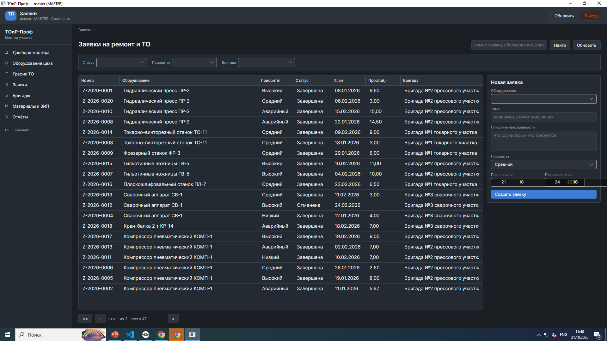
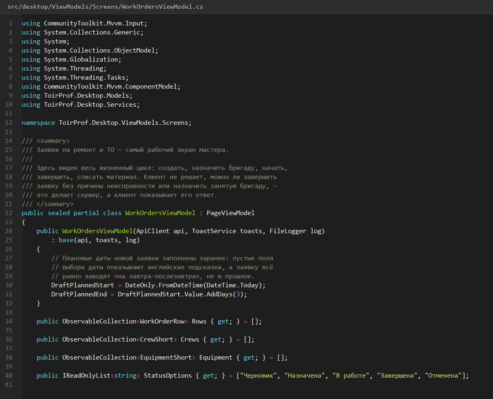
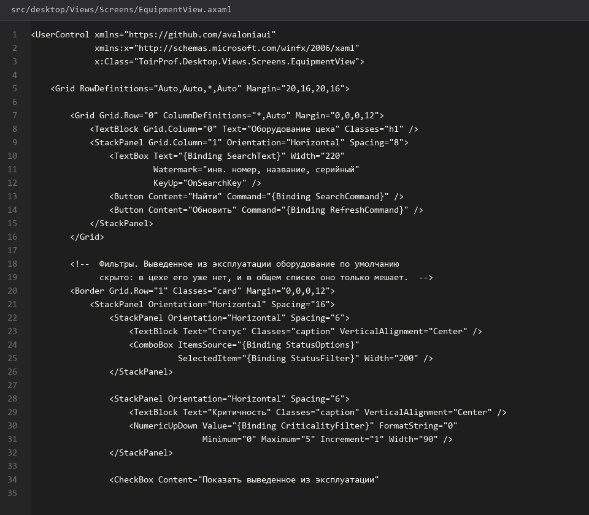

# 31. Экран Оборудование цеха

> Спринт 14. Desktop: оборудование и график ТО · 145 мин · страница 31 из 54

Список оборудования цеха: карточки, фильтры, создание и правка. Отдельный акцент — на запрет менять статус «Выведено из эксплуатации»: сервер вернёт 409, и клиент обязан показать это понятно, а не молча.

**Итог страницы.** Экран со списком, фильтрами по цеху и статусу, формами создания и правки и корректной реакцией на запрет смены статуса.

| Критерий оценивания | Что закрывает страница |
|---|---|
| Б / Desktop | Экран «Оборудование цеха» |
| Б / Desktop | Фильтрация и поиск |
| Б / Desktop | Модальные окна ошибок |

**Результат в репозитории:**

- `src/desktop/Views/EquipmentView.axaml`
- `src/desktop/Views/EquipmentView.axaml.cs`
- `src/desktop/ViewModels/EquipmentViewModel.cs`
- `src/desktop/ViewModels/EquipmentEditViewModel.cs`
- `src/desktop/Views/EquipmentEditView.axaml`

## Шаг 1. Список оборудования — 30 мин

Таблица из общего компонента: инвентарный номер, наименование, цех, установка, статус. Статус выделен цветом.

**src/desktop/Views/EquipmentView.axaml**

```xml
<DataGrid Grid.Column="0" ItemsSource="{Binding Items}" AutoGenerateColumns="False">
  <DataGrid.Columns>
    <DataGridTextColumn Header="Инв. №" Binding="{Binding InventoryNumber}" Width="140" />
    <DataGridTextColumn Header="Наименование" Binding="{Binding Name}" Width="*" />
    <DataGridTextColumn Header="Цех" Binding="{Binding WorkshopName}" Width="160" />
    <DataGridTextColumn Header="Установлен" Binding="{Binding CommissionDate, StringFormat='dd.MM.yyyy'}" Width="130" />
    <DataGridTemplateColumn Header="Статус" Width="200">
      <DataGridTemplateColumn.CellTemplate>
        <DataTemplate>
          <Border Classes="status" Classes.urgent="{Binding IsRetired}"
                  Padding="8,2" CornerRadius="10">
            <TextBlock Text="{Binding Status}" />
          </Border>
        </DataTemplate>
      </DataGridTemplateColumn.CellTemplate>
    </DataGridTemplateColumn>
  </DataGrid.Columns>
</DataGrid>
```

> **Замечание.** Цветом выделяйте не «работает» (зелёный всем приелся), а проблемные статусы: «В ремонте» — жёлтый, «Выведено из эксплуатации» — красный. Так взгляд сразу находит проблемы.


*Список из 12 единиц, счётчик «12 из 47»*


## Шаг 2. Фильтры по цеху и статусу — 25 мин

Два выпадающих списка и строка поиска применяются одновременно. Значения приходят из справочников, а не из вручную набранного списка.

**src/desktop/ViewModels/EquipmentViewModel.cs**

```csharp
[ObservableProperty] private Guid? _workshopId;
[ObservableProperty] private string? _status;

private async Task ApplyFiltersAsync()
{
    Page = 1;
    await ReloadAsync(CancellationToken.None);
}

protected override async Task<PagedResult<EquipmentDto>> FetchAsync(CancellationToken ct)
{
    var query = new EquipmentQuery(WorkshopId, Status, Search, Page, PageSize, SortBy, Descending);
    var response = await _api.GetEquipmentAsync(query, ct);
    if (!response.Success) ShowError(response);
    return response.Data ?? new([], 0, Page, PageSize);
}
```

> **Замечание.** Сброс любого фильтра должен возвращать страницу 1. Иначе после сброса вы окажетесь на третьей странице пустого результата.


*Фильтры: цех «Механический», статус «В ремонте»*


## Шаг 3. Форма создания и правки — 35 мин

Обязательные поля подсвечены, номера инвентаризации — с подсказкой о формате. Поле статуса на выведенном из эксплуатации — только чтение.

**src/desktop/Views/EquipmentEditView.axaml**

```xml
<StackPanel Spacing="10" Width="420">
  <TextBox Watermark="Инвентарный номер" Text="{Binding InventoryNumber}" />
  <TextBox Watermark="Наименование" Text="{Binding Name}" />
  <ComboBox HorizontalAlignment="Stretch" ItemsSource="{Binding Workshops}" SelectedItem="{Binding Workshop}" />
  <ComboBox HorizontalAlignment="Stretch" ItemsSource="{Binding Statuses}" SelectedItem="{Binding Status}" />
  <NumericUpDown Minimum="0" Maximum="5" Increment="0.5" Value="{Binding Criticality}" />
  <DatePicker SelectedDate="{Binding CommissionDate}" />
  <StackPanel Orientation="Horizontal" Spacing="8" HorizontalAlignment="Right">
    <Button Content="Отмена" Command="{Binding CancelCommand}" />
    <Button Content="Сохранить" Command="{Binding SaveCommand}" IsEnabled="{Binding !IsBusy}" />
  </StackPanel>
</StackPanel>
```

> **Замечание.** Критичность — шкала 0…5 с шагом 0.5. Сервер проверяет диапазон ограничением CHECK, клиент подсказывает допустимые значения заранее: эксперт любит ввести 9 и посмотреть на реакцию.


*Форма создания оборудования*


## Шаг 4. Обработка 409 по статусу — 30 мин

Триггер базы запрещает менять статус выведенного из эксплуатации оборудования. API вернёт 409 с кодом `STATUS_LOCKED`.

**src/desktop/ViewModels/EquipmentEditViewModel.cs**

```csharp
if (!response.Success)
{
    if (response.ErrorCode == ErrorCode.StatusLocked)
    {
        _dialogs.ShowWarning(
            "Оборудование выведено из эксплуатации",
            "Статус нельзя изменить: сначала оформите заявку на списание.");
        return;
    }

    ShowError(response);
}
```

> **Замечание.** Не показывайте «Ошибка 409» — покажите причину. Мастер должен понять, что делать дальше: завести заявку на списание. Код `STATUS_LOCKED` приходит из `error_code`, а не из текста.


## Шаг 5. Проверка формы — 25 мин

Пустые обязательные поля и некорректная дата ввода не уходят на сервер.

**src/desktop/ViewModels/EquipmentEditViewModel.cs**

```csharp
private string? Validate()
{
    if (string.IsNullOrWhiteSpace(InventoryNumber)) return "Укажите инвентарный номер";
    if (string.IsNullOrWhiteSpace(Name)) return "Укажите наименование";
    if (CommissionDate is null or > DateTime.Today) return "Дата ввода не может быть в будущем";
    if (Workshop is null) return "Выберите цех";
    return null;
}
```

> **Замечание.** Валидация на клиенте — для удобства, на сервере — для гарантий. Проверять только на клиенте нельзя: любой может отправить запрос через Postman.


## Если что-то не получилось

| Симптом | Что делать |
|---|---|
| 409 при изменении статуса | сработал триггер — так и должно быть, показывайте предупреждение |
| Дата будущая прошла на сервер | валидация на клиенте не написана или не вызывается |
| Фильтры не применяются | не сброшен `Page` — после фильтра вы на пустой третьей странице |
| Инвентарный номер занят | дубликат UNIQUE — проверьте наличие номера в поиске |

## Проверка

```bash
dotnet run --project src/desktop/ToirProf.Desktop.csproj
```

## Коммит

```bash
git add -A
git commit -m "feat(desktop): экран оборудования цеха с фильтрами, формами и обработкой 409"
```

---

[Таблицы поиск сортировка пагинация](30-Таблицы-поиск-сортировка-пагинация.md) · [все спринты](Home) · [Экран График ТО](32-Экран-График-ТО.md)
