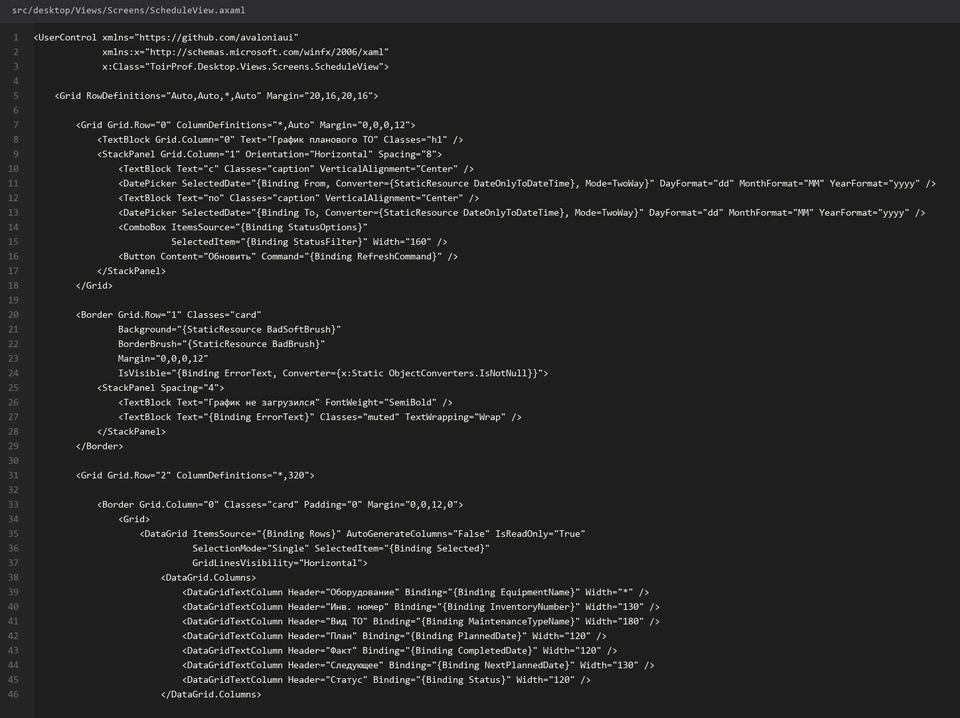

# 32. Экран График ТО

> Спринт 14. Desktop: оборудование и график ТО · 140 мин · страница 32 из 54

План технического обслуживания: календарная сетка по цехам, создание записей и отметка выполнения. Здесь же видно, как функция расчёта следующей плановой даты работает на практике.

**Итог страницы.** Календарь плановых ТО за месяц, форма создания записи и отметка выполнения, которая сама подставляет дату следующего обслуживания.

| Критерий оценивания | Что закрывает страница |
|---|---|
| Б / Desktop | Экран «График ТО» |
| Б / Desktop | Формы ввода данных |

**Результат в репозитории:**

- `src/desktop/Views/ScheduleView.axaml`
- `src/desktop/Views/ScheduleView.axaml.cs`
- `src/desktop/ViewModels/ScheduleViewModel.cs`
- `src/desktop/Controls/MonthCalendar.axaml`

## Шаг 1. Календарная сетка — 35 мин

Месяц сеткой: строки — единицы оборудования, столбцы — дни. Записи показываются цветом вида обслуживания.

**src/desktop/Controls/MonthCalendar.axaml**

```xml
<ItemsControl ItemsSource="{Binding Days}">
  <ItemsControl.ItemsPanel>
    <ItemsPanelTemplate><UniformGrid Columns="31" /></ItemsPanelTemplate>
  </ItemsControl.ItemsPanel>
  <ItemsControl.ItemTemplate>
    <DataTemplate>
      <Border BorderThickness="0,0,1,1" BorderBrush="#22000000" Padding="2">
        <StackPanel>
          <TextBlock Text="{Binding Day}" FontSize="11" Opacity="0.6" />
          <ItemsControl ItemsSource="{Binding Entries}">
            <ItemsControl.ItemTemplate>
              <DataTemplate>
                <Border Background="{Binding KindBrush}" CornerRadius="3" Padding="2" Margin="0,1">
                  <TextBlock Text="{Binding ShortTitle}" TextTrimming="CharacterEllipsis" FontSize="10" />
                </Border>
              </DataTemplate>
            </ItemsControl.ItemTemplate>
          </ItemsControl>
        </StackPanel>
      </Border>
    </DataTemplate>
  </ItemsControl.ItemTemplate>
</ItemsControl>
```

> **Замечание.** 31 столбец `UniformGrid` при ширине окна 1440 даёт около 44 px на день — текст вида обслуживания не влезает. Показывайте сокращение («ТО-2», «ТО-3») и полное название в подсказке.


## Шаг 2. Загрузка месяца — 25 мин

Переход между месяцами не перезагружает приложение: меняется только запрос и содержимое сетки.

**src/desktop/ViewModels/ScheduleViewModel.cs**

```csharp
[RelayCommand]
private async Task NextMonthAsync()
{
    _month = _month.AddMonths(1);
    await LoadAsync(CancellationToken.None);
}

private async Task LoadAsync(CancellationToken ct)
{
    var response = await _api.GetScheduleAsync(_month.Year, _month.Month, ct);
    if (!response.Success) { ShowError(response); return; }

    Days = Enumerable.Range(1, DateTime.DaysInMonth(_month.Year, _month.Month))
        .Select(day => new DayCell(day, response.Data!.Where(e => e.PlannedDate.Day == day).ToList()))
        .ToList();
}
```

> **Замечание.** Храните месяц в поле, а не в заголовке окна. Иначе при переходе назад заголовок останется от старого месяца — мелочь, которую замечают при демонстрации.


## Шаг 3. Форма создания записи — 30 мин

Оборудование, вид обслуживания, плановые даты и ответственный. Период проверяется: окончание не раньше начала.

**src/desktop/Views/ScheduleView.axaml**

```xml
<StackPanel Spacing="10" Width="420">
  <ComboBox ItemsSource="{Binding Equipment}" SelectedItem="{Binding Equipment}"
            HorizontalAlignment="Stretch" Watermark="Оборудование" />
  <ComboBox ItemsSource="{Binding Kinds}" SelectedItem="{Binding Kind}"
            HorizontalAlignment="Stretch" Watermark="Вид ТО" />
  <StackPanel Orientation="Horizontal" Spacing="10">
    <DatePicker SelectedDate="{Binding PlannedStart}" />
    <DatePicker SelectedDate="{Binding PlannedEnd}" />
  </StackPanel>
  <ComboBox ItemsSource="{Binding Users}" SelectedItem="{Binding AssignedUser}"
            HorizontalAlignment="Stretch" Watermark="Ответственный" />
</StackPanel>
```

> **Замечание.** Даты в форме — только плановые. Фактические заполняются при закрытии заявки: смешивать их в одной форме нельзя, критерий проверяет корректность хронологии на сервере.


*Создание записи графика*


## Шаг 4. Отметка выполнения — 30 мин

Закрытие записи вызывает расчёт следующей плановой даты. Пользователь видит её до подтверждения.

**src/desktop/ViewModels/ScheduleViewModel.cs**

```csharp
var preview = await _api.GetNextMaintenanceDateAsync(entry.Id, ct);
if (!preview.Success) { ShowError(preview); return; }

var answer = _dialogs.Confirm(
    "Записать выполнение?",
    $"Следующее плановое обслуживание: {preview.Data:dd.MM.yyyy}");

if (!answer) return;
await _api.CompleteScheduleEntryAsync(entry.Id, ct);
```

> **Замечание.** Спрашивайте перед сохранением и показывайте будущую дату. Мастер видит последствие и может исправить, если вид обслуживания выбран неверно.


## Шаг 5. Фильтр по виду ТО — 20 мин

Цветовая легенда и фильтр: показывать только один вид обслуживания.

**src/desktop/Views/ScheduleView.axaml**

```xml
<StackPanel Orientation="Horizontal" Spacing="16">
  <ToggleSwitch Content="Только просроченные"
                  IsChecked="{Binding OnlyOverdue}" />
  <ComboBox ItemsSource="{Binding Kinds}" SelectedItem="{Binding KindFilter}"
            MinWidth="200" Watermark="Вид обслуживания" />
</StackPanel>
```

> **Замечание.** Просроченные подсвечивайте отдельно от остальных — их ищут каждый день.


## Если что-то не получилось

| Симптом | Что делать |
|---|---|
| Календарь пуст | запрос вернул записи другого месяца — проверьте формат `from` и `to` |
| Дубли записей в один день | в `maintenance_schedule` нет ограничения на период, добавьте проверку на клиенте |
| Следующая дата не совпадает с расчётом | используйте серверную функцию расчёта, а не клиентскую арифметику |
| Календарь не влезает в окно | не задан `MinWidth` окна или сетка без горизонтальной прокрутки |

## Проверка

```bash
dotnet build src/desktop/ToirProf.Desktop.csproj -c Release
```

## Коммит

```bash
git add -A
git commit -m "feat(desktop): экран графика ТО с календарём, формами и отметкой выполнения"
```

---

[Экран Оборудование цеха](31-Экран-Оборудование-цеха.md) · [все спринты](Home) · [Экран Заявки](33-Экран-Заявки.md)
