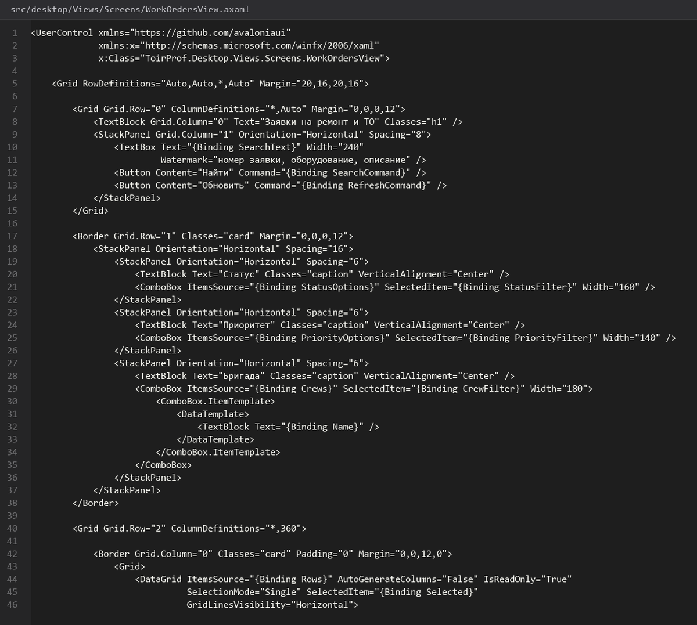
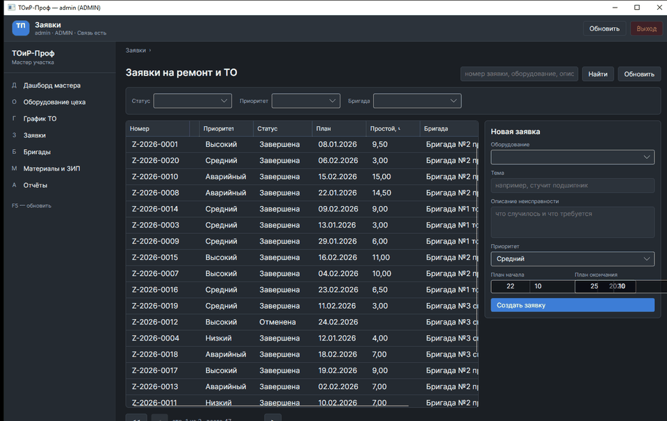
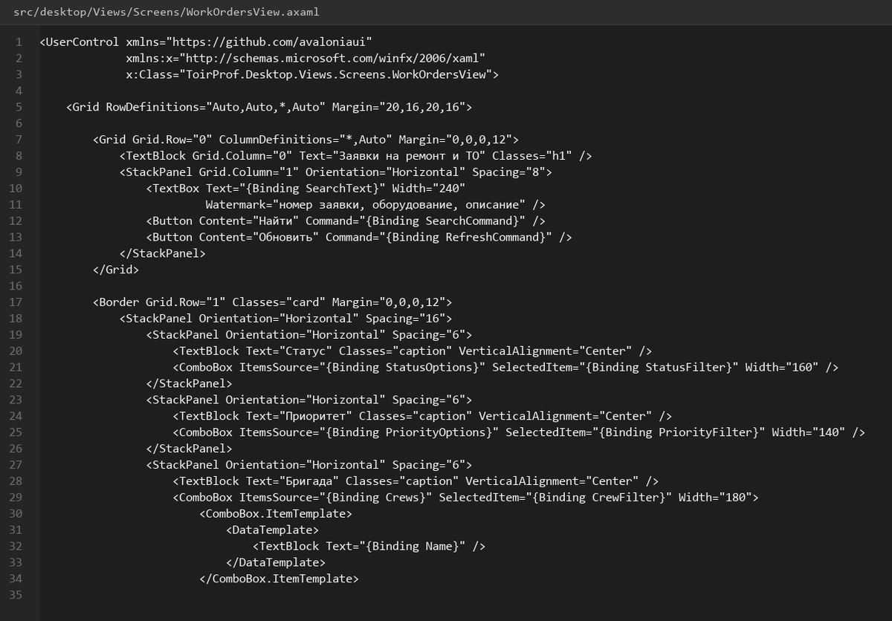
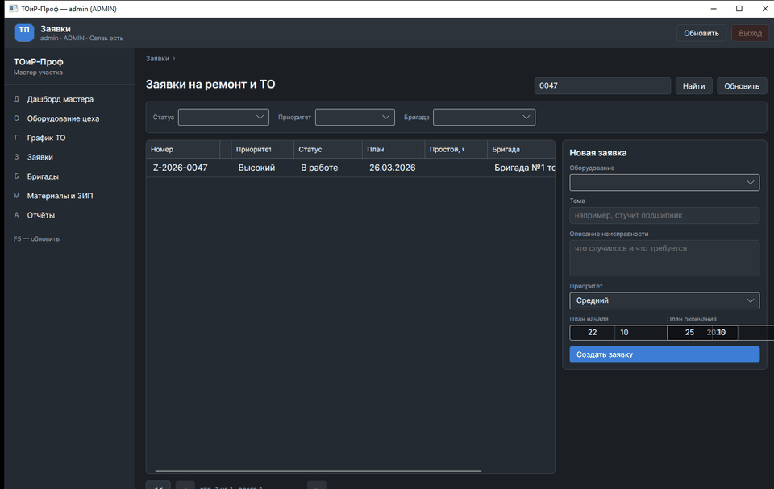
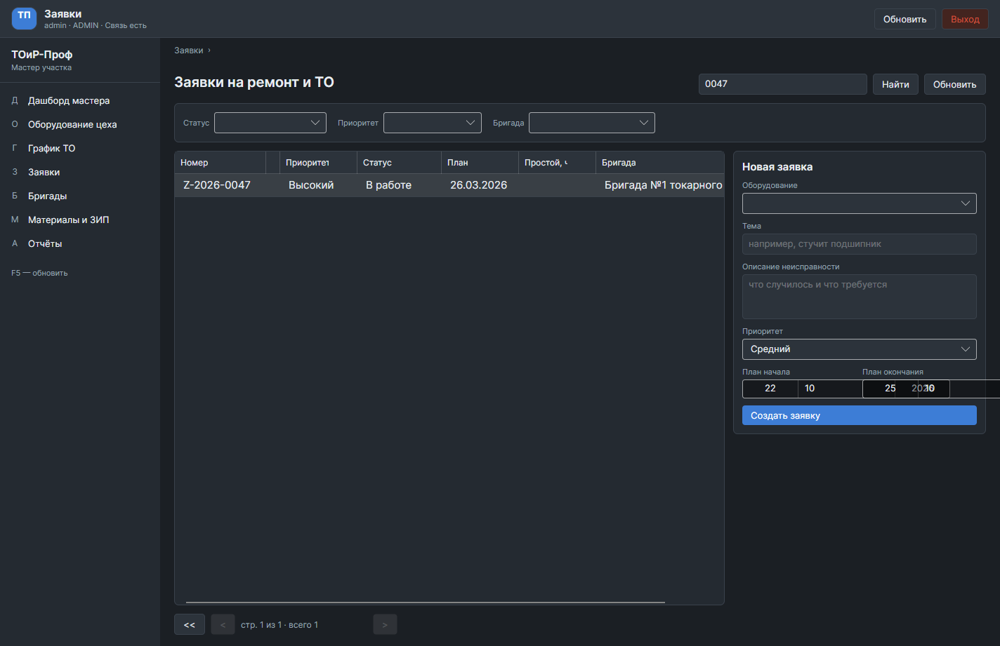
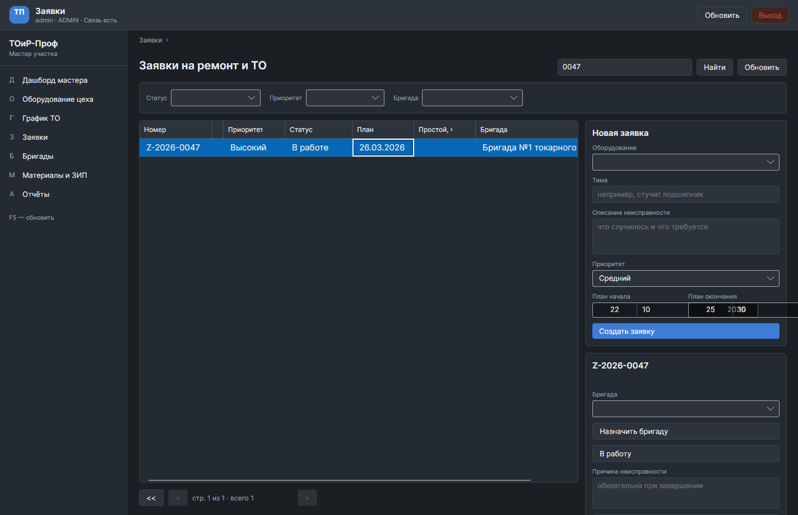

# Экран-Заявки

> Спринт 15. Desktop: заявки, бригады, материалы, отчёты · 140 мин · страница 33 из 54

Главный рабочий экран мастера: список заявок, карточка заявки, назначение бригады и завершение работы со списанием материалов. Здесь сходится жизненный цикл заявки, разобранный в API.

**Итог страницы.** Мастер открывает заявку, видит её детали, назначает бригаду и закрывает работу, указав потраченные материалы и итоговую стоимость.

| Критерий оценивания | Что закрывает страница |
|---|---|
| Б / Desktop | Экран «Заявки» |
| Б / Desktop | Формы ввода данных |
| Б / Desktop | Индикация асинхронных операций |

**Результат в репозитории:**

- `src/desktop/Views/WorkOrdersView.axaml`
- `src/desktop/Views/WorkOrderCardView.axaml`
- `src/desktop/Views/CompleteWorkOrderView.axaml`
- `src/desktop/ViewModels/WorkOrderViewModel.cs`
- `src/desktop/ViewModels/CompleteWorkOrderViewModel.cs`

## Шаг 1. Список заявок — 30 мин

Таблица из общего компонента плюс фильтры: статус, приоритет, оборудование. Для мастера список по умолчанию ограничен его бригадой.

**src/desktop/ViewModels/WorkOrderViewModel.cs**

```csharp
protected override async Task<PagedResult<WorkOrderDto>> FetchAsync(CancellationToken ct)
{
    var response = await _api.GetWorkOrdersAsync(new WorkOrderQuery(
        Status, Priority, Search, Page, PageSize, SortBy, Descending), ct);

    if (!response.Success) { ShowError(response); return new([], 0, Page, PageSize); }

    return new PagedResult<WorkOrderDto>(
        response.Data!.Items, response.Data.Total, Page, PageSize);
}
```

> **Замечание.** Для роли «Мастер» сервер сам ограничивает выдачу заявками его бригад. Фильтровать это на клиенте нельзя: в ответе придёт больше строк, чем имеет право видеть пользователь.


*Заявки в работе, счётчик «5 из 12»*


*Заявки в работе, счётчик «5 из 12»*


## Шаг 2. Карточка заявки — 30 мин

Номер вида Z-2026-0048, оборудование, описание неисправности, плановые и фактические даты, статус в виде «шагов».

**src/desktop/Views/WorkOrderCardView.axaml**

```xml
<StackPanel Spacing="14">
  <TextBlock Text="{Binding Number}" FontSize="24" FontWeight="SemiBold" />
  <Grid ColumnDefinitions="160,*" RowSpacing="6">
    <TextBlock Text="Оборудование" Opacity="0.7" />
    <TextBlock Grid.Column="1" Text="{Binding EquipmentName}" />
    <TextBlock Text="Приоритет" Opacity="0.7" />
    <TextBlock Grid.Column="1" Text="{Binding Priority}" />
    <TextBlock Text="Описание" Opacity="0.7" />
    <TextBlock Grid.Column="1" Text="{Binding Description}" TextWrapping="Wrap" />
    <TextBlock Text="Простой" Opacity="0.7" />
    <TextBlock Grid.Column="1" Text="{Binding DowntimeHours, StringFormat='0.00 ч'}" />
  </Grid>
</StackPanel>
```

> **Замечание.** Простой показывайте сразу из поля, которое посчитал триггер. Пустое поле «простой» на открытой заявке выглядит как ошибка, хотя просто ещё не начался.


*Карточка заявки Z-2026-0048*


*Карточка заявки Z-2026-0048*


## Шаг 3. Назначение бригады — 25 мин

Выбор бригады из списка, недоступные показываются серым. Занятая бригада вернёт 409 — предупреждаем до отправки.

**src/desktop/ViewModels/WorkOrderViewModel.cs**

```csharp
var crews = await _api.GetAvailableCrewsAsync(workOrderId, plannedStart, ct);
if (!crews.Success) { ShowError(crews); return; }

Crews = crews.Data!
    .Select(c => new CrewOption(c.Id, $"{c.Name} ({c.MembersCount} чел.)", c.IsBusy))
    .ToList();

var chosen = _dialogs.ChooseCrew(Crews);
if (chosen is null) return;

var result = await _api.AssignCrewAsync(Number, chosen.Value, ct);
if (!result.Success && result.ErrorCode == ErrorCode.CrewBusy)
    _dialogs.ShowWarning("Бригада занята", "Выберите другую бригаду или сдвиньте дату.");
else if (!result.Success) ShowError(result);
```

> **Замечание.** Доступность бригады считает сервер на пересечении плановых интервалов. Клиент только показывает результат — своими расчётами вы ничего не добьётесь.


*Выбор бригады: занятые серым, после назначения статус «Назначена»*


*Выбор бригады: занятые серым, после назначения статус «Назначена»*


## Шаг 4. Завершение работы — 35 мин

Форма закрытия: фактические даты, выполненные работы, потраченные материалы с количеством и итог. Стоимость считается на сервере.

**src/desktop/ViewModels/CompleteWorkOrderViewModel.cs**

```csharp
var rows = Materials.Select(m => new WorkOrderMaterialDto(
    m.Id, m.Quantity, DateTime.Today)).ToList();

var request = new CompleteWorkOrderRequest(ActualStart, ActualEnd, Comment, rows);
var response = await _api.CompleteAsync(Number, request, ct);

if (!response.Success)
{
    if (response.ErrorCode == ErrorCode.NotEnoughStock)
        _dialogs.ShowWarning("Недостаточно материалов", response.Message);
    else
        ShowError(response);
    return;
}

_toasts.Show($"Заявка {Number} закрыта на сумму {response.Data!.Cost:0.00} руб.");
```

> **Замечание.** Список материалов берёте из формы, а количество ограничивайте остатком из справочника. Сервер всё равно проверит и вернёт 409 — ранняя проверка экономит мастеру время.


*Форма закрытия и итог 7 300,00 руб. по трём позициям*


*Форма закрытия и итог 7 300,00 руб. по трём позициям*


## Шаг 5. Хлебные крошки и возврат — 20 мин

Карточка открывается поверх списка, кнопка «Назад» возвращает в список с прежними фильтрами.

**src/desktop/ViewModels/WorkOrderViewModel.cs**

```csharp
public override void OnNavigatedTo(NavigationContext context)
{
    Breadcrumbs = ["Главная", "Заявки", Number];
}

private void GoBack()
{
    NavigationService?.GoBack();
    FiltersSnapshot = _savedFilters;
}
```

> **Замечание.** Сохраняйте состояние фильтров при возврате. Мастер ушёл в заявку, посмотрел и вернулся — фильтр сбросился, значит снова искать. Это заметно тормозит работу.


*Крошки «Главная / Заявки / Z-2026-0048» и возврат к списку*


## Если что-то не получилось

| Симптом | Что делать |
|---|---|
| 409 при назначении бригады | бригада уже занята — покажите предупреждение, а не ошибку |
| 409 при списании | остатка материала не хватает — покажите остаток в диалоге |
| Заявки чужих бригад | фильтрация по бригаде только на клиенте — исправьте на сервере |
| Итог списания не сходится | цена берётся из справочника, а не из позиции заявки |

## Проверка

```bash
dotnet run --project src/desktop/ToirProf.Desktop.csproj
```

## Коммит

```bash
git add -A
git commit -m "feat(desktop): экран заявок с карточкой, назначением бригады и закрытием работ"
```

---

[Экран-График-ТО](32-Экран-График-ТО.md) · [все спринты](Home) · [Экраны-Бригады-и-Материалы](34-Экраны-Бригады-и-Материалы.md)
