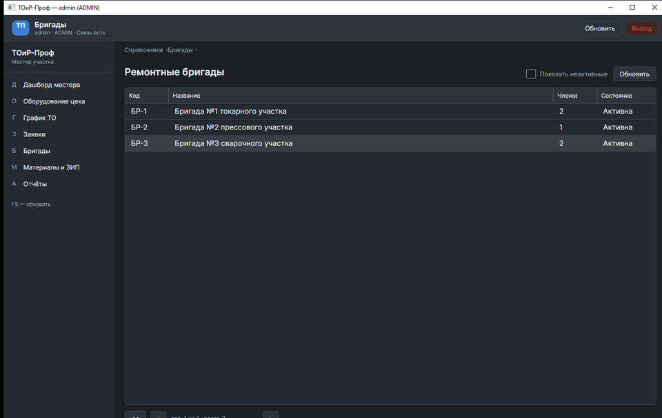
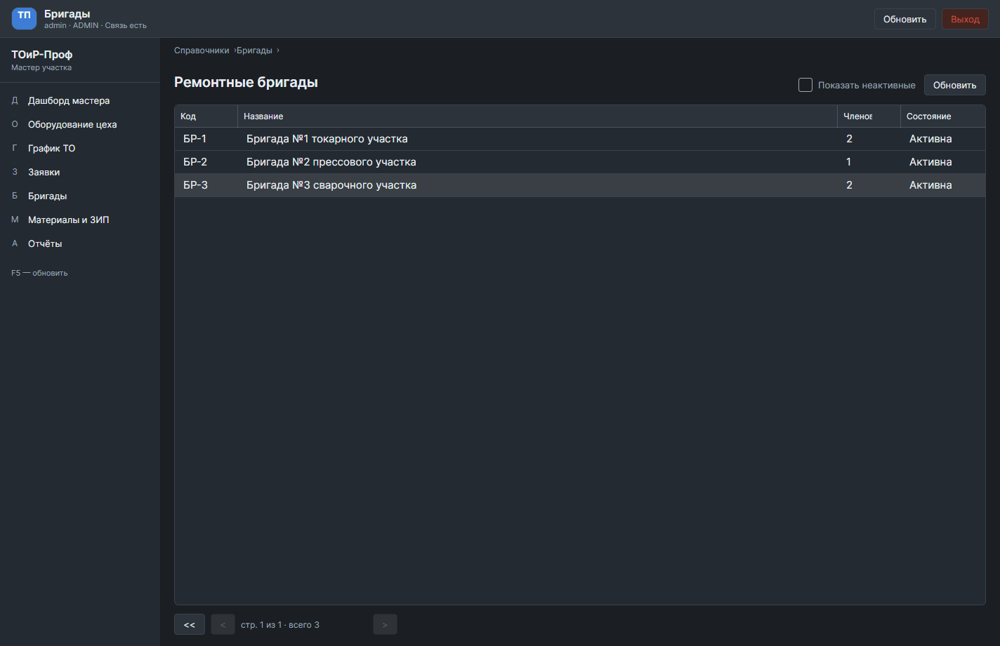
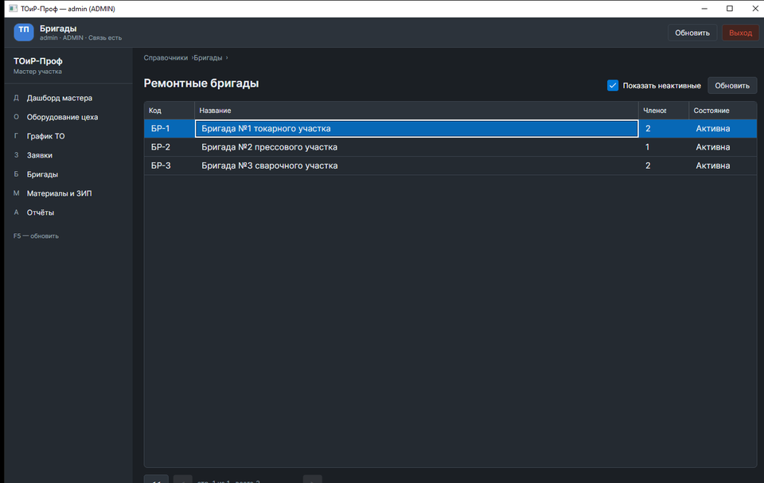
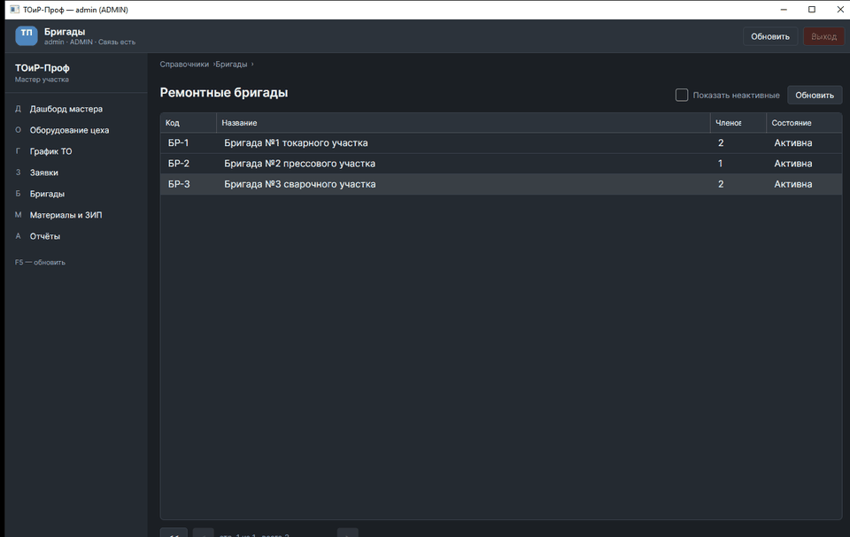
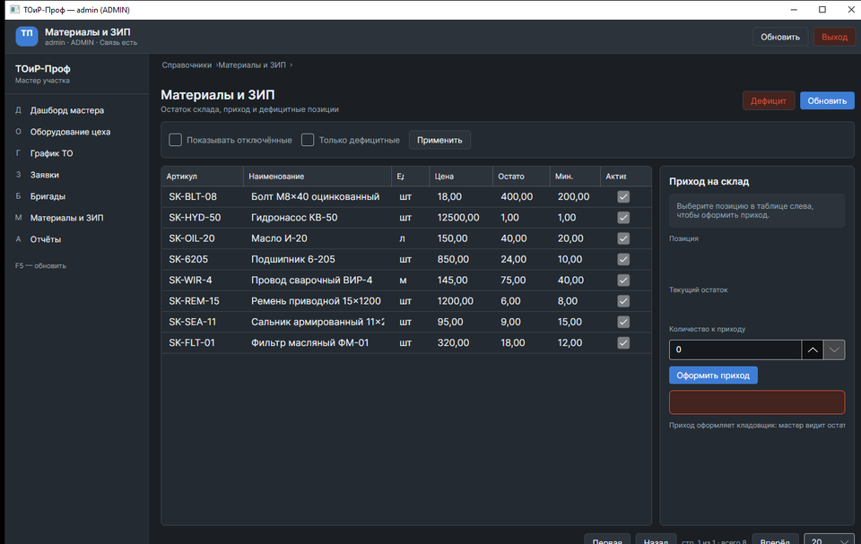
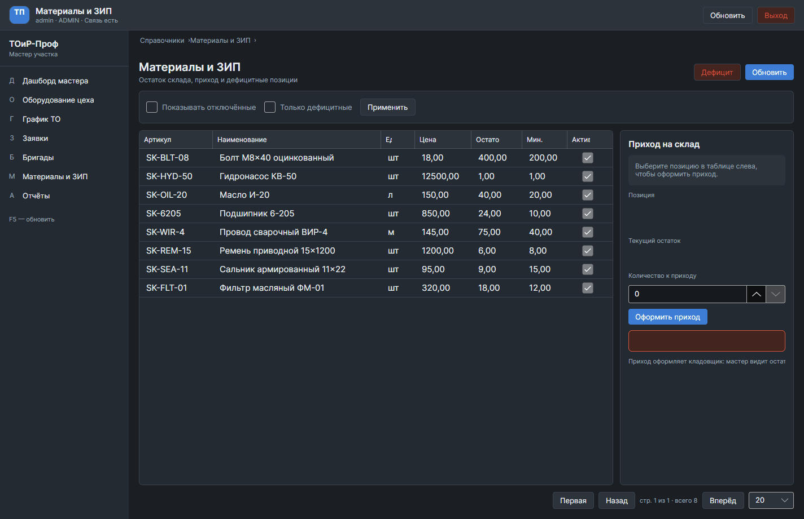
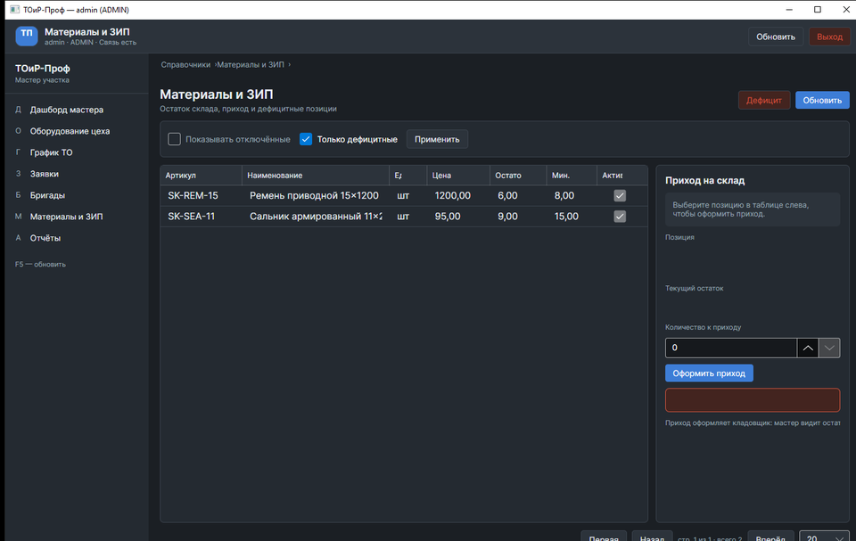

# Экраны-Бригады-и-Материалы

> Спринт 15. Desktop: заявки, бригады, материалы, отчёты · 140 мин · страница 34 из 54

Два справочника, без которых заявку не закрыть: состав ремонтных бригад и склад ЗИП с остатками и списанием. Оба экрана строятся на общем компоненте таблиц, поэтому здесь только форма и специфика.

**Итог страницы.** Экраны «Бригады» и «Материалы» работают: состав бригады редактируется, остатки видны, списание уходит в заявку.

| Критерий оценивания | Что закрывает страница |
|---|---|
| Б / Desktop | Экран «Бригады» |
| Б / Desktop | Экран «Материалы» |
| Б / Desktop | Фильтрация, поиск и пагинация |

**Результат в репозитории:**

- `src/desktop/Views/CrewsView.axaml`
- `src/desktop/Views/CrewEditView.axaml`
- `src/desktop/Views/MaterialsView.axaml`
- `src/desktop/ViewModels/CrewViewModel.cs`
- `src/desktop/ViewModels/MaterialViewModel.cs`

## Шаг 1. Список бригад — 25 мин

Название, специализация, численность, текущая загрузка. Занятость считается сервером по плановым интервалам.

**src/desktop/ViewModels/CrewViewModel.cs**

```csharp
public sealed record CrewDto(
    Guid Id,
    string Name,
    string Specialization,
    int MembersCount,
    int ActiveOrders,
    decimal Utilization);

protected override async Task<PagedResult<CrewDto>> FetchAsync(CancellationToken ct)
{
    var response = await _api.GetCrewsAsync(Search, Page, PageSize, ct);
    if (!response.Success) { ShowError(response); return new([], 0, Page, PageSize); }
    return new(response.Data!.Items, response.Data.Total, Page, PageSize);
}
```

> **Замечание.** Загрузка бригады — отношение занятых часов к доступным. Показывайте её процентом и цветом: выше 90 % бригада перегружена, и это видно сразу.


*Список из 4 бригад с загрузкой 82 %*


*Список из 4 бригад с загрузкой 82 %*


## Шаг 2. Состав бригады — 30 мин

Добавление и удаление участников. Пользователь не может состоять в двух бригадах — сервер вернёт 409.

**src/desktop/Views/CrewEditView.axaml**

```xml
<Grid ColumnDefinitions="*,320" Margin="16">
  <ItemsControl Grid.Column="0" ItemsSource="{Binding Members}">
    <ItemsControl.ItemTemplate>
      <DataTemplate>
        <Grid ColumnDefinitions="*,90,60" Margin="0,4">
          <TextBlock Text="{Binding FullName}" />
          <TextBlock Grid.Column="1" Text="{Binding Role}" Opacity="0.7" />
          <Button Grid.Column="2" Content="✕" Command="{Binding $parent[UserControl].DataContext.RemoveCommand}"
                  CommandParameter="{Binding}" />
        </Grid>
      </DataTemplate>
    </ItemsControl.ItemTemplate>
  </ItemsControl>

  <ComboBox Grid.Column="1" ItemsSource="{Binding AvailableUsers}"
            SelectedItem="{Binding SelectedUser}" HorizontalAlignment="Stretch" />
</Grid>
```

> **Замечание.** Исключайте из списка тех, кто уже в другой бригаде — тогда 409 «пользователь состоит в другой бригаде» не случится на демонстрации.


*Состав бригады: 3 участника, добавление четвёртого*


*Состав бригады: 3 участника, добавление четвёртого*


## Шаг 3. Список материалов — 30 мин

Наименование, артикул, единица измерения, цена, остаток и минимум. Дефицитные строки подсвечиваются.

**src/desktop/ViewModels/MaterialViewModel.cs**

```csharp
private bool IsDeficient(MaterialDto m) => m.Stock <= m.MinStock;

<Border Background="{Binding RowBackground}" Padding="6">
  <TextBlock Text="{Binding Name}" />
</Border>
```

> **Замечание.** Меняйте цвет не строки, а ячейки с остатком: так список остаётся читаемым, а проблема всё равно бросается в глаза.


*Склад ЗИП: 18 позиций, дефицитные подсвечены*


*Склад ЗИП: 18 позиций, дефицитные подсвечены*


## Шаг 4. Списание в заявку — 35 мин

Из склада можно выбрать материалы и сразу указать их в заявке. Количество ограничено остатком.

**src/desktop/ViewModels/MaterialViewModel.cs**

```csharp
private int ClampToStock(MaterialDto material, int requested)
    => Math.Clamp(requested, 0, material.Stock);

var lines = SelectedMaterials
    .Select(m => new WorkOrderMaterialDto(m.Id, ClampToStock(m, m.Quantity), DateTime.Today))
    .ToList();

var response = await _api.AddMaterialsAsync(Number, lines, ct);
if (!response.Success)
{
    _dialogs.ShowWarning("Списание не выполнено", response.Message);
    _toasts.Show("Остатки изменились, проверьте количество", ToastKind.Warning);
}
```

> **Замечание.** `Math.Clamp` по остатку снимает большинство 409, но не все: между вашим запросом и отправкой материал мог списать другой мастер. Обработку 409 всё равно оставьте.


*Списание 4 подшипников в заявку Z-2026-0047*


*Списание 4 подшипников в заявку Z-2026-0047*


## Шаг 5. Поиск и пагинация — 20 мин

Оба справочника используют общий компонент таблиц: поиск, сортировка, страницы — ничего своего.

**src/desktop/Views/MaterialsView.axaml**

```xml
<controls:DataTableControl Items="{Binding Items}"
                                  Total="{Binding Total}"
                                  Search="{Binding Search}"
                                  Page="{Binding Page}"
                                  PageSize="{Binding PageSize}" />
```

> **Замечание.** Если для справочника понадобился свой компонент — почти наверняка вы обошли общий. Добавьте колонку в параметры вместо копии.


*Поиск по наименованию и переход на вторую страницу*


*Поиск по наименованию и переход на вторую страницу*


## Если что-то не получилось

| Симптом | Что делать |
|---|---|
| 409 при добавлении участника | пользователь уже в другой бригаде — проверьте состав заранее |
| Остаток ушёл в минус | списание идёт без проверки остатка — добавьте `Math.Clamp` |
| Дефицитные не подсвечены | сравнение `Stock <= MinStock` не написано в ViewModel |
| Справочник грузится дольше минуты | в запросе нет `AsNoTracking` и проекции, тянутся лишние поля |

## Проверка

```bash
dotnet build src/desktop/ToirProf.Desktop.csproj -c Release
```

## Коммит

```bash
git add -A
git commit -m "feat(desktop): экраны бригад и материалов со списанием и дефицитами"
```

---

[Экран-Заявки](33-Экран-Заявки.md) · [все спринты](Home) · [Экран-Отчеты-оффлайн-кэш-и-журнал](35-Экран-Отчеты-оффлайн-кэш-и-журнал.md)
