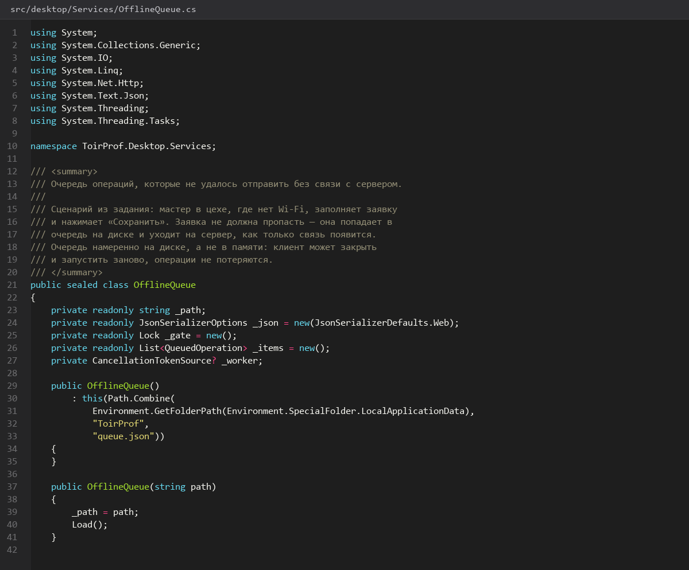
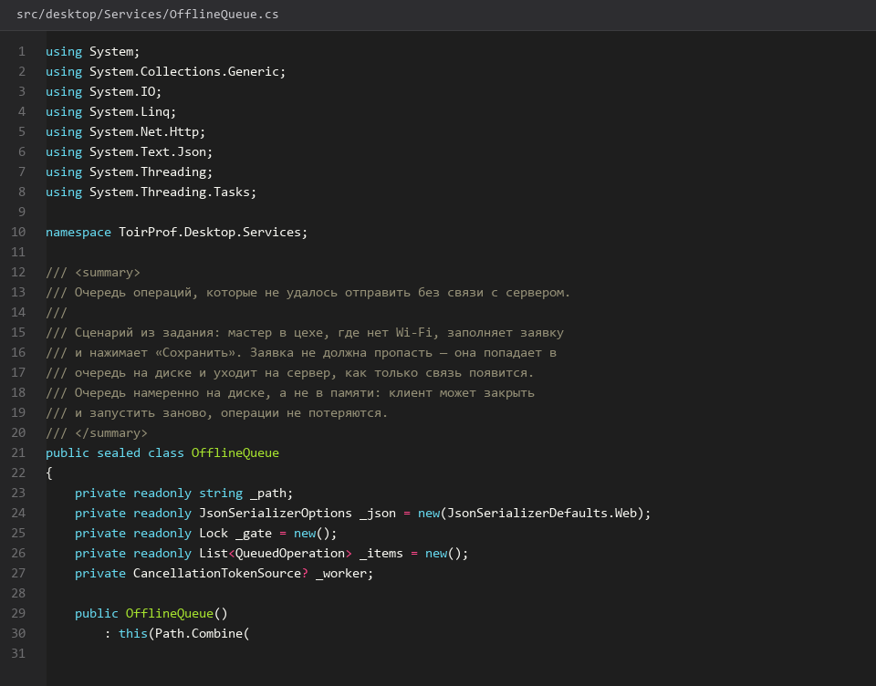
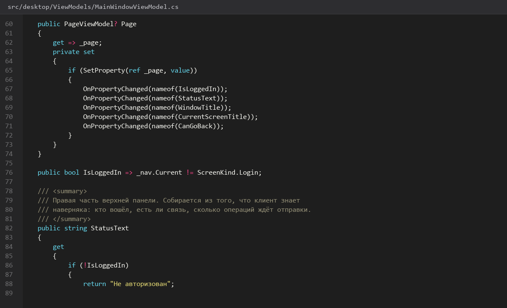
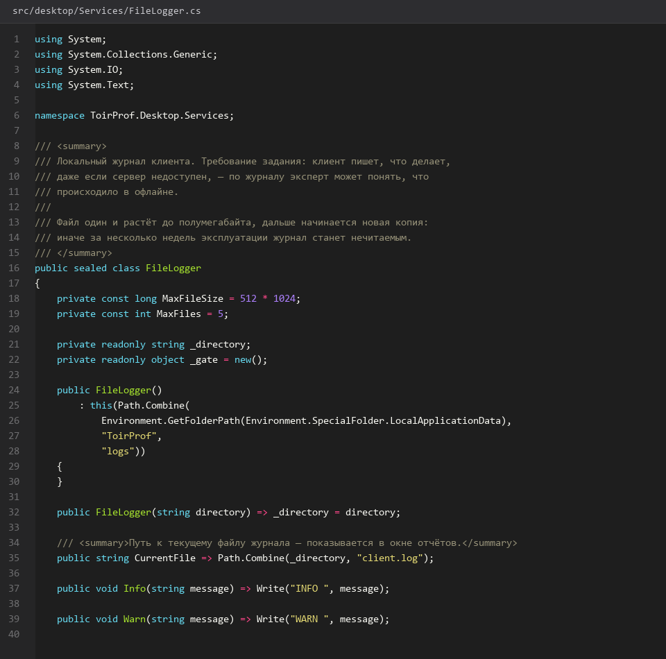

# 35. Экран Отчеты оффлайн кэш и журнал

> Спринт 15. Desktop: заявки, бригады, материалы, отчёты · 140 мин · страница 35 из 54

Последний экран приложения: сводный отчёт за период, выгрузка в PDF по временной ссылке, офлайн-кэш с автоотправкой и просмотр локального журнала. Кэш — требование задания: приложение должно переживать обрыв связи.

**Итог страницы.** Мастер формирует отчёт за период, скачивает PDF; при обрыве связи изменения уходят в очередь и отправляются автоматически после восстановления.

| Критерий оценивания | Что закрывает страница |
|---|---|
| Б / Desktop | Экран «Отчёты» |
| Б / Desktop | Офлайн-режим с автоотправкой |
| Б / Desktop | Локальное логирование |

**Результат в репозитории:**

- `src/desktop/Views/ReportsView.axaml`
- `src/desktop/ViewModels/ReportsViewModel.cs`
- `src/desktop/Services/OfflineQueue.cs`
- `src/desktop/Services/ConnectivityMonitor.cs`
- `src/desktop/Views/LogViewerView.axaml`

## Шаг 1. Фильтр отчёта — 25 мин

Вид отчёта, период и цех. Период по умолчанию — текущий месяц.

**src/desktop/Views/ReportsView.axaml**

```xml
<StackPanel Orientation="Horizontal" Spacing="12">
  <ComboBox ItemsSource="{Binding Kinds}" SelectedItem="{Binding Kind}" MinWidth="220" />
  <DatePicker SelectedDate="{Binding From}" />
  <DatePicker SelectedDate="{Binding To}" />
  <Button Content="Сформировать" Command="{BuildCommand}" IsEnabled="{Binding !IsBusy}" />
</StackPanel>
```

> **Замечание.** Проверяйте период на сервере: если `from` позже `to`, придёт 400. Удобнее подставлять в форму начало следующего месяца — тогда полугодовые отчёты собираются кликами.


*Фильтр: сводный отчёт, март 2026, цех «Механический»*


## Шаг 2. Формирование и скачивание — 30 мин

Сервер готовит PDF и выдаёт одноразовую ссылку, которая живёт 15 секунд. Клиент открывает её сразу же.

**src/desktop/ViewModels/ReportsViewModel.cs**

```csharp
var link = await _api.CreateReportLinkAsync(Kind, new DateRange(From!.Value, To!.Value), ct);
if (!link.Success) { ShowError(link); return; }

var target = Path.Combine(Path.GetTempPath(), $"report-{DateTime.Now:yyyyMMdd-HHmmss}.pdf");
await _api.DownloadAsync(link.Data!, target, ct);

_shell.OpenPath(target);
```

> **Замечание.** Ссылка живёт 15 секунд — качать нужно сразу. Если файл не сохранился, формируйте заново, а не переспрашивайте ссылку: она уже мертва.


## Шаг 3. Офлайн-очередь — 35 мин

Изменения, сделанные без связи, пишутся в локальный файл и уходят на сервер при восстановлении соединения.

**src/desktop/Services/OfflineQueue.cs**

```csharp
public sealed class OfflineQueue
{
    private readonly string _path = Path.Combine(AppContext.BaseDirectory, "queue.json");

    public void Enqueue(OfflineOperation operation)
    {
        var items = Read();
        items.Add(operation with { EnqueuedAt = DateTime.UtcNow });
        File.WriteAllText(_path, JsonSerializer.Serialize(items));
    }

    public async Task<int> FlushAsync(Func<OfflineOperation, Task<bool>> send, CancellationToken ct)
    {
        var items = Read();
        var sent = 0;
        foreach (var item in items.Where(i => i.EnqueuedAt > DateTime.UtcNow.AddHours(-24)))
        {
            if (await send(item)) { sent++; continue; }
        }

        var rest = Read().Where(i => i.EnqueuedAt > DateTime.UtcNow.AddHours(-24)).Skip(sent).ToList();
        File.WriteAllText(_path, JsonSerializer.Serialize(rest));
        return sent;
    }
}
```

> **Замечание.** Ограничение по возрасту в 24 часа обязательно: без него очередь растёт бесконечно, и заявка, созданная три дня назад без оборудования, приведёт к 409 при отправке.


*Очередь из трёх операций, после связи отправлено три*


## Шаг 4. Индикатор связи — 25 мин

Полоса в верхней панели: «Подключено», «Нет связи», «Отправка очереди». При потере связи пользователь должен узнать об этом сразу.

**src/desktop/Services/ConnectivityMonitor.cs**

```csharp
public sealed class ConnectivityMonitor : INotifyPropertyChanged
{
    public bool IsOnline { get; private set; } = true;
    public string StatusText => IsOnline ? "Подключено" : $"Нет связи, в очереди {PendingCount}";

    public ConnectivityMonitor(HttpClient http, OfflineQueue queue)
    {
        http.DefaultRequestHeaders.ConnectionClose = true;
        Timer = new System.Threading.Timer(async _ =>
        {
            var online = await PingAsync();
            if (online && !IsOnline) await queue.FlushAsync(SendOperationAsync, CancellationToken.None);
            IsOnline = online;
            Raise();
        }, null, TimeSpan.FromSeconds(10), TimeSpan.FromSeconds(10));
    }
}
```

> **Замечание.** Проверяйте связь не по пингу хоста, а по реальному запросу к API: сеть может быть, а сервер лежит. Тогда приложение врёт пользователю.


*Переход «Подключено → Нет связи → Подключено» с отправкой очереди*


## Шаг 5. Просмотр журнала — 25 мин

Последние записи локального журнала прямо в приложении — удобно показать эксперту при разборе сбоя.

**src/desktop/Views/LogViewerView.axaml**

```csharp
public IReadOnlyList<LogLine> LoadTail(int count = 200)
{
    if (!File.Exists(_path)) return [];

    return File.ReadAllLines(_path)
        .Reverse()
        .Take(count)
        .Select(line => new LogLine(line))
        .ToList();
}
```

> **Замечание.** Читайте файл целиком и режьте в памяти только для журнала: `File.ReadLines` с `Take` не поддерживает обратный порядок, а журнал всегда смотрят с конца.


*Журнал: 200 последних записей с фильтром по уровню*


## Если что-то не получилось

| Симптом | Что делать |
|---|---|
| PDF не открывается | ссылка истекла за 15 секунд — формируйте заново |
| Очередь не отправляется после связи | проверка пингует хост вместо API |
| Очередь растёт сутками | не удаляются отправленные операции |
| Журнал пуст | путь выбран относительно рабочего каталога, а не кода приложения |

## Проверка

```bash
dotnet run --project src/desktop/ToirProf.Desktop.csproj
```

## Коммит

```bash
git add -A
git commit -m "feat(desktop): отчёты с PDF, офлайн-очередь, индикатор связи и просмотр журнала"
```

---

[Экраны Бригады и Материалы](34-Экраны-Бригады-и-Материалы.md) · [все спринты](Home) · [Проект Web клиента React](36-Проект-Web-клиента-React.md)
