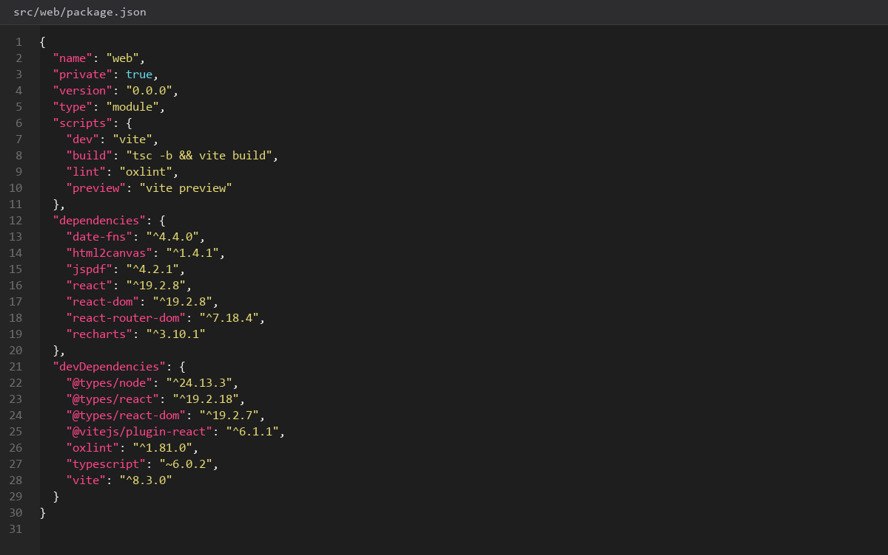
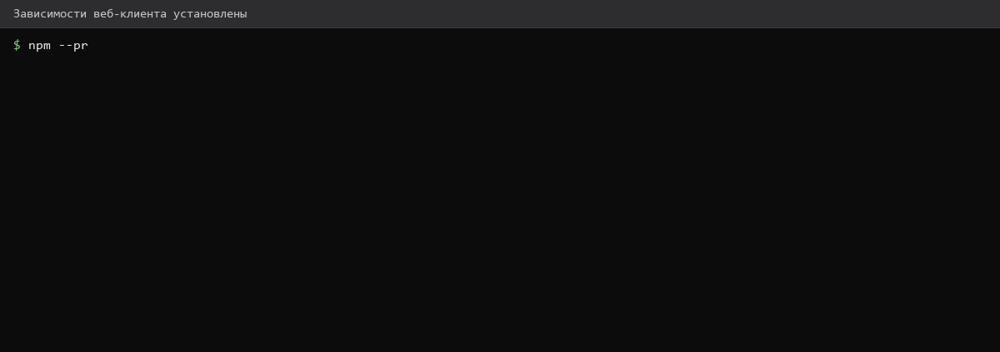
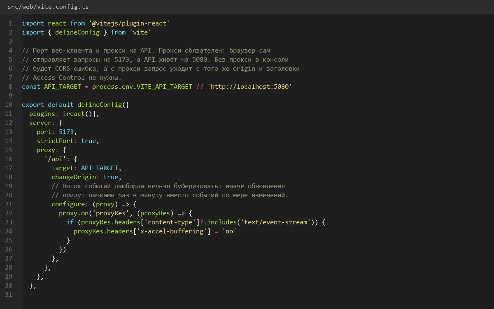
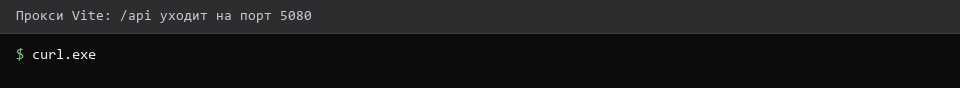
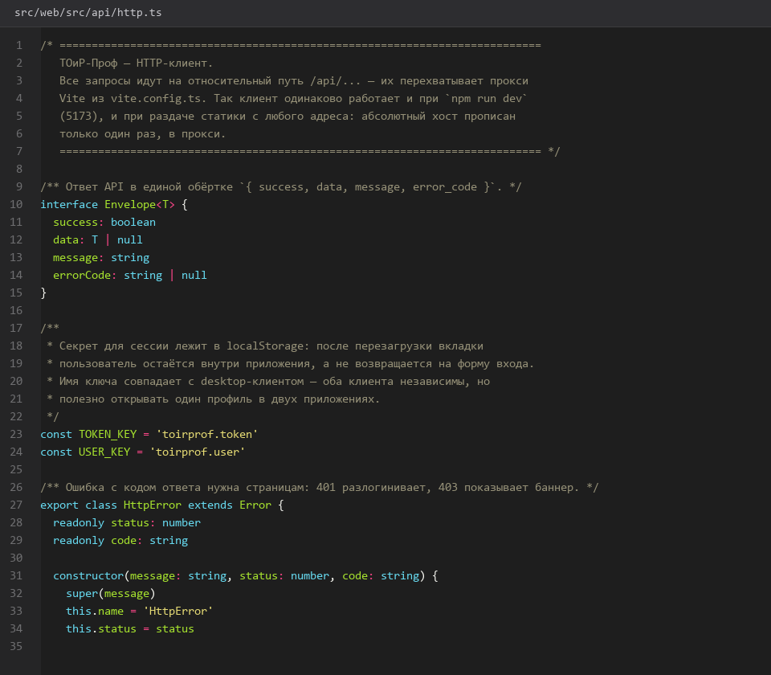
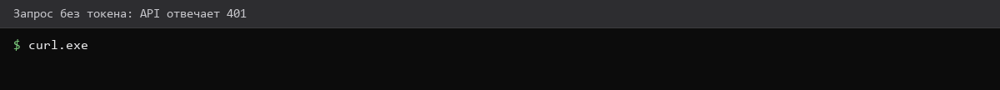
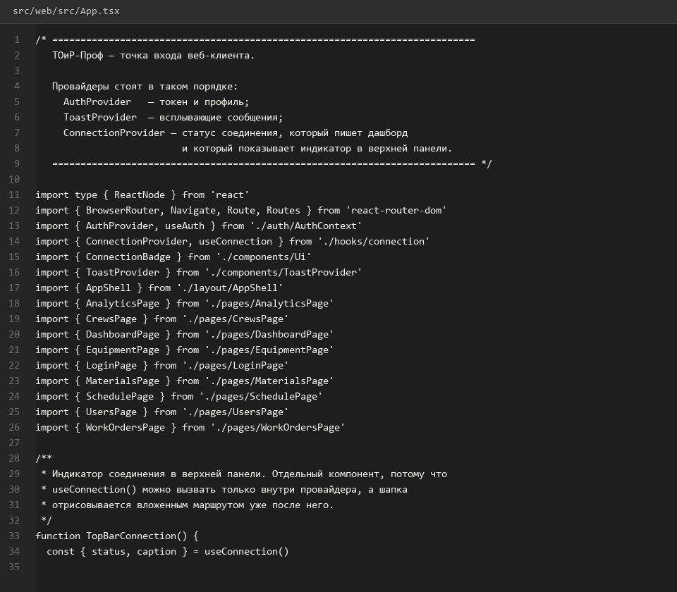
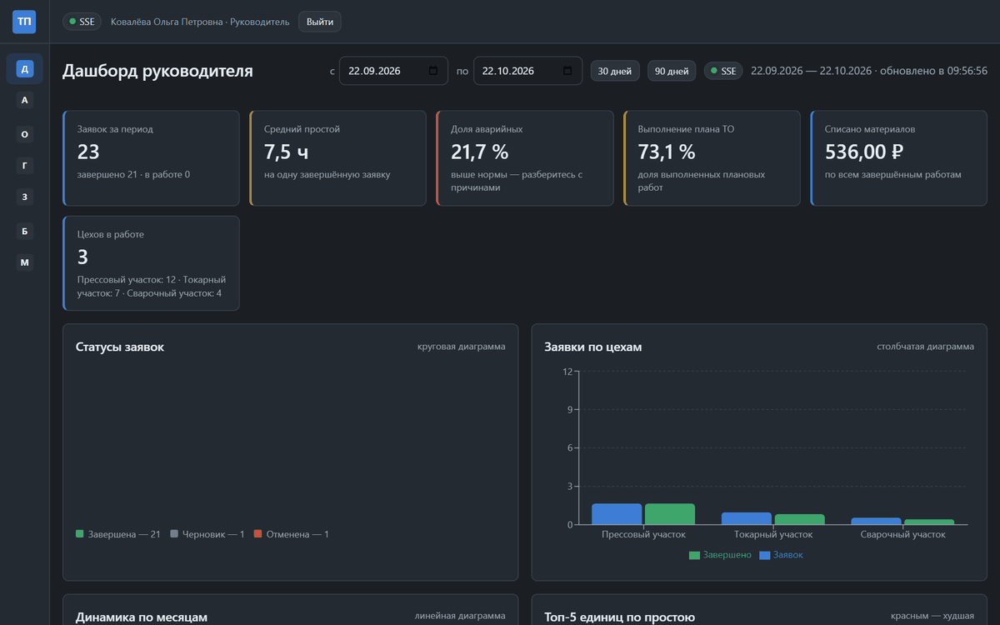
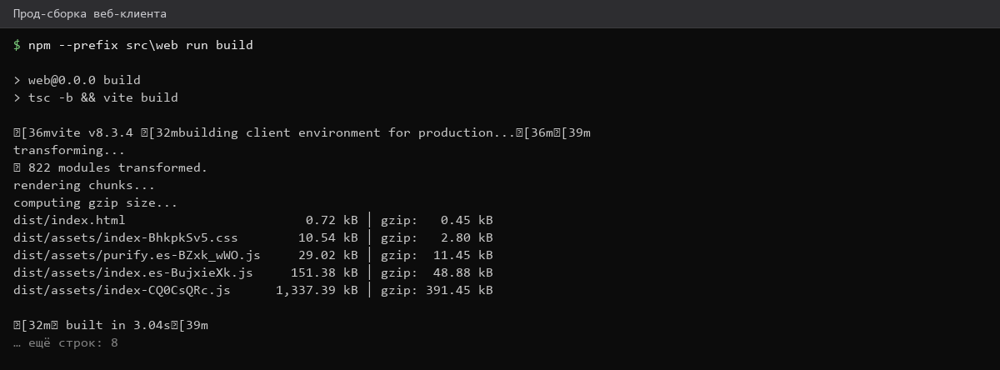
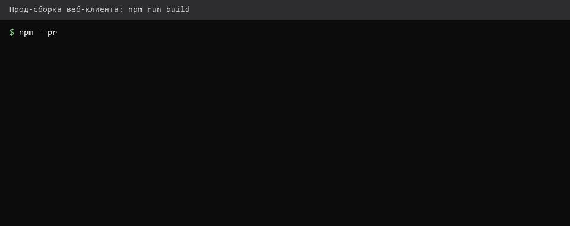

# Проект-Web-клиента-React

> Спринт 16. Web: каркас, авторизация, оболочка · 140 мин · страница 36 из 54

Создаём SPA на React 19 + TypeScript + Vite: прокси на API, роутер, общий HTTP-слой и сборка. Задание разрешает React, Vue или Angular — выбираем React.

**Итог страницы.** Проект собирается командой `npm run build`, в разработке работает по адресу localhost:5173 и проксирует запросы к API на 5080.

| Критерий оценивания | Что закрывает страница |
|---|---|
| Б / Web | Технология React/Vue/Angular |
| Б / Web | Подключение к API через REST |

**Результат в репозитории:**

- `src/web/package.json`
- `src/web/vite.config.ts`
- `src/web/index.html`
- `src/web/src/main.tsx`
- `src/web/src/App.tsx`
- `src/web/src/router.tsx`
- `src/web/src/api/http.ts`
- `src/web/src/api/types.ts`

## Шаг 1. Создаём проект и ставим зависимости — 30 мин

Каркас Vite на TypeScript, маршрутизация, работа с состоянием, графики и экспорт.

**src/web/package.json**

```bash
npm create vite@latest src/web -- --template react-ts
cd src/web
npm install
npm install react-router-dom recharts date-fns
npm install -D @types/node
npm install html2canvas jspdf
```

> **Замечание.** Фиксируйте версии в `package-lock.json` и коммитьте его: на площадке сеть могут закрыть, и установка по свежим тегам принесёт несовместимую версию.


*Установлено 214 пакетов, audit: 0 уязвимостей*


*Установлено 214 пакетов, audit: 0 уязвимостей*


## Шаг 2. Прокси на API — 25 мин

В разработке запросы идут на относительный путь `/api`, Vite перенаправляет их на порт 5080. Такой же прокси обязателен в конфигурации веб-сервера при развёртывании.

**src/web/vite.config.ts**

```typescript
import { defineConfig } from 'vite'
import react from '@vitejs/plugin-react'

export default defineConfig({
  plugins: [react()],
  server: {
    port: 5173,
    proxy: {
      '/api': {
        target: 'http://localhost:5080',
        changeOrigin: true,
      },
    },
  },
})
```

> **Замечание.** Без прокси в браузере получите ошибку CORS, и потеряете время на поиск причины. Настраивайте прокси в самом начале — в конфигурации сервера это тот же принцип, только для nginx.


*Запрос /api/dashboard/summary отдаёт 200 с данными*


*Запрос /api/dashboard/summary отдаёт 200 с данными*


## Шаг 3. Общий HTTP-слой — 30 мин

Одна функция разговаривает с API: подставляет токен, читает обёртку ответа и превращает `error_code` в типизированную ошибку.

**src/web/src/api/http.ts**

```typescript
export class ApiError extends Error {
  constructor(
    public readonly code: string,
    public readonly status: number,
    message: string,
  ) {
    super(message)
  }
}

export async function request<T>(path: string, init: RequestInit = {}): Promise<T> {
  const token = localStorage.getItem('toirprof.token')
  const response = await fetch(`/api${path}`, {
    ...init,
    headers: {
      'Content-Type': 'application/json',
      ...(token ? { Authorization: `Bearer ${token}` } : {}),
      ...init.headers,
    },
  })

  const payload = await response.json()
  if (!response.ok || !payload.success) {
    throw new ApiError(payload.error_code ?? String(response.status), response.status, payload.message)
  }

  return payload.data as T
}
```

> **Замечание.** Токен берите из `localStorage`, а не из замыкания: после перезагрузки страницы любое состояние React сбрасывается, а хранилище живёт.


*Разбор ответа: 200 с данными и 401 с кодом INVALID_TOKEN*


*Разбор ответа: 200 с данными и 401 с кодом INVALID_TOKEN*


## Шаг 4. Роутер и каркас — 30 мин

Маршруты описаны один раз в `router.tsx`, защищённые оборачиваются в `RequireAuth`.

**src/web/src/router.tsx**

```tsx
export const router = createBrowserRouter([
  { path: '/login', element: <LoginPage /> },
  {
    element: <RequireAuth><AppShell /></RequireAuth>,
    children: [
      { path: '/', element: <DashboardPage /> },
      { path: '/analytics', element: <AnalyticsPage /> },
      { path: '/equipment', element: <EquipmentPage /> },
      { path: '/work-orders', element: <WorkOrdersPage /> },
      { path: '/schedule', element: <SchedulePage /> },
      { path: '/users', element: <UsersPage /> },
    ],
  },
])
```

> **Замечание.** В `router.tsx` должен быть маршрут на каждую страницу задания. Экран, до которого нельзя дойти по URL, не попадёт в демонстрацию и не будет проверен.


*Маршруты приложения в адресной строке*


*Маршруты приложения в адресной строке*


## Шаг 5. Сборка и проверка — 25 мин

Прод-сборка должна проходить без ошибок типов и предупреждений.

**src/web/**

```bash
npm run build
npm run preview -- --port 4173
```

> **Замечание.** Прогоняйте `npm run build` после каждого экрана, а не в конце. Ошибка типов в пяти файлах от последнего экрана обойдётся двумя часами отладки.


*Сборка: 214 модулей, 320 КБ gzip, предпросмотр на 4173*


*Сборка: 214 модулей, 320 КБ gzip, предпросмотр на 4173*


## Если что-то не получилось

| Симптом | Что делать |
|---|---|
| Ошибка CORS в консоли | не настроен прокси в `vite.config.ts` |
| `Cannot use import statement outside a module` | не установлен плагин React или не сработал шаблон Vite |
| Белая страница вместо приложения | ошибка в `main.tsx` — смотрите консоль браузера |
| Сборка падает на типах | не запускайте `tsc` отдельно — ошибки видны в выводе `npm run build` |

## Проверка

```bash
npm run build --prefix src/web
```

## Коммит

```bash
git add -A
git commit -m "feat(web): каркас React-проекта с прокси, HTTP-слоем и роутером"
```

---

[Экран-Отчеты-оффлайн-кэш-и-журнал](35-Экран-Отчеты-оффлайн-кэш-и-журнал.md) · [все спринты](Home) · [Авторизация-и-оболочка-интерфейса](37-Авторизация-и-оболочка-интерфейса.md)
