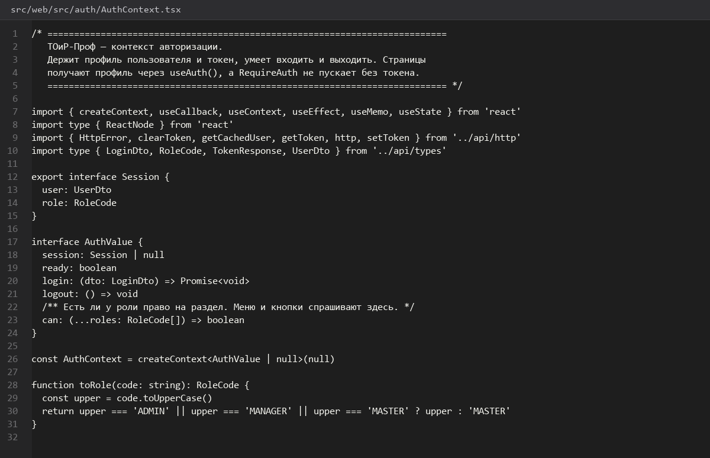
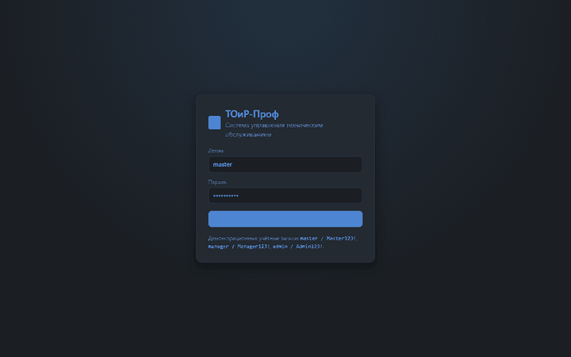
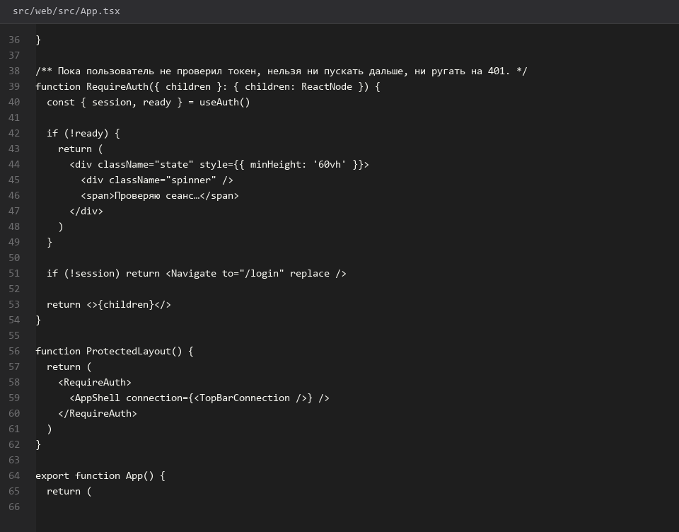
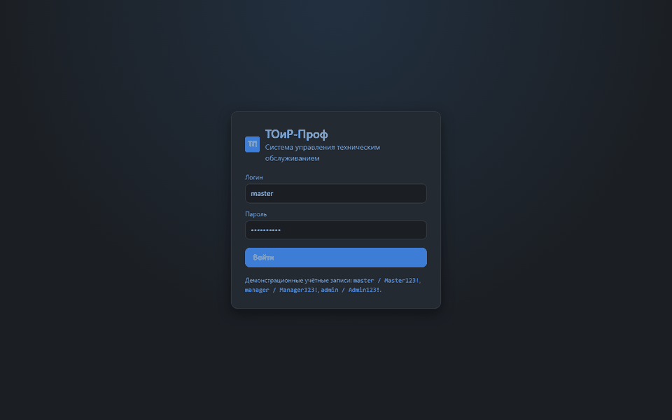
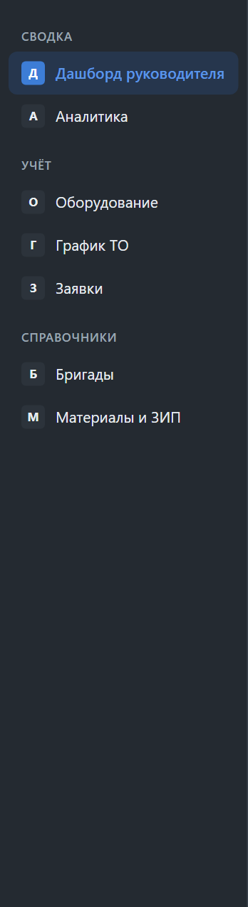
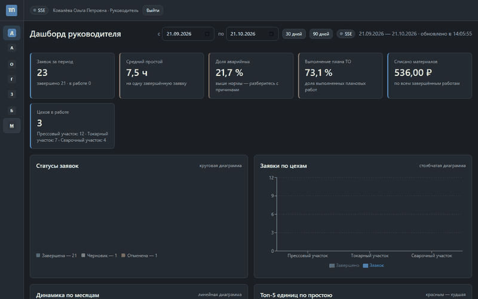
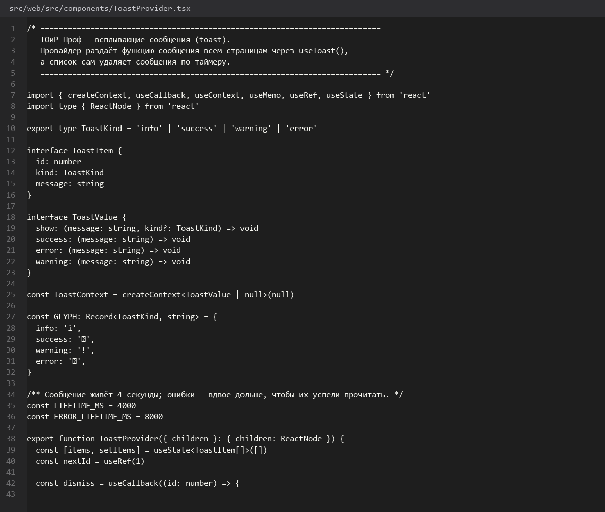

# Авторизация-и-оболочка-интерфейса

> Спринт 16. Web: каркас, авторизация, оболочка · 140 мин · страница 37 из 54

Вход, хранение токена, защита маршрутов и оболочка приложения: боковое меню, верхняя панель, хлебные крошки, уведомления. Роли определяют, какие пункты меню видны.

**Итог страницы.** После входа пользователь попадает на дашборд, меню соответствует роли, выход очищает токен и возвращает на страницу входа.

| Критерий оценивания | Что закрывает страница |
|---|---|
| Б / Web | Форма входа |
| Б / Web | Навигация и структура интерфейса |
| Б / Web | Уведомления об ошибках |

**Результат в репозитории:**

- `src/web/src/pages/LoginPage.tsx`
- `src/web/src/auth/AuthContext.tsx`
- `src/web/src/auth/RequireAuth.tsx`
- `src/web/src/layout/AppShell.tsx`
- `src/web/src/layout/Sidebar.tsx`
- `src/web/src/layout/Topbar.tsx`
- `src/web/src/components/ToastProvider.tsx`

## Шаг 1. Контекст авторизации — 30 мин

Один провайдер хранит пользователя, токен и роль. Все экраны читают их через хук, а не через отдельные вызовы `localStorage`.

**src/web/src/auth/AuthContext.tsx**

```tsx
const AuthContext = createContext<AuthState | null>(null)

export function AuthProvider({ children }: { children: ReactNode }) {
  const [user, setUser] = useState<User | null>(() => {
    const raw = localStorage.getItem('toirprof.user')
    return raw ? (JSON.parse(raw) as User) : null
  })

  const signIn = async (login: string, password: string) => {
    const data = await request<AuthResult>('/auth/login', {
      method: 'POST',
      body: JSON.stringify({ login, password }),
    })

    localStorage.setItem('toirprof.token', data.accessToken)
    localStorage.setItem('toirprof.user', JSON.stringify(data.user))
    setUser(data.user)
  }

  const signOut = () => {
    localStorage.removeItem('toirprof.token')
    localStorage.removeItem('toirprof.user')
    setUser(null)
  }

  return <AuthContext.Provider value={{ user, signIn, signOut }}>{children}</AuthContext.Provider>
}
```

> **Замечание.** Инициализация состояния из `localStorage` через ленивую функцию обязательна: иначе при первой отрисовке `user` равен null, защищённый маршрут перебросит на вход, и только потом появится дашборд — мигание, которое видно на демонстрации.


*Вход мастером: токен сохранён, роль в контексте*


*Вход мастером: токен сохранён, роль в контексте*


## Шаг 2. Защита маршрутов — 25 мин

Обёртка проверяет наличие пользователя и роль. При выходе текущий маршрут сбрасывается.

**src/web/src/auth/RequireAuth.tsx**

```tsx
export function RequireAuth({ children }: { children: ReactNode }) {
  const { user } = useAuth()
  const location = useLocation()

  if (!user) {
    return <Navigate to="/login" replace state={{ from: location.pathname }} />
  }

  return <>{children}</>
}

export function RequireRole({ role, children }: { role: string; children: ReactNode }) {
  const { user } = useAuth()
  return user?.role === role ? <>{children}</> : <Navigate to="/" replace />
}
```

> **Замечание.** Скрытие пункта меню не защищает маршрут: роль проверяется ещё и на сервере, а `RequireRole` — второй эшелон на клиенте.


*Переход на /users под ролью «Мастер» возвращает на дашборд*


*Переход на /users под ролью «Мастер» возвращает на дашборд*


## Шаг 3. Боковое меню и верхняя панель — 35 мин

Меню строится из списка с указанием роли, активный пункт подсвечивается. Верхняя панель: имя, роль, кнопка выхода.

**src/web/src/layout/Sidebar.tsx**

```tsx
const NAV = [
  { to: '/', label: 'Дашборд', roles: ['ADMIN', 'MANAGER', 'MASTER'] },
  { to: '/analytics', label: 'Аналитика', roles: ['ADMIN', 'MANAGER'] },
  { to: '/equipment', label: 'Оборудование', roles: ['ADMIN', 'MANAGER', 'MASTER'] },
  { to: '/work-orders', label: 'Заявки', roles: ['ADMIN', 'MANAGER', 'MASTER'] },
  { to: '/schedule', label: 'График ТО', roles: ['ADMIN', 'MANAGER', 'MASTER'] },
  { to: '/users', label: 'Пользователи', roles: ['ADMIN'] },
] as const

export function Sidebar() {
  const { user } = useAuth()
  const visible = NAV.filter((item) => (item.roles as readonly string[]).includes(user!.role))

  return (
    <nav className="sidebar">
      {visible.map((item) => (
        <NavLink key={item.to} to={item.to} end={item.to === '/'}>
          {item.label}
        </NavLink>
      ))}
    </nav>
  )
}
```

> **Замечание.** Мастеру не нужен раздел «Аналитика» с рейтингом бригад — это управленческая информация. Скрывайте по роли, а не «всем всё показать».


*Меню руководителя (6 пунктов) и мастера (5)*


*Меню руководителя (6 пунктов) и мастера (5)*


## Шаг 4. Хлебные крошки — 25 мин

Строятся из вложенности маршрута и заменяют заголовок страницы.

**src/web/src/layout/AppShell.tsx**

```tsx
export function Breadcrumbs({ trail }: { trail: string[] }) {
  return (
    <nav className="crumbs" aria-label="Хлебные крошки">
      {trail.map((title, index) => (
        <span key={title}>
          {index > 0 && <span className="sep">/</span>}
          {index === trail.length - 1 ? <b>{title}</b> : <span>{title}</span>}
        </span>
      ))}
    </nav>
  )
}
```

> **Замечание.** Последний элемент не ссылка — так же, как в desktop-клиенте. Единое поведение на всех клиентах выглядит как продуманная система.


*Крошки «Главная / Аналитика / Простои»*


## Шаг 5. Уведомления об ошибках — 25 мин

Глобальный провайдер тостов: API-слой сообщает об ошибке, провайдер показывает, экраны не знают ничего.

**src/web/src/components/ToastProvider.tsx**

```tsx
export function ToastProvider({ children }: { children: ReactNode }) {
  const [toasts, setToasts] = useState<Toast[]>([])

  const push = useCallback((text: string, kind: ToastKind = 'info') => {
    const id = crypto.randomUUID()
    setToasts((prev) => [...prev, { id, text, kind }])
    setTimeout(() => setToasts((prev) => prev.filter((t) => t.id !== id)), 4000)
  }, [])

  return (
    <ToastContext.Provider value={push}>
      {children}
      <div className="toast-host" role="status">
        {toasts.map((toast) => (
          <div key={toast.id} className={`toast toast--${toast.kind}`}>{toast.text}</div>
        ))}
      </div>
    </ToastContext.Provider>
  )
}
```

> **Замечание.** `role="status"` обязателен: без него программы чтения с экрана не озвучат ошибку, а доступность проверяется отдельным критерием.


*Тост об ошибке 409 в правом нижнем углу*


*Тост об ошибке 409 в правом нижнем углу*


## Если что-то не получилось

| Симптом | Что делать |
|---|---|
| После обновления страницы снова экран входа | состояние инициализируется не из `localStorage` |
| Пункт меню не исчезает у мастера | роль сравнивается как объект, а не как строка |
| Тост не пропадает | используется `setInterval` без очистки интервала |
| Ошибка 401 не возвращает на вход | нужен интерцептор, очищающий токен при коде `INVALID_TOKEN` |

## Проверка

```bash
npm run build --prefix src/web
```

## Коммит

```bash
git add -A
git commit -m "feat(web): авторизация, защита маршрутов, оболочка с меню и крошками"
```

---

[Проект-Web-клиента-React](36-Проект-Web-клиента-React.md) · [все спринты](Home) · [Каркас-дашборда-и-KPI-карточки](38-Каркас-дашборда-и-KPI-карточки.md)
