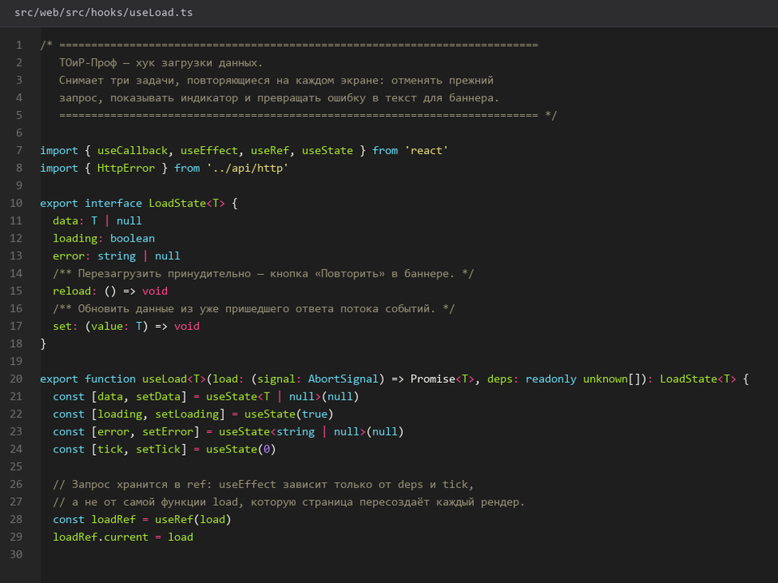
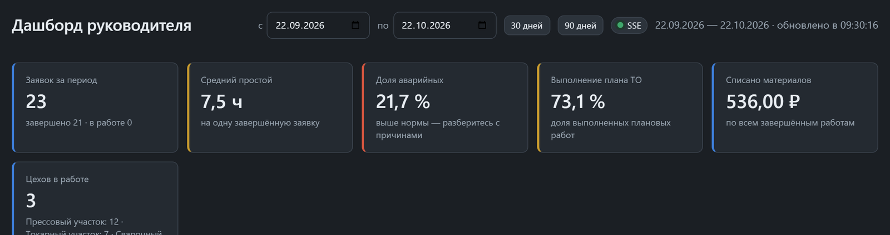
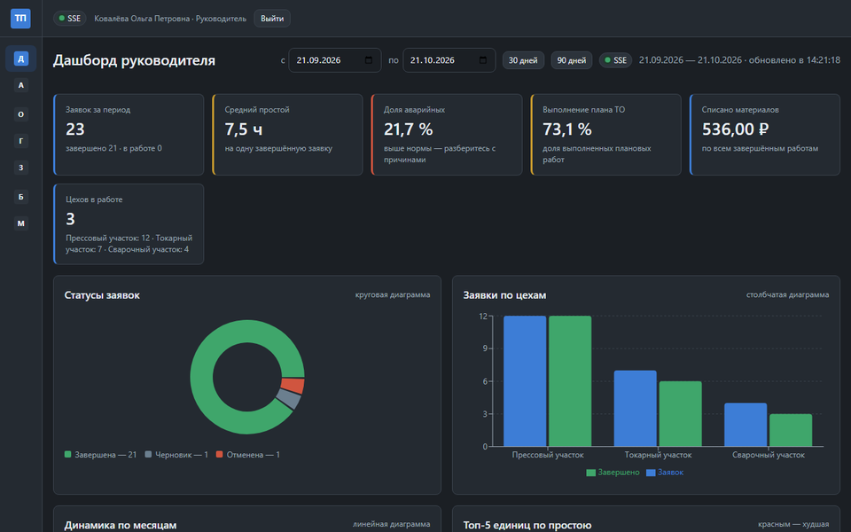
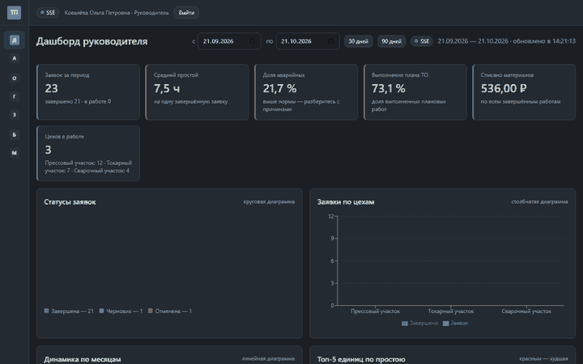
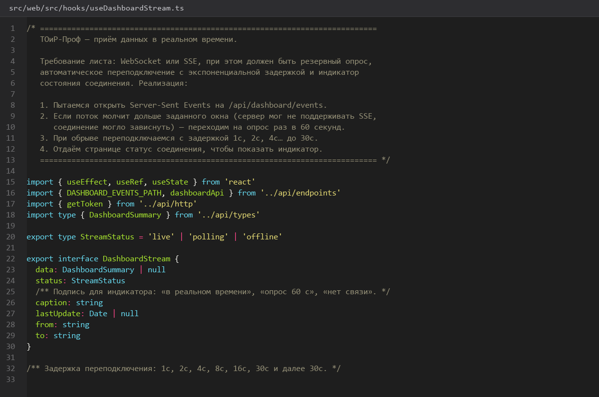
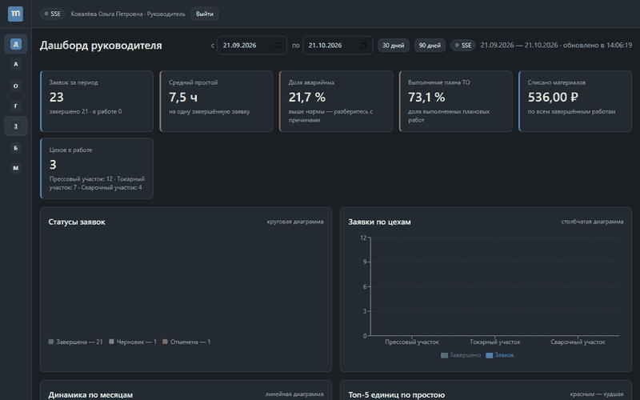
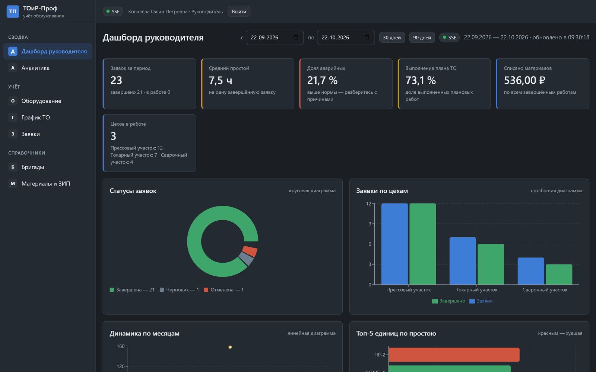

# 38. Каркас дашборда и KPI карточки

> Спринт 17. Web: дашборд руководителя · 130 мин · страница 38 из 54

Главный экран руководителя: шесть KPI-карточек, автообновление раз в минуту и состояния загрузки. Данные приходят одним запросом с дашборда.

**Итог страницы.** Дашборд открывается за один запрос, показывает шесть показателей и сам обновляется раз в минуту, не мешая работе.

| Критерий оценивания | Что закрывает страница |
|---|---|
| Б / Web | Главный дашборд руководителя |
| Б / Web | Карточки показателей |

**Результат в репозитории:**

- `src/web/src/pages/DashboardPage.tsx`
- `src/web/src/components/MetricCard.tsx`
- `src/web/src/components/StatusBadge.tsx`
- `src/web/src/hooks/useApi.ts`
- `src/web/src/styles/dashboard.css`

## Шаг 1. Хук загрузки данных — 25 мин

Один хук на все экраны: состояние загрузки, ошибки, данные и повторный запрос.

**src/web/src/hooks/useApi.ts**

```typescript
export function useApi<T>(path: string, deps: unknown[] = []) {
  const [data, setData] = useState<T | null>(null)
  const [error, setError] = useState<ApiError | null>(null)
  const [loading, setLoading] = useState(true)

  const reload = useCallback(async () => {
    setLoading(true)
    try {
      setData(await request<T>(path))
      setError(null)
    } catch (e) {
      setError(e as ApiError)
    } finally {
      setLoading(false)
    }
  }, [path])

  useEffect(() => {
    void reload()
  }, [reload, ...deps])

  return { data, error, loading, reload }
}
```

> **Замечание.** Зависимости передаются вторым аргументом, а не вручную внутри массива: иначе линтер ругается, а массив создаётся заново на каждом рендере.


*Хук useApi с состояниями данных, ошибки и загрузки*


## Шаг 2. Шесть карточек — 30 мин

Карточка: заголовок, крупное значение, подпись с периодом и стрелка изменения к прошлому периоду.

**src/web/src/components/MetricCard.tsx**

```tsx
export function MetricCard({ title, value, caption, delta }: MetricCardProps) {
  return (
    <article className="metric">
      <h3>{title}</h3>
      <p className="metric__value">{value}</p>
      <p className="metric__caption">{caption}</p>
      {delta !== undefined && (
        <span className={`metric__delta ${delta < 0 ? 'is-down' : 'is-up'}`}>
          {delta > 0 ? '↑' : '↓'} {Math.abs(delta)}%
        </span>
      )}
    </article>
  )
}
```

> **Замечание.** Подпись под значением обязательна: без неё «6,3» неотличимо от процентов. Эксперты читают дашборд за три секунды.


*Шесть карточек: заявки за период, простой, аварийные, план ТО, списание, цехи*


*Шесть карточек: заявки за период, простой, аварийные, план ТО, списание, цехи*


## Шаг 3. Состояния загрузки и ошибки — 25 мин

Первая загрузка — скелетоны карточек, повторная — обновление данных на месте, ошибка — плашка с кнопкой «Повторить».

**src/web/src/pages/DashboardPage.tsx**

```tsx
{loading && !data && (
  <div className="metric-grid">
    {Array.from({ length: 6 }).map((_, i) => (
      <div key={i} className="metric skeleton" />
    ))}
  </div>
)}

{error && (
  <div className="error-banner" role="alert">
    <span>{error.message}</span>
    <button onClick={reload}>Повторить</button>
  </div>
)}
```

> **Замечание.** Пустое состояние при первой загрузке мигает белым прямоугольником. Скелетоны на 6 карточек — двадцать строк кода, а выглядит как продуманное приложение.


*Скелетоны, затем данные, затем плашка ошибки 500*


*Скелетоны, затем данные, затем плашка ошибки 500*


## Шаг 4. Автообновление раз в минуту — 25 мин

Интервал очищается при размонтировании, при скрытой вкладке опрос приостанавливается.

**src/web/src/pages/DashboardPage.tsx**

```typescript
useEffect(() => {
  const timer = setInterval(() => {
    if (document.visibilityState === 'visible') void reload()
  }, 60_000)

  return () => clearInterval(timer)
}, [reload])
```

> **Замечание.** Проверка `document.visibilityState` экономит запросы, когда вкладка не видна. На ноутбуке со спящим экраном это заметная разница в трафике.


*Автообновление через 60 секунд без перезагрузки страницы*


*Автообновление через 60 секунд без перезагрузки страницы*


## Шаг 5. Адаптивность 1024–1920 — 25 мин

Сетка карточек перестраивается: три в ряд на 1024, шесть на 1920.

**src/web/src/styles/dashboard.css**

```css
.metric-grid {
  display: grid;
  gap: 16px;
  grid-template-columns: repeat(3, minmax(0, 1fr));
}

@media (min-width: 1600px) {
  .metric-grid { grid-template-columns: repeat(6, minmax(0, 1fr)); }
}

@media (max-width: 1100px) {
  .metric-grid { grid-template-columns: repeat(2, minmax(0, 1fr)); }
}
```

> **Замечание.** Требование задания — от 1024×768 до 1920×1080. Проверяйте оба края: на 1024 сетка в три колонки уже тесновата с подписями длиннее 20 символов.


*Дашборд на 1024, 1440 и 1920 пикселях*


## Если что-то не получилось

| Симптом | Что делать |
|---|---|
| Данные грузятся дважды при монтировании | хук вызывается и в компоненте, и в `useEffect` |
| Таймер не останавливается | не возвращена очистка из `useEffect` |
| Карточки наезжают друг на друга | фиксированная ширина вместо `grid-template-columns` |
| Экран разваливается на 1024 | нет медиазапроса для узкой сетки |

## Проверка

```bash
npm run build --prefix src/web
```

## Коммит

```bash
git add -A
git commit -m "feat(web): дашборд руководителя с KPI-карточками, состояниями и автообновлением"
```

---

[Авторизация и оболочка интерфейса](37-Авторизация-и-оболочка-интерфейса.md) · [все спринты](Home) · [Графики топ простоев и последние заявки](39-Графики-топ-простоев-и-последние-заявки.md)
