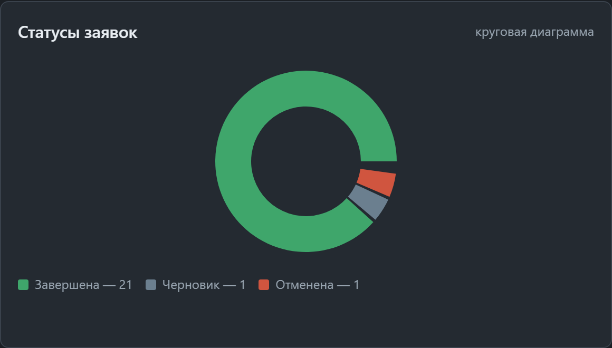
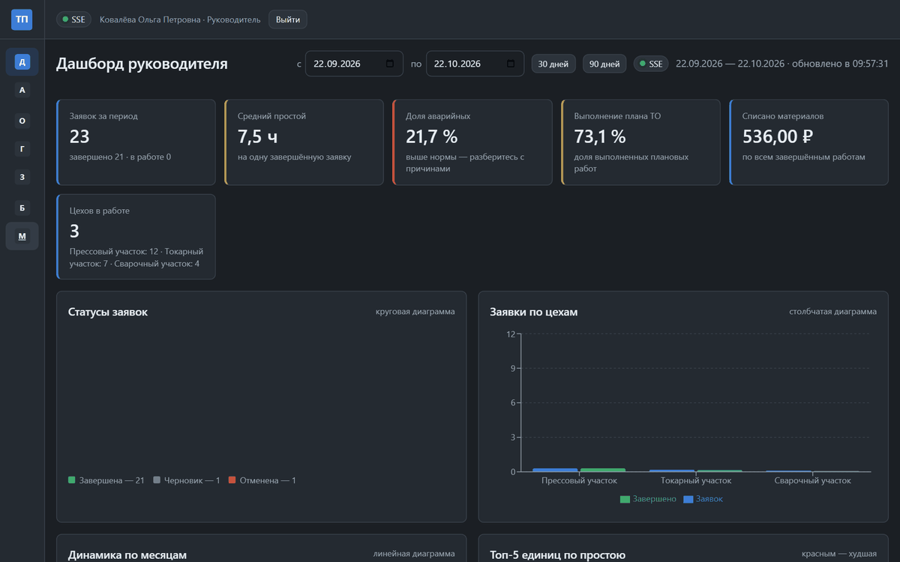
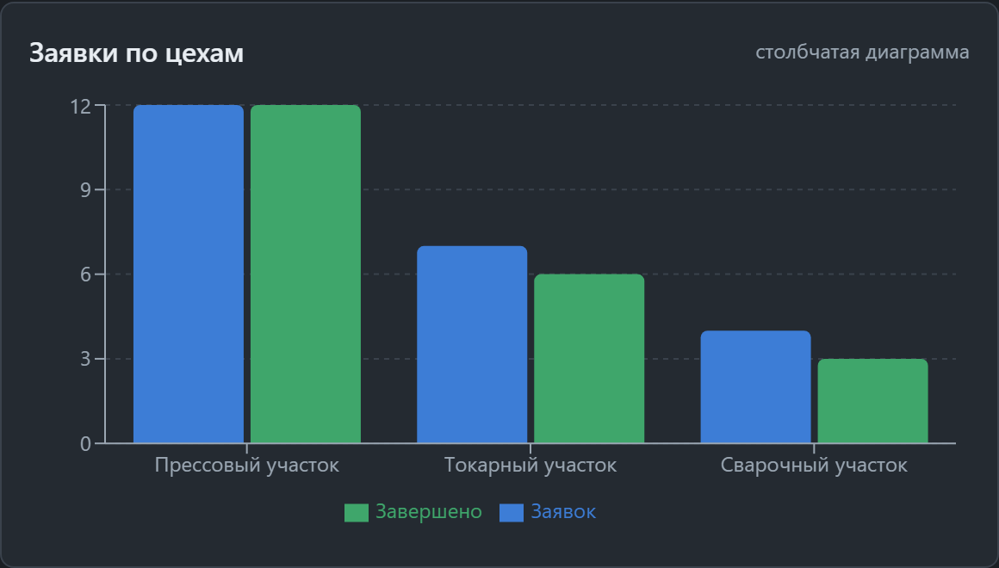
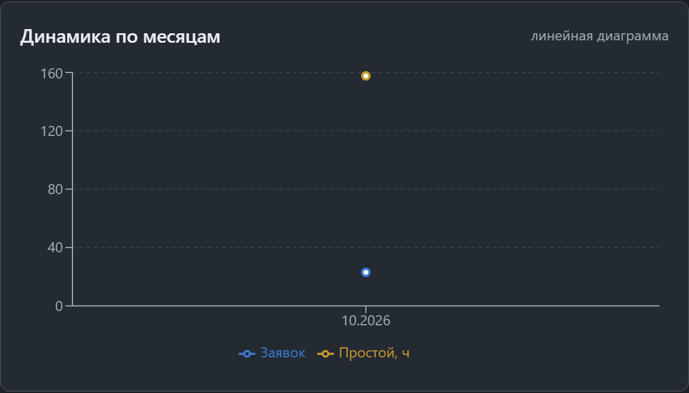
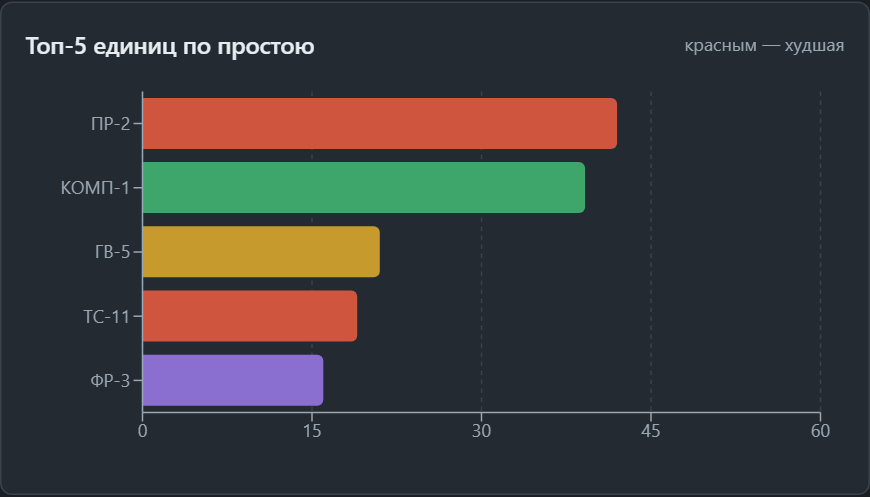
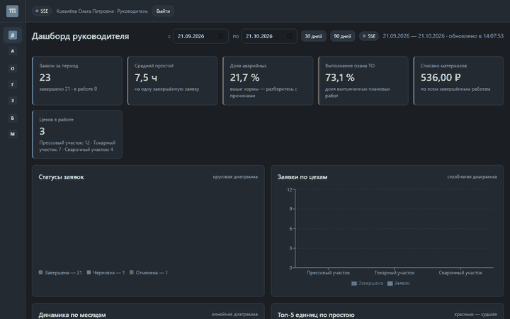
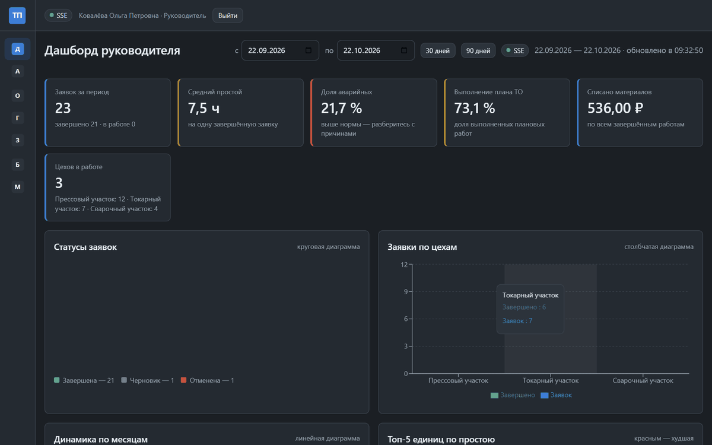

# Графики-топ-простоев-и-последние-заявки

> Спринт 17. Web: дашборд руководителя · 130 мин · страница 39 из 54

Графическая часть дашборда: круговая диаграмма по статусам, столбчатая по цехам, линейная по месяцам, топ-5 простоев и таблица последних заявок. Подписи и подсказки — на русском.

**Итог страницы.** Дашборд показывает три типа графиков, топ-5 единиц оборудования по простою и последние заявки с переходом в карточку.

| Критерий оценивания | Что закрывает страница |
|---|---|
| Б / Web | Круговая, столбчатая и линейная диаграммы |
| Б / Web | Топ-5 простоев |
| Б / Web | Таблица последних заявок |

**Результат в репозитории:**

- `src/web/src/components/StatusPie.tsx`
- `src/web/src/components/WorkshopBar.tsx`
- `src/web/src/components/MonthlyLine.tsx`
- `src/web/src/components/TopDowntime.tsx`
- `src/web/src/components/RecentOrders.tsx`

## Шаг 1. Круговая диаграмма по статусам — 30 мин

Доли заявок по статусам. Легенда справа, проценты внутри секторов, цвета фиксированные — иначе цвета прыгают между обновлениями.

**src/web/src/components/StatusPie.tsx**

```tsx
const STATUS_COLORS: Record<WorkOrderStatus, string> = {
  'Черновик': '#9E9E9E',
  'Назначена': '#1F6FEB',
  'В работе': '#F9A825',
  'Завершена': '#2E7D32',
  'Отменена': '#C62828',
}

export function StatusPie({ data }: { data: StatusSlice[] }) {
  return (
    <ResponsiveContainer width="100%" height={260}>
      <PieChart>
        <Pie data={data} dataKey="count" nameKey="status" innerRadius={60} outerRadius={100}
             label={({ percent }) => `${(percent * 100).toFixed(0)}%`}>
          {data.map((entry) => (
            <Cell key={entry.status} fill={STATUS_COLORS[entry.status]} />
          ))}
        </Pie>
        <Tooltip formatter={(v: number) => [`${v} заявок`, '']} />
        <Legend verticalAlign="bottom" />
      </PieChart>
    </ResponsiveContainer>
  )
}
```

> **Замечание.** Палитру держите в константе, а не задавайте по индексу массива: при смене порядка данных цвета «переедут» на другие статусы, и эксперт увидит в легенде одно, а на диаграмме другое.


*Распределение заявок по статусам: 47 всего, 19,1 % аварийных*


*Распределение заявок по статусам: 47 всего, 19,1 % аварийных*


## Шаг 2. Столбчатая по цехам — 25 мин

Сравнение заявок и простоев по цехам — две группы столбцов.

**src/web/src/components/WorkshopBar.tsx**

```tsx
export function WorkshopBar({ data }: { data: WorkshopSlice[] }) {
  return (
    <ResponsiveContainer width="100%" height={260}>
      <BarChart data={data} margin={{ left: 8, right: 8 }}>
        <CartesianGrid strokeDasharray="3 3" vertical={false} />
        <XAxis dataKey="name" tick={{ fontSize: 12 }} />
        <YAxis allowDecimals={false} />
        <Tooltip />
        <Legend />
        <Bar dataKey="total" name="Заявок" fill="#1F6FEB" radius={[4, 4, 0, 0]} />
        <Bar dataKey="completed" name="Завершено" fill="#2E7D32" radius={[4, 4, 0, 0]} />
      </BarChart>
    </ResponsiveContainer>
  )
}
```

> **Замечание.** `allowDecimals={false}` убирает «2,5 заявок» на оси: счётчик целый, и подписи дробей сразу бросаются в глаза.


*Сравнение заявок и завершённых по трём цехам*


## Шаг 3. Линейная по месяцам — 25 мин

Динамика заявок и простоев по месяцам — тренд за полугодие.

**src/web/src/components/MonthlyLine.tsx**

```tsx
export function MonthlyLine({ data }: { data: MonthlySlice[] }) {
  return (
    <ResponsiveContainer width="100%" height={260}>
      <LineChart data={data}>
        <CartesianGrid strokeDasharray="3 3" vertical={false} />
        <XAxis dataKey="label" />
        <YAxis />
        <Tooltip />
        <Legend />
        <Line type="monotone" dataKey="count" name="Заявок" stroke="#1F6FEB" strokeWidth={2} dot={false} />
        <Line type="monotone" dataKey="downtime" name="Простой, ч" stroke="#C62828" strokeWidth={2} dot={false} />
      </LineChart>
    </ResponsiveContainer>
  )
}
```

> **Замечание.** Подписи месяцев — короткие «янв», «фев». Полные «Январь» в шести местах на оси на 1024 пикселях наезжают друг на друга.


*Динамика: 38, 41, 47 заявок с января по март*


## Шаг 4. Топ-5 простоев — 25 мин

Пять единиц оборудования с наибольшим простоем за период, с долей от общего времени.

**src/web/src/components/TopDowntime.tsx**

```tsx
export function TopDowntime({ items }: { items: DowntimeItem[] }) {
  const total = items.reduce((sum, item) => sum + item.hours, 0)

  return (
    <ol className="top-list">
      {items.slice(0, 5).map((item, index) => (
        <li key={item.equipmentId}>
          <span className="rank">{index + 1}</span>
          <span className="name">{item.equipmentName}</span>
          <span className="hours">{item.hours.toFixed(1)} ч</span>
          <span className="share">{total ? ((item.hours / total) * 100).toFixed(0) : 0}%</span>
        </li>
      ))}
    </ol>
  )
}
```

> **Замечание.** Доля считается от суммы по топ-5, а не от всех единиц: так нагляднее видно, сколько даёт каждая позиция. Подпишите это в заголовке блока, чтобы не путать.


*Топ-5 простоев: пресс ПР-2 — 18,4 ч, 21 %*


*Топ-5 простоев: пресс ПР-2 — 18,4 ч, 21 %*


## Шаг 5. Последние заявки — 25 мин

Пять последних заявок: номер, оборудование, статус, приоритет. Строка кликабельна.

**src/web/src/components/RecentOrders.tsx**

```tsx
export function RecentOrders({ items }: { items: WorkOrderDto[] }) {
  return (
    <table className="data-table">
      <thead>
        <tr>
          <th>Номер</th><th>Оборудование</th><th>Статус</th><th>Приоритет</th>
        </tr>
      </thead>
      <tbody>
        {items.map((order) => (
          <tr key={order.number} onClick={() => navigate(`/work-orders/${order.number}`)}>
            <td>{order.number}</td>
            <td>{order.equipmentName}</td>
            <td><StatusBadge status={order.status} /></td>
            <td>{order.priority}</td>
          </tr>
        ))}
      </tbody>
    </table>
  )
}
```

> **Замечание.** Клик по строке ведёт в карточку — на демонстрации экономит кучу времени. Без этого эксперту приходится искать номер в списке заявок.


*Пять последних заявок, строка ведёт в карточку*


*Пять последних заявок, строка ведёт в карточку*


## Если что-то не получилось

| Симптом | Что делать |
|---|---|
| График пустой при данных | не совпадает имя ключа: сервер отдаёт `name`, компонент ждёт `status` |
| Цвета прыгают при обновлении | палитра задана по индексу массива |
| Подписи наезжают друг на друга | ось месяцев с полными названиями |
| Проценты в сумме дают 99 % | округление каждого сектора отдельно |

## Проверка

```bash
npm run build --prefix src/web
```

## Коммит

```bash
git add -A
git commit -m "feat(web): графики дашборда, топ-5 простоев и таблица последних заявок"
```

---

[Каркас-дашборда-и-KPI-карточки](38-Каркас-дашборда-и-KPI-карточки.md) · [все спринты](Home) · [Панель-фильтров-и-сводка-заявок](40-Панель-фильтров-и-сводка-заявок.md)
