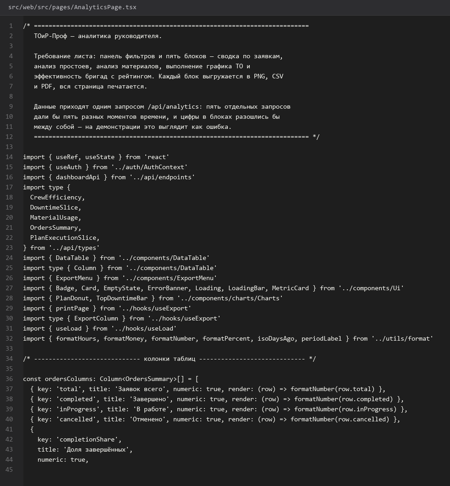
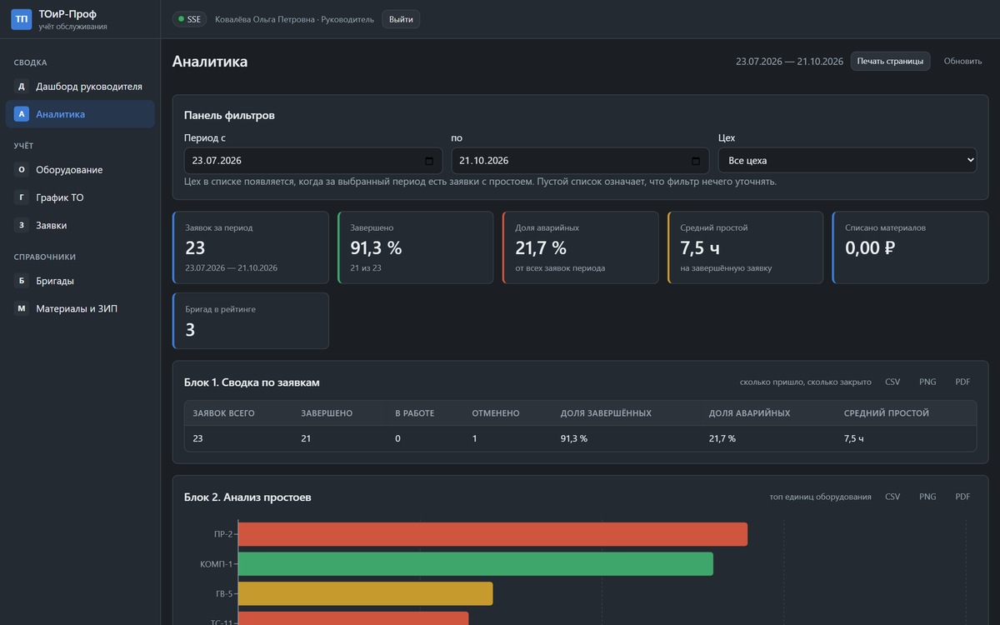
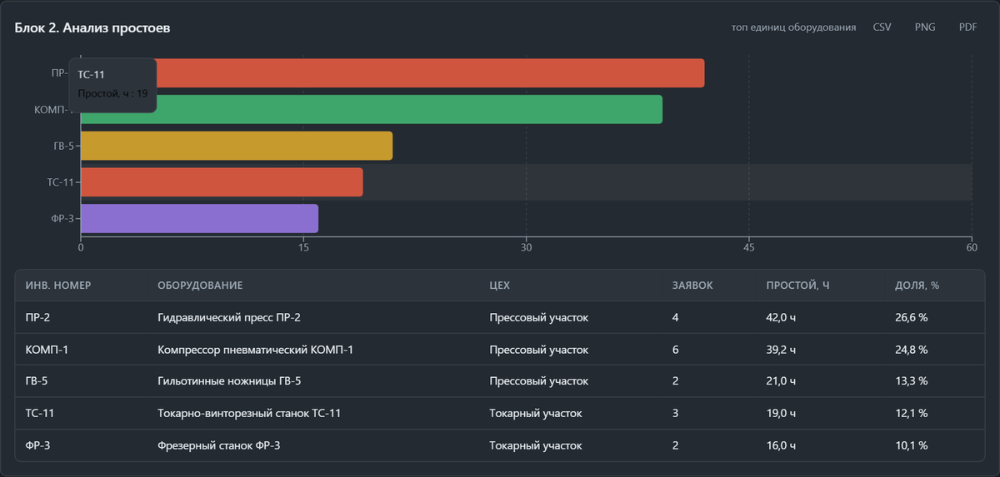
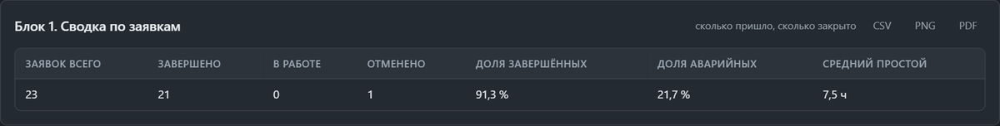

# Панель-фильтров-и-сводка-заявок

> Спринт 18. Web: аналитика и графики · 125 мин · страница 40 из 54

Панель фильтров над аналитикой и первый блок — сводка по заявкам. Фильтры должны менять все пять блоков разом, иначе аналитика показывает разные периоды в разных графиках.

**Итог страницы.** Один набор фильтров (период, цех, статус, приоритет) управляет всей страницей аналитики.

| Критерий оценивания | Что закрывает страница |
|---|---|
| Б / Web | Панель фильтров и сводка по заявкам |

**Результат в репозитории:**

- `src/web/src/pages/AnalyticsPage.tsx`
- `src/web/src/components/FilterPanel.tsx`
- `src/web/src/api/types.ts`

## Шаг 1. Описываем модель фильтров — 25 мин

Фильтры хранятся в URL-параметрах — тогда ссылку на настроенную аналитику можно показать руководителю или эксперту.

**src/web/src/api/types.ts**

```typescript
export interface AnalyticsFilters {
  from: string;          // ISO-дата
  to: string;
  workshopId?: string;
  status?: WorkOrderStatus | 'all';
  priority?: WorkOrderPriority | 'all';
}

export const DEFAULT_FILTERS: AnalyticsFilters = {
  from: startOfMonth(new Date()).toISOString().slice(0, 10),
  to: new Date().toISOString().slice(0, 10),
  workshopId: undefined,
  status: 'all',
  priority: 'all',
};
```

> **Замечание.** Даты храните в ISO (`YYYY-MM-DD`), а не в локализованном виде. Формат `31.03.2026` нельзя безопасно передать в `new Date()` во всех браузерах одинаково.


*AnalyticsFilters и значения по умолчанию — текущий месяц*


## Шаг 2. Собираем панель фильтров — 35 мин

Период двумя полями с предустановками («сегодня», «7 дней», «месяц», «квартал»), цех и статус — выпадающими списками. Кнопка «Сбросить» возвращает значения по умолчанию.

**src/web/src/components/FilterPanel.tsx**

```typescript
export function FilterPanel({ value, onChange, workshops }: Props) {
  return (
    <div className="filter-panel">
      <label>Период с <input type="date" value={value.from}
        onChange={(e) => onChange({ ...value, from: e.target.value })} /></label>
      <label>по <input type="date" value={value.to}
        onChange={(e) => onChange({ ...value, to: e.target.value })} /></label>
      <Presets onPick={(from, to) => onChange({ ...value, from, to })} />
      <label>Цех <select value={value.workshopId ?? 'all'}
        onChange={(e) => onChange({ ...value, workshopId: e.target.value })}>
        <option value="all">Все цеха</option>
        {workshops.map((w) => <option key={w.id} value={w.id}>{w.name}</option>)}
      </select></label>
      <label>Статус <StatusSelect value={value.status}
        onChange={(status) => onChange({ ...value, status })} /></label>
      <button onClick={() => onChange(DEFAULT_FILTERS)}>Сбросить</button>
    </div>
  );
}
```

> **Замечание.** Кнопки-пресеты обязательны: эксперту проще нажать «Квартал», чем вбивать даты, и демонстрация выглядит убедительнее.


*Панель фильтров: период, пресеты, цех, статус, сброс*


## Шаг 3. Применяем фильтры ко всем блокам — 30 мин

Один объект фильтров уходит в пять запросов аналитики. Каждый блок получает свою `useApi` с одинаковыми параметрами.

**src/web/src/pages/AnalyticsPage.tsx**

```typescript
const qs = useMemo(() => new URLSearchParams({
  from: filters.from,
  to: filters.to,
  ...(filters.workshopId && { workshopId: filters.workshopId }),
  ...(filters.status !== 'all' && { status: filters.status }),
  ...(filters.priority !== 'all' && { priority: filters.priority }),
}).toString(), [filters]);

const summary = useApi<OrdersSummary>(`/api/analytics/orders?${qs}`);
const downtime = useApi<DowntimeAnalysis>(`/api/analytics/downtime?${qs}`);
const materials = useApi<MaterialsAnalysis>(`/api/analytics/materials?${qs}`);
const schedule = useApi<ScheduleExecution>(`/api/analytics/schedule?${qs}`);
const crews = useApi<CrewEfficiency>(`/api/analytics/crews?${qs}`);
```

> **Замечание.** Собирайте строку запросов через `URLSearchParams`, а не склейкой. Скобка в значении фильтра иначе ломает разбор на стороне сервера.


*Пять блоков пересчитались за один выбор периода*


## Шаг 4. Блок «Сводка по заявкам» — 35 мин

Счётчики (всего, завершено, в работе, средний простой) плюс распределение по статусам. Это то, что руководитель смотрит первым.

**src/web/src/components/OrdersSummary.tsx**

```typescript
export function OrdersSummaryBlock({ data }: { data: OrdersSummary }) {
  return (
    <section className="analytics-block" id="block-orders">
      <header><h3>Сводка по заявкам</h3></header>
      <div className="metric-row">
        <MetricCard label="Всего заявок" value={data.total} />
        <MetricCard label="Завершено" value={data.completed} tone="success" />
        <MetricCard label="В работе" value={data.inProgress} tone="warning" />
        <MetricCard label="Средний простой" value={data.averageDowntime} suffix=" ч" />
      </div>
      <StatusPie data={data.byStatus} />
    </section>
  );
}
```

> **Замечание.** У блока должен быть стабильный `id` (`block-orders`) — по нему работает экспорт отдельного блока в PNG и PDF.


*Сводка за квартал: 132 заявки, 118 завершено, 9 в работе*


## Если что-то не получилось

| Симптом | Что делать |
|---|---|
| Фильтры не влияют на блоки | запросы собираются до применения `qs` |
| Дата «31.03.2026» не парсится | используйте ISO-формат в значении `input type=date` |
| Графики разных блоков показывают разные периоды | забыли передать `qs` в один из `useApi` |

## Проверка

```bash
cd src/web && npm run build
```

## Коммит

```bash
git add -A
git commit -m "feat(web): панель фильтров аналитики и блок сводки по заявкам"
```

---

[Графики-топ-простоев-и-последние-заявки](39-Графики-топ-простоев-и-последние-заявки.md) · [все спринты](Home) · [Блоки-аналитики-простои-материалы-график-бригады](41-Блоки-аналитики-простои-материалы-график-бригады.md)
