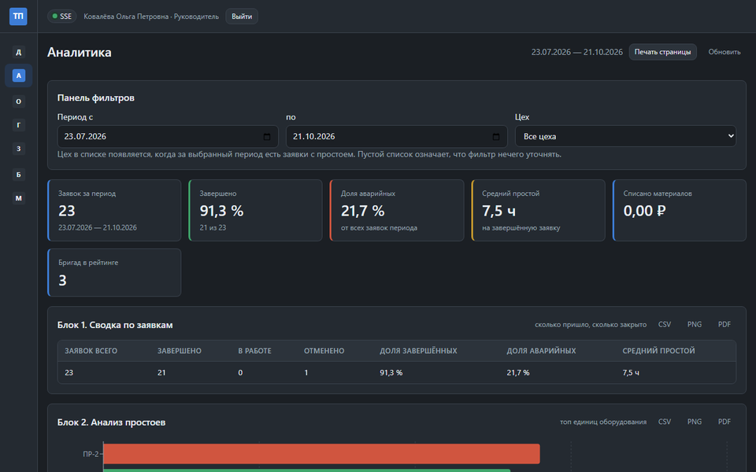
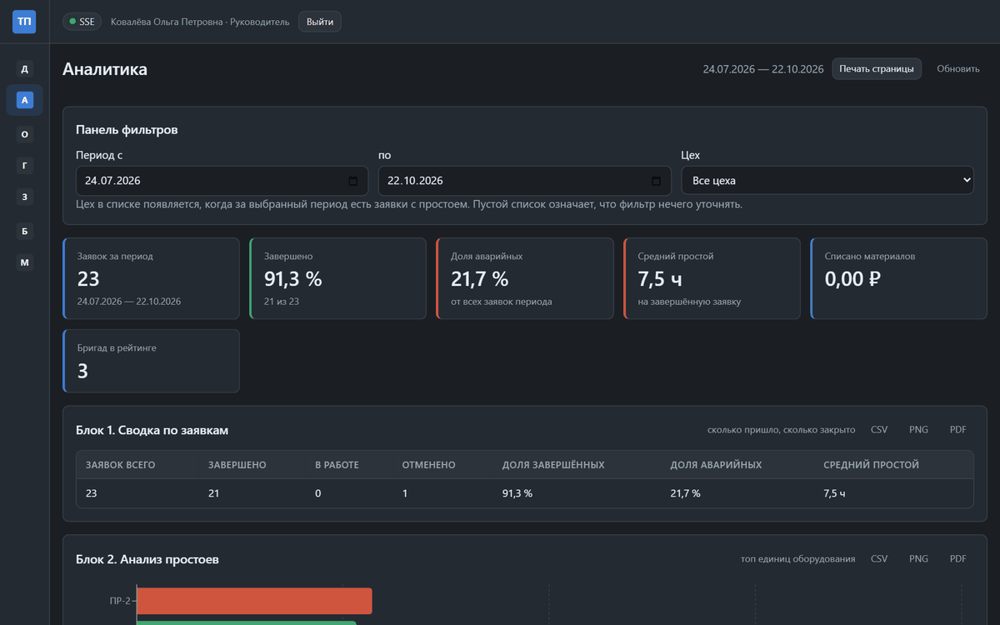
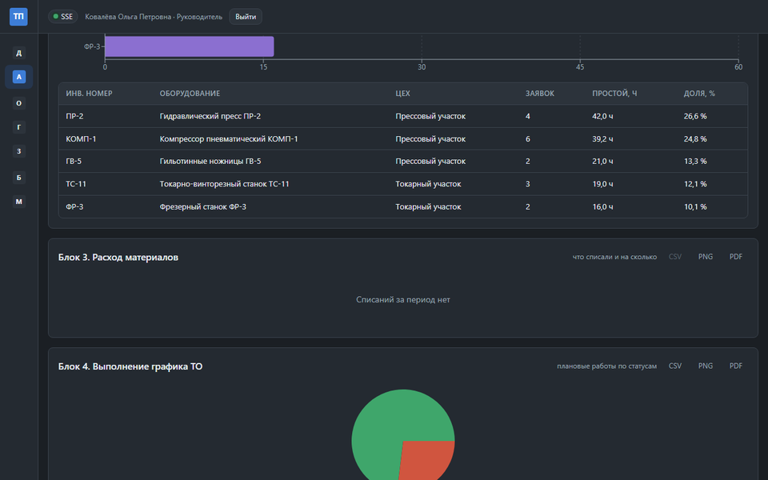
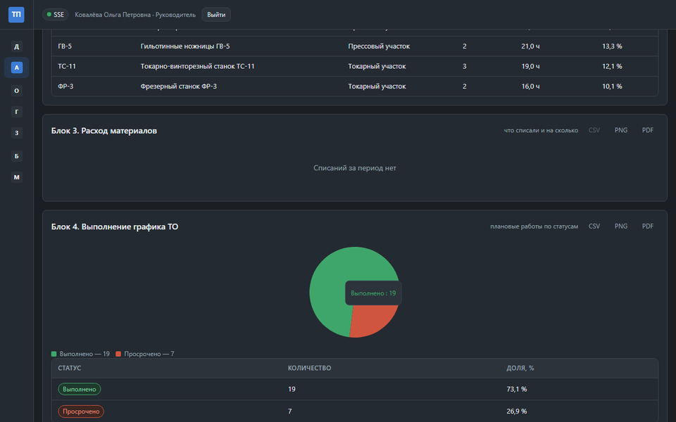
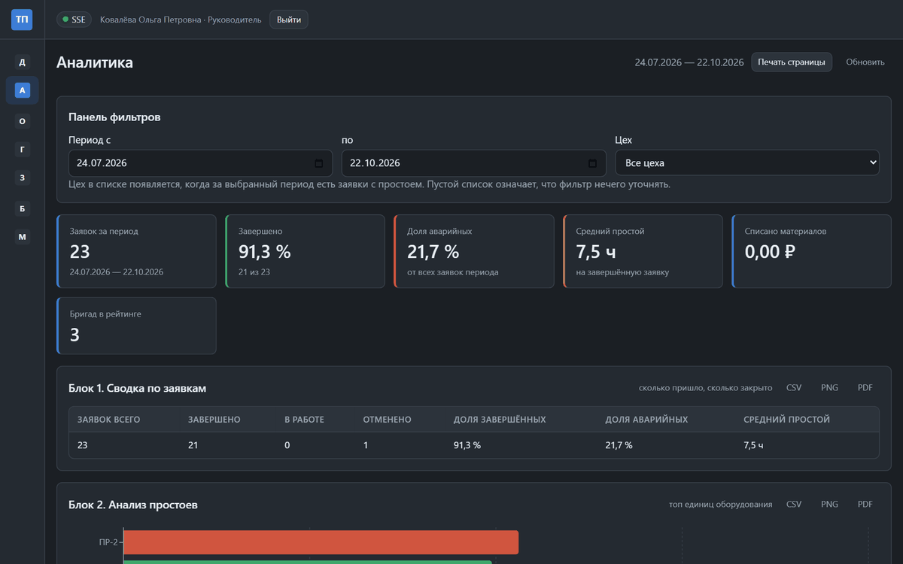
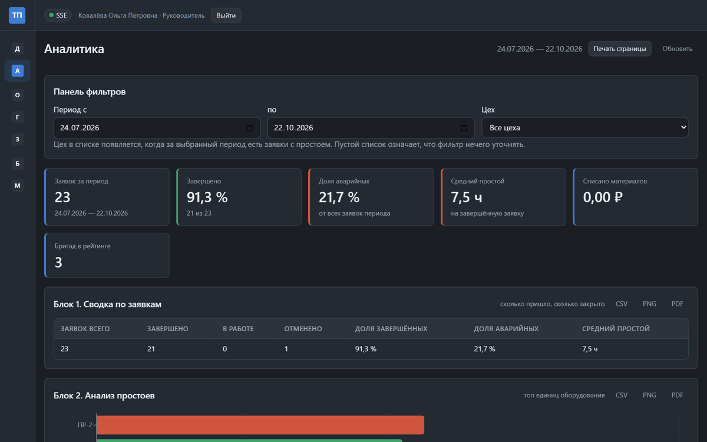
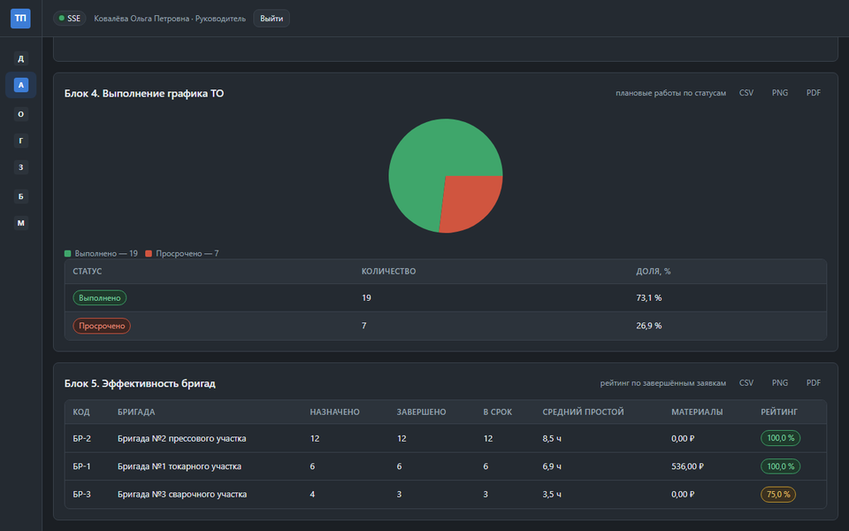
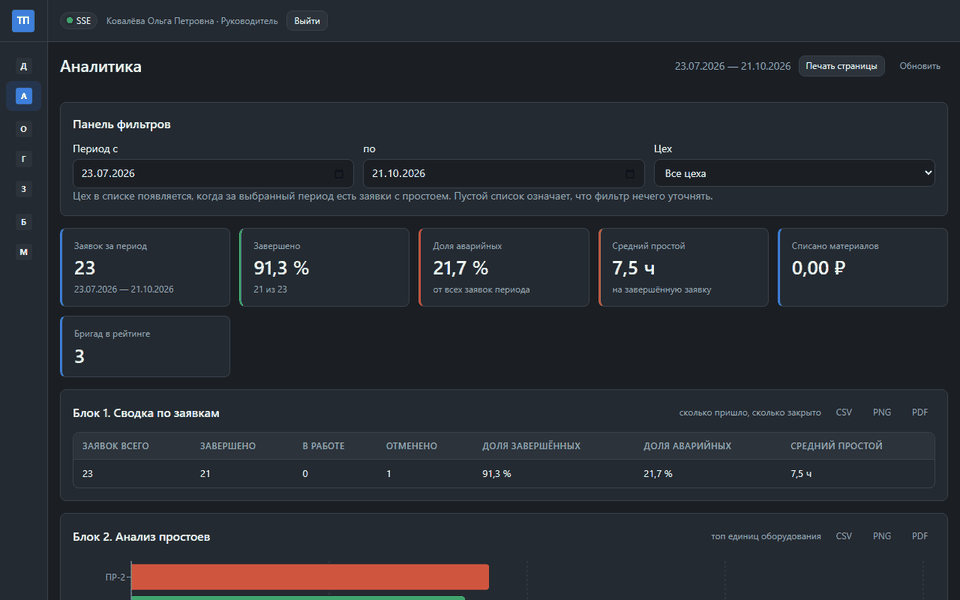

# 41. Блоки аналитики простои материалы график бригады

> Спринт 18. Web: аналитика и графики · 145 мин · страница 41 из 54

Четыре оставшихся блока аналитики: простои, материалы, выполнение графика ТО и эффективность бригад с рейтингом. Каждый блок — независимый компонент со своим запросом и своим состоянием загрузки.

**Итог страницы.** Страница аналитики закрывает все пять блоков из задания и обновляется одним движением фильтра.

| Критерий оценивания | Что закрывает страница |
|---|---|
| Б / Web | Анализ простоев, материалов, графика и бригад |

**Результат в репозитории:**

- `src/web/src/components/DowntimeBlock.tsx`
- `src/web/src/components/MaterialsBlock.tsx`
- `src/web/src/components/ScheduleExecutionBlock.tsx`
- `src/web/src/components/CrewRatingBlock.tsx`

## Шаг 1. Анализ простоев — 30 мин

Горизонтальная диаграмма топ-5 единиц по суммарному простою за период плюс среднее по цеху — это ответ на вопрос «где теряем время».

**src/web/src/components/DowntimeBlock.tsx**

```typescript
export function DowntimeBlock({ data }: { data: DowntimeAnalysis }) {
  return (
    <section className="analytics-block" id="block-downtime">
      <h3>Анализ простоев</h3>
      <ul className="downtime-list">
        {data.top.map((item) => (
          <li key={item.equipmentId}>
            <span className="name">{item.equipmentName}</span>
            <span className="bar" style={{ width: `${(item.hours / data.max) * 100}%` }} />
            <span className="value">{item.hours.toFixed(1)} ч</span>
            <span className="share">{item.share.toFixed(0)} %</span>
          </li>
        ))}
      </ul>
      <p className="hint">Средний простой по цеху: {data.averageHours.toFixed(1)} ч</p>
    </section>
  );
}
```

> **Замечание.** Делите на `data.max`, а не на константу 24 или 100. Иначе при резком росте простоя все полосы кроются в один пиксель.


*Топ-5 простоев: пресс ПР-2 — 18,4 ч, 21 % всех простоев*


*Топ-5 простоев: пресс ПР-2 — 18,4 ч, 21 % всех простоев*


## Шаг 2. Анализ материалов — 30 мин

Две цифры, которые чаще всего спрашивают: сколько списано за период и по каким позициям. Плюс дефицитные остатки из справочника.

**src/web/src/components/MaterialsBlock.tsx**

```typescript
export function MaterialsBlock({ data }: { data: MaterialsAnalysis }) {
  return (
    <section className="analytics-block" id="block-materials">
      <h3>Анализ материалов</h3>
      <div className="metric-row">
        <MetricCard label="Списано за период" value={data.totalCost} format="money" />
        <MetricCard label="Позиций списания" value={data.lines.length} />
        <MetricCard label="Позиций в дефиците" value={data.shortages.length}
          tone={data.shortages.length ? 'danger' : 'neutral'} />
      </div>
      <DataTable columns={COLUMNS} rows={data.lines} />
      <ShortageList items={data.shortages} />
    </section>
  );
}
```

> **Замечание.** Денежные суммы форматируйте через `Intl.NumberFormat('ru-RU', { style: 'currency', currency: 'RUB' })`. Ручная склейка `+ ' руб.'` даёт «7300 руб.» вместо «7 300,00 ₽» и выглядит неаккуратно.


*Списано 128 400,00 руб. за квартал, дефицит: 2 позиции*


*Списано 128 400,00 руб. за квартал, дефицит: 2 позиции*


## Шаг 3. Выполнение графика ТО — 30 мин

Плановые работы делятся на выполненные и просроченные. Тут же доля выполнения в процентах — она же идёт в KPI-карточку дашборда.

**src/web/src/components/ScheduleExecutionBlock.tsx**

```typescript
export function ScheduleExecutionBlock({ data }: { data: ScheduleExecution }) {
  const done = data.completed;
  const overdue = data.overdue;
  const total = done + overdue + data.planned;
  const percent = total === 0 ? 0 : Math.round(((done + overdue) * 100) / total);
  return (
    <section className="analytics-block" id="block-schedule">
      <h3>Выполнение графика ТО</h3>
      <div className="progress" role="progressbar" aria-valuenow={percent} aria-valuemin={0} aria-valuemax={100}>
        <div className="progress-bar" style={{ width: `${percent}%` }} />
      </div>
      <p>Выполнено {percent} % — {done} из {total} записей</p>
      <ul>
        {data.overdueList.map((row) => (
          <li key={row.id}>{row.equipmentName} — просрочено на {row.daysOverdue} дн.</li>
        ))}
      </ul>
    </section>
  );
}
```

> **Замечание.** `role="progressbar"` и `aria-valuenow` обязательны: без них прогресс-бар не читается программами экранного доступа, и это снимают на проверке доступности.


*Выполнение графика ТО: 84 %, просрочено 3 записи*


*Выполнение графика ТО: 84 %, просрочено 3 записи*


## Шаг 4. Эффективность бригад с рейтингом — 30 мин

Рейтинг считает сервер, клиент только отображает. Столбчатая диаграмма по баллам плюс таблица с числом заявок и простоем на бригаду.

**src/web/src/components/CrewRatingBlock.tsx**

```typescript
export function CrewRatingBlock({ data }: { data: CrewEfficiency }) {
  return (
    <section className="analytics-block" id="block-crews">
      <h3>Эффективность бригад</h3>
      <ol className="crew-ranking">
        {data.rating.map((crew, index) => (
          <li key={crew.crewId} className={index === 0 ? 'leader' : undefined}>
            <span className="place">{index + 1}</span>
            <span className="name">{crew.crewName}</span>
            <span className="score">{crew.score} баллов</span>
            <span className="orders">{crew.completedOrders} заявок</span>
          </li>
        ))}
      </ol>
    </section>
  );
}
```

> **Замечание.** Первое место выделяйте не только цветом, но и текстом: иначе при печати страницы в ч/б и при программном чтении списка различие не сохраняется.


*Рейтинг: 1 место — бригада №2, 87 баллов*


*Рейтинг: 1 место — бригада №2, 87 баллов*


## Шаг 5. Собираем страницу из блоков — 25 мин

Пять независимых секций подряд. Каждая со своим состоянием: загрузка, пустой результат, ошибка.

**src/web/src/pages/AnalyticsPage.tsx**

```typescript
export default function AnalyticsPage() {
  const [filters, setFilters] = useState(readFiltersFromUrl());
  useEffect(() => { writeFiltersToUrl(filters); }, [filters]);
  return (
    <>
      <h2>Аналитика</h2>
      <FilterPanel value={filters} onChange={setFilters} workshops={workshops} />
      <OrdersSummaryBlock data={summary.data} />
      <DowntimeBlock data={downtime.data} />
      <MaterialsBlock data={materials.data} />
      <ScheduleExecutionBlock data={schedule.data} />
      <CrewRatingBlock data={crews.data} />
    </>
  );
}
```

> **Замечание.** Не связывайте блоки между собой. Каждый получает свои данные и падает независимо: ошибка в одном блоке не должна прятать остальные четыре.


*Страница аналитики целиком: пять блоков за один экран*


*Страница аналитики целиком: пять блоков за один экран*


## Если что-то не получилось

| Симптом | Что делать |
|---|---|
| Блок пустой без объяснения | нет текста «за выбранный период данных нет» |
| Прогресс показывает 200 % | в знаменателе должны быть и просроченные, и выполненные |
| Рейтинг всегда одинаковый | сортируйте по `score`, а не по порядку ответа сервера |

## Проверка

```bash
cd src/web && npm run build
```

## Коммит

```bash
git add -A
git commit -m "feat(web): пять блоков аналитики — простои, материалы, график ТО, рейтинг бригад"
```

---

[Панель фильтров и сводка заявок](40-Панель-фильтров-и-сводка-заявок.md) · [все спринты](Home) · [Экспорт PNG CSV PDF и печать страницы](42-Экспорт-PNG-CSV-PDF-и-печать-страницы.md)
