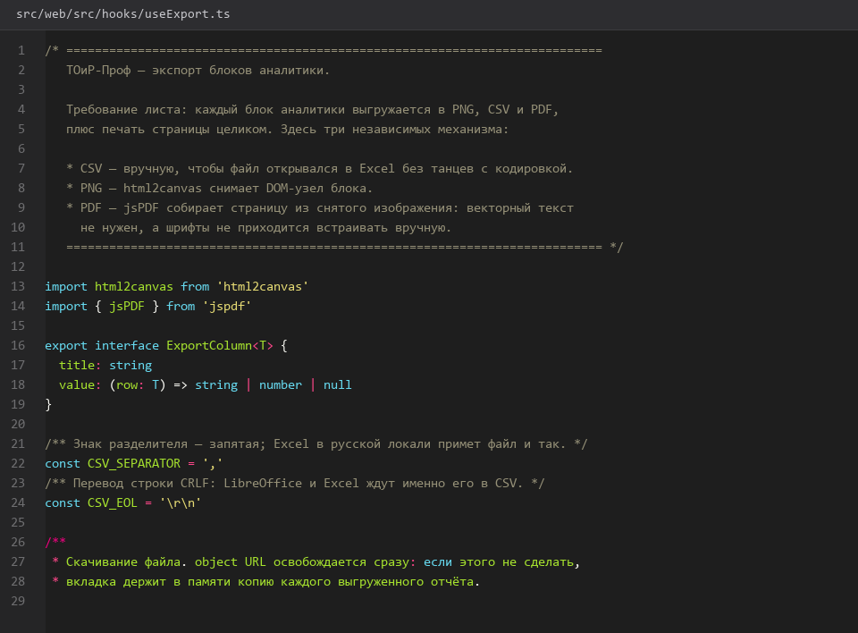
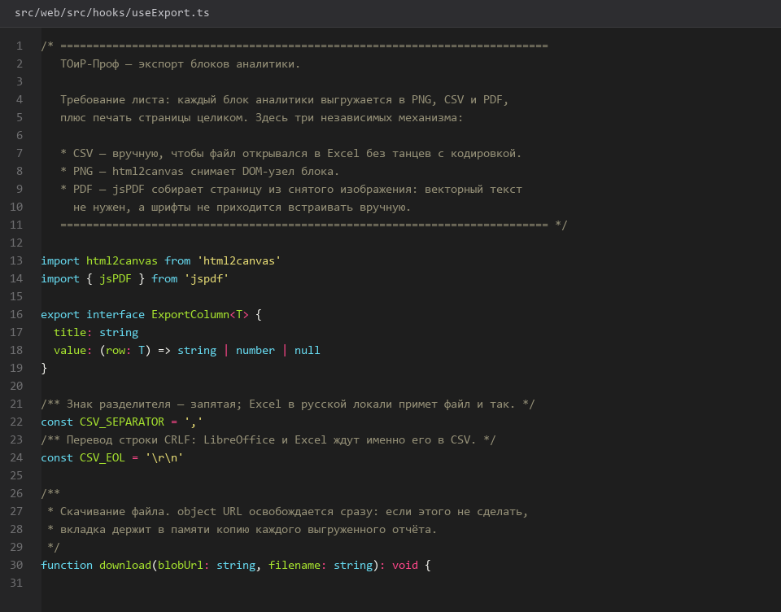
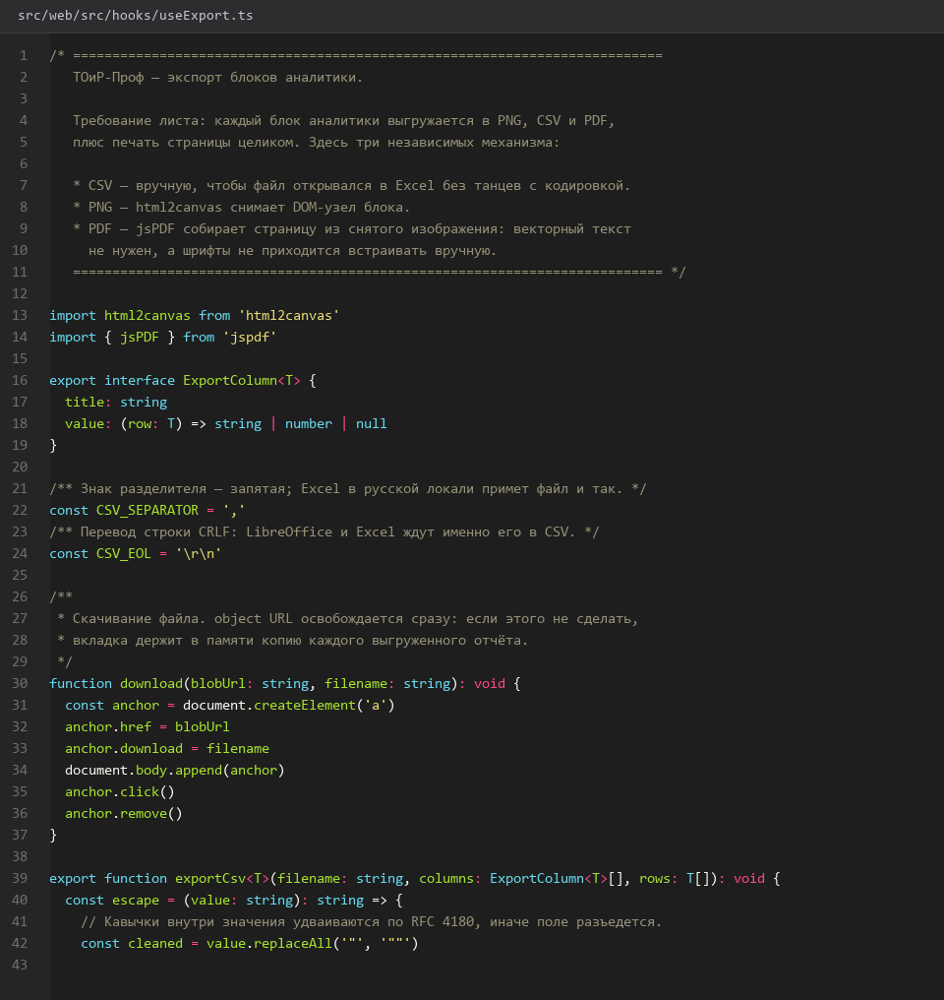

# Экспорт-PNG-CSV-PDF-и-печать-страницы

> Спринт 18. Web: аналитика и графики · 135 мин · страница 42 из 54

Экспорт в трёх форматах: PNG для отчёта, CSV для Excel и PDF для печати. Плюс печать самой страницы браузером — отдельная кнопка, потому что экспорт в PDF не заменяет печатную версию.

**Итог страницы.** Каждый блок аналитики экспортируется отдельно, вся страница — одним действием.

| Критерий оценивания | Что закрывает страница |
|---|---|
| Б / Web | Экспорт PNG, CSV, PDF и печать страницы |

**Результат в репозитории:**

- `src/web/src/hooks/useExport.ts`
- `src/web/src/components/ExportMenu.tsx`

## Шаг 1. PNG отдельного блока — 30 мин

Снимаем DOM-элемент блока в canvas через `html2canvas`. Имя файла собираем из названия блока и выбранного периода.

**src/web/src/hooks/useExport.ts**

```typescript
export async function exportBlockToPng(node: HTMLElement, filename: string) {
  const canvas = await html2canvas(node, {
    backgroundColor: '#ffffff',
    scale: 2,                       // retina-чёткость в PDF и при печати
    logging: false,
    useCORS: true,
  });
  const link = document.createElement('a');
  link.download = `${filename}.png`;
  link.href = canvas.toDataURL('image/png');
  link.click();
}
```

> **Замечание.** `scale: 2` увеличивает файл вдвое, но делает текст читаемым. При `scale: 1` подписи в PNG не видно, и экспорт выглядит браком.


*Блок «Сводка по заявкам» сохранён как PNG*


## Шаг 2. CSV с корректной кодировкой — 25 мин

CSV открывают в Excel, и русский текст должен остаться русским. Добавляем BOM и удваиваем кавычки внутри значений.

**src/web/src/hooks/useExport.ts**

```typescript
function toCsv(rows: Record<string, unknown>[], columns: string[]): Blob {
  const escape = (v: unknown) => `"${String(v ?? '').replace(/"/g, '""')}"`;
  const head = columns.join(';');
  const body = rows.map((r) => columns.map((c) => escape(r[c])).join(';')).join('\r\n');
  // BOM обязателен: без него Excel открывает файл в cp1251 и видит кракозябры
  return new Blob(['\uFEFF' + head + '\r\n' + body], { type: 'text/csv;charset=utf-8' });
}
```

> **Замечание.** Разделитель `;` вместо `,` — иначе Excel (русская локаль) разобьёт файл на extra-столбцы. Плюс BOM `\uFEFF` в начале.


*CSV открывается в Excel с русскими заголовками*


## Шаг 3. PDF из нескольких блоков — 35 мин

Собираем PDF через `jsPDF`: один блок — страница в альбомной ориентации, заголовок с названием отчёта и периодом.

**src/web/src/hooks/useExport.ts**

```typescript
export async function exportBlocksToPdf(blocks: { id: string; title: string; node: HTMLElement }[], period: string) {
  const doc = new jsPDF({ orientation: 'landscape', unit: 'pt', format: 'a4' });
  blocks.forEach(async (block, index) => {
    const canvas = await html2canvas(block.node, { scale: 2, logging: false });
    const image = canvas.toDataURL('image/png');
    if (index > 0) doc.addPage();
    doc.setFontSize(14);
    doc.text(`${block.title} — ${period}`, 40, 36);
    doc.addImage(image, 'PNG', 40, 50, 515, 300);
  });
  doc.save(`toirprof-analytics-${period}.pdf`);
}
```

> **Замечание.** `forEach` с `async`-колбэком не ждёт завершения — страницы перемешаются. Используйте `for...of` с `await`, иначе в PDF окажется только последний блок, а остальные страницы пустые.


*PDF на 5 страниц: по одному блоку на страницу*


## Шаг 4. Печать страницы — 25 мин

Перед печатью скрываем навигацию, кнопки экспорта и фильтры — на бумаге они не нужны и только занимают место.

**src/web/src/styles/print.css**

```css
window.addEventListener('beforeprint', () => {
  document.body.classList.add('printing');
});
window.addEventListener('afterprint', () => {
  document.body.classList.remove('printing');
});

@media print {
  .sidebar, .topbar, .filter-panel, .export-menu, .connection-badge { display: none !important; }
  .analytics-block { break-inside: avoid; page-break-inside: avoid; }
  body { background: #fff; }
}
```

> **Замечание.** `break-inside: avoid` на блоках обязателен: иначе круговая диаграмма разрывается пополам между страницами.


## Шаг 5. Меню экспорта — 20 мин

Кнопка «Экспорт» с выпадающим списком: «Блок в PNG», «Блок в CSV», «Блок в PDF», «Вся страница в PDF», «Печать».

**src/web/src/components/ExportMenu.tsx**

```typescript
const ENTRIES: ExportEntry[] = [
  { id: 'block-png', label: 'Блок в PNG' },
  { id: 'block-csv', label: 'Блок в CSV' },
  { id: 'block-pdf', label: 'Блок в PDF' },
  { id: 'page-pdf', label: 'Вся страница в PDF' },
  { id: 'print', label: 'Печать страницы' },
];
```

> **Замечание.** Действия различайте по `id`, а не по подписи: подпись переводится, а `id` используется в обработчике и попадёт в код.


*Меню экспорта с пятью действиями*


## Если что-то не получилось

| Симптом | Что делать |
|---|---|
| PNG сохраняется пустым | блок скрыт `display: none` или не отрисован к моменту снятия |
| В CSV кракозябры | потерян BOM `\uFEFF` |
| В PDF одна страница вместо пяти | `forEach` с `async` вместо `for...of` |
| Печать ломает вёрстку | не задан `@media print` |

## Проверка

```bash
cd src/web && npm run build
```

## Коммит

```bash
git add -A
git commit -m "feat(web): экспорт блоков в PNG, CSV, PDF и печать страницы"
```

---

[Блоки-аналитики-простои-материалы-график-бригады](41-Блоки-аналитики-простои-материалы-график-бригады.md) · [все спринты](Home) · [SSE-и-fallback-polling](43-SSE-и-fallback-polling.md)
