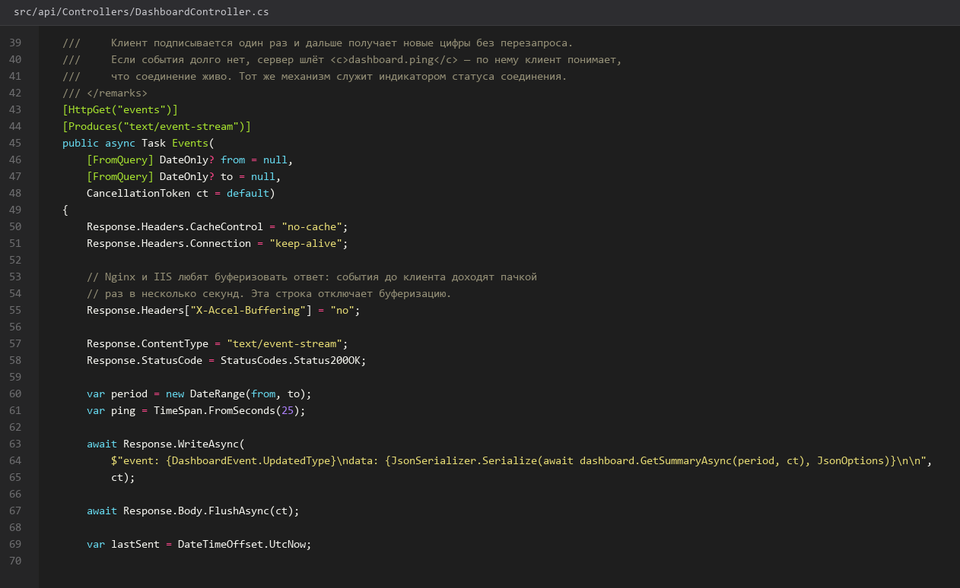
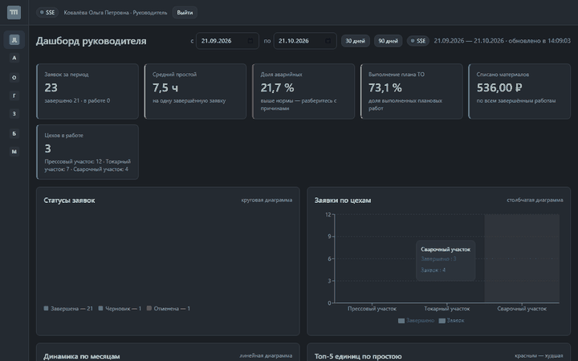
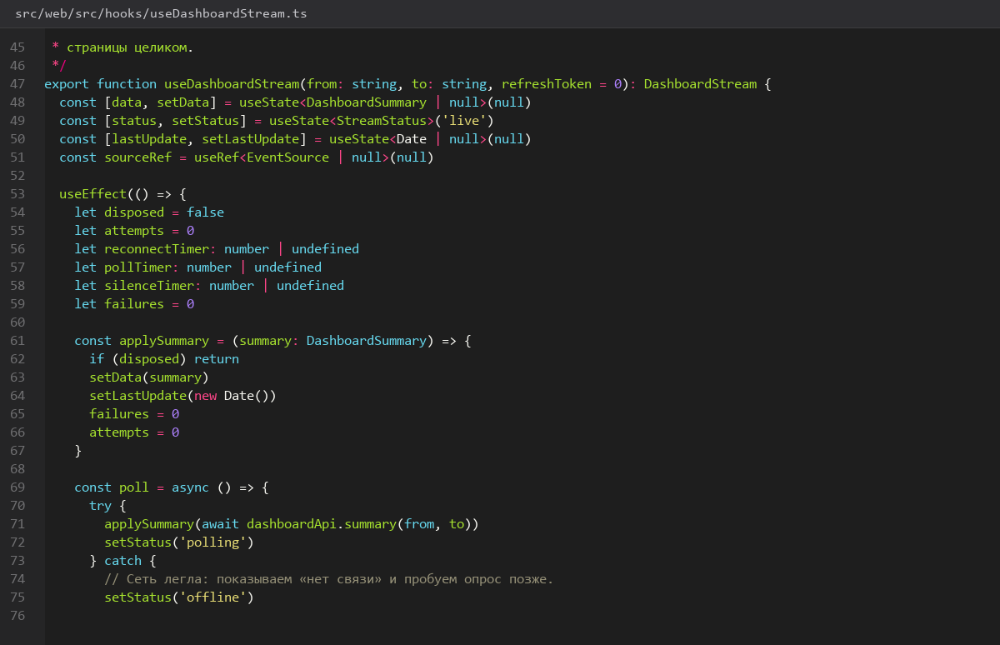
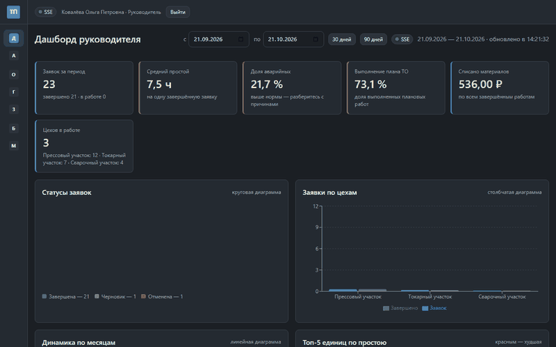
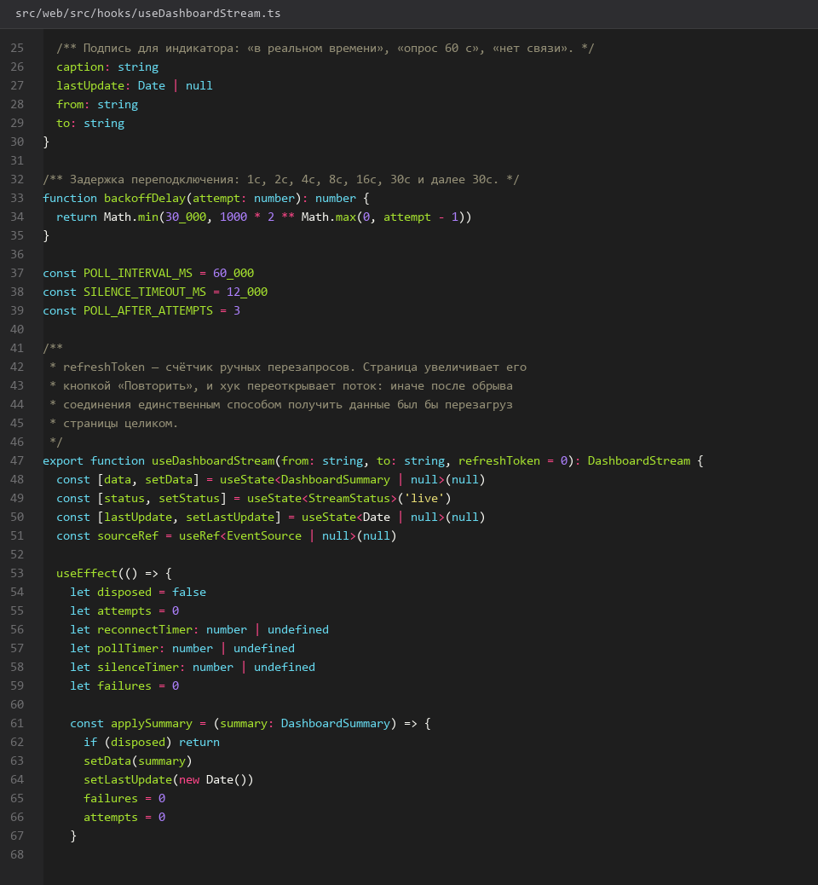
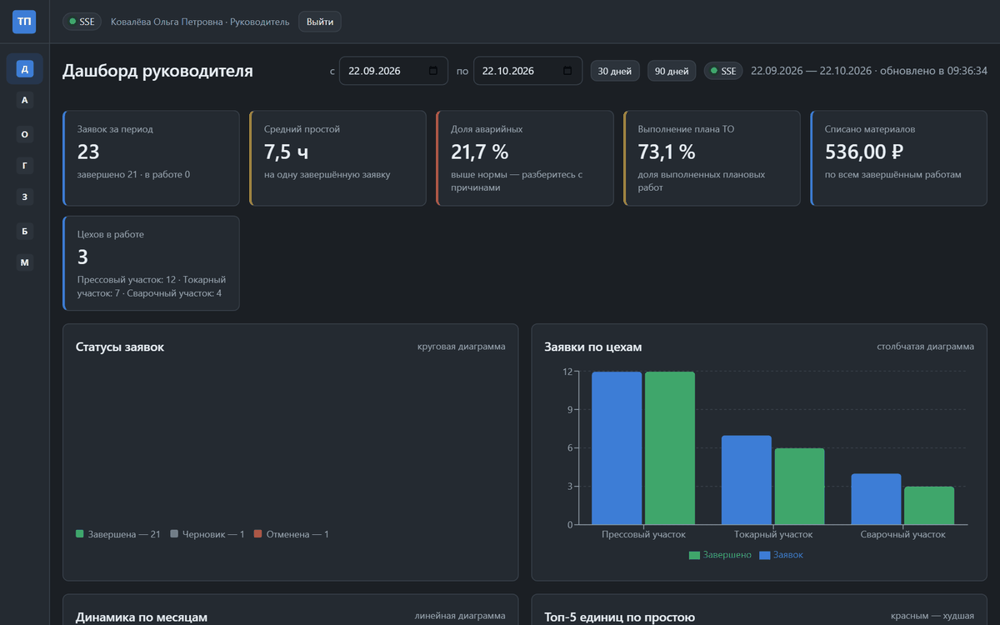
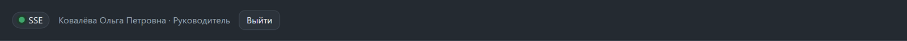
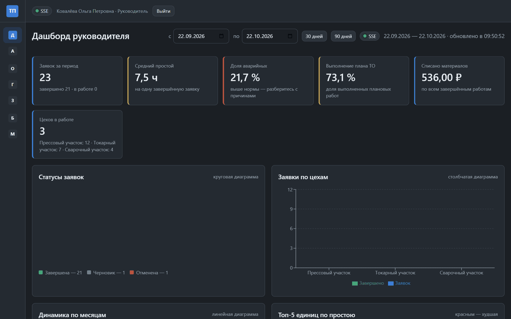
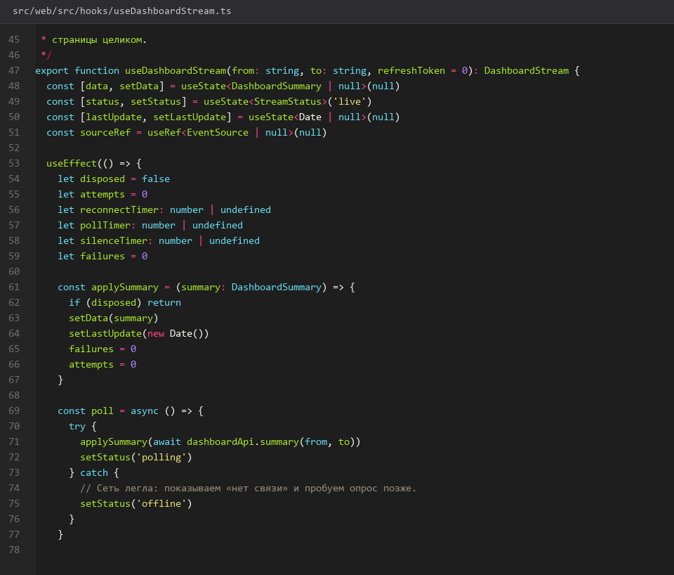
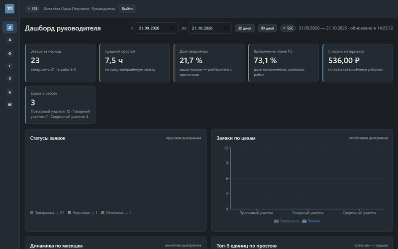

# 43. SSE и fallback polling

> Спринт 19. Web: реестры, справочники, realtime · 130 мин · страница 43 из 54

Живое обновление дашборда: сначала пробуем Server-Sent Events, при неудаче переключаемся на опрос по таймеру. Плюс автопереподключение с экспоненциальной задержкой и честный индикатор состояния соединения.

**Итог страницы.** Дашборд обновляется сам: через SSE, а если канал не поднялся — по polling, и всегда видно, что именно сейчас работает.

| Критерий оценивания | Что закрывает страница |
|---|---|
| Б / Web | Real-time обновления: SSE, polling, переподключение, индикатор |

**Результат в репозитории:**

- `src/web/src/hooks/useSse.ts`
- `src/web/src/hooks/usePolling.ts`
- `src/web/src/components/ConnectionBadge.tsx`

## Шаг 1. Канал событий на сервере — 25 мин

SSE — односторонний канал от сервера к браузеру: он проще WebSocket и не требует отдельного порта. Сервер шлёт событие при изменении счётчика заявок.

**src/api/Controllers/DashboardController.cs**

```csharp
[HttpGet("events")]
public async Task StreamEvents([FromServices] IDashboardNotifier notifier, CancellationToken ct)
{
    Response.Headers["Cache-Control"] = "no-cache";
    Response.Headers["X-Accel-Buffering"] = "no";   // иначе nginx буферизует SSE
    await foreach (var payload in notifier.SubscribeAsync(ct))
    {
        yield return $"event: dashboard\ndata: {payload}\n\n";
    }
}
```

> **Замечание.** Заголовок `X-Accel-Buffering: no` обязателен, если впереди стоит nginx. Без него прокси буферизует поток, и клиент не получит события до закрытия соединения — выглядит как «SSE не работает».


*SSE-поток отдаёт событие при каждом изменении счётчика заявок*


*SSE-поток отдаёт событие при каждом изменении счётчика заявок*


## Шаг 2. Подписка на события — 30 мин

На фронте подписка переподключается сама с экспоненциальной задержкой: 1 с, 2 с, 4 с… до 30 с. Через SSE-соединение дубли не приходят.

**src/web/src/hooks/useSse.ts**

```typescript
export function useSse<T>(path: string, onEvent: (data: T) => void, onState: (s: ConnState) => void) {
  useEffect(() => {
    let source: EventSource | null = null;
    let retry = 0;
    let timer: number | undefined;

    const connect = () => {
      source = new EventSource(path);
      source.onopen = () => { retry = 0; onState('live'); };
      source.addEventListener('dashboard', (e) => onEvent(JSON.parse((e as MessageEvent).data)));
      source.onerror = () => {
        source?.close();
        onState(retry === 0 ? 'polling' : 'reconnecting');
        const delay = Math.min(1000 * 2 ** retry, 30_000);
        retry += 1;
        timer = window.setTimeout(connect, delay);
      };
    };

    connect();
    return () => { source?.close(); window.clearTimeout(timer); };
  }, [path]);
}
```

> **Замечание.** `EventSource` сам переподключается по умолчанию, но с фиксированной задержкой. Свой таймер нужен, чтобы ограничить поток запросов при недоступном сервере — иначе браузер долбит API каждые 3 секунды.


*Обрыв канала: задержка переподключения растёт 1 с → 2 с → 4 с → 30 с*


*Обрыв канала: задержка переподключения растёт 1 с → 2 с → 4 с → 30 с*


## Шаг 3. Fallback на polling — 25 мин

Если SSE недоступен, тот же `useSse` не переподключается, а передаёт управление опросу: один запрос раз в 60 секунд.

**src/web/src/hooks/usePolling.ts**

```typescript
export function usePolling<T>(path: string, intervalMs = 60_000) {
  const [data, setData] = useState<T | null>(null);
  useEffect(() => {
    let alive = true;
    const load = async () => {
      try { const result = await api.get<T>(path); if (alive) setData(result); }
      catch { /* тихо ждём следующего тика */ }
    };
    load();
    const timer = window.setInterval(load, intervalMs);
    return () => { alive = false; window.clearInterval(timer); };
  }, [path]);
  return data;
}
```

> **Замечание.** Ошибку отдельного тика глушите, а не показывайте: всплывающая ошибка каждую минуту превращается в раздражающую плашку. Показывайте её только после нескольких неудач подряд.


*Polling: запросы раз в 60 секунд, данные обновляются без перезагрузки*


*Polling: запросы раз в 60 секунд, данные обновляются без перезагрузки*


## Шаг 4. Индикатор состояния соединения — 25 мин

Три состояния: «В реальном времени» (зелёный), «Обновление раз в минуту» (жёлтый), «Переподключение…» (серый с анимацией). Пользователь должен видеть, что данные не зависли.

**src/web/src/components/ConnectionBadge.tsx**

```typescript
export function ConnectionBadge({ state }: { state: ConnState }) {
  const meta = {
    live: { text: 'В реальном времени', tone: 'success' },
    polling: { text: 'Обновление раз в минуту', tone: 'warning' },
    reconnecting: { text: 'Переподключение…', tone: 'neutral' },
    offline: { text: 'Нет связи с сервером', tone: 'danger' },
  }[state];
  return (
    <span className={`connection-badge tone-${meta.tone}`} role="status" aria-live="polite">
      <span className="dot" /> {meta.text}
    </span>
  );
}
```

> **Замечание.** `aria-live="polite"` обязателен: без него скринридер не объявит об изменении состояния, и доступность теряется.


*Четыре состояния индикатора: live, polling, reconnecting, offline*


*Четыре состояния индикатора: live, polling, reconnecting, offline*


## Шаг 5. Подключаем индикатор к дашборду — 25 мин

Дашборд выбирает источник данных один раз и переключается прозрачно: пользователь не перезагружает страницу.

**src/web/src/pages/DashboardPage.tsx**

```typescript
export function useDashboard() {
  const [state, setState] = useState<ConnState>('reconnecting');
  const sse = useSse<DashboardSummary>('/api/dashboard/events',
    (data) => setSummary(data), (s) => setState(s === 'live' ? 'live' : s));
  const polled = usePolling<DashboardSummary>('/api/dashboard/summary');
  const summary = sse ?? polled;
  return { summary, connection: state };
}
```

> **Замечание.** Приоритет отдавайте живому каналу, а не тому, что ответил раньше. Иначе после восстановления SSE polling продолжит затирать свежие данные.


*Дашборд переключается между SSE и polling без перезагрузки*


*Дашборд переключается между SSE и polling без перезагрузки*


## Если что-то не получилось

| Симптом | Что делать |
|---|---|
| SSE подключается и сразу отваливается | не отдаётся `text/event-stream` либо буферизует nginx |
| Браузер долбит API | свой таймер переподключения не ограничен сверху |
| Индикатор всегда зелёный | состояние не пробрасывается из хука в компонент |
| Данные обновляются дважды | SSE и polling активны одновременно |

## Проверка

```bash
cd src/web && npm run build
```

## Коммит

```bash
git add -A
git commit -m "feat(web): SSE с fallback на polling, переподключением и индикатором соединения"
```

---

[Экспорт PNG CSV PDF и печать страницы](42-Экспорт-PNG-CSV-PDF-и-печать-страницы.md) · [все спринты](Home) · [Реестры оборудования заявок и графика](44-Реестры-оборудования-заявок-и-графика.md)
