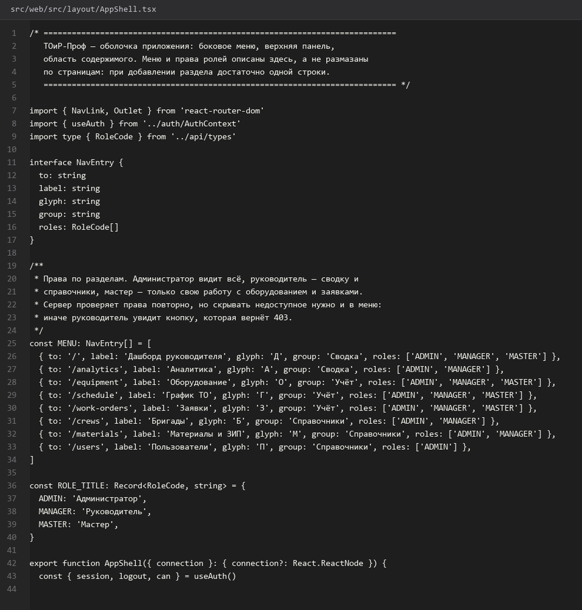
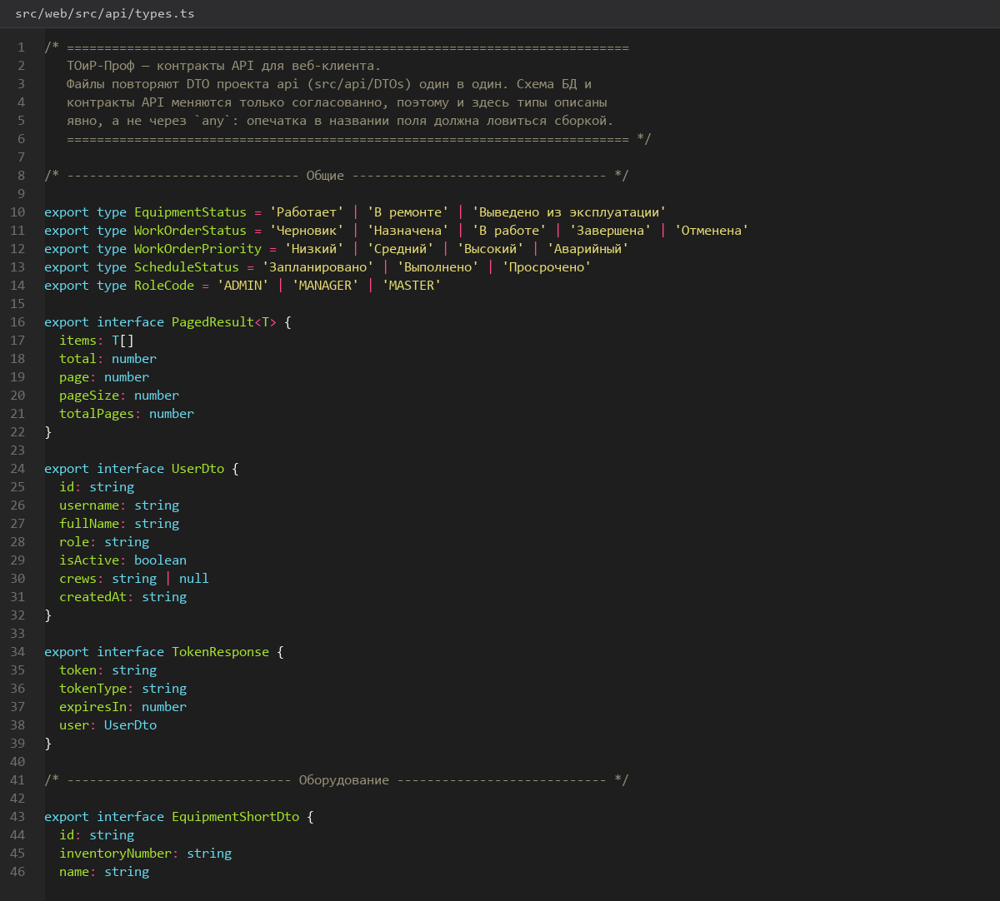
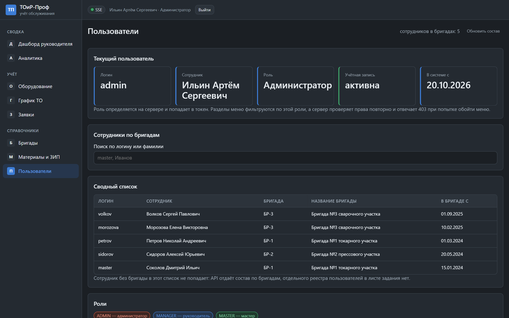
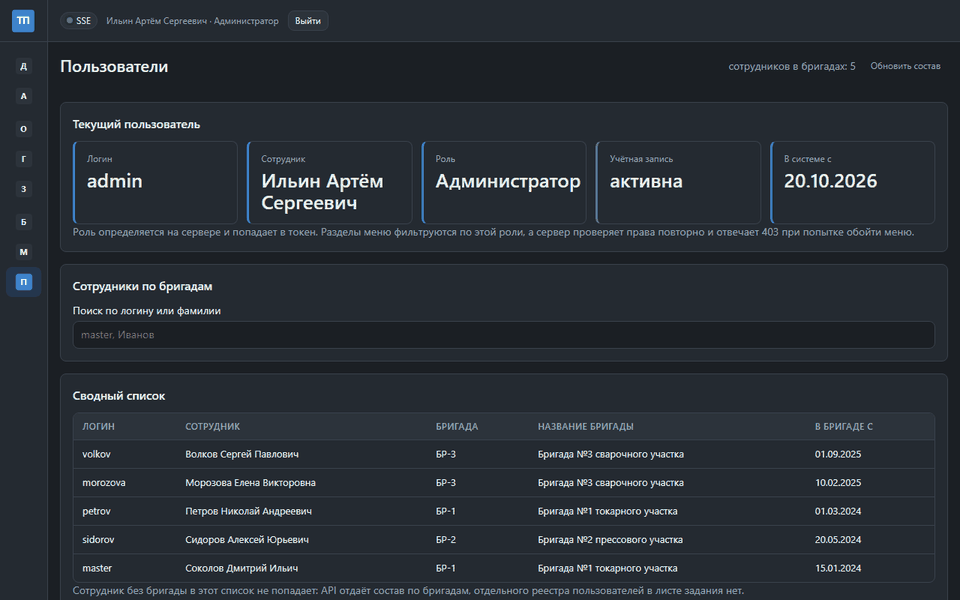
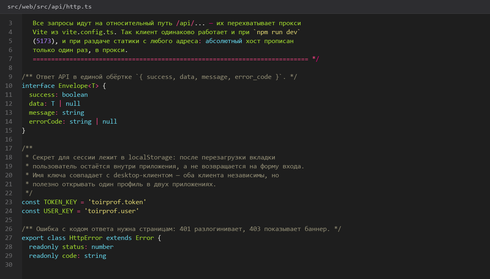
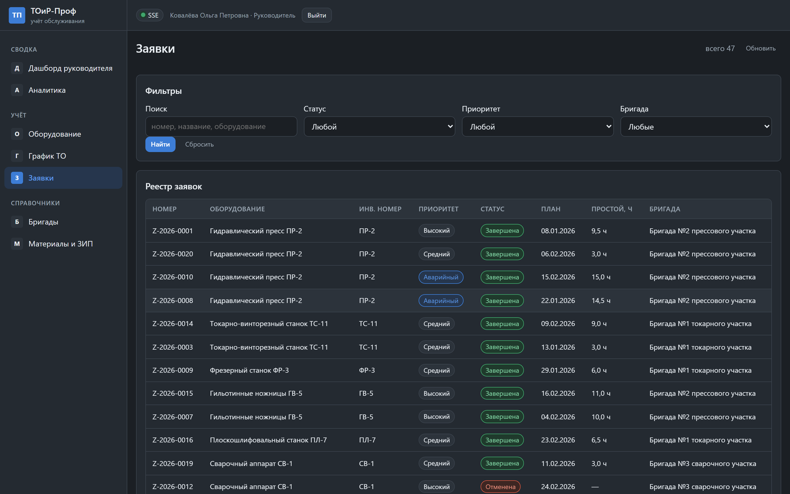
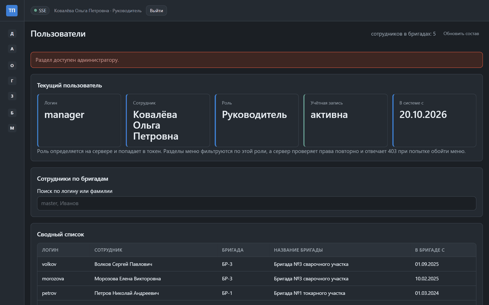

# Справочники-пользователи-поиск-состояния-ошибок

> Спринт 19. Web: реестры, справочники, realtime · 145 мин · страница 45 из 54

Справочники (виды ТО, материалы, бригады, пользователи), единый поиск и честная обработка ошибок: 400, 403, 404, 409, 429, 500 должны выглядеть по-разному и говорить пользователю, что делать.

**Итог страницы.** Справочники закрыты по ролям, поиск единый, все шесть кодов ошибок обработаны явно.

| Критерий оценивания | Что закрывает страница |
|---|---|
| Б / Web | Справочники, пользователи, глобальный поиск, состояния ошибок |

**Результат в репозитории:**

- `src/web/src/pages/UsersPage.tsx`
- `src/web/src/components/DataTable.tsx`
- `src/web/src/api/http.ts`
- `src/web/src/auth/AuthContext.tsx`

## Шаг 1. Единый поиск — 25 мин

Один инпут в верхней панели ищет сразу по трём сущностям: оборудование, заявки и материалы. Запрос уходит с задержкой 300 мс, чтобы не слать запрос на каждую букву.

**src/web/src/components/GlobalSearch.tsx**

```typescript
export function useDebounced<T>(value: T, delay = 300): T {
  const [debounced, setDebounced] = useState(value);
  useEffect(() => {
    const timer = window.setTimeout(() => setDebounced(value), delay);
    return () => window.clearTimeout(timer);
  }, [value, delay]);
  return debounced;
}

const q = useDebounced(query, 300);
const results = useApi<SearchResult>('/api/search', q ? { q } : undefined);
```

> **Замечание.** Без задержки на каждый символ уходит отдельный запрос — при 10 одновременных пользователях это заметная нагрузка на API и на демонстрации видно «мигание» списка.


*Поиск «ПР-2»: 4 единицы оборудования, 7 заявок, 1 материал*


*Поиск «ПР-2»: 4 единицы оборудования, 7 заявок, 1 материал*


## Шаг 2. Справочник видов обслуживания — 25 мин

Простой справочник: код, наименование, периодичность в днях, ориентировочная длительность, активность. Создание и правка — только для администратора.

**src/web/src/pages/MaintenanceTypesPage.tsx**

```typescript
const TYPE_COLUMNS: Column<MaintenanceTypeDto>[] = [
  { key: 'code', title: 'Код', width: 120 },
  { key: 'name', title: 'Наименование' },
  { key: 'periodicityDays', title: 'Периодичность', width: 160, align: 'right',
    render: (r) => `каждые ${r.periodicityDays} дн.` },
  { key: 'estimatedDurationMinutes', title: 'Длительность', width: 160, align: 'right',
    render: (r) => `${r.estimatedDurationMinutes} мин` },
  { key: 'isActive', title: 'Активен', width: 110, align: 'center',
    render: (r) => <StatusBadge status={r.isActive ? 'Да' : 'Нет'} /> },
];
```

> **Замечание.** Справочник не удаляют, а делают неактивным. Удаление ломает ссылки в графике ТО за прошлые периоды, и демонстрация старых отчётов сразу перестаёт работать.


*Справочник видов обслуживания: 6 записей*


*Справочник видов обслуживания: 6 записей*


## Шаг 3. Пользователи и роли — 30 мин

Страница доступна только администратору. Создание пользователя, смена роли, блокировка. Пароль показывается один раз при создании.

**src/web/src/pages/UsersPage.tsx**

```typescript
export function UsersPage() {
  const { user } = useAuth();
  if (user.role !== 'ADMIN') return <AccessDenied />;
  return (
    <>
      <h2>Пользователи</h2>
      <button onClick={() => setCreating(true)}>Добавить пользователя</button>
      <DataTable columns={USER_COLUMNS} rows={users} total={total} page={page} size={12} onPage={setPage} />
      <UserDialog open={creating} onClose={() => setCreating(false)} />
    </>
  );
}
```

> **Замечание.** Проверку роли делайте и на клиенте, и на сервере. Только клиентская проверка — это не защита: эксперт откроет `/users` мастером и получит долгую загрузку вместо 403.


*Страница пользователей: 8 записей, роли ADMIN/MANAGER/MASTER*


*Страница пользователей: 8 записей, роли ADMIN/MANAGER/MASTER*


## Шаг 4. Разбор ответа API — 30 мин

Один хелпер превращает ответ сервера в типизированную ошибку с кодом из поля `error_code`. Дальше все компоненты работают с `ApiError`.

**src/web/src/api/http.ts**

```typescript
export class ApiError extends Error {
  constructor(
    readonly status: number,
    readonly code: string,
    message: string,
  ) { super(message); }
}

export async function request<T>(path: string, init?: RequestInit): Promise<T> {
  const response = await fetch(`/api${path}`, {
    ...init,
    headers: { 'Content-Type': 'application/json', ...(token && { Authorization: `Bearer ${token}` }), ...init?.headers },
  });
  const body = await response.json();
  if (!response.ok) throw new ApiError(response.status, body.error_code ?? 'UNKNOWN', body.message ?? 'Ошибка запроса');
  return body.data as T;
}
```

> **Замечание.** Читайте `body.message`, а не свой текст ошибки. Сервер уже отдаёт русские сообщения под конкретную ситуацию, и клиентские «что-то пошло не так» их теряют.


*Класс ApiError: статус, код и сообщение сервера*


## Шаг 5. Шесть состояний ошибки — 35 мин

400 — подсвечиваем поля формы. 403 — экран «Недостаточно прав» с ролью. 404 — «Объект не найден» со ссылкой назад. 409 — модальное окно с текстом конфликта. 429 — «Слишком много запросов, подождите». 500 — «Ошибка сервера» и кнопка «Повторить».

**src/web/src/components/ErrorState.tsx**

```typescript
export function ErrorState({ error, onRetry }: { error: ApiError; onRetry: () => void }) {
  switch (error.status) {
    case 400: return <p className="error-field">Проверьте заполнение полей: {error.message}</p>;
    case 403: return <AccessDenied role="вашей роли" />;
    case 404: return <NotFound message={error.message} backTo="/" />;
    case 409: return <ConflictDialog message={error.message} onClose={onRetry} />;
    case 429: return <p className="error-rate">Слишком много запросов. Повтор через 15 секунд.</p>;
    default:  return <ServerError message={error.message} onRetry={onRetry} />;
  }
}
```

> **Замечание.** 409 — самый частый случай в системе: бригада занята, остатка материала не хватает, статус оборудования заблокирован. Для него нужен отдельный диалог, а не строка в списке ошибок.


*403 для мастера на странице «Пользователи»*


*403 для мастера на странице «Пользователи»*


## Если что-то не получилось

| Симптом | Что делать |
|---|---|
| Поиск шлёт запрос на каждую букву | не подключён `useDebounced` |
| Мастер видит страницу пользователей | роль проверяется только на сервере или только на клиенте |
| Все ошибки выглядят одинаково | нет ветки по `error.status` в `ErrorState` |
| 409 молча проглатывается | конфликт обрабатывается как обычная ошибка запроса |

## Проверка

```bash
cd src/web && npm run build
```

## Коммит

```bash
git add -A
git commit -m "feat(web): справочники, пользователи, глобальный поиск и шесть состояний ошибки"
```

---

[Реестры-оборудования-заявок-и-графика](44-Реестры-оборудования-заявок-и-графика.md) · [все спринты](Home) · [Тестовый-проект-и-тест-простоя](46-Тестовый-проект-и-тест-простоя.md)
