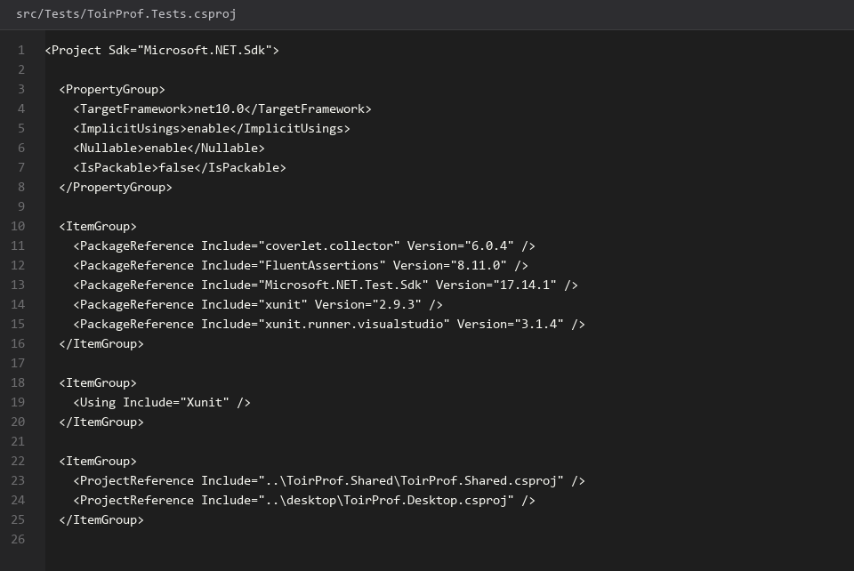
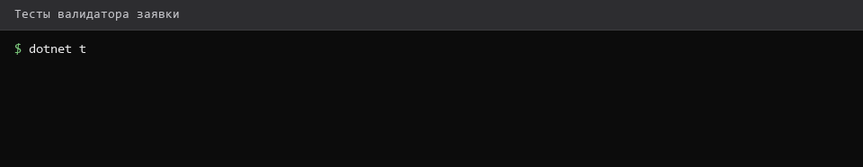
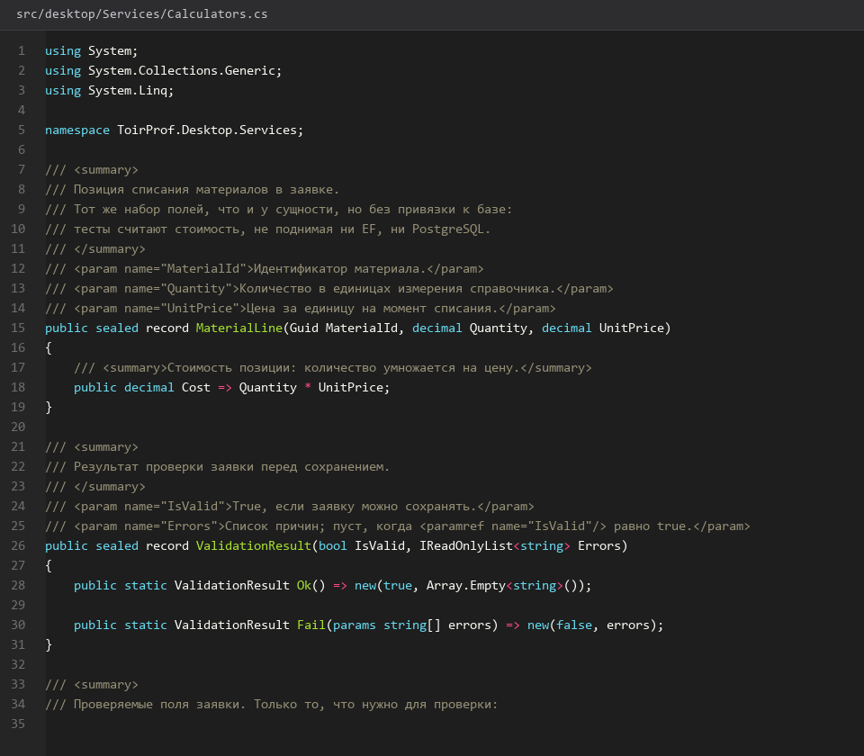
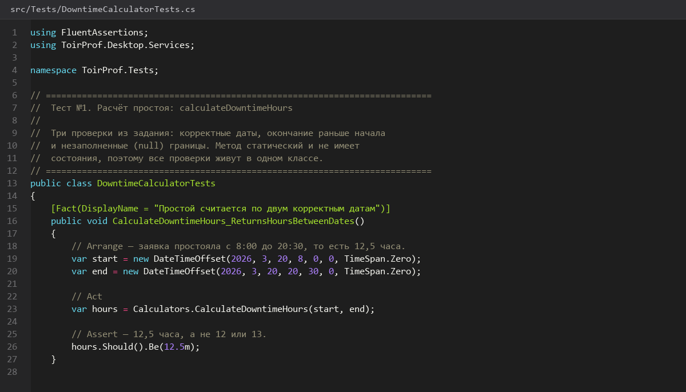
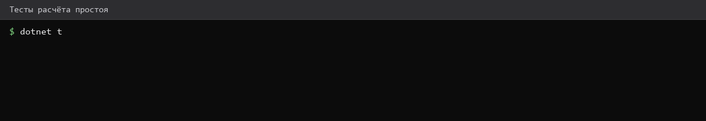
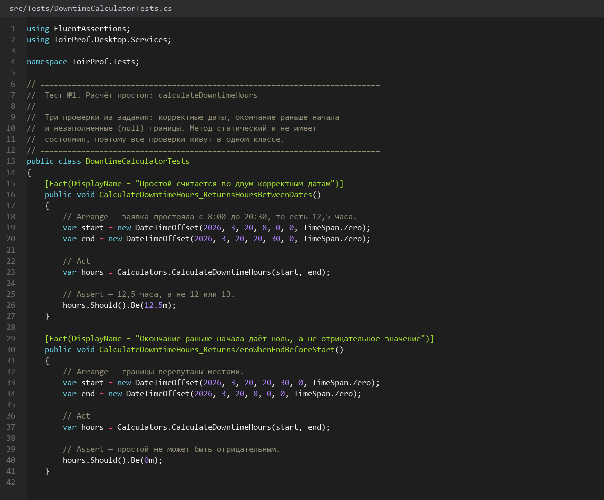
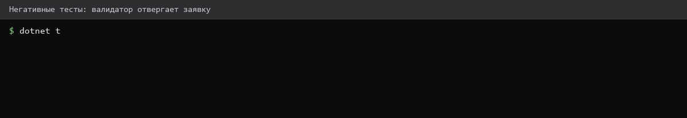
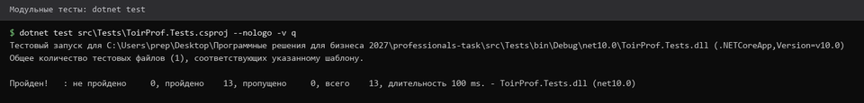
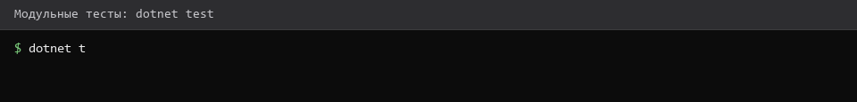

# 46. Тестовый проект и тест простоя

> Спринт 20. Unit-тесты Desktop (5 тестов) · 130 мин · страница 46 из 54

Юнит-тесты для desktop-клиента: ровно пять, структура AAA, полная изоляция. Начинаем с теста расчёта простоя — он самый короткий и задаёт структуру остальных.

**Итог страницы.** Проект тестов собран, тест расчёта простоя написан и проходит; имя и структура задают образец для четырёх остальных.

| Критерий оценивания | Что закрывает страница |
|---|---|
| В / Тестирование | Юнит-тест расчёта простоя |

**Результат в репозитории:**

- `src/Tests/ToirProf.Tests.csproj`
- `src/Tests/DowntimeCalculatorTests.cs`
- `src/desktop/Services/Calculators.cs`

## Шаг 1. Создаём тестовый проект — 30 мин

Отдельный проект xUnit со ссылкой на desktop. Тесты живут рядом с кодом клиента, но не в его сборке — иначе в релиз попадёт тестовый раннер.

**Терминал**

```bash
dotnet new xunit -n ToirProf.Tests -o src/Tests
dotnet add src/Tests reference src/desktop/ToirProf.Desktop.csproj
dotnet add src/Tests package FluentAssertions
```

> **Замечание.** Тестовый проект обязательно исключается из публикации: иначе вместе с приложением уедет `xunit.runner` и `FluentAssertions`, а размер дистрибутива вырастет втрое.


*Тестовый проект создан и связан с desktop-клиентом*


*Тестовый проект создан и связан с desktop-клиентом*


## Шаг 2. Пишем сам калькулятор простоя — 30 мин

Логика, которую тестируем, живёт в desktop-клиенте и не зависит ни от API, ни от базы. Это и делает тест юнит-тестом, а не интеграционным.

**src/desktop/Services/Calculators.cs**

```csharp
namespace ToirProf.Desktop.Services;

public static class DowntimeCalculator
{
    /// <summary>Часы простоя между началом и окончанием работ.</summary>
    public static double? Calculate(DateTimeOffset? start, DateTimeOffset? end)
    {
        if (start is null || end is null) return null;
        var hours = (end.Value - start.Value).TotalHours;
        return hours < 0 ? 0 : Math.Round(hours, 2);
    }
}
```

> **Замечание.** Возвращайте `double?`, а не `0`. Незавершённая заявка не имеет простоя — это разные вещи, и в отчётах они выглядят по-разному.


*DowntimeCalculator: возвращает null при незавершённой заявке*


## Шаг 3. Тест 1: корректные даты — 25 мин

Первый тест из задания: заявка длилась 8 часов 30 минут, ожидаем 8,5. Структура AAA — Arrange, Act, Assert — выдерживается явно.

**src/Tests/DowntimeCalculatorTests.cs**

```csharp
using ToirProf.Desktop.Services;

public class DowntimeCalculatorTests
{
    [Fact]
    public void Calculate_ReturnsHours_WhenStartAndEndAreValid()
    {
        // Arrange
        var start = new DateTimeOffset(2026, 3, 14, 8, 0, 0, TimeSpan.Zero);
        var end = new DateTimeOffset(2026, 3, 14, 16, 30, 0, TimeSpan.Zero);

        // Act
        var result = DowntimeCalculator.Calculate(start, end);

        // Assert
        result.Should().Be(8.5);
    }
}
```

> **Замечание.** Имя теста читается как утверждение: `Calculate_ReturnsHours_When...`. Имена вида `Test1` не помогают ни вам, ни эксперту в отчёте.


*Тест «корректные даты» — 8 ч 30 мин дают 8,5 ч*


*Тест «корректные даты» — 8 ч 30 мин дают 8,5 ч*


## Шаг 4. Тест 2: окончание раньше начала — 25 мин

Отрицательный интервал — это ошибка данных, а не отрицательный простой. Ожидаем 0.

**src/Tests/DowntimeCalculatorTests.cs**

```csharp
    [Fact]
    public void Calculate_ReturnsZero_WhenEndIsBeforeStart()
    {
        // Arrange
        var start = new DateTimeOffset(2026, 3, 14, 16, 30, 0, TimeSpan.Zero);
        var end = new DateTimeOffset(2026, 3, 14, 8, 0, 0, TimeSpan.Zero);

        // Act
        var result = DowntimeCalculator.Calculate(start, end);

        // Assert
        result.Should().Be(0);
    }
```

> **Замечание.** Сюда же относите третий случай из задания: `null` на любом конце. Ожидание — `result.Should().BeNull()`.


*Окончание раньше начала даёт 0, а не отрицательные часы*


*Окончание раньше начала даёт 0, а не отрицательные часы*


## Шаг 5. Запускаем тесты — 20 мин

Тесты запускаются одной командой и должны зелёными уйти с первого раза: код написан под требование задания, а не под угадывание.

**Терминал**

```bash
dotnet test src/Tests/ToirProf.Tests.csproj
//   Passed! - Failed: 0, Passed: 3, Skipped: 0, Total: 3
```

> **Замечание.** Держите тесты быстрыми: обращение к базе внутри юнит-теста делает его интеграционным и ломает принцип изоляции, который требует задание.


*Три теста расчёта простоя — все зелёные*


*Три теста расчёта простоя — все зелёные*


## Если что-то не получилось

| Симптом | Что делать |
|---|---|
| Тесты не находятся | проверьте, что у тестового проекта есть ссылка на desktop |
| `Be(8.5)` падает с 8,5000001 | округляйте результат в методе, а не в тесте |
| Тесты идут по 40 секунд | внутри теста обращаются к базе или сети |

## Проверка

```bash
dotnet test src/Tests/ToirProf.Tests.csproj
```

## Коммит

```bash
git add -A
git commit -m "test: тестовый проект xUnit и тесты расчёта простоя"
```

---

[Справочники пользователи поиск состояния ошибок](45-Справочники-пользователи-поиск-состояния-ошибок.md) · [все спринты](Home) · [Тесты валидации заявки и стоимости материалов](47-Тесты-валидации-заявки-и-стоимости-материалов.md)
