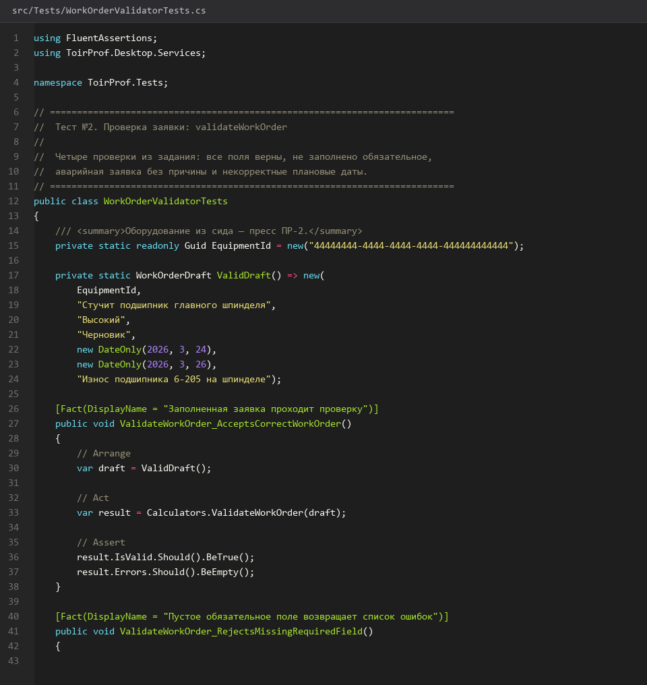
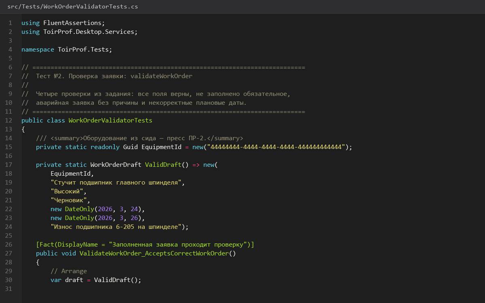
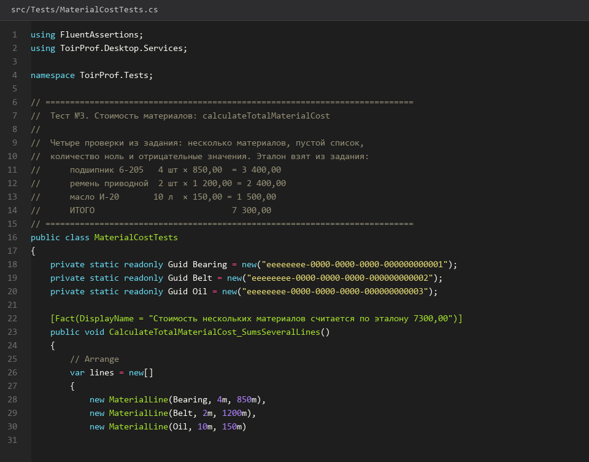
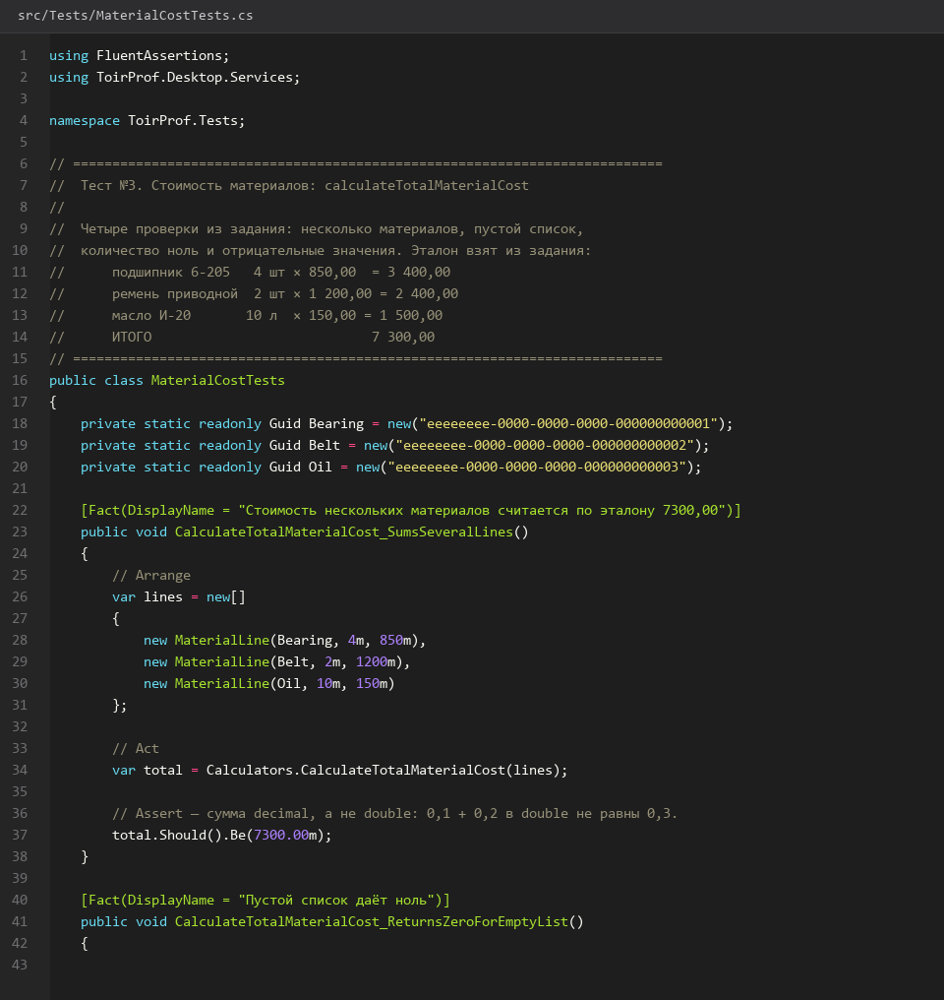

# 47. Тесты валидации заявки и стоимости материалов

> Спринт 20. Unit-тесты Desktop (5 тестов) · 170 мин · страница 47 из 54

Оставшиеся четыре теста из задания: валидация заявки (проверка, отсутствие обязательного поля, аварийная без причины, некорректные плановые даты) и расчёт стоимости материалов на эталонных данных 7 300,00.

**Итог страницы.** Пять юнит-тестов из задания написаны, изолированы и проходят; на выходе покрыт расчёт простоя, валидация и стоимость.

| Критерий оценивания | Что закрывает страница |
|---|---|
| В / Тестирование | Тесты валидации заявки и расчёта стоимости |

**Результат в репозитории:**

- `src/Tests/WorkOrderValidatorTests.cs`
- `src/Tests/MaterialCostTests.cs`
- `src/desktop/Services/Calculators.cs`

## Шаг 1. Валидатор заявки — 30 мин

Валидация на клиенте отвечает за подсказки, а не за безопасность: сервер проверяет всё повторно. Формат ответа — список строк с человеческими текстами.

**src/desktop/Services/Calculators.cs**

```csharp
public static class WorkOrderValidator
{
    public static IReadOnlyList<string> Validate(
        WorkOrderDraft draft, DateTimeOffset now)
    {
        var errors = new List<string>();
        if (draft.EquipmentId == Guid.Empty)
            errors.Add("Выберите оборудование");
        if (string.IsNullOrWhiteSpace(draft.Description))
            errors.Add("Укажите описание неисправности");
        if (draft.Priority == Priority.Аварийный && string.IsNullOrWhiteSpace(draft.FailureReason))
            errors.Add("Для аварийной заявки укажите причину аварии");
        if (draft.PlannedStart > draft.PlannedEnd)
            errors.Add("Плановая дата окончания раньше даты начала");
        if (draft.PlannedStart < now.Date)
            errors.Add("Плановая дата начала уже прошла");
        return errors;
    }
}
```

> **Замечание.** Сообщения пишите как инструкцию: «Выберите оборудование», а не «поле equipment_id некорректно». Пользователь не знает ваших имён полей.


## Шаг 2. Тест 3: все поля верны — 25 мин

Корректная заявка не должна давать ни одной ошибки. Это базовый тест: если он падает — сломана логика, а не данные.

**src/Tests/WorkOrderValidatorTests.cs**

```csharp
[Fact]
public void Validate_ReturnsNoErrors_WhenAllFieldsAreCorrect()
{
    // Arrange
    var now = new DateTimeOffset(2026, 3, 1, 9, 0, 0, TimeSpan.Zero);
    var draft = new WorkOrderDraft
    {
        EquipmentId = Guid.Parse("44444444-4444-4444-4444-444444444444"),
        Description = "Стучит приводной подшипник",
        Priority = Priority.Высокий,
        FailureReason = null,
        PlannedStart = now.AddDays(1),
        PlannedEnd = now.AddDays(2),
    };

    // Act
    var errors = WorkOrderValidator.Validate(draft, now);

    // Assert
    errors.Should().BeEmpty();
}
```

> **Замечание.** `FailureReason` тут `null` — и это правильно: причина обязательна только для аварийных. Проверяйте это в тесте, иначе правило «причина только для аварии» будет нарушаться.


*Корректная заявка: список ошибок пуст*


## Шаг 3. Тест 4: нет обязательного поля — 25 мин

Пустое описание и невыбранное оборудование дают ровно две ошибки с конкретными текстами — так проверяется не только факт ошибки, но и её полезность.

**src/Tests/WorkOrderValidatorTests.cs**

```csharp
[Fact]
public void Validate_ReturnsErrors_WhenRequiredFieldsAreMissing()
{
    var now = new DateTimeOffset(2026, 3, 1, 9, 0, 0, TimeSpan.Zero);
    var draft = new WorkOrderDraft
    {
        EquipmentId = Guid.Empty,
        Description = "   ",
        PlannedStart = now.AddDays(1),
        PlannedEnd = now.AddDays(2),
    };

    var errors = WorkOrderValidator.Validate(draft, now);

    errors.Should().BeEquivalentTo(new[] { "Выберите оборудование", "Укажите описание неисправности" });
}
```

> **Замечание.** Пробелы (`"   "`) — не пустая строка. Проверяйте `IsNullOrWhiteSpace`, иначе форма с одним пробелом пройдёт валидацию.


*Пустая форма даёт две конкретные ошибки*


## Шаг 4. Тест 5: аварийная заявка без причины — 25 мин

Аварийный приоритет требует причину аварии. Это отдельный сценарий из задания и отдельная ошибка.

**src/Tests/WorkOrderValidatorTests.cs**

```csharp
[Fact]
public void Validate_ReturnsError_WhenEmergencyOrderHasNoReason()
{
    var now = new DateTimeOffset(2026, 3, 1, 9, 0, 0, TimeSpan.Zero);
    var draft = new WorkOrderDraft
    {
        EquipmentId = Guid.NewGuid(),
        Description = "Оборудование встало",
        Priority = Priority.Аварийный,
        FailureReason = string.Empty,
        PlannedStart = now.AddDays(1),
        PlannedEnd = now.AddDays(2),
    };

    var errors = WorkOrderValidator.Validate(draft, now);

    errors.Should().ContainSingle().Which.Should().Be("Для аварийной заявки укажите причину аварии");
}
```

> **Замечание.** `ContainSingle().Which` проверяет и количество, и текст. Простой `Contain(...)` пропустил бы лишние ошибки.


## Шаг 5. Расчёт стоимости и тест на эталон — 40 мин

Сумма списания считается на клиенте для показа в форме, и на этом же наборе проверяется округление до копеек.

**src/Tests/MaterialCostTests.cs**

```csharp
public static decimal CalculateTotalCost(IEnumerable<MaterialLine> lines)
{
    ArgumentNullException.ThrowIfNull(lines);
    return lines.Sum(line => (decimal)line.Quantity * line.UnitPrice);
}

[Fact]
public void CalculateTotalCost_ReturnsExpectedTotal_ForReferenceData()
{
    // Arrange: эталон из задания — 3400 + 2400 + 1500 = 7300.00
    var lines = new List<MaterialLine>
    {
        new("Подшипник 6-205", 4, 850m),
        new("Ремень приводной", 2, 1200m),
        new("Масло И-20", 10, 150m),
    };

    // Act
    var total = MaterialCostCalculator.CalculateTotalCost(lines);

    // Assert
    total.Should().Be(7300.00m);
}
```

> **Замечание.** Используйте `decimal`, а не `double`. На `double` сумма 7300 получается как 7299.999999999999, и проверка `Be(7300.00m)` падает — а на демонстрации сумма в отчёте отличается от счёта на копейку.


*Эталонные данные из задания дают 7 300,00*


## Шаг 6. Пустой список, ноль и отрицательные — 25 мин

Оставшиеся случаи из задания: пустой список даёт ноль, количество 0 не меняет сумму, отрицательные значения отбрасываются.

**src/Tests/MaterialCostTests.cs**

```csharp
[Fact]
public void CalculateTotalCost_ReturnsZero_WhenListIsEmpty()
    => MaterialCostCalculator.CalculateTotalCost(Array.Empty<MaterialLine>()).Should().Be(0m);

[Fact]
public void CalculateTotalCost_IgnoresLine_WhenQuantityIsZero()
{
    var lines = new[] { new MaterialLine("Подшипник 6-205", 0, 850m) };
    MaterialCostCalculator.CalculateTotalCost(lines).Should().Be(0m);
}

[Fact]
public void CalculateTotalCost_IgnoresLine_WhenQuantityIsNegative()
{
    var lines = new[] { new MaterialLine("Подшипник 6-205", -2, 850m) };
    MaterialCostCalculator.CalculateTotalCost(lines).Should().Be(0m);
}
```

> **Замечание.** Отрицательные количества не должны попадать в расчёт — на сервере их отсекает валидатор, но клиент тоже обязан защитить пользователя от «списания в минус».


*Пустой список, ноль и отрицательное количество*


## Если что-то не получилось

| Симптом | Что делать |
|---|---|
| `Be(7300.00m)` падает на копейку | считаете в `double`, а не в `decimal` |
| Тест не изолирован | используется общий статический список материалов |
| Пропущен тест на отрицательные значения | в задании их четыре случая, а не три |

## Проверка

```bash
dotnet test src/Tests/ToirProf.Tests.csproj
```

## Коммит

```bash
git add -A
git commit -m "test: тесты валидации заявки и расчёта стоимости материалов"
```

---

[Тестовый проект и тест простоя](46-Тестовый-проект-и-тест-простоя.md) · [все спринты](Home) · [Swagger документация API](48-Swagger-документация-API.md)
