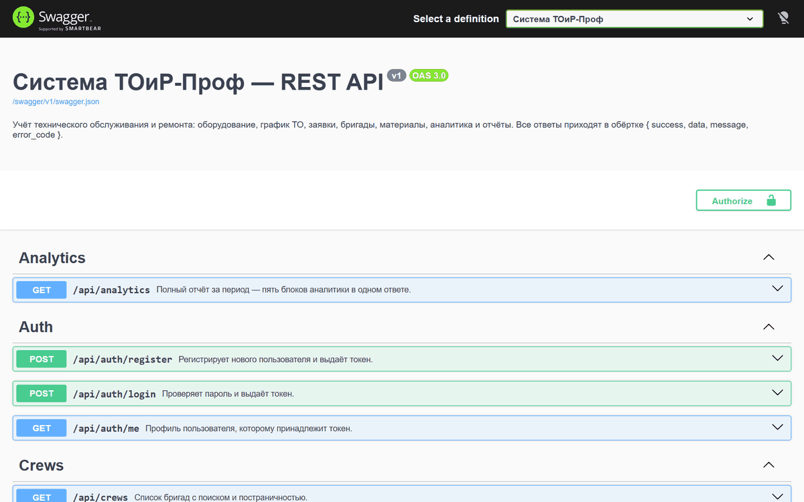
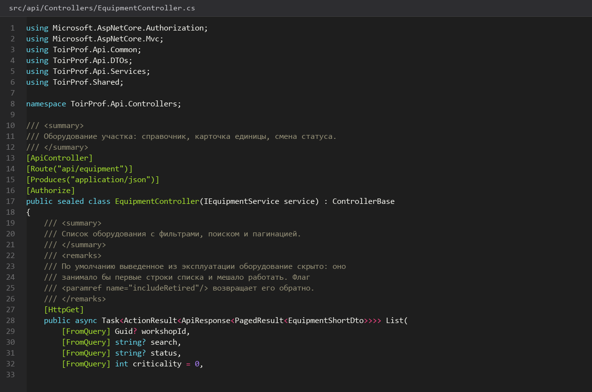
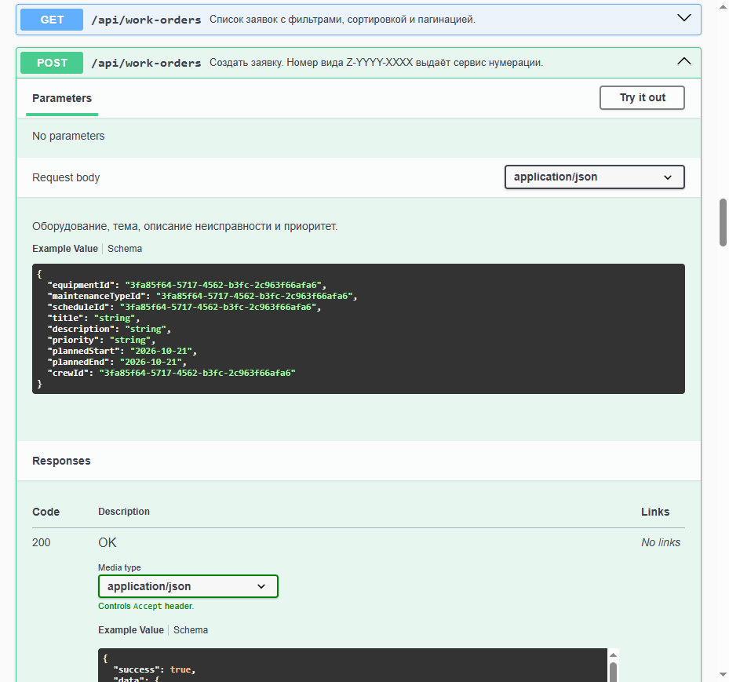
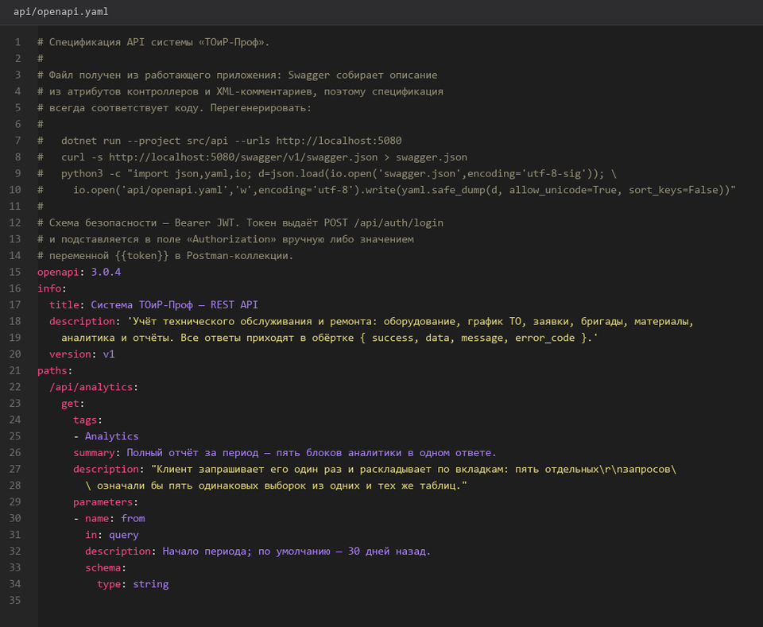
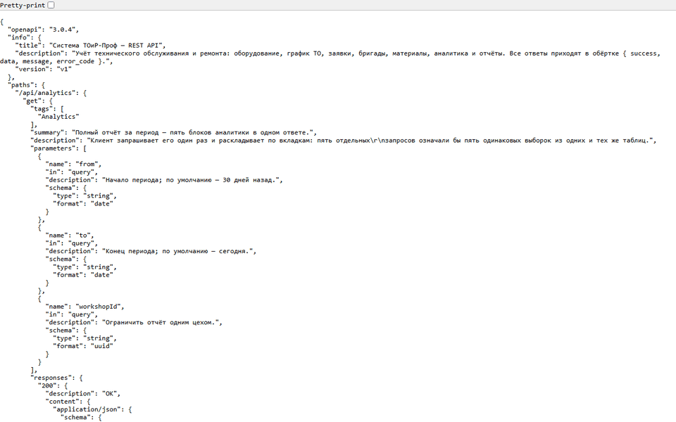
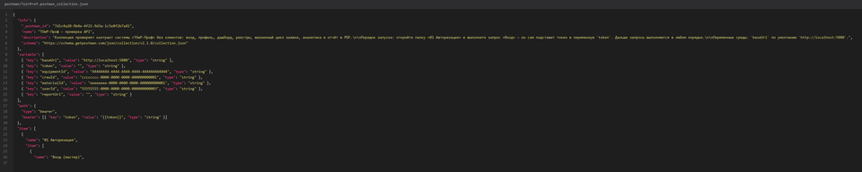

# Swagger-документация-API

> Спринт 21. Документация: Swagger + развёртывание · 140 мин · страница 48 из 54

Документирование API через Swagger UI: XML-комментарии, описания операций, коды ответов, примеры запросов и ответов. Здесь же — коллекция Postman, собранная из той же спецификации.

**Итог страницы.** Swagger показывает все методы с описаниями, кодами ответов и примерами; спецификация OpenAPI выгружается в `api/openapi.yaml`.

| Критерий оценивания | Что закрывает страница |
|---|---|
| Г / Документирование | Документирование API (Swagger) |

**Результат в репозитории:**

- `src/api/Program.cs`
- `src/api/Controllers/EquipmentController.cs`
- `api/openapi.yaml`
- `postman/ToirProf.postman_collection.json`

## Шаг 1. Включаем Swagger в Development — 25 мин

Swagger доступен только в режиме разработки — на площадке его можно потрогать руками, а в «боевой» сборке его быть не должно.

**src/api/Program.cs**

```csharp
if (app.Environment.IsDevelopment())
{
    app.UseSwagger();
    app.UseSwaggerUI(options =>
    {
        options.SwaggerEndpoint("/swagger/v1/swagger.json", "ТОиР-Проф API v1");
        options.DocumentTitle = "ТОиР-Проф — API";
        options.DisplayRequestDuration();
    });
}
```

> **Замечание.** Группируйте методы по тегам (`ApiExplorerSettings.GroupName`), иначе десятки операций слипаются в один список без структуры.


*Swagger UI доступен по /swagger в режиме разработки*


*Swagger UI доступен по /swagger в режиме разработки*


## Шаг 2. XML-комментарии и описания операций — 35 мин

Описание в Swagger — это документация из исходного кода: `<summary>` на методе, `<param>` на параметре, `<response>` на каждом коде ответа.

**src/api/Controllers/EquipmentController.cs**

```csharp
/// <summary>Возвращает страницу оборудования с фильтрами.</summary>
/// <param name="search">Поиск по наименованию и инвентарному номеру.</param>
/// <param name="page">Номер страницы, начиная с 1.</param>
/// <param name="size">Размер страницы: 1–100, по умолчанию 20.</param>
/// <param name="workshopId">Фильтр по цеху.</param>
/// <param name="status">Фильтр по статусу оборудования.</param>
[HttpGet]
[ProducesResponseType(typeof(ApiResponse<PagedResult<EquipmentDto>>), StatusCodes.Status200OK)]
[ProducesResponseType(StatusCodes.Status400BadRequest)]
[ProducesResponseType(StatusCodes.Status401Unauthorized)]
[ProducesResponseType(StatusCodes.Status403Forbidden)]
public async Task<ActionResult<ApiResponse<PagedResult<EquipmentDto>>>> GetAll(
    [FromQuery] string? search, [FromQuery] int page = 1, [FromQuery] int size = 20,
    [FromQuery] Guid? workshopId, [FromQuery] EquipmentStatus? status, CancellationToken ct)
{
    var result = await _service.GetPagedAsync(search, page, size, workshopId, status, ct);
    return Ok(ApiResponse<PagedResult<EquipmentDto>>.Ok(result));
}
```

> **Замечание.** `ProducesResponseType` указывайте явно. Иначе в Swagger будет один «200 OK» на все методы, и по документации невозможно понять, какой код ожидать при ошибке.


*Описание операции и пять кодов ответа в Swagger*


## Шаг 3. Примеры запросов и ответов — 30 мин

Swagger даёт «попробовать» прямо из браузера: с тестовым токеном и готовым набором данных операция возвращает осмысленный ответ.

**src/api/DTOs/EquipmentDtos.cs**

```csharp
/// <example>
/// <code>
/// {
///   "success": true,
///   "data": {
///     "id": "44444444-4444-4444-4444-444444444444",
///     "inventoryNumber": "PR-2-0001",
///     "name": "Пресс гидравлический ПР-2",
///     "status": "В ремонте",
///     "criticality": 3
///   },
///   "message": "OK",
///   "error_code": null
/// }
/// </code>
/// </example>
```

> **Замечание.** Пример берите из реального ответа Postman, а не выдумывайте. Расхождение между документацией и фактом эксперт найдёт за секунду.


*Пример ответа в документации совпадает с реальным*


*Пример ответа в документации совпадает с реальным*


## Шаг 4. Выгрузка спецификации — 20 мин

Файл спецификации нужен и для Postman, и как отдельный артефакт: из него клиенты собирают типы.

**Терминал**

```bash
# Выгружаем спецификацию в файл
dotnet run --project src/api -- swagger export api/openapi.yaml
```

> **Замечание.** Коммитьте `openapi.yaml` в репозиторий. По нему потом собирается коллекция Postman и генерируются типы для клиентов — это экономит час работы на согласовании полей.


*api/openapi.yaml содержит все операции и схемы*


*api/openapi.yaml содержит все операции и схемы*


## Шаг 5. Коллекция Postman — 30 мин

Коллекция повторяет структуру Swagger: папки по сущностям, переменные `baseUrl` и `token`, готовые примеры.

**postman/ToirProf.postman_collection.json**

```json
{
  "info": { "name": "ТОиР-Проф API", "schema": "https://schema.getpostman.com/json/collection/v2.1.0/collection.json" },
  "variable": [
    { "key": "baseUrl", "value": "http://localhost:5080/api" },
    { "key": "token", "value": "" }
  ]
}
```

> **Замечание.** Авторизацию задайте на уровне коллекции («Bearer Token»), а не в каждом запросе: иначе токен придётся обновлять в 24 местах.


*Коллекция Postman: 24 запроса в 7 папках*


*Коллекция Postman: 24 запроса в 7 папках*


## Если что-то не получилось

| Симптом | Что делать |
|---|---|
| Swagger показывает 500 на всех методах | не указаны `ProducesResponseType` |
| В Swagger нет описаний | в проект не подключён `GenerateDocumentationFile` |
| Кнопка «Try it out» возвращает 401 | не задан токен авторизации в UI |
| Схемы показаны как object | DTO описаны как `record`, а не как `object` |

## Проверка

```bash
curl -s http://localhost:5080/swagger/v1/swagger.json | head -c 200
```

## Коммит

```bash
git add -A
git commit -m "docs(api): Swagger-документация, OpenAPI-спецификация и коллекция Postman"
```

---

[Тесты-валидации-заявки-и-стоимости-материалов](47-Тесты-валидации-заявки-и-стоимости-материалов.md) · [все спринты](Home) · [Инструкция-по-развёртыванию](49-Инструкция-по-развёртыванию.md)
