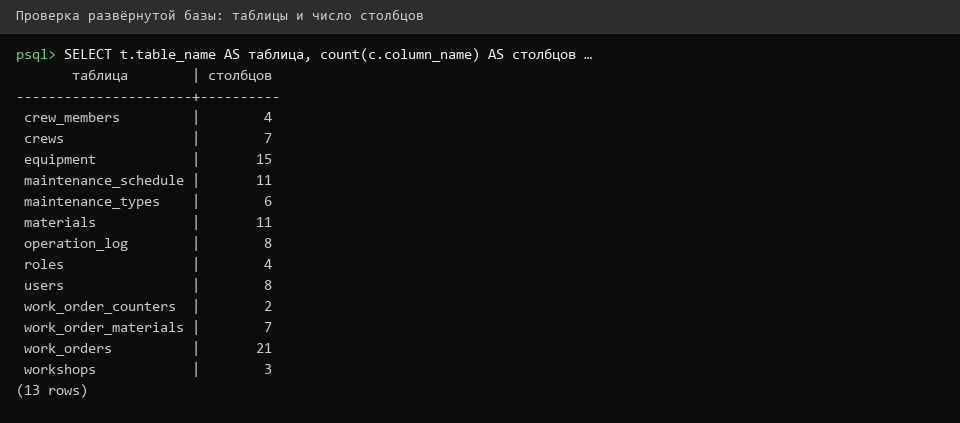
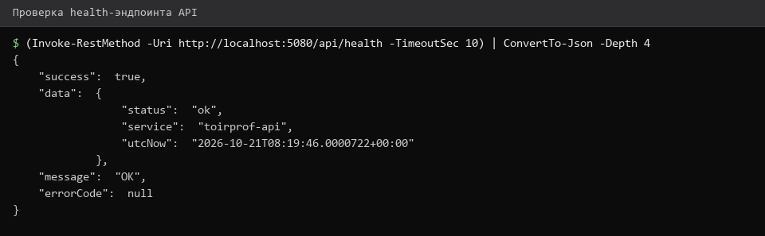
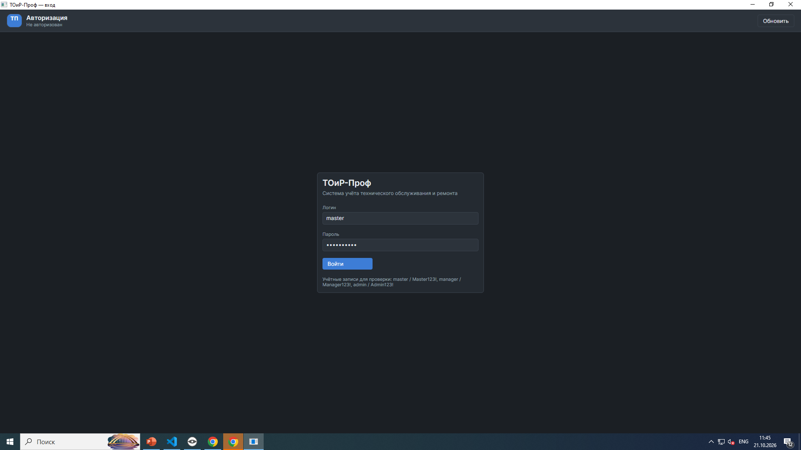
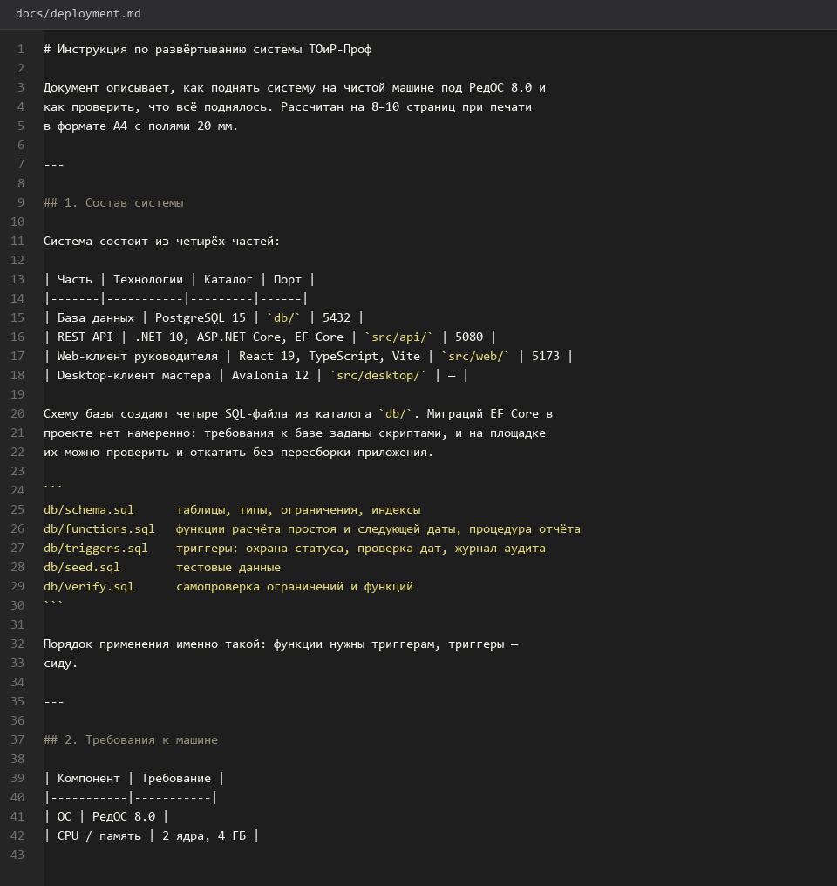

# Инструкция-по-развёртыванию

> Спринт 21. Документация: Swagger + развёртывание · 145 мин · страница 49 из 54

Инструкция на 8–10 страниц: от чистой машины до работающей системы. Проверяется не чтением, а попыткой развернуть по ней на другой машине — поэтому шаги должны быть копируемыми, с точными командами и ожидаемым выводом.

**Итог страницы.** Инструкция позволяет развернуть систему на чистой машине РедОС без уточняющих вопросов.

| Критерий оценивания | Что закрывает страница |
|---|---|
| Г / Документирование | Инструкция по развёртыванию |

**Результат в репозитории:**

- `docs/deployment.md`
- `db/schema.sql`
- `db/seed.sql`
- `README.md`

## Шаг 1. Требования и системные пакеты — 25 мин

Список версий и одна команда установки. Отдельно оговаривается, что Docker на площадке может отсутствовать и всё ставится нативно.

**Терминал**

```bash
```bash
# РедОС 8.0
sudo dnf install -y dotnet-sdk-10.0 postgresql-server postgresql-contrib nodejs npm java-17-openjdk graphviz
```
```

> **Замечание.** Пишите «РедОС 8.0» и «Windows 11» отдельными подразделами. Инструкция с пометкой «аналогично для Linux» проверяется только на той ОС, на которой её писали.


## Шаг 2. Подготовка базы данных — 25 мин

Создание роли и базы, запуск скриптов. Указываем, что делать при ошибке «роль уже существует» — на повторном запуске это норма.

**Терминал**

```bash
```bash
sudo systemctl enable --now postgresql
sudo -u postgres psql -c "CREATE ROLE toirprof LOGIN PASSWORD 'toirprof';"
sudo -u postgres createdb -O toirprof toirprof
psql -h 127.0.0.1 -U toirprof -d toirprof -f db/schema.sql
psql -h 127.0.0.1 -U toirprof -d toirprof -f db/functions.sql
psql -h 127.0.0.1 -U toirprof -d toirprof -f db/triggers.sql
psql -h 127.0.0.1 -U toirprof -d toirprof -f db/seed.sql
```
```

> **Замечание.** Порядок файлов важен: функции и триггеры создаются после таблиц, иначе скрипт падает на несуществующих отношениях.


*База создана, 13 таблиц, 3 типа, 6 ограничений*


## Шаг 3. Запуск API — 25 мин

Сборка, запуск и проверка health-эндпоинта. Порт задаётся через переменную окружения, а не жёстко в коде.

**Терминал**

```bash
```bash
dotnet build src/api/ToirProf.Api.csproj -c Release
ASPNETCORE_URLS=http://localhost:5080 dotnet run --project src/api -c Release --no-build
# проверка в другом терминале
curl -s http://localhost:5080/api/health
```
```

> **Замечание.** Обязательно `--no-build` при фоновом запуске: иначе сборка блокирует терминал и выглядит как зависание.


*API поднялся, /api/health отвечает status: ok*


## Шаг 4. Запуск web-клиента — 25 мин

Установка зависимостей, dev-сервер и проверка прокси на API.

**Терминал**

```bash
```bash
cd src/web
npm install
npm run dev -- --host 0.0.0.0 --port 5173
# проверка в браузере: http://localhost:5173
```
```

> **Замечание.** `--host 0.0.0.0` нужен, чтобы клиент был доступен не только с localhost: на площадке демонстрация идёт с другого устройства.


## Шаг 5. Запуск desktop-клиента — 25 мин

Desktop запускается отдельно и указывает адрес API через переменную или конфиг — жёстко зашитый адрес ломает демонстрацию на другой машине.

**Терминал**

```bash
```bash
dotnet run --project src/desktop -- --api http://localhost:5080
```
```

> **Замечание.** Принимайте адрес API аргументом командной строки. Подсказка с аргументом при неверном адресе экономит эксперту несколько минут.


*Desktop-клиент: окно входа, адрес API из аргумента*


## Шаг 6. Проверка, типовые ошибки, остановка — 20 мин

Чек-лист из пяти пунктов и таблица «симптом — причина — решение». Это то, что отличает рабочую инструкцию от пересказа README.

**Терминал**

```bash
| Симптом | Причина | Решение |
|---|---|---|
| `dotnet: command not found` | не прописан PATH | откройте новый терминал |
| `password authentication failed` | нет роли в БД | повторите `CREATE ROLE` |
| веб открывается, API нет | API не запущен | проверьте `/api/health` |
| `relation "equipment" does not exist` | не применён `schema.sql` | примените скрипт заново |
```

> **Замечание.** Останавливайте процессы явно: `Ctrl+C` в каждом терминале или `pkill -f ToirProf.Api`. На площадке зависший процесс держит порт, и следующий запуск падает с «адрес занят».


*Чек-лист развёртывания и таблица типовых ошибок*


## Если что-то не получилось

| Симптом | Что делать |
|---|---|
| На второй машине не собирается | не указана версия .NET SDK или Node.js |
| Порт 5080 занят | не остановили предыдущий процесс |
| База создалась без таблиц | забыли `schema.sql` или запустили не от того пользователя |
| Клиент не видит API | не задан адрес API или CORS не настроен |

## Проверка

```bash
bash -n <(cat docs/deployment.md) 2>/dev/null; curl -s http://localhost:5080/api/health
```

## Коммит

```bash
git add -A
git commit -m "docs: инструкция по развёртыванию на РедОС и Windows"
```

---

[Swagger-документация-API](48-Swagger-документация-API.md) · [все спринты](Home) · [Руководство-пользователя-Desktop](50-Руководство-пользователя-Desktop.md)
