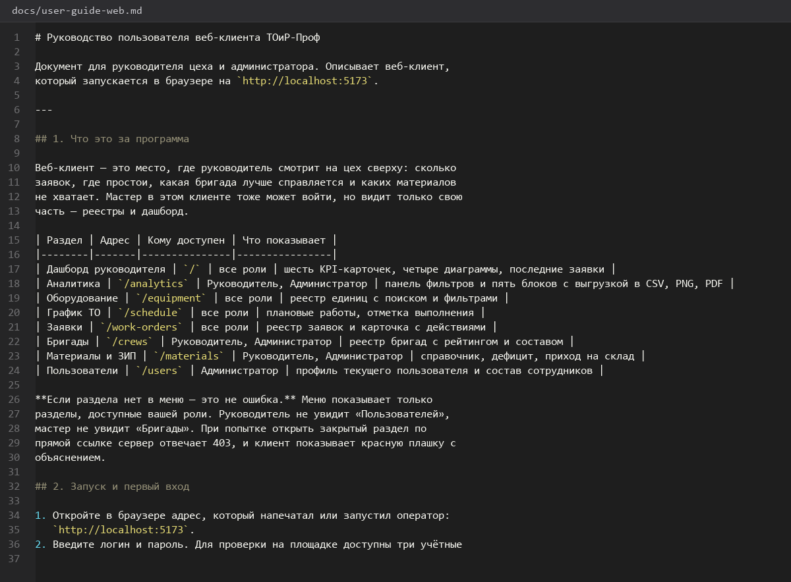
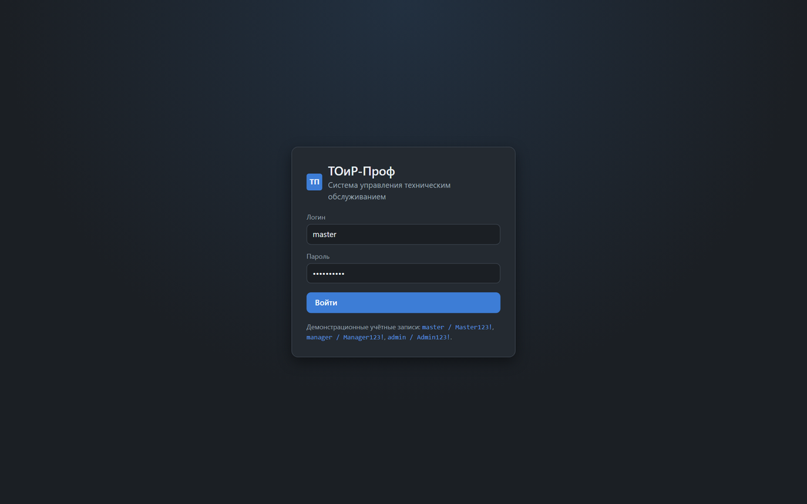
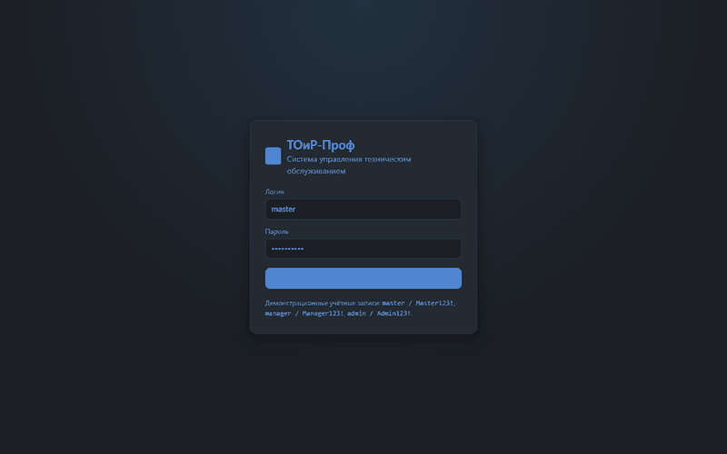
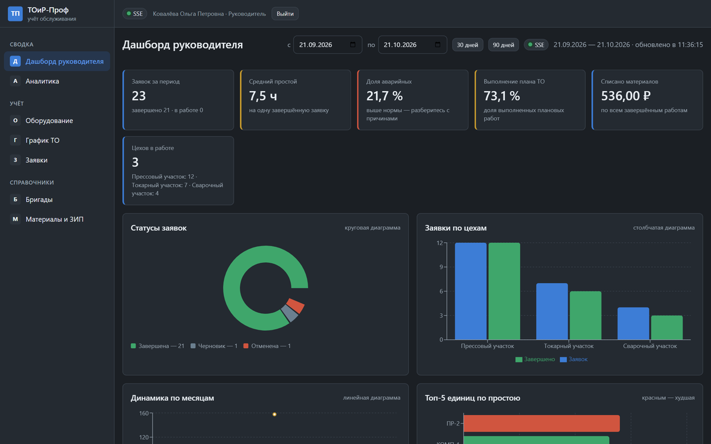
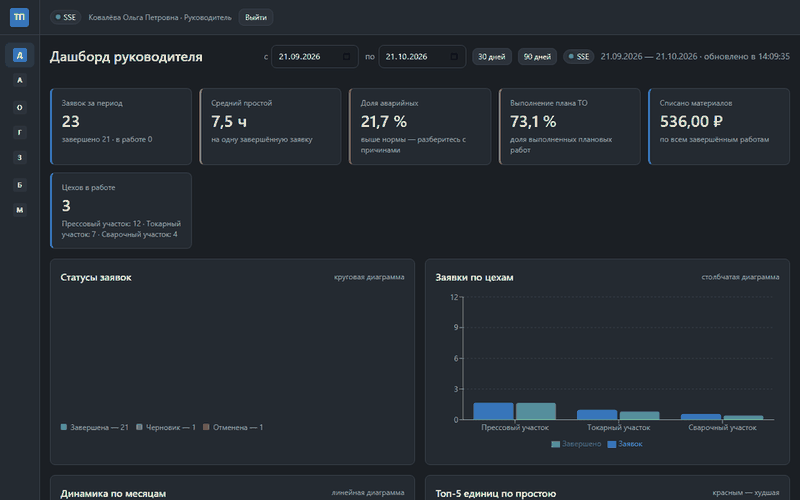
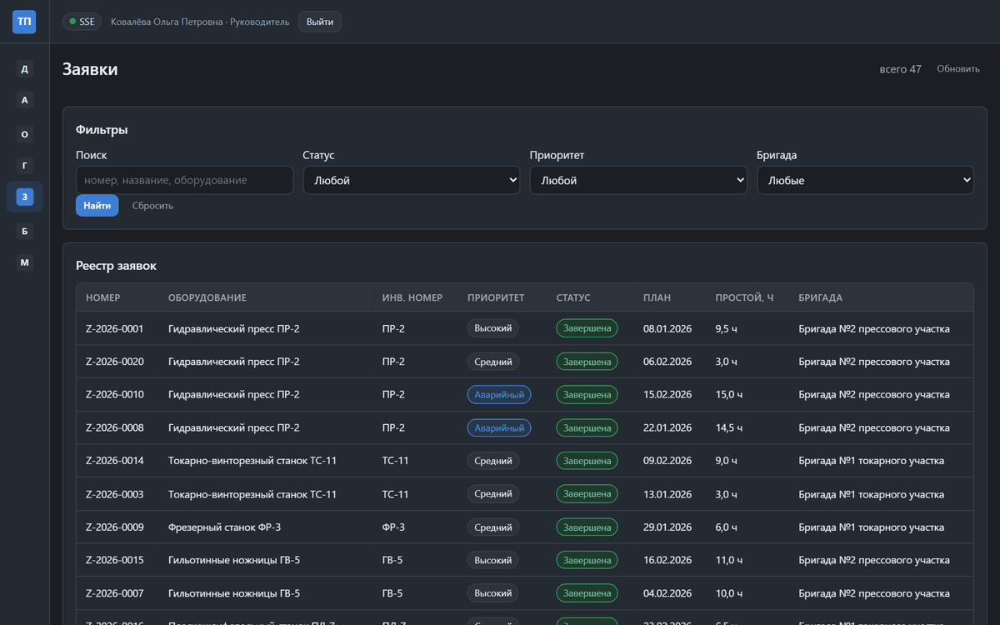
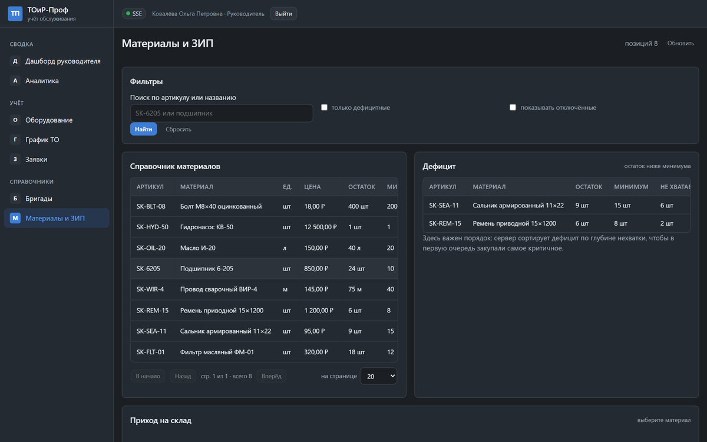
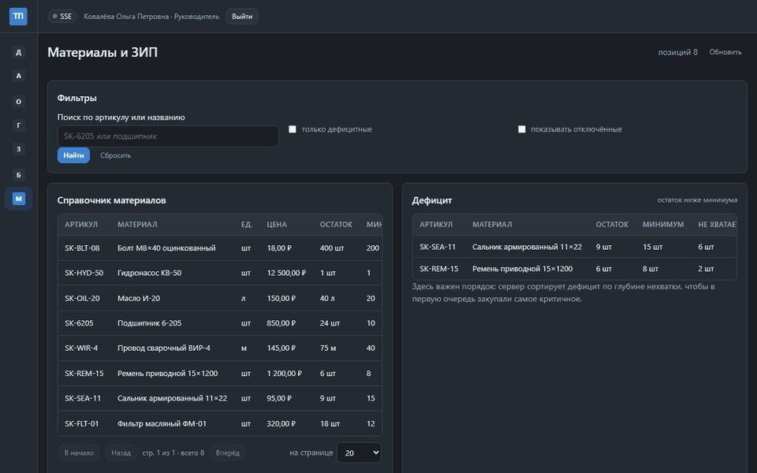

# Руководство-пользователя-Desktop

> Спринт 22. Руководство пользователя · 135 мин · страница 50 из 54

Руководство мастера: вход, оболочка, каждый экран по шагам, типовые ситуации и ответы на вопросы. Пишется от лица пользователя и разбирает один сценарий от начала до конца.

**Итог страницы.** Мастер по руководству самостоятельно проходит путь «заявка → выполнение → отчёт», не обращаясь к разработчику.

| Критерий оценивания | Что закрывает страница |
|---|---|
| Г / Документирование | Руководство пользователя (desktop) |

**Результат в репозитории:**

- `docs/user-guide-desktop.md`
- `docs/screenshots/desktop/*.png`

## Шаг 1. Кому адресовано и как читать — 20 мин

Первая страница: кто такой мастер, что умеет система, как открыть руководство и что делать с иконками в тексте.

**docs/user-guide-desktop.md**

```markdown
```markdown
# Руководство пользователя
## Система «ТОиР-Проф»

Руководство для мастера участка технического обслуживания
и ремонта оборудования.

| Раздел | О чём |
|---|---|
| 1. Вход в систему | как войти и что делать при ошибке |
| 2. Обзор интерфейса | меню, панель, хлебные крошки |
| 3. Дашборд мастера | показатели за смену |
| 4. Оборудование цеха | просмотр и правка |
| 5. График ТО | план работ на месяц |
| 6. Заявки | главный рабочий раздел |
| 7. Материалы и бригады | ЗИП и состав бригад |
| 8. Отчёты | сводка и выгрузка |
```
```

> **Замечание.** Оглавление с номерами разделов обязательно: на демонстрации эксперту нужен быстрый переход к нужному разделу, а он не будет листать 20 страниц.


*Оглавление руководства мастера: восемь разделов*


## Шаг 2. Вход и типовые ошибки — 25 мин

Пошаговый вход с картинкой экрана, таблица «сообщение — причина — действие» для четырёх частых ошибок.

**Терминал**

```bash
| Сообщение | Что означает | Что делать |
|---|---|---|
| Неверный логин или пароль | нет пользователя с таким именем | проверьте раскладку и регистр |
| Сессия завершена | 15 минут бездействия | войдите заново |
| Нет доступа к разделу | роль мастера | обратитесь к администратору |
| Нет связи с сервером | API не запущен | сообщите администратору |
```

> **Замечание.** Автоблокировка через 15 минут обязательно упоминается в руководстве: мастер, которого выкинуло посреди работы, ищет общую кнопку выхода — и не находит её.


*Раздел «Вход в систему» с таблицей ошибок*


*Раздел «Вход в систему» с таблицей ошибок*


## Шаг 3. Дашборд и реестры — 30 мин

Что показывает дашборд, как читать показатели, как искать и сортировать в реестрах. Скриншот под каждым описанием.

**Терминал**

```bash
На дашборде мастера шесть показателей:

1. **Заявки в работе** — сколько заявок закреплено за бригадой сейчас.
2. **Завершено за смену** — сколько закрыто сегодня.
3. **Просроченные заявки** — требуют внимания в первую очередь.
4. **Средний простой** — среднее по завершённым заявкам за неделю.
5. **Расход материалов** — сумма списанного за неделю.
6. **Выполнение графика ТО** — доля плановых работ, выполненных в срок.

Красная карточка означает отклонение от нормы, а не ошибку системы.
```

> **Замечание.** Объясняйте цветовую схему. Иначе мастер читает красную карточку как «сломалось» и звонит в поддержку.


*Раздел «Дашборд мастера»: шесть показателей и их смысл*


*Раздел «Дашборд мастера»: шесть показателей и их смысл*


## Шаг 4. Работа с заявкой от начала до конца — 35 мин

Главный сценарий руководства: мастер открывает заявку, видит детали, назначает исполнителя, отмечает ход работы и завершает со списанием материалов. Один скриншот на каждый шаг.

**Терминал**

```bash
### Сценарий: выполнение заявки на ремонт

**Шаг 1.** Откройте раздел «Заявки» и найдите заявку по номеру, например `Z-2026-0047`.

**Шаг 2.** Откройте карточку. Проверьте описание неисправности и плановые даты.

**Шаг 3.** Если бригада не назначена, выберите её в поле «Бригада» и сохраните.

**Шаг 4.** Когда работы начались, нажмите «В работу» и укажите фактическое время начала.

**Шаг 5.** По завершении нажмите «Завершить», укажите фактическое время окончания и причину.

**Шаг 6.** Добавьте списанные материалы: количество, стоимость из справочника сохраняется автоматически.

**Шаг 7.** Нажмите «Сохранить и завершить». Заявка получает статус «Завершена», а остатки материалов пересчитываются.

> **Важно:** завершить заявку без фактического времени окончания нельзя — простой останется незаполненным и попадёт в отчёт как ноль.
```

> **Замечание.** Сценарий должен быть сквозным: от экрана до экрана, с номерами заявок и названиями кнопок ровно как в интерфейсе. Руководство пишется по работающему приложению, а не по памяти.


*Сценарий выполнения заявки: семь шагов со скриншотами*


*Сценарий выполнения заявки: семь шагов со скриншотами*


## Шаг 5. Отчёты, материалы, офлайн-режим — 25 мин

Формирование сводки, выгрузка в PDF, просмотр остатков ЗИП и поведение клиента при отсутствии связи: очередь операций и автоотправка.

**Терминал**

```bash
### Если пропал интернет

Изменения не теряются. Клиент покажет индикатор «Нет связи с сервером»,
а сделанные изменения попадут в очередь и отправятся автоматически,
как только связь восстановится.

Очередь видна в разделе «Журнал операций». Не выключайте клиент, пока очередь не опустела:
при закрытии программы неотправленные изменения остаются на диске и уйдут
при следующем запуске.
```

> **Замечание.** Офлайн-режим объясняйте словами пользователя, а не словами разработчика: «не пропали», «уйдут сами», а не «персистентная очередь операций».


*Раздел об офлайн-режиме и очереди изменений*


*Раздел об офлайн-режиме и очереди изменений*


## Если что-то не получилось

| Симптом | Что делать |
|---|---|
| В руководстве скриншоты старой версии | пересняты после изменения экрана |
| Описаны несуществующие кнопки | руководство писалось по ТЗ, а не по приложению |
| Нет сценария заявки | это самый нужный раздел — без него руководство не работает |

## Проверка

```bash
rg -c '^\|' docs/user-guide-desktop.md
```

## Коммит

```bash
git add -A
git commit -m "docs: руководство пользователя desktop-клиента"
```

---

[Инструкция-по-развёртыванию](49-Инструкция-по-развёртыванию.md) · [все спринты](Home) · [Руководство-пользователя-Web-и-администратора](51-Руководство-пользователя-Web-и-администратора.md)
