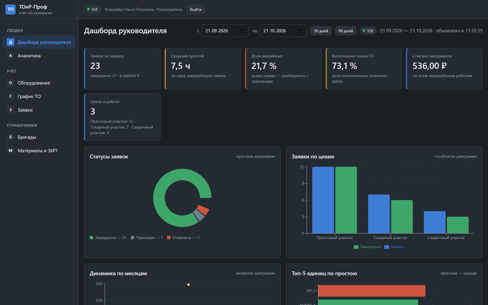

# Руководство-пользователя-Web-и-администратора

> Спринт 22. Руководство пользователя · 120 мин · страница 51 из 54

Второй том руководства: руководитель в web-клиенте и администратор в разделе пользователей. Кто видит какие экраны, что означают показатели дашборда и как читать аналитику.

**Итог страницы.** Руководитель по руководству читает аналитику сам, администратор — управляет пользователями и справочниками.

| Критерий оценивания | Что закрывает страница |
|---|---|
| Г / Документирование | Руководство пользователя (web) и администратора |

**Результат в репозитории:**

- `docs/user-guide-web.md`
- `docs/screenshots/web/*.png`

## Шаг 1. Роли и доступ к экранам — 25 мин

Таблица «роль — что видит — что может». Это первое, что спрашивает руководитель: «а я это увижу?».

**Терминал**

```bash
| Раздел | Администратор | Руководитель | Мастер |
|---|---|---|---|
| Дашборд | да | да | да |
| Аналитика | да | да | нет |
| Оборудование | да | да | да |
| Заявки | да | да | да |
| График ТО | да | да | да |
| Справочники | да | нет | нет |
| Пользователи | да | нет | нет |
```

> **Замечание.** Таблица должна совпадать с тем, что реально проверяет сервер. Расхождение обнаруживается первой же демонстрацией под другой ролью.


*Матрица прав: кто что видит в web-клиенте*


## Шаг 2. Дашборд руководителя — 30 мин

Шесть KPI-карточек, автообновление раз в минуту и индикатор соединения. Отдельно объясняем, что означает каждая диаграмма.

**Терминал**

```bash
**Средний простой** показывает, сколько часов оборудование в среднем
не работало. Рост значения означает либо рост отказов, либо заниженную
дисциплину закрытия заявок.

**Доля аварийных заявок** — здоровье парка. Устойчивая доля выше 15 % говорит
о том, что плановое обслуживание не выполняется в срок.

**Выполнение графика ТО** рассчитывается как отношение выполненных записей к общему
числу записей за период. Значение ниже 90 % — повод разобрать график.
```

> **Замечание.** Не пересказывайте интерфейс. Объясняйте, что означает показатель и на какое решение он влияет — это и есть ценность руководства.


*Раздел «Дашборд руководителя»: показатели и их интерпретация*


## Шаг 3. Аналитика и экспорт — 35 мин

Панель фильтров, пять блоков аналитики, экспорт в PNG, CSV, PDF и печать. Разбираем типовой вопрос: «почему вырос простой в цехе №2».

**Терминал**

```bash
### Типовой вопрос: откуда взялся простой

1. Откройте «Аналитика» и задайте период, например квартал.
2. В блоке «Анализ простоев» посмотрите топ-5 единиц по суммарному простою.
3. Выберите единицу из топ-5 и перейдите в «Заявки», отфильтровав по ней.
4. Посмотрите приоритеты: если среди заявок много аварийных — проблема в отказе,
   если нет — в качестве планового обслуживания.
5. Выгрузите блок в PDF и приложите к служебной записке.
```

> **Замечание.** Описывайте не кнопки, а путь решения задачи. Руководство, в котором идёт «нажмите сюда, потом сюда», через месяц никому не помогает.


## Шаг 4. Администратор: пользователи и справочники — 30 мин

Создание пользователя, выдача роли, блокировка, ведение видов обслуживания, материалов и бригад. Здесь же — правило про невозможность удаления справочника, который уже используется.

**Терминал**

```bash
### Порядок работы администратора

1. **Пользователи.** Создайте учётную запись, назначьте роль, сообщите пароль сотруднику лично.
2. **Виды обслуживания.** Добавьте вид с периодичностью в днях — она используется в графике.
3. **Материалы.** Внесите номенклатуру с артикулом, единицей измерения, ценой и минимальным остатком.
4. **Бригады.** Создайте бригаду и добавьте в неё членов.

> **Важно:** вид обслуживания и материал нельзя удалить, если они уже использованы в заявках или графике.
> Вместо удаления снимите отметку «активен» — новые работы использовать такой справочник перестанут,
> а старые записи останутся корректными.
```

> **Замечание.** Справочник не удаляется, а деактивируется — об этом знают не все. Без этого пояснения новичок удалит вид обслуживания и сломает график за прошлые месяцы.


## Если что-то не получилось

| Симптом | Что делать |
|---|---|
| Таблица прав не совпадает с сервером | сверьтесь с `RequireRole` на контроллерах |
| Руководство описывает несуществующий блок | сверьтесь со страницей аналитики |
| Нет объяснения, что делать при сбое соединения | опишите индикатор и polling |

## Проверка

```bash
rg -c '^\|' docs/user-guide-web.md
```

## Коммит

```bash
git add -A
git commit -m "docs: руководство пользователя web-клиента и администратора"
```

---

[Руководство-пользователя-Desktop](50-Руководство-пользователя-Desktop.md) · [все спринты](Home) · [Презентация-проекта](52-Презентация-проекта.md)
