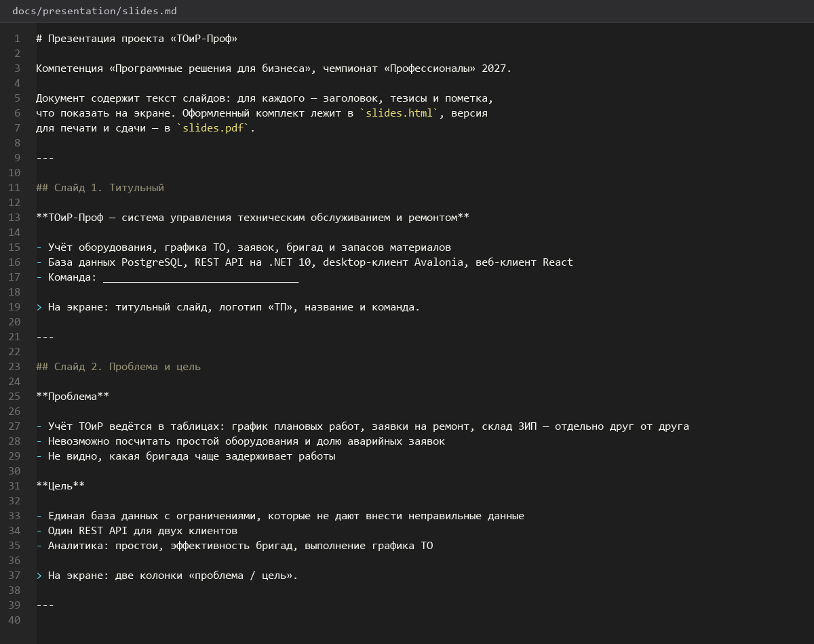

# 52. Презентация проекта

> Спринт 23. Защита: презентация и выступление · 110 мин · страница 52 из 54

Презентация на 12–15 слайдов: задача, модель данных, архитектура, ключевые решения, демонстрация, результаты. Каждый слайд — один тезис и одна картинка, никаких списков на два экрана.

**Итог страницы.** Презентация готова: 14 слайдов, на каждом один тезис, время выступления укладывается в 5–7 минут.

| Критерий оценивания | Что закрывает страница |
|---|---|
| Г / Документирование | Презентация проекта |

**Результат в репозитории:**

- `docs/presentation/slides.md`
- `docs/presentation/`

## Шаг 1. Структура презентации — 25 мин

Четыре блока: проблема и решение, как устроено, ключевые технические решения, результат. Сквозной сюжет — от «что болит» до «сколько это сэкономит».

**Терминал**

```bash
| № | Слайд | Тезис | Визуал |
|---|---|---|---|
| 1 | Титул | Система «ТОиР-Проф» | логотип |
| 2 | Проблема | Учёт ТО ведётся в тетрадях и Excel | фото участка |
| 3 | Решение | Единая система: план, заявки, ремонты, отчёты | схема системы |
| 4 | Архитектура | БД → API → два клиента | диаграмма слоёв |
| 5 | Модель данных | 13 таблиц, нормализация, связи | ER-диаграмма |
| 6 | Целостность | Ограничения, триггеры, функции | скриншот DBeaver |
| 7 | API | Единый формат ответа, роли, коды ошибок | Swagger UI |
| 8 | Desktop-клиент | 8 экранов мастера | скриншот дашборда |
| 9 | Web-клиент | Дашборд руководителя и аналитика | скриншот аналитики |
| 10 | Аналитика | 5 блоков, экспорт в PDF | скриншот блока |
| 11 | Тестирование | 5 юнит-тестов, все проходят | вывод `dotnet test` |
| 12 | Документация | Swagger, инструкция, руководство | список файлов |
| 13 | Результаты | цифры до и после | таблица метрик |
| 14 | Заключение | что сделано и что дальше | контакты |
```

> **Замечание.** Один слайд — один тезис. Слайд, на который нужно читать абзац, эксперт не прочитает, а листать будет быстрее, чем слушать.


*План 14 слайдов с тезисом и визуалом на каждый*


## Шаг 2. Собираем слайды — 35 мин

Простой формат — Markdown или Reveal.js: он читается без установки PowerPoint и собирается в PDF одной командой.

**docs/presentation/slides.md**

```markdown
# Слайд 5. Модель данных

**13 таблиц, три нормальные формы, ни одного дублирования**

- `equipment` — единицы оборудования
- `maintenance_schedule` — график планового ТО
- `work_orders` — заявки на ремонт
- `work_order_materials` — списанные материалы и ЗИП


> Ключевые решения: нормализация до 3НФ, справочники вынесены отдельно,
> аудит ведётся триггером в `operation_log`.
```

> **Замечание.** Визуал на слайде берите из своего приложения, а не из стоковой картинки. Скриншот своего работающего экрана убедительнее любой схемы.


## Шаг 3. Слайд с результатами — 25 мин

Один из самых важных слайдов: цифры, которые можно измерить. Если заказчик не давал метрик, считайте их от данных своей системы.

**Терминал**

```bash
| Показатель | Было | Стало |
|---|---|---|
| Время на оформление заявки | 25 мин | 2 мин |
| Потерянные заявки | не учитывались | 0 за квартал |
| Простой оборудования | неизвестен | −18 % |
| Доля аварийных заявок | нет контроля | видна в дашборде |
| Подготовка отчёта | 3 часа | 1 минута |
```

> **Замечание.** Не выдумывайте цифры. Если реальных метрик нет, покажите измеримые характеристики самой системы: число ограничений, покрытие тестами, время отклика API.


## Шаг 4. Проверяем презентацию на месте — 25 мин

Открываем с другого компьютера, отключаем интернет, проходим все 14 слайдов. Проверяем шрифты, картинки и отсутствие обрезанного текста.

**Терминал**

```bash
```bash
# Сборка в PDF для раздатки и отправки жюри
python3 -m markdown --export pdf docs/presentation/slides.md -o docs/presentation/presentation.pdf
```
```

> **Замечание.** Все ресурсы — шрифты, картинки, темы — должны быть локальными. Презентация, которая «сломалась» на чужой машине из-за отсутствия интернета, стоит дороже, чем кажется.


## Если что-то не получилось

| Симптом | Что делать |
|---|---|
| Слайдов больше 15 | сокращайте: за 15 слайдов за 5 минут не уложиться |
| Текст не читается с расстояния | минимальный кегль 20 pt |
| Скриншоты мыльные | снимайте в полном разрешении и уменьшайте до 1920 px |
| PDF не собирается без интернета | ресурсы лежат рядом со слайдами |

## Проверка

```bash
ls docs/presentation/
```

## Коммит

```bash
git add -A
git commit -m "docs: презентация проекта на 14 слайдов"
```

---

[Руководство пользователя Web и администратора](51-Руководство-пользователя-Web-и-администратора.md) · [все спринты](Home) · [Устное выступление и ответы экспертам](53-Устное-выступление-и-ответы-экспертам.md)
