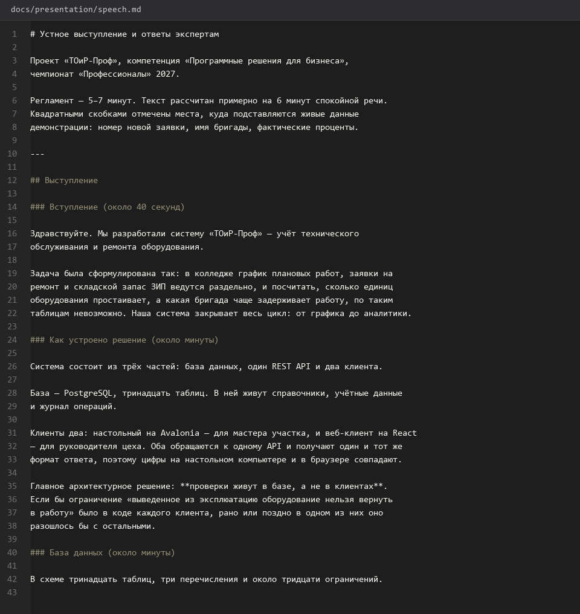

# Устное-выступление-и-ответы-экспертам

> Спринт 23. Защита: презентация и выступление · 125 мин · страница 53 из 54

Речь на 5–7 минут по слайдам и заготовленные ответы на частые вопросы экспертов. Речь пишется заранее целиком — на защите её читают, а не импровизируют.

**Итог страницы.** Текст выступления на 6 минут и ответы на 12 типовых вопросов экспертов.

| Критерий оценивания | Что закрывает страница |
|---|---|
| Г / Документирование | Устное выступление и ответы на вопросы |

**Результат в репозитории:**

- `docs/presentation/speech.md`
- `docs/presentation/qa.md`

## Шаг 1. Пишем текст выступления — 30 мин

По одному абзацу на слайд, 80–110 слов на слайд. Общий объём — около 900 слов на 6 минут спокойной речи.

**docs/presentation/speech.md**

```markdown
**Слайд 2. Проблема.**

> Сегодня учёт технического обслуживания ведётся в тетрадях и разрозненных файлах.
> Мы не знаем, какое оборудование простаивает, какие заявки забыты и сколько
> на самом деле стоит ремонт. Решения принимаются без цифр.

**Слайд 3. Решение.**

> Мы разработали систему «ТОиР-Проф»: единый контур от графика планового
> обслуживания до закрытой заявки с отчётом. Система состоит из базы данных,
> API и двух клиентов — для мастера на участке и для руководителя в браузере.
```

> **Замечание.** Говорите от результата, а не от технологий. Эксперту интересно, что изменилось для участка, а название фреймворка он и так прочтёт в репозитории.


*Текст выступления с абзацем на каждый слайд*


## Шаг 2. Регламент и репетиция — 25 мин

Прогон с секундомером: 6 минут ± 30 секунд. Две репетиции вслух — чтение с листа на защите читается хуже, чем кажется.

**Терминал**

```bash
```bash
# Проверка объёма текста: ~900 слов ≈ 6 минут при темпе 150 слов в минуту
python3 - <<'EOF'
import re, io
text = io.open('docs/presentation/speech.md', encoding='utf-8').read()
words = len(re.findall(r'\S+', text))
print(f'Слов: {words}')
print(f'Оценка времени: {words / 150:.1f} мин при 150 слов/мин')
EOF
```
```

> **Замечание.** Вторую половину речи обычно «съедает» торопливое объяснение демонстрации. Держите демонстрацию отдельным этапом и возвращайтесь к тексту после неё.


## Шаг 3. Вопросы о базе данных — 35 мин

Самые частые вопросы экспертов: почему 3НФ, зачем триггер, а не проверка в приложении, чем отличается ON DELETE CASCADE от RESTRICT.

**Терминал**

```bash
**Почему ограничения в базе, а не в приложении?**

Правило в базе выполняется всегда: через Postman, через прямой SQL, через отчёт.
Проверка в приложении обходится одним запросом — например, при загрузке данных
скриптом. Ограничение в базе — это последний рубеж, его нельзя обойти.

**Почему `ON DELETE RESTRICT` для справочников?**

Вид обслуживания или материал нельзя удалить, если он уже использован в заявках
или графике. `CASCADE` молча удалил бы связанные записи — и данные за прошлые
периоды исчезли бы из отчётов.

**Почему триггер, а не `CHECK`?**

`CHECK` сравнивает только значения этой строки и не может посмотреть старую
(`OLD`) или соседние строки. Триггер нужен там, где правило зависит от истории
изменений, — например «нельзя менять статус, если уже выведено из эксплуатации».
```

> **Замечание.** Отвечайте «потому что» — объяснение причины ценится выше самого решения. Фраза «так было в задании» обесценивает работу.


## Шаг 4. Вопросы об архитектуре и клиентах — 35 мин

Почему два клиента, а не один; как обеспечивается изоляция данных; что происходит при потере связи; чем SSE отличается от WebSocket.

**Терминал**

```bash
**Почему два клиента, а не один?**

Мастер работает на участке с участковым компьютера — ему нужен нативный
интерфейс и работа при нестабильной сети. Руководитель смотрит аналитику
с любого устройства — ему нужен браузер и печать отчёта. Общая только бизнес-логика,
она живёт в API.

**Что происходит при обрыве связи?**

Клиент кладёт изменение в очередь на диск и отправляет его при восстановлении
связи. Пользователь при этом видит индикатор состояния, а не «зависшее»
приложение.

**Почему SSE, а не WebSocket?**

Канал односторонний: сервер только отправляет изменения счётчиков.
SSE работает поверх обычного HTTP, не требует отдельного порта и проходит
через прокси без дополнительной настройки.
```

> **Замечание.** Держите лист ответов перед собой. Большинство вопросов повторяется из защиты в защиту, и подготовленный ответ звучит увереннее, чем пауза.


## Если что-то не получилось

| Симптом | Что делать |
|---|---|
| Речь длится 9 минут | сократите до 900 слов и отрепетируйте с секундомером |
| На вопрос отвечаете «мы не пробовали» | проговорите слабые места заранее и честно |
| Терминология не совпадает с кодом | сверьте названия по репозиторию перед защитой |

## Проверка

```bash
python3 -c "import re,io;print(len(re.findall(r'\S+', io.open('docs/presentation/speech.md',encoding='utf-8').read())))"
```

## Коммит

```bash
git add -A
git commit -m "docs: текст выступления и ответы на вопросы экспертов"
```

---

[Презентация-проекта](52-Презентация-проекта.md) · [все спринты](Home) · [Итоговая-проверка-по-критериям](54-Итоговая-проверка-по-критериям.md)
